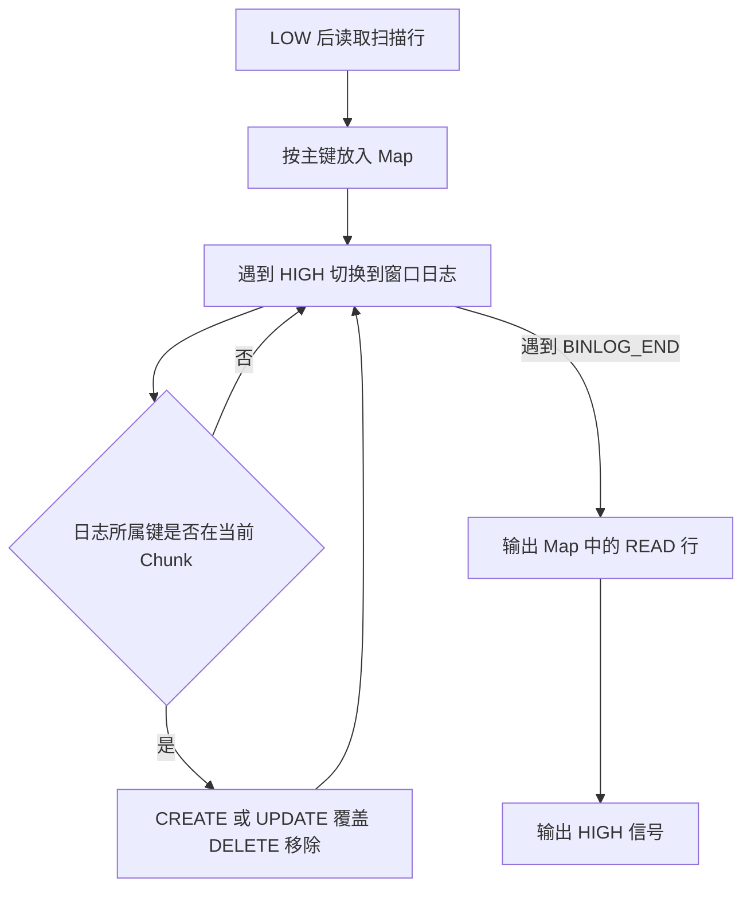

[系列导读与验证材料](/flink-cdc-series/) · [一：一致性边界](/2026/10/18/flink-cdc-1-consistency/) · [二：增量快照](/2026/10/18/flink-cdc-2-incremental-snapshot/) · [三·上：Source 状态机](/2026/10/18/flink-cdc-3a-source-state/) · [三·下：故障恢复](/2026/10/18/flink-cdc-3b-checkpoint-recovery/) · [四：Schema 演进](/2026/10/18/flink-cdc-4-schema-evolution/) · [五：Paimon 提交](/2026/10/18/flink-cdc-5-paimon-commit/)

---

[第一篇](/2026/10/18/flink-cdc-1-consistency/)区分了状态一致、事件历史与端到端提交。这一篇进入增量快照的核心：数据库持续写入时，一次 SELECT 的结果如何与 binlog 对齐；多个 Chunk 在不同时间完成后，如何拼成可以继续追赶的表状态。

关键结论是：**每个 Chunk 先用窗口日志把自己的扫描结果归一到自己的 HIGH；持续日志再从最小 HIGH 起读，按每个 Chunk 的 HIGH 消除已经包含在快照中的变化。** 快照阶段结束时，各 Chunk 可以对应不同的时间边界。把它们对齐到同一个日志位置，还需要后续日志。

源码固定为 Apache Flink CDC `release-3.7.0`，提交 `045e8da45df4b1017849b04e2d8bfe8f0ed7936d`。主线是 MySQL Connector 的独立实现，默认开启回填，表有稳定主键、稳定 Chunk key，Schema 在读取期间不变。下文给出这些条件下的人工证明草图，不是 DBLog 对 Flink CDC 的现成证明，也不是机器验证。“实测”部分来自 2026 年 10 月 18 日执行的真实 MySQL Reader 集成测试；本次形式化补写复核了源码与既有输出，没有新增或重跑数据库、故障恢复实验。

## 先解决扫描结果属于哪个时间的问题

设一行的值依次经历 `10 → 20 → 30`。扫描可能读到 10，也可能读到 20。若先发出扫描结果，再把一段重叠日志全部发出，读到 20 的那一行可能再次收到把值设为 20 的更新；若把日志先发出去，再输出旧扫描行，又可能用 10 覆盖 30。日志本身有序，并不足以决定扫描行应该插入历史的哪个位置。

最直接的解法是得到一个全表一致性读视图，并把它准确对应到日志位置。但增量快照希望把大表拆开扫描，让进度和资源占用以 Chunk 为单位。此时要解决的核心问题变为：**即使不知道 SELECT 对应的精确日志位置，能否找到包含它的窗口，并消除窗口内的不确定性。**

## DBLog 如何用窗口安放扫描行

DBLog 的 Algorithm 1 先短暂停止日志处理，更新水位表写入 LOW，读取一个主键范围，再写 HIGH 并恢复日志处理。两次水位写入产生可识别的日志事件。消费 LOW 到 HIGH 之间的变化时，照常输出日志，同时从扫描缓冲区删除同键行；遇到 HIGH 后补发剩余扫描行。它要求提交历史可排序、范围读取高效，且 SELECT 不能读到 LOW 之前的陈旧视图。论文的“避免长时间停顿”允许上述短暂停顿。[DBLog 第 3.2、3.3 节及 Algorithm 1](https://arxiv.org/html/2010.12597v1#S3.SS2)

Flink CDC 的 `SignalEventDispatcher` 明确注明受到 DBLog 启发，但代码采取了不同的输出策略。MySQL 路径在本地队列中构造水位信号，把窗口日志合并进扫描结果，最后输出归一后的快照行。理解这一步，才能判断窗口中的中间更新是否还会作为独立事件交给下游。[SignalEventDispatcher](https://github.com/apache/flink-cdc/blob/045e8da45df4b1017849b04e2d8bfe8f0ed7936d/flink-cdc-connect/flink-cdc-source-connectors/flink-connector-mysql-cdc/src/main/java/org/apache/flink/cdc/connectors/mysql/debezium/dispatcher/SignalEventDispatcher.java#L42)

| 需要比较的行为 | DBLog Algorithm 1 | 本文 MySQL 增量快照路径 |
| --- | --- | --- |
| 水位产生位置 | 源库水位表写入形成日志标记 | 查询日志位置，向本地队列放入信号 |
| 扫描与日志同键冲突 | 移除该扫描行，保留日志输出 | 按日志覆盖或删除缓冲中的行 |
| 窗口处理后的结果 | 日志与未冲突扫描行交织 | 合并后的快照行，再进入持续日志阶段 |

从不变量看，DBLog 保持的是“尚待补发的扫描键，与窗口内已经出现变化的键不相交”。若 `C(p)` 表示 LOW 之后、已消费至位置 p 的本表变更键集合，则剩余扫描缓冲的键为 `keys(Q) − C(p)`。日志继续按原顺序输出；到 HIGH 时，剩余扫描行在整个窗口内未改变，因此补发它们不会覆盖窗口中的较新版本。这个推导依赖论文的读取与日志前提，不包含下游投递的 exactly-once 证明。[DBLog 第 3.1—3.3 节](https://arxiv.org/html/2010.12597v1#S3)

Flink CDC 下文要证明的是另一件事：用日志改写扫描 Map，使最终 Map 等于 HIGH 处的状态。两个算法共享窗口思想，但“排除冲突扫描行”与“吸收窗口变化”对应不同的不变量，不能交换它们对事件历史的结论。

## 沿真实调用链找到 LOW 和 HIGH

一次快照 Split 的主调用链如下。这里的 `MySqlSnapshotSplit` 是一个表的一个键范围；`MySqlBinlogSplit` 则描述日志读取的起止位置及已完成快照的信息。

```text
SnapshotSplitReader.submitSplit
  ├─ MySqlSnapshotSplitReadTask.doExecute
  │    ├─ currentBinlogOffset → LOW
  │    ├─ SELECT 当前 Split 的键范围
  │    └─ currentBinlogOffset → HIGH
  ├─ createBackfillBinlogSplit(LOW, HIGH)
  └─ MySqlBinlogSplitReadTask 执行有界回填

SnapshotSplitReader.pollWithBuffer
  └─ 消费上述队列 → 合并 Map → 输出 LOW、快照行、HIGH
```

[submitSplit](https://github.com/apache/flink-cdc/blob/045e8da45df4b1017849b04e2d8bfe8f0ed7936d/flink-cdc-connect/flink-cdc-source-connectors/flink-connector-mysql-cdc/src/main/java/org/apache/flink/cdc/connectors/mysql/debezium/reader/SnapshotSplitReader.java#L132)先配置上下文，再在工作线程中执行扫描和回填；[doExecute](https://github.com/apache/flink-cdc/blob/045e8da45df4b1017849b04e2d8bfe8f0ed7936d/flink-cdc-connect/flink-cdc-source-connectors/flink-connector-mysql-cdc/src/main/java/org/apache/flink/cdc/connectors/mysql/debezium/task/MySqlSnapshotSplitReadTask.java#L139)依次读取 LOW、完整扫描当前范围、读取 HIGH。读取 HIGH 时，回填尚未完成。HIGH 表示扫描需要追赶到哪里，不表示这个 Chunk 已经向下游发送完毕。

LOW/HIGH 的载体是 `BinlogOffset`。取得位置时，`DebeziumUtils.currentBinlogOffset`读取日志文件、位置和可用的 GTID 集合。该版本的 MySQL 连接会探测 `SHOW BINARY LOG STATUS`，不支持时回退到 `SHOW MASTER STATUS`。随后 `SignalEventDispatcher`创建 `SourceRecord`并执行 `queue.enqueue`，这个步骤没有向源库写水位表。[位置采集](https://github.com/apache/flink-cdc/blob/045e8da45df4b1017849b04e2d8bfe8f0ed7936d/flink-cdc-connect/flink-cdc-source-connectors/flink-connector-mysql-cdc/src/main/java/org/apache/flink/cdc/connectors/mysql/debezium/DebeziumUtils.java#L119)、[SQL 探测](https://github.com/apache/flink-cdc/blob/045e8da45df4b1017849b04e2d8bfe8f0ed7936d/flink-cdc-connect/flink-cdc-source-connectors/flink-connector-mysql-cdc/src/main/java/io/debezium/connector/mysql/MySqlConnection.java#L788)

这些信号也不具有 Flink 事件时间 Watermark 的含义。`MySqlRecordEmitter`识别内部水位，将 HIGH 写入快照 Split 状态，不把它当作业务行反序列化输出。事件时间推进、日志边界和 Checkpoint 完成，是三套不同的机制。[MySqlRecordEmitter.processElement](https://github.com/apache/flink-cdc/blob/045e8da45df4b1017849b04e2d8bfe8f0ed7936d/flink-cdc-connect/flink-cdc-source-connectors/flink-connector-mysql-cdc/src/main/java/org/apache/flink/cdc/connectors/mysql/source/reader/MySqlRecordEmitter.java#L83)

## 先定义要证明的状态与模型假设

只考虑一张表的一次正常初始读取。令 `U` 为记录主键集合，`S(p): U → Row ∪ {⊥}` 为日志位置 p 对应的表状态，`⊥` 表示该键不存在。CREATE/UPDATE 将键的值设为完整 after image，DELETE 将它设为 `⊥`；这里不把更新解释成“再加一次增量”。状态等式只比较业务列值与行的存在性，不比较 READ 包装、sourceOffset 或时间戳等记录元数据；后文 Map 中缺失的键也统一记作 `⊥`。

固定 Chunk key 函数 `g(k)` 后，范围 `K_i=[a_i,b_i)` 对应主键集合 `U_i={k | g(k)∈K_i}`。`S_i(p)` 是 S(p) 在 U_i 上的限制，`Q_i` 是 SELECT 返回的完整键值映射，未返回的键记为 `⊥`。`E_i(a,b]` 表示逻辑窗口内属于 U_i 的有序行变更，`Apply` 表示按上述赋值/删除语义折叠这些事件。

L、H、p、q 是同一条历史中的逻辑切点，涉及真实数据库状态时取完整事务提交后的边界；事务内部可按行事件顺序推演，但不能把中间状态称为已提交表状态。实现中的 `BinlogOffset` 如何对应这些切点，是后文要核对的义务，不能预先简化成文件位置整数。

下列条件是证明的充分前提，不是“代码调用顺序正确”就自动获得的事实：

| 编号 | 模型假设 | 在实现中需要核对什么 |
| --- | --- | --- |
| A1 | 日志来自同一条可比较的提交历史；状态与日志顺序相容 | 位点来自同一源历史，不能把分叉 GTID 当成线性时间轴 |
| A2 | 存在 `L_i≤R_i≤H_i`，使 `Q_i=S_i(R_i)`，包括不存在的键；范围扫描无漏行 | 读视图不早于 LOW，也不含 HIGH 之后的状态；查询完整结束，不能只看事务隔离级别名称 |
| A3 | 主键与 g(k) 在证明区间内稳定；U_i 两两不交且覆盖所需键域 | SQL、Java 范围判断与排序比较一致；新插入也有唯一范围，删除再插入不改变其归属 |
| A4 | Schema 固定，事件提供正确键和足以重建行的 after image，保留 NULL 语义 | UPDATE 是完整状态覆盖，DELETE 能定位原键；不能把缺列当 NULL |
| A5 | 回填提供 `(L_i,H_i]` 的完整有序事件，持续日志也不漏事件；本模型每个逻辑事件按原顺序处理一次，边界映射一致 | 不能缺失末次更新、乱序覆盖或把 HIGH 后的记录并入快照 |
| A6 | 正常回填开启，消费完窗口才输出；衔接使用与快照一致的范围/HIGH 元数据，先建立快照基线再应用增量 | `BINLOG_END`、FinishedSnapshotSplitInfo 与切换协议各有责任；当前模型不包含失败重放或 Sink 提交 |

A2 是便于阅读的较强条件。下面的逐键证明实际只需要：窗口内从未改变的键，其扫描值和存在性正确；窗口内改变过的键，由完整日志的最后一次状态覆盖修正。不过，不能因此把读取不陈旧、完整范围扫描等要求省略。DBLog 第 3.2 节也明确要求 SELECT 位于水位窗口内；本文没有证明所有 JDBC 配置都满足这个前提。

源码在这条扫描路径上没有显式把隔离级别设置为 `READ COMMITTED`。本轮用同一配置和连接工厂新建的 JDBC 连接，实测 `autocommit=true`、隔离级别为 JDBC 的 `4`，即 `REPEATABLE_READ`。这个观察不能被改写成“Flink CDC 强制使用 READ COMMITTED”。判断读取是否足够新，需要结合事务生命周期和实际连接配置。

事务开始时间也不决定归属。一个事务可以在 LOW 之前开始修改，在 SELECT 时仍未提交，直到 HIGH 之前才提交。此时 SELECT 可以读到旧版本，提交后的 binlog 会在回填阶段把它修正。本轮针对这一时序做了独立连接实验，结果见后文。

## 回填如何把扫描结果归一到 HIGH

正常回填时，队列里的输入顺序是：LOW、扫描行、HIGH、窗口 binlog、BINLOG_END。`pollWithBuffer`把扫描行放入 Map；遇到 HIGH 后切换到回填阶段；遇到 BINLOG_END 才结束合并。最终返回 LOW、Map 中保留下来的行、HIGH。因此，队列里先出现 HIGH，并不意味着 HIGH 后面的回填日志已经向下游输出。[pollWithBuffer](https://github.com/apache/flink-cdc/blob/045e8da45df4b1017849b04e2d8bfe8f0ed7936d/flink-cdc-connect/flink-cdc-source-connectors/flink-connector-mysql-cdc/src/main/java/org/apache/flink/cdc/connectors/mysql/debezium/reader/SnapshotSplitReader.java#L312)



对于有主键的表，核心规则可以缩写为以下伪代码。它表达的是已核对源码的行为，省略了 Schema、信号、无主键表和异常处理。

```text
M = 将 SELECT 行按完整记录主键放入 Map
for e in 当前 Chunk 回填范围内的 binlog:
    if chunkKey(e) 不属于当前 Chunk:
        continue
    if e.op 为 CREATE 或 UPDATE:
        M[e.key] = READ(e.after)
    if e.op 为 DELETE:
        M.remove(e.key)
输出 M 的全部值
```

[RecordUtils.upsertBinlog](https://github.com/apache/flink-cdc/blob/045e8da45df4b1017849b04e2d8bfe8f0ed7936d/flink-cdc-connect/flink-cdc-source-connectors/flink-connector-mysql-cdc/src/main/java/org/apache/flink/cdc/connectors/mysql/source/utils/RecordUtils.java#L97)先判断范围归属，再合并。CREATE、UPDATE 使用 after 值生成新的 READ；DELETE 移除 Map 中对应记录。Snapshot Reader 使用 HashMap，不能据此承诺快照行按主键或提交时间排序。回填产生的 READ 与原始扫描 READ 会一起输出。

### 不变量一：每个键始终只有一个当前值

在 A3、A4 下，Map 用完整记录主键标识行；同一键重复扫描或回填只覆盖对应项，删除移除该项。因而 `M` 是键到值的部分函数，而非事件列表。这说明为何快照阶段能合并重复状态，但没有说明事件历史只出现一次，也没有扩展到无主键的 List 分支。

### 不变量二：已触及的键取日志值，未触及的键保留扫描值

把属于当前 Chunk 的窗口事件按顺序写成 `e_1,…,e_m`。令 `M_j` 为从 Q 开始处理前 j 条事件后的 Map，`T_j` 为这 j 条事件触及的键集合，`last_j(k)` 为其中 k 的最后一次状态（DELETE 对应 `⊥`）。不变量为：

```text
k ∈ T_j  ⇒ M_j(k) = last_j(k)
k ∉ T_j  ⇒ M_j(k) = Q(k)
```

**归纳步骤**：j=0 时 T 为空，M 就是 Q。处理下一条事件只影响它的键 k：CREATE/UPDATE 用完整 after 覆盖，DELETE 移除；这恰好建立新的 `last(k)`。其他键不变，因此不变量继续成立。它依赖的是“覆盖为完整状态”，不是对任意增量操作都成立的交换律。

**终点推论**：消费完全部 m 条事件后，触及过的键由不晚于 H 的最后一次变更决定，故值为 `S_i(H)(k)`；未触及的键在 `(L,H]` 内未变，由 A2 可知 `Q(k)=S_i(H)(k)`。两类键覆盖 U_i，于是：

```text
Normalize(Q_i, E_i(L_i,H_i]) = S_i(H_i)
```

不存在的键也包含在证明中：先插入后删除，终值为 `⊥`；扫描后才插入的键，由 CREATE 加入 Map。证明不是只检查 SELECT 已经返回的行。

**中间状态不能套用终点等式**。例如 Q 已读到 30，窗口日志依次为 `10→20`、`20→30`；只处理第一条时 M 会暂时变成 20。不同键还可能分别保留扫描时刻的值或较早日志的值，所以 M_j 不必是源库某一共同时间点的状态。`pollWithBuffer` 等待 BINLOG_END 后才输出，正是把这种内部归一过程与最终快照结果隔开。该源码行为已核对；证明只在 A1—A6 成立时说明输出等式。

这个等式是状态结论。窗口中的 `20→30` 等历史已经折叠为 READ(30)，需要完整审计事件的消费者不能把快照 READ 当成每一次业务操作。

## 边界比较不能简化成两个整数

代码里有两个看似不同、实际上承担不同职责的判断。回填任务在处理一次底层 binlog event 后，检查当前位置 `isAtOrAfter(endingOffset)`，达到边界就发送 BINLOG_END。持续日志的逐 Chunk 过滤则使用 `position.isAfter(chunkHigh)`，只保留尚未包含在该 Chunk 快照中的记录。[有界读取停止条件](https://github.com/apache/flink-cdc/blob/045e8da45df4b1017849b04e2d8bfe8f0ed7936d/flink-cdc-connect/flink-cdc-source-connectors/flink-connector-mysql-cdc/src/main/java/org/apache/flink/cdc/connectors/mysql/debezium/task/MySqlBinlogSplitReadTask.java#L90)、[持续日志过滤](https://github.com/apache/flink-cdc/blob/045e8da45df4b1017849b04e2d8bfe8f0ed7936d/flink-cdc-connect/flink-cdc-source-connectors/flink-connector-mysql-cdc/src/main/java/org/apache/flink/cdc/connectors/mysql/debezium/reader/BinlogSplitReader.java#L289)

不能据此机械写成“行事件文件位置必须大于 HIGH.pos”。`BinlogOffset`还包含 GTID 集合、事务内 event 和 row 进度。在 Debezium 的恢复位置里，GTID 集合记录的是此前已完成的事务，事务中的行还需要 event/row 描述进度；事务提交后才推进已完成 GTID 集合。[BinlogOffset.compareTo](https://github.com/apache/flink-cdc/blob/045e8da45df4b1017849b04e2d8bfe8f0ed7936d/flink-cdc-connect/flink-cdc-source-connectors/flink-connector-mysql-cdc/src/main/java/org/apache/flink/cdc/connectors/mysql/source/offset/BinlogOffset.java#L167)、[Debezium 1.9.8 的 MySqlOffsetContext](https://github.com/debezium/debezium/blob/v1.9.8.Final/debezium-connector-mysql/src/main/java/io/debezium/connector/mysql/MySqlOffsetContext.java#L70)

本轮首个成功运行日志中，单 Chunk 的 HIGH 带有 `GTID …:1-38, event=0, row=0`；HIGH 之后那条 UPDATE 的恢复位置仍带 `GTID …:1-38`，但有 `event=2, row=1`，最终被正确保留。只比较 GTID 字符串是否相等，会把这个事件误判为已经包含。

正文中的 `E(L,H]`只用于表示提交历史上的逻辑窗口。实际边界由连接器的恢复位置语义实现；它不是对 binlog 字节地址的区间算术。以下最小值、最大值讨论也限定在同一条可比较的日志历史上，不扩展到相互分叉的 GTID 集合。

## Chunk 的范围和主键承担不同职责

Chunk key 决定行交给哪个 Split；记录主键决定 Map 中哪些事件属于同一行。当前实现的 Chunk key 是单列，默认选主键的第一列，也允许配置其他列。有复合主键，并不意味着分片边界按完整复合主键划分。[ChunkUtils.getChunkKeyColumn](https://github.com/apache/flink-cdc/blob/045e8da45df4b1017849b04e2d8bfe8f0ed7936d/flink-cdc-connect/flink-cdc-source-connectors/flink-connector-mysql-cdc/src/main/java/org/apache/flink/cdc/connectors/mysql/source/utils/ChunkUtils.java#L59)

源码使用左闭右开的范围 `[start,end)`：`start=null`表示没有下界，`end=null`表示没有上界。一个中间 Chunk 的实际 SQL 条件写作 `id >= start AND NOT(id = end) AND id <= end`，对本文非空整数键等价于 `start <= id < end`。二分查找和回填范围判断也使用这一约定。[StatementUtils](https://github.com/apache/flink-cdc/blob/045e8da45df4b1017849b04e2d8bfe8f0ed7936d/flink-cdc-connect/flink-cdc-source-connectors/flink-connector-mysql-cdc/src/main/java/org/apache/flink/cdc/connectors/mysql/source/utils/StatementUtils.java#L151)、[SplitKeyUtils](https://github.com/apache/flink-cdc/blob/045e8da45df4b1017849b04e2d8bfe8f0ed7936d/flink-cdc-connect/flink-cdc-source-connectors/flink-connector-mysql-cdc/src/main/java/org/apache/flink/cdc/connectors/mysql/source/utils/SplitKeyUtils.java#L195)

因此，对于 `A=(-∞,105)`、`B=[105,+∞)`，键 105 只属于 B。本轮 Reader 实测同时检查了扫描和回填：A 输出 4 行且没有 105，B 输出 6 行并包含回填后的 105=55。原有的 8 个 SplitKeyUtils 单测另行验证了数值边界、字节数组、排序和二分查找行为。

Chunk size 是切分目标，不是扫描结果行数的硬上限。数值分布满足条件时，`MySqlChunkSplitter`按估算行数和数值跨度计算步长；否则查询下一段边界。实际扫描查询按键范围读取，不加 Chunk size 的 LIMIT。重复 Chunk key、倾斜和扫描期间新增数据，都可能改变范围内的行数。[切分决策](https://github.com/apache/flink-cdc/blob/045e8da45df4b1017849b04e2d8bfe8f0ed7936d/flink-cdc-connect/flink-cdc-source-connectors/flink-connector-mysql-cdc/src/main/java/org/apache/flink/cdc/connectors/mysql/source/assigners/MySqlChunkSplitter.java#L113)、[数值分布估算](https://github.com/apache/flink-cdc/blob/045e8da45df4b1017849b04e2d8bfe8f0ed7936d/flink-cdc-connect/flink-cdc-source-connectors/flink-connector-mysql-cdc/src/main/java/org/apache/flink/cdc/connectors/mysql/source/assigners/MySqlChunkSplitter.java#L386)

## 多 Chunk 为什么必须从最小 HIGH 追赶

设 A 先完成，边界为 H_A；B 后完成，边界为 H_B，且 H_A < H_B。A 的快照只包含截至 H_A 的状态。在两个 HIGH 之间，A 的行仍然可以更新。这些变化既不在 A 的快照里，也不会被属于 B 的回填接管。

如果直接从 H_B 开始读日志，这部分 A 的变化就没有补齐路径。`MySqlHybridSplitAssigner.createBinlogSplit`因此取所有已完成 Split 的最小 HIGH 作为起点，同时保存每个 Split 的表、范围和 HIGH。[createBinlogSplit](https://github.com/apache/flink-cdc/blob/045e8da45df4b1017849b04e2d8bfe8f0ed7936d/flink-cdc-connect/flink-cdc-source-connectors/flink-connector-mysql-cdc/src/main/java/org/apache/flink/cdc/connectors/mysql/source/assigners/MySqlHybridSplitAssigner.java#L314)

从最小 HIGH 起读又带来重叠：B 的快照已经包含了其 HIGH 之前的变化，所以这部分日志必须过滤。进入“纯 binlog 阶段”之前，`BinlogSplitReader.shouldEmit`根据表和 Chunk key 找到所属 Split，再比较该 Split 的 HIGH。不能只用一个全局 HIGH 做统一判断。

```text
start = min(H_1, H_2, ..., H_n)

对于来自已完成快照范围的数据记录 e：
    i = 根据表和 Chunk key 找到所属 Chunk
    emit(e) = offset(e).isAfter(H_i)
```

某个表的当前位置超过这个表的最大 HIGH 后，该表所有 Chunk 的重叠窗口都已过去。代码将它加入 `pureBinlogPhaseTables`，后续该表的数据记录可以跳过逐 Chunk 范围比较。这个优化按表生效，并非等待整个作业所有表共享一个最大值。[hasEnterPureBinlogPhase 与 configureFilter](https://github.com/apache/flink-cdc/blob/045e8da45df4b1017849b04e2d8bfe8f0ed7936d/flink-cdc-connect/flink-cdc-source-connectors/flink-connector-mysql-cdc/src/main/java/org/apache/flink/cdc/connectors/mysql/debezium/reader/BinlogSplitReader.java#L337)

### 不变量三：每个 Chunk 有自己的推进边界

快照基线是 `M₀=Union_i S_i(H_i)`。这不是全表共同时间点的快照。令持续日志从 `h_min=min_i H_i` 读至逻辑切点 p，定义每个 Chunk 的有效边界 `F_i(p)=max(H_i,p)`。若仅把通过该 Chunk 过滤的事件应用到它的基线上，则保持：

```text
p ≤ H_i：M_i(p) = S_i(H_i)                 // 仍保留该块自己的快照
p > H_i：M_i(p) = Apply(S_i(H_i), E_i(H_i,p]) = S_i(p)
因此：   M(p)   = Union_i S_i(F_i(p))
```

这是一个“各块边界不同”的状态不变量。初始 p=h_min 时各块保留自己的快照；日志继续推进时，`p≤H_i` 的事件被过滤，`p>H_i` 的事件按顺序更新所属块。A3 保证事件有唯一归属，A5、A6 保证没有缺口、错配或把旧快照覆盖到新增量之后。不同块的更新作用于不相交的键集合，因此可以逐块归纳；这不赋予跨块业务事务原子可见性。

对任意完整提交边界 `q≥max_i H_i`，所有 F_i(q) 都等于 q，才得到：

```text
Union_i Apply(S_i(H_i), E_i(H_i,q]) = S_table(q)
```

这里说的是从快照和日志重建出的逻辑状态，不是 Reader 内部另有一张全表，也不是外部 Sink 在任意时刻的查询保证。q 之前可以是一组混合边界状态；即使一个事务同时更新两个 Chunk，消费者也不能由这个终点等式推导出它们始终同时可见。

从最小 HIGH 开始，是不漏掉任何块所缺后缀的通用起点；从更早处开始并正确过滤也可成立，只会多读。若从更晚处开始，则可能丢掉最早完成块尚未包含的变化。因此“必须取最小 HIGH”指这条实现使用的最晚通用安全起点，不是声称任何更早起点都不正确。

需要区分手工构造的有界日志读取与 `snapshot`启动模式。本文的有界 Reader 实验确实验证了从最小 HIGH 补齐至最大 HIGH，但在这个固定提交中，`MySqlSource.createEnumerator`为 snapshot-only 选择 `MySqlSnapshotSplitAssigner`，不会走初始模式使用的 Hybrid Assigner。Hybrid 内部虽有把终点设为最大 HIGH 的条件分支，也不能据此断言 snapshot-only 作业会执行跨 Chunk 的日志补齐。初始模式的最小 HIGH 追赶结论与上述 Reader 实验不受影响。[MySqlSource 的入口选择](https://github.com/apache/flink-cdc/blob/045e8da45df4b1017849b04e2d8bfe8f0ed7936d/flink-cdc-connect/flink-cdc-source-connectors/flink-connector-mysql-cdc/src/main/java/org/apache/flink/cdc/connectors/mysql/source/MySqlSource.java#L192)

## 哪些反例会破坏结论

下面区分三种证据：**模型反例**展示去掉假设后等式为何不成立；**源码条件推演**把构造时序代入已核对的分支；**既有实测**才表示实际执行过。前两类不能改写成“本轮复现了连接器故障”。

### 陈旧视图：回填窗口根本不包含需要修正的更新

**模型反例，破坏 A2**：在 L 之前，k 已从 10 提交为 20；Q 却来自更早的读视图，返回 10，且 `(L,H]` 没有 k 的变化。T 始终为空，最终 M(k)=10，而 S(H)(k)=20。完整回填也无济于事，因为应修正的事件在窗口之外。复用旧事务或从延迟副本读取，都需要额外核对这一前提；本文没有实际运行这两种故障配置。

### 最后一次覆盖不可靠：日志顺序与完整行缺一不可

**模型反例，破坏 A5**：真实顺序为 `10→20→30`，却回放为 `20→30` 后再 `10→20`，最终留下 20；漏掉最后一条也可留下 20。反过来，若把 H 之后的 `30→40` 错并入快照，则输出超前到 40。这分别说明有序、完整和上界准确的作用，不意味着正常源码会这么做。

**模型反例，破坏 A4**：Q 的一行为 `(amount=10,note='old')`；窗口先改 amount=20，再改 note='new'。若事件只带变化字段，直接把最后一条 `{note:'new'}` 当完整 after 覆盖，就不能重建 `(20,'new')`。这针对“完整覆盖”模型；不声称本文已实测某种 MySQL row-image 配置的失败方式。DDL 改变字段布局同样要求重新建立解码模型，第四篇的运行期 Schema 研究不能自动补足此处的固定 Schema 假设。

### Chunk key 迁移：两个快照都没读到，持续日志又被过滤

**源码条件推演，破坏 A3，尚未做真实 Reader 复现**：固定主键 k，另用可变列 c 分片，A 的范围为 `c<105`，B 为 `c≥105`。构造如下顺序：

```text
A 已在 H_A 完成：k 的 c=110，不在 A 快照中
H_A < e < L_B：   UPDATE k SET c=100，主键不变
B 随后扫描：      k 已离开 B，也不在 B 快照中
H_B 完成：        两块快照都没有 k
从 H_A 追赶：     e 的 before.c=110，被归到 B；e≤H_B，过滤
```

这里 B 的 LOW 也晚于 e，所以 B 的回填不会补它。把该 UPDATE 代入 `getStructContainsChunkKey` 的 before 取值与 `shouldEmit` 的逐块 HIGH 比较，得到上述遗漏路径。它给出了一个可执行的验证问题，而非已完成的故障报告；还需实际固定分片、UPDATE 的 SourceRecord 形态与水位时序，断言 Reader 是否漏掉 k。[UPDATE 的 Chunk key 取值](https://github.com/apache/flink-cdc/blob/045e8da45df4b1017849b04e2d8bfe8f0ed7936d/flink-cdc-connect/flink-cdc-source-connectors/flink-connector-mysql-cdc/src/main/java/org/apache/flink/cdc/connectors/mysql/source/utils/RecordUtils.java#L84)、[逐块过滤分支](https://github.com/apache/flink-cdc/blob/045e8da45df4b1017849b04e2d8bfe8f0ed7936d/flink-cdc-connect/flink-cdc-source-connectors/flink-connector-mysql-cdc/src/main/java/org/apache/flink/cdc/connectors/mysql/debezium/reader/BinlogSplitReader.java#L289)

### 起点与 HIGH 错配：共同起点不能替代逐块边界

**模型反例，破坏 A5/A6**：H_A=10、H_B=20，A 中一行在位置 15 更新。若改从 20 起读，该变化既不在 A 快照里，也不会再被读到。若仍从 10 起读、却统一用 20 过滤，结果相同。相反，统一用 10 过滤会放出 B 已吸收的窗口变化，破坏“没有快照/日志重叠”的划分；最终主键值是否仍正确，需要另看消费方式。

**已有真实案例**是不同 HIGH 的混合快照：后文测试中 A 的 103=20 与 B 的 106=50 从未同时存在。它反驳“所有快照 READ 一输出就是一个全局时间点快照”，并不反驳按各块 HIGH 追赶后的终点等式。skip-backfill 的重复 UPDATE 也已有 Reader 实测，但它主动撤去了 A6 的正常回填条件。

### 安全性成立，也不等于一定能完成

上述等式证明的是安全性：满足前提且完成指定窗口后，输出应是什么。活性还需要有限的 Chunk 扫描和窗口、可用日志、查询与队列持续推进，以及足够资源。若 `(L,H]` 在回填前已被清理，完整日志前提失效；如果扫描或消费永久阻塞，就不能保证产生最终输出。这里不推断实现一定静默丢数据，也可能报错或持续等待，实际处理方式需另测。

即使能完成每个固定的有限窗口，也没有证明能在给定时限内追上不断前移的日志头。本文没有做吞吐、内存或延迟基准，更没有由安全性推导性能保证。

## 用真实 MySQL 验证窗口和衔接

实验使用独立 MySQL 8.4.11 容器，InnoDB、ROW binlog、FULL row image、GTID 开启；Java 为 Temurin 11.0.29，Flink 依赖为源码默认的 1.20.3。容器只映射本机回环地址。测试直接实例化未修改的 SnapshotSplitReader 和 BinlogSplitReader，以独立 JDBC 写连接和已有 SnapshotPhaseHooks 安排提交时序。

原实验新增的 `ArticleIncrementalSnapshotITCase`有 5 个真实数据库用例，均通过；上游 `SplitKeyUtilsTest`的 8 个单测也全部通过，共 13 个，失败、错误、跳过均为 0。下面的 r/u 是 Debezium READ/UPDATE 操作；列出的内容是 Reader 输出记录，不是 Sink 表结果。

### 单 Chunk 的窗口合并

初始有 101 至 110 共 10 行，amount 都为 10。LOW 之后、SELECT 之前插入 111=11；SELECT 结束、HIGH 之前，把 101 连续改为 20、30，删除 102，插入 112=12 和 113=13，再删除 113；HIGH 之后把 101 改为 40。

```text
快照输出：11 条 READ
  包含 r:101=30、r:111=11、r:112=12
  不包含 102、113

从快照 HIGH 继续读取：
  u:101=40
```

[单 Chunk 实际输出](/assets/flink-cdc-series/article-02/windowMergesCommittedChangesButExcludesPostHigh.txt)同时检查了三件事：SELECT 已看见的 111 没有因回填变成两行；SELECT 未看见的更新、插入和删除被合并；HIGH 之后的 40 没有越过边界进入快照。该用例使用一个不限上下界的 Chunk，不能单凭它推断多范围过滤正确。

### 两个 Chunk 的不同 HIGH

这次明确构造 A 的范围为 `(-∞,105)`，B 为 `[105,+∞)`，顺序执行扫描以固定时序。A 的 SELECT 后、H_A 前把 103 改成 20；H_A 后把 103 改成 30、106 改成 40。随后扫描 B，在 B 的 SELECT 后、H_B 前，把 106 改成 50、边界键 105 改成 55。

| 观察点 | 实际 Reader 输出 | 说明 |
| --- | --- | --- |
| A 的归一快照 | 4 条 READ，含 103=20 | A 只归一到 H_A |
| B 的归一快照 | 6 条 READ，含 106=50、105=55 | B 已吸收自身窗口变化 |
| 从 H_A 读至 H_B | 只有 u:103=30 | 补 A 的缺口，过滤 B 已包含的变化 |
| 再写 103=60、106=70、110=99 后，从 H_A 重读至新终点 | 依次为 u:103=30、u:103=60、u:106=70、u:110=99 | 同时覆盖重叠窗口及其后的持续日志 |

[双 Chunk 实际输出](/assets/flink-cdc-series/article-02/multipleChunksUseIndividualHighWatermarks.txt)中的最后一组使用一个新的 Reader 从同一起点重读，目的是独立断言完整输出，不是一次故障恢复实验。两个 Chunk 的扫描也没有并发执行。这里验证的是实际范围、回填和多 HIGH 过滤；并行调度、网络重排和 Checkpoint 衔接仍属于下一篇的验证范围。

A 快照里的 103=20 与 B 快照里的 106=50，在本次源库时序中没有同时存在过。源库在 106=50 出现之前就已把 103 改成了 30。这为“Chunk 快照的并集不一定是全局时间点快照”提供了一个实际案例；有界日志输出的 103=30 正是所需补齐。

### 长事务与没有变化的窗口

长事务用例在 LOW 之前，通过独立连接关闭自动提交并把 101 改成 77；在 SELECT 结束之后、HIGH 之前才提交。快照最终输出 `r:101=77`，HIGH 大于 LOW。它验证了这一事务提交时序能被回填覆盖，没有测量锁等待、死锁或长事务资源消耗。

另一用例在扫描窗口内不产生写入，实测 LOW 等于 HIGH，Reader 正常结束并输出原有 10 条 READ。对应源码会跳过不必要的 binlog 回填，直接发送 BINLOG_END。LOW=HIGH 在这个用例中确实意味着没有需要回填的变化。

## 关闭回填后为什么同一个更新会再来一次

`scan.incremental.snapshot.backfill.skip=true`会同时改变两处行为：快照任务强制令 HIGH=LOW，Snapshot Reader 走 `pollWithoutBuffer`直接输出扫描批次；持续日志阶段不再按正常回填完成的规则过滤重叠变化。[HIGH 的设置](https://github.com/apache/flink-cdc/blob/045e8da45df4b1017849b04e2d8bfe8f0ed7936d/flink-cdc-connect/flink-cdc-source-connectors/flink-connector-mysql-cdc/src/main/java/org/apache/flink/cdc/connectors/mysql/debezium/task/MySqlSnapshotSplitReadTask.java#L178)、[无缓冲输出](https://github.com/apache/flink-cdc/blob/045e8da45df4b1017849b04e2d8bfe8f0ed7936d/flink-cdc-connect/flink-cdc-source-connectors/flink-connector-mysql-cdc/src/main/java/org/apache/flink/cdc/connectors/mysql/debezium/reader/SnapshotSplitReader.java#L281)

实测时，101 初始为 10；LOW 后、SELECT 前改为 20；SELECT 后改为 30。结果如下。

```text
快照：r:101=20
记录的边界：HIGH == LOW
后续日志：u:101=20、u:101=30
```

快照已经包含的 20 又作为 UPDATE 出现了一次。这个结果支持源码注释所说的 at-least-once 退化，但不能只凭这一条时序证明所有配置下的最终 Sink 语义。若窗口里有更早的中间版本，重叠回放还可能产生暂时回退；本轮没有专门复现该回退时序。

还应区分两种 LOW=HIGH：正常回填路径中，它可以表示窗口没有日志进展；skip 模式中，它是人为保存的重读起点，不说明源库在扫描期间没有变化。

## 正确性依赖的条件也是成本和风险的来源

回填把不确定性集中在每个 Chunk 的内存缓冲中。正常路径要等到 BINLOG_END 才返回归一结果，扫描本身完成不代表首批快照数据已经可输出。多个活跃 Chunk 会各自占用缓冲；fetch size 控制 JDBC 拉取批量，不能替代整块 Map 的内存预算。

回填任务只限定当前表，行属于哪个 Chunk 则在 RecordUtils 中判断。同一表的多个 Chunk 可能各自读取重叠的日志区间。因此，Chunk 越小不必然意味着总工作越少：扫描更短，但查询、连接和回填次数可能增加。Chunk 较大又会扩大缓冲和等待时间。这些是由调用路径推导出的成本关系，本轮没有做吞吐、内存或延迟基准。

稳定 Chunk key 是前面逐键证明的重要前提。源码对 UPDATE 使用 before 中的 Chunk key 判断归属；对于无主键表，还存在 after 已经移出范围的告警和 at-least-once 注释。不能把稳定主键例子的证明直接推广到跨 Chunk 迁移。无主键、Chunk key 更新、字符串排序规则与数据库比较是否一致，都需要各自验证。[RecordUtils 的范围与更新分支](https://github.com/apache/flink-cdc/blob/045e8da45df4b1017849b04e2d8bfe8f0ed7936d/flink-cdc-connect/flink-cdc-source-connectors/flink-connector-mysql-cdc/src/main/java/org/apache/flink/cdc/connectors/mysql/source/utils/RecordUtils.java#L84)

并行快照结束后，分配器还要处理输出顺序。`MySqlSnapshotSplitAssigner`在并行度大于 1 时，收到全部完成信息后等待一次满足条件的 completed checkpoint；并行度为 1 时走立即完成分支。Hybrid Assigner 只有在初始快照分配阶段完成后才创建持续 Binlog Split。这些结论来自源码，本轮没有把 Reader 测试提升为这套 Checkpoint 协议的实测结论。[完成条件](https://github.com/apache/flink-cdc/blob/045e8da45df4b1017849b04e2d8bfe8f0ed7936d/flink-cdc-connect/flink-cdc-source-connectors/flink-connector-mysql-cdc/src/main/java/org/apache/flink/cdc/connectors/mysql/source/assigners/MySqlSnapshotSplitAssigner.java#L429)、[Binlog Split 分配门槛](https://github.com/apache/flink-cdc/blob/045e8da45df4b1017849b04e2d8bfe8f0ed7936d/flink-cdc-connect/flink-cdc-source-connectors/flink-connector-mysql-cdc/src/main/java/org/apache/flink/cdc/connectors/mysql/source/assigners/MySqlHybridSplitAssigner.java#L153)

## 验证结论及下一篇的边界

形式化补写新增的是模型与推导，不增加实验计数。下表把证明义务和运行证据分开；5 个真实 Reader 用例与 8 个工具单测仍是原有覆盖。

| 待核实问题 | 已确认的结论 | 证据层级 |
| --- | --- | --- |
| 归一等式需要哪些前提 | A1—A6 下，由“已触及/未触及键”不变量推出 `M_i=S_i(H_i)` | 人工条件化证明；不是新增实验或机器验证 |
| 多 Chunk 何时对应共同切点 | `M(p)=Union_i S_i(max(H_i,p))`；完整边界 q 不早于全部 HIGH 时得到全表状态 | 条件化推导；顺序双 Chunk Reader 用例只覆盖其具体时序 |
| 去掉前提后会怎样 | 陈旧视图、缺失/乱序日志、部分 after、键迁移和 HIGH 错配可破坏证明 | 模型反例或源码条件推演；未运行相应故障配置 |
| LOW/HIGH 是否写入源库水位表 | 这条 MySQL 路径查询位置并产生本地队列信号 | 源码 |
| HIGH 是否表示回填完成 | HIGH 先采集，BINLOG_END 后才完成归一输出 | 源码及单 Chunk 实测 |
| 多次更新和删除如何处理 | 同键覆盖为最终 READ，删除后不输出该行 | 源码及真实 Reader 实测 |
| 没有变化的窗口是否能结束 | LOW=HIGH 时直接结束回填 | 源码及真实 Reader 实测 |
| 多 Chunk 从哪里追赶 | 从最小 HIGH 起读，再按各自 HIGH 过滤 | 分配器源码及手工构造 metadata 的 Reader 实测 |
| 恰在分片边界的键属于哪里 | 左闭右开，105 属于以 105 开始的 Chunk | SQL 与过滤源码、单测及 Reader 实测 |
| 等于 HIGH 的恢复位置是否输出 | 正常过滤使用严格 isAfter，完全相等不输出 | 源码；未另造等值记录运行该私有谓词 |
| skip backfill 是否仍消除窗口重叠 | 不再保证，实测出现已扫描更新的重放 | 源码及真实 Reader 实测 |
| 并行完成后何时切换 | 分配器按并行度和 completed checkpoint 控制 | 源码，运行证据 evidence_incomplete |

实验证据保留了[测试源码](/assets/flink-cdc-series/article-02/ArticleIncrementalSnapshotITCase.java)、[通过数汇总](/assets/flink-cdc-series/article-02/test-summary.json)、Maven 完整日志、Surefire XML、MySQL 配置与镜像标识、DBLog 原论文及源码 SHA-256 清单。测试覆盖范围以用例中的实际输入和断言为准；通过数统计为 5 个真实数据库用例和 8 个工具单测。

还没有覆盖完整 Flink 作业中的失败恢复、并发 Chunk 调度、日志清理或主从切换、跨 Chunk 修改键、DDL 与 Paimon 提交。文章的状态证明限定在明确的输入条件内；Reader 集成通过不等于端到端 exactly-once 通过。下一篇继续沿 Split 分配、完成报告、Checkpoint 状态和恢复位置，检查这些边界怎样在失败后保持成立。

## 精读源码与论文的顺序

先读 [DBLog 第 3 节](https://arxiv.org/html/2010.12597v1#S3)，明确窗口、冲突和输出顺序；再依次读 [MySqlSnapshotSplitReadTask](https://github.com/apache/flink-cdc/blob/045e8da45df4b1017849b04e2d8bfe8f0ed7936d/flink-cdc-connect/flink-cdc-source-connectors/flink-connector-mysql-cdc/src/main/java/org/apache/flink/cdc/connectors/mysql/debezium/task/MySqlSnapshotSplitReadTask.java#L139)、[SnapshotSplitReader](https://github.com/apache/flink-cdc/blob/045e8da45df4b1017849b04e2d8bfe8f0ed7936d/flink-cdc-connect/flink-cdc-source-connectors/flink-connector-mysql-cdc/src/main/java/org/apache/flink/cdc/connectors/mysql/debezium/reader/SnapshotSplitReader.java#L182)、[RecordUtils](https://github.com/apache/flink-cdc/blob/045e8da45df4b1017849b04e2d8bfe8f0ed7936d/flink-cdc-connect/flink-cdc-source-connectors/flink-connector-mysql-cdc/src/main/java/org/apache/flink/cdc/connectors/mysql/source/utils/RecordUtils.java#L97)，核对一次 Chunk 的完整生命周期。

随后把 [StatementUtils](https://github.com/apache/flink-cdc/blob/045e8da45df4b1017849b04e2d8bfe8f0ed7936d/flink-cdc-connect/flink-cdc-source-connectors/flink-connector-mysql-cdc/src/main/java/org/apache/flink/cdc/connectors/mysql/source/utils/StatementUtils.java#L151)和 [SplitKeyUtils](https://github.com/apache/flink-cdc/blob/045e8da45df4b1017849b04e2d8bfe8f0ed7936d/flink-cdc-connect/flink-cdc-source-connectors/flink-connector-mysql-cdc/src/main/java/org/apache/flink/cdc/connectors/mysql/source/utils/SplitKeyUtils.java#L195)并排读，检查 SQL 范围与日志归属是否一致；最后连接 [MySqlHybridSplitAssigner](https://github.com/apache/flink-cdc/blob/045e8da45df4b1017849b04e2d8bfe8f0ed7936d/flink-cdc-connect/flink-cdc-source-connectors/flink-connector-mysql-cdc/src/main/java/org/apache/flink/cdc/connectors/mysql/source/assigners/MySqlHybridSplitAssigner.java#L314)与 [BinlogSplitReader](https://github.com/apache/flink-cdc/blob/045e8da45df4b1017849b04e2d8bfe8f0ed7936d/flink-cdc-connect/flink-cdc-source-connectors/flink-connector-mysql-cdc/src/main/java/org/apache/flink/cdc/connectors/mysql/debezium/reader/BinlogSplitReader.java#L289)，追踪同一份 FinishedSnapshotSplitInfo 如何从分配器进入逐记录过滤。本文所有 Flink CDC 链接均固定到同一提交。


公开测试源码、结果和复现条件见[系列验证材料](/flink-cdc-series/#evidence-2)。

---

[系列导读与验证材料](/flink-cdc-series/) · [一：一致性边界](/2026/10/18/flink-cdc-1-consistency/) · [二：增量快照](/2026/10/18/flink-cdc-2-incremental-snapshot/) · [三·上：Source 状态机](/2026/10/18/flink-cdc-3a-source-state/) · [三·下：故障恢复](/2026/10/18/flink-cdc-3b-checkpoint-recovery/) · [四：Schema 演进](/2026/10/18/flink-cdc-4-schema-evolution/) · [五：Paimon 提交](/2026/10/18/flink-cdc-5-paimon-commit/)
