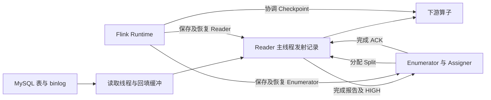

[系列导读与验证材料](/flink-cdc-series/) · [一：一致性边界](/2026/10/18/flink-cdc-1-consistency/) · [二：增量快照](/2026/10/18/flink-cdc-2-incremental-snapshot/) · [三·上：Source 状态机](/2026/10/18/flink-cdc-3a-source-state/) · [三·下：故障恢复](/2026/10/18/flink-cdc-3b-checkpoint-recovery/) · [四：Schema 演进](/2026/10/18/flink-cdc-4-schema-evolution/) · [五：Paimon 提交](/2026/10/18/flink-cdc-5-paimon-commit/)

---

增量快照解决了一个 Chunk 内如何把全量读取与并发变更合并的问题。把多个 Chunk 放到并行 Source 中，还会出现另一个问题：某个 Reader 已经读完，不代表其他 Reader 的结果已经进入下游；所有 Reader 都报告完成，也不代表这些完成事实已经形成可恢复的状态。此时直接启动 binlog，可能让同一主键的后续更新越过尚在传输的快照结果。

Flink CDC 因而需要一套跨 Reader、Enumerator 和 Flink Runtime 的协议。它既要决定谁拥有每个 Split，又要把快照结束、完成确认、Checkpoint 和 binlog 分配连接起来。第三篇拆成上下两篇：本篇讲状态归属与切换条件；[下篇](/2026/10/18/flink-cdc-3b-checkpoint-recovery/)讲恢复点、故障窗口和真实作业重启实验。原先五个主题保持不变，第三个主题分成两个阅读单元。

本文基于 Flink CDC 3.7.0 的固定提交 `045e8da45df4b1017849b04e2d8bfe8f0ed7936d`，配套阅读 Flink 1.20.3 Runtime。主线采用 MySQL `initial` 模式、默认开启回填，先快照再持续读取 binlog。源码行为、对象级测试和真实作业实验分别说明，不能互相替代。[第二篇 增量快照的水位回填与多 Chunk 衔接](/2026/10/18/flink-cdc-2-incremental-snapshot/)

## 先从 Source 工厂确定实际执行路径

阅读状态机之前，先确认程序到底创建了哪种 Assigner。否则，一个内部方法里存在的条件分支，很容易被误认为用户选择某种启动模式后一定会走到的路径。

| 启动方式 | MySqlSource.createEnumerator 选择的 Assigner | 主要职责 |
| --- | --- | --- |
| initial | MySqlHybridSplitAssigner | 先委托快照分配，再分配连续 binlog Split |
| snapshot-only | MySqlSnapshotSplitAssigner | 只执行快照分配路径 |
| 纯日志启动方式 | MySqlBinlogSplitAssigner | 从相应起点直接进入日志读取 |

这个入口进一步限定了第二篇的结论：虽然 Hybrid 的 `createBinlogSplit` 内存在 snapshot-only 时使用最大 HIGH 作终点的分支，但工厂在正常 snapshot-only 启动时选择的是 Snapshot Assigner。不能只凭那个内部条件，就断言 snapshot-only 作业会额外追赶到最大 HIGH。第二篇手工构造有界 Reader 的实验仍然有效，但只证明那个 Reader 的行为。[MySqlSource.createEnumerator](https://github.com/apache/flink-cdc/blob/045e8da45df4b1017849b04e2d8bfe8f0ed7936d/flink-cdc-connect/flink-cdc-source-connectors/flink-connector-mysql-cdc/src/main/java/org/apache/flink/cdc/connectors/mysql/source/MySqlSource.java#L192)

接下来的状态机只沿 `initial → Hybrid → Snapshot Assigner → binlog Split` 展开。动态新增表会重新进入一组额外状态，放在本篇边界说明中，不与首次启动混写。

## 三类组件分别拥有不同的事实

FLIP-27 将发现和分配工作交给 Enumerator，将实际读取交给 Reader；Split 同时承担工作描述和可恢复状态的载体。理解 CDC 时，可以沿用这个分工，但还要补上 Runtime 对 Checkpoint 和分配回退的管理。[FLIP-27 Reader 与 Failover 设计](https://cwiki.apache.org/confluence/spaces/FLINK/pages/95653746/FLIP-27%2BRefactor%2BSource%2BInterface)

| 组件 | 它知道什么 | 它不能单独证明什么 |
| --- | --- | --- |
| MySqlSnapshotSplitAssigner 与 Hybrid Assigner | 待发现表、待分配范围、已分配范围、已报告 HIGH、阶段状态 | 某条快照记录已经提交到外部 Sink |
| MySqlSourceReader | 自己持有的 Split、发射进度、待确认完成记录、待组装 binlog 元数据 | 其他 Reader 已完成，或全局 Checkpoint 已成功 |
| Flink SourceCoordinator 与 SourceOperator | 两侧状态的 Checkpoint 生命周期、事件传递、恢复入口 | 数据库 binlog 永远可重放，或任意 Sink 都能回滚外部副作用 |

这里的“拥有”是指承担哪部分恢复责任，而不是某个 Split 只能在一张 Map 里出现。一个已分配 Chunk 可以同时出现在 Enumerator 的分配元数据和 Reader 的执行状态中；两者保存它的目的不同。前者保留范围与后续拼接所需信息，后者保存自己是否完成这个范围。



这张图还分开了两个线程边界。数据库读取线程能够继续扫描或回填，并不表示 Reader 主线程已经把那些记录发出去；只有推进到 Reader 主线程所管理的 Split 状态，才会成为对应 Checkpoint 的逻辑进度。

## 分配完所有范围不等于完成所有范围

Snapshot Assigner 维护 `remainingTables`、`remainingSplits`、`assignedSplits` 和 `splitFinishedOffsets` 等结构。分配一个 Chunk 时，它从待分配集合移走，并进入已分配集合；Reader 报告完成后，才把 HIGH 放入完成水位表。已分配元数据不会因为收到完成报告就全部删除，Hybrid 稍后还要用它构造范围与 HIGH 的对应关系。[getNext 与完成处理](https://github.com/apache/flink-cdc/blob/045e8da45df4b1017849b04e2d8bfe8f0ed7936d/flink-cdc-connect/flink-cdc-source-connectors/flink-connector-mysql-cdc/src/main/java/org/apache/flink/cdc/connectors/mysql/source/assigners/MySqlSnapshotSplitAssigner.java#L369)

`noMoreSplits()` 检查的是还有没有待发现、待划分或待分配的工作。假设最后一个范围刚交给 Reader，所有数据库读取还没有结束，`noMoreSplits()` 仍可能已经为真。它不能直接充当“快照结束”的信号。

源码另外定义了 `allSnapshotSplitsFinished()`：除了没有剩余工作，还要求已分配 Split 数量与已报告完成水位的数量一致。这个判断建立在正常的 Split ID 报告协议上，表达的是已分配任务全部交回了完成结果。

```text
范围尚未分配
    ↓ getNext
范围已分配，但未收到完成 HIGH
    ↓ onFinishedSplits
范围已报告完成
    ↓ 全部范围满足条件，并完成切换门槛
初始快照阶段结束
```

首次启动的主要阶段是 `INITIAL_ASSIGNING → INITIAL_ASSIGNING_FINISHED`。这两个值属于 Assigner 的阶段状态；它们不等于某个 Reader 的“正在扫表/正在读日志”瞬时状态，更不等于作业是否 RUNNING。[AssignerStatus](https://github.com/apache/flink-cdc/blob/045e8da45df4b1017849b04e2d8bfe8f0ed7936d/flink-cdc-connect/flink-cdc-source-connectors/flink-connector-mysql-cdc/src/main/java/org/apache/flink/cdc/connectors/mysql/source/assigners/AssignerStatus.java)，[完整完成条件](https://github.com/apache/flink-cdc/blob/045e8da45df4b1017849b04e2d8bfe8f0ed7936d/flink-cdc-connect/flink-cdc-source-connectors/flink-connector-mysql-cdc/src/main/java/org/apache/flink/cdc/connectors/mysql/source/assigners/MySqlSnapshotSplitAssigner.java#L612)

## HIGH 必须推进到 Reader 的状态

第二篇已经说明数据库侧 LOW/HIGH 夹住扫描与回填窗口。本篇需要再区分三件事：数据库读取任务取得 HIGH、回填完成并形成输出批次、Reader 发射这个批次后保存 HIGH。它们发生在不同的位置。

正常回填路径的 `SnapshotSplitReader.pollWithBuffer` 先消费扫描和回填数据，在缓冲中形成最终结果，再构造顺序为 LOW、规范化快照记录、HIGH 的一个 `SourceRecords` 批次。这里的 HIGH 位于交给上层的批次末尾。[SnapshotSplitReader.pollWithBuffer](https://github.com/apache/flink-cdc/blob/045e8da45df4b1017849b04e2d8bfe8f0ed7936d/flink-cdc-connect/flink-cdc-source-connectors/flink-connector-mysql-cdc/src/main/java/org/apache/flink/cdc/connectors/mysql/debezium/reader/SnapshotSplitReader.java#L312)

`SourceReaderBase` 把批次交给 `MySqlRecordEmitter.emitRecord`。Emitter 在当前调用内依次处理记录，遇到 HIGH 时才执行 `setHighWatermark`。因此，读取线程已经取得 HIGH，不代表 Reader 的可恢复状态已经带有 HIGH；要先走过主线程发射这一步。[MySqlRecordEmitter](https://github.com/apache/flink-cdc/blob/045e8da45df4b1017849b04e2d8bfe8f0ed7936d/flink-cdc-connect/flink-cdc-source-connectors/flink-connector-mysql-cdc/src/main/java/org/apache/flink/cdc/connectors/mysql/source/reader/MySqlRecordEmitter.java#L75)，[SourceReaderBase.pollNext](https://github.com/apache/flink/blob/release-1.20.3/flink-connectors/flink-connector-base/src/main/java/org/apache/flink/connector/base/source/reader/SourceReaderBase.java#L185)

```text
数据库读取线程：LOW → 扫描 → 取得 HIGH → 回填 → 形成完整批次
Reader 主线程： 接收批次 → 发射规范化记录 → 处理 HIGH → Split 状态完成
后续 Reader 轮询：识别 Split 结束 → 放入待确认集合 → 向 Enumerator 报告
```

在这个正常缓冲路径中，一个 Chunk 的规范化结果由同一次 Emitter 调用处理，Checkpoint 的主线程状态快照不会随意插入这次同步调用的循环中间。于是，Chunk 内临时读取进度与主线程已经提交给输出的逻辑进度不会被混为一谈。这个结论针对当前批次组织方式；不能套用到开启跳过回填后的所有路径。

Chunk 仍未完成时，Split 状态中没有持久化 JDBC 逐行游标或回填 Map；失败恢复通常要重新读取这个未完成范围。Chunk 已经带有完成 HIGH 时，恢复入口则能识别它已经完成，不必再扫描。下篇的快照故障实验会具体检验前一种情况。

## 完成报告和 ACK 负责交接完成事实

`MySqlSourceReader.onSplitFinished` 将已经完成的 snapshot Split 放进 `finishedUnackedSplits`，发送 `FinishedSnapshotSplitsReportEvent`。Enumerator 收到后调用 Assigner 的 `onFinishedSplits`，再发送 `FinishedSnapshotSplitsAckEvent`。Reader 收到 ACK 后，才删除这份待确认完成记录。[Reader 完成处理](https://github.com/apache/flink-cdc/blob/045e8da45df4b1017849b04e2d8bfe8f0ed7936d/flink-cdc-connect/flink-cdc-source-connectors/flink-connector-mysql-cdc/src/main/java/org/apache/flink/cdc/connectors/mysql/source/reader/MySqlSourceReader.java#L157)，[Enumerator 处理报告](https://github.com/apache/flink-cdc/blob/045e8da45df4b1017849b04e2d8bfe8f0ed7936d/flink-cdc-connect/flink-cdc-source-connectors/flink-connector-mysql-cdc/src/main/java/org/apache/flink/cdc/connectors/mysql/source/enumerator/MySqlSourceEnumerator.java#L167)

ACK 的含义是 Enumerator 已接收这份报告。它不是“该状态已经写进成功 Checkpoint”，也不是“数据已提交到 Sink”。这三个时刻必须分开，否则后面的恢复推理会立即失效。

如果 ACK 尚未收到，`snapshotState` 会把 `finishedUnackedSplits` 一并保存。恢复时，`addSplits` 发现 snapshot Split 已经有完成 HIGH，就放回待确认集合并重报；Enumerator 的周期性同步也会请求 Reader 重报未确认完成信息。[Reader 状态集合](https://github.com/apache/flink-cdc/blob/045e8da45df4b1017849b04e2d8bfe8f0ed7936d/flink-cdc-connect/flink-cdc-source-connectors/flink-connector-mysql-cdc/src/main/java/org/apache/flink/cdc/connectors/mysql/source/reader/MySqlSourceReader.java#L135)，[恢复入口](https://github.com/apache/flink-cdc/blob/045e8da45df4b1017849b04e2d8bfe8f0ed7936d/flink-cdc-connect/flink-cdc-source-connectors/flink-connector-mysql-cdc/src/main/java/org/apache/flink/cdc/connectors/mysql/source/reader/MySqlSourceReader.java#L239)，[Enumerator 同步](https://github.com/apache/flink-cdc/blob/045e8da45df4b1017849b04e2d8bfe8f0ed7936d/flink-cdc-connect/flink-cdc-source-connectors/flink-connector-mysql-cdc/src/main/java/org/apache/flink/cdc/connectors/mysql/source/enumerator/MySqlSourceEnumerator.java#L320)

对象级测试实际把一个已完成 Split 序列化再恢复到 Reader，确认它进入待确认集合，活动 Split 数量为 0；收到重报请求时再次发送报告，收到 ACK 后下一次状态才不再包含它。这支持“完成信息可以重报且无需重新扫描”的结论，但不是一次网络丢包实验。

完成 ACK 与 Checkpoint 的排序还依赖 Flink Runtime 的 Coordinator 事件通道。CDC 的几张 Map 不能独立建立跨组件的一致切面；下篇会分析为什么 Enumerator 取完状态之后发出的 ACK，不能随意越过 Reader 的同轮 Checkpoint。

## 并行快照为什么还要等待一次 Checkpoint

假设 Reader A 已经把 `id=101, amount=10` 发到输出缓冲区，并报告完成。由于另一条通道拥塞，这条快照记录仍未被下游处理。如果此时另一个 Reader 开始发出同一主键的 binlog 更新 `amount=20`，下游可能先看到更新，再看到旧快照，从而被旧值覆盖。

单个 Chunk 的回填没有问题，多 Chunk 的 HIGH 过滤也可以正确；错误仍然会出现在跨 Reader 的输出先后关系上。这就是阶段切换还要借助 Flink Checkpoint 的原因。

`MySqlSnapshotSplitAssigner.onFinishedSplits` 收齐报告后检查当前并行度。并行度为 1 时直接完成阶段；大于 1 时等待后续 Checkpoint。该实现的意图在 Hybrid 的分配路径中也写得很明确：避免同一主键的 binlog 记录与 snapshot 记录乱序。[onFinishedSplits](https://github.com/apache/flink-cdc/blob/045e8da45df4b1017849b04e2d8bfe8f0ed7936d/flink-cdc-connect/flink-cdc-source-connectors/flink-connector-mysql-cdc/src/main/java/org/apache/flink/cdc/connectors/mysql/source/assigners/MySqlSnapshotSplitAssigner.java#L429)，[Hybrid.getNext](https://github.com/apache/flink-cdc/blob/045e8da45df4b1017849b04e2d8bfe8f0ed7936d/flink-cdc-connect/flink-cdc-source-connectors/flink-connector-mysql-cdc/src/main/java/org/apache/flink/cdc/connectors/mysql/source/assigners/MySqlHybridSplitAssigner.java#L153)

下面是省略异常处理和新增表分支后的逻辑摘要，不是逐字源码：

```text
收到完成报告：
    记录各 Split 的 HIGH
    若全部完成且并行度为 1：结束快照阶段

snapshotState(C)：
    若全部完成，且阶段仍在分配快照：
        记住首个满足条件的 checkpointIdToFinish

notifyCheckpointComplete(C)：
    若仍然全部完成，且 C 不早于记住的门槛：
        结束快照阶段
```

重点是“收齐报告之后取得的 Checkpoint 成功”，不是“任何一个旧 Checkpoint 传来了成功通知”。`snapshotState` 建立门槛，`notifyCheckpointComplete` 才放行；Enumerator 接到完成回调后再尝试分配等待中的 Split。[门槛建立与放行](https://github.com/apache/flink-cdc/blob/045e8da45df4b1017849b04e2d8bfe8f0ed7936d/flink-cdc-connect/flink-cdc-source-connectors/flink-connector-mysql-cdc/src/main/java/org/apache/flink/cdc/connectors/mysql/source/assigners/MySqlSnapshotSplitAssigner.java#L462)，[Enumerator 完成回调](https://github.com/apache/flink-cdc/blob/045e8da45df4b1017849b04e2d8bfe8f0ed7936d/flink-cdc-connect/flink-cdc-source-connectors/flink-connector-mysql-cdc/src/main/java/org/apache/flink/cdc/connectors/mysql/source/enumerator/MySqlSourceEnumerator.java#L242)

在本文默认对齐 Checkpoint 的范围内，这个完成点把之前各快照输出纳入同一个成功状态切面，然后才允许后续 binlog 输出进入下一阶段。它不要求所有外部系统此时都已经提交可见结果；外部提交仍取决于 Sink 自己的协议。

并行度为 1 的特例跳过的是这个阶段切换等待门槛。快照与随后 binlog 由同一个 Source Reader 的输出序列衔接，不需要再用该门槛协调多个 Reader 的快照输出。它没有关闭 Flink 的故障恢复 Checkpoint，也没有赋予外部 Sink 额外保证。 新增跨 Chunk 恢复实验实际利用了这个 p=1 分支：A 已完成的 C1 之后，不再完成新 Checkpoint 也能继续读 binlog；故障后从 C1 只重扫 B，真实 Paimon 仍缺迁移行。具体状态与对账见[下篇新增实验](/2026/10/18/flink-cdc-3b-checkpoint-recovery/#chunk-recovery)，不能推广到 p>1 的切换门槛。

## binlog Split 是怎样组装出来的

快照阶段满足门槛后，Hybrid Assigner 才能创建初始 binlog Split。构造时，它遍历完成的 snapshot Split，把表、范围边界和各自 HIGH 汇成 `FinishedSnapshotSplitInfo`，并取所有 HIGH 的最小值作为连续日志的起读位置。

```text
Chunk A 的 HIGH = HA
Chunk B 的 HIGH = HB，且 HA 早于 HB

连续 binlog 起点 = min(HA, HB)
A 的记录：仅接纳 A 范围内越过 HA 的后续变更
B 的记录：仅接纳 B 范围内越过 HB 的后续变更
```

这段过滤弥合了各 Chunk 完成时刻不同的差异；它与前一节 Checkpoint 门槛解决的是两个问题。HIGH 过滤决定哪些日志已被快照结果覆盖，Checkpoint 门槛控制快照输出与后续日志输出的阶段先后。[createBinlogSplit](https://github.com/apache/flink-cdc/blob/045e8da45df4b1017849b04e2d8bfe8f0ed7936d/flink-cdc-connect/flink-cdc-source-connectors/flink-connector-mysql-cdc/src/main/java/org/apache/flink/cdc/connectors/mysql/source/assigners/MySqlHybridSplitAssigner.java#L314)，[BinlogSplitReader.shouldEmit](https://github.com/apache/flink-cdc/blob/045e8da45df4b1017849b04e2d8bfe8f0ed7936d/flink-cdc-connect/flink-cdc-source-connectors/flink-connector-mysql-cdc/src/main/java/org/apache/flink/cdc/connectors/mysql/debezium/reader/BinlogSplitReader.java#L289)

两个机制不能互相替代。只保留 HIGH 过滤，无法阻止旧快照在下游晚于新更新出现；只保留 Checkpoint 等待，又无法知道从最小 HIGH 起读时哪些范围的旧日志应当过滤。

首次分配使用 `isBinlogSplitAssigned` 防止重复创建同一个连续读取任务。Enumerator 从当前等待且仍已注册的 Reader 中选择接收者，并记录 `binlogSplitTaskId`。这个实现不是固定指定 subtask 0 持有 binlog；也不是快照并行度为 N，随后就自动出现 N 个独立连续 binlog Split。[Enumerator.assignSplits](https://github.com/apache/flink-cdc/blob/045e8da45df4b1017849b04e2d8bfe8f0ed7936d/flink-cdc-connect/flink-cdc-source-connectors/flink-connector-mysql-cdc/src/main/java/org/apache/flink/cdc/connectors/mysql/source/enumerator/MySqlSourceEnumerator.java#L263)

## 收到 binlog Split 还不一定能开始读取

当 Chunk 数量较多，所有完成范围信息塞进一次 Split 下发会变得很大。这个版本支持把完成元数据分组发送：binlog Split 可以先携带起点和预期完成范围总数，Reader 再向 Enumerator 请求元数据组。

Reader 把尚未组装完整的 binlog Split 放在 `uncompletedBinlogSplits` 中。它们也属于 Reader 的 Checkpoint 状态，但在元数据完整之前，不会按完整 Split 的路径交给底层读取器。否则 Reader 虽然知道从哪里读日志，却未必知道某条记录应该与哪个范围的 HIGH 比较。[MySqlSourceReader.addSplits 及元数据处理](https://github.com/apache/flink-cdc/blob/045e8da45df4b1017849b04e2d8bfe8f0ed7936d/flink-cdc-connect/flink-cdc-source-connectors/flink-connector-mysql-cdc/src/main/java/org/apache/flink/cdc/connectors/mysql/source/reader/MySqlSourceReader.java#L239)

因此，至少还要区分“binlog Split 已下发”“完成范围元数据已组装”“binlog 数据开始发射”三个状态。看到 Enumerator 打出分配日志，只能证明第一个。

元数据释放也沿用同样的责任划分。这个提交的释放优化默认关闭；开启后，需要等 Reader 确认组装完成，再经过覆盖该事实的成功 Checkpoint，才能释放 Enumerator 的重型快照元数据。默认状态序列化仍使用版本 5，开启释放后使用保存额外标记的版本 6。[Hybrid 元数据生命周期](https://github.com/apache/flink-cdc/blob/045e8da45df4b1017849b04e2d8bfe8f0ed7936d/flink-cdc-connect/flink-cdc-source-connectors/flink-connector-mysql-cdc/src/main/java/org/apache/flink/cdc/connectors/mysql/source/assigners/MySqlHybridSplitAssigner.java#L227)，[PendingSplitsStateSerializer](https://github.com/apache/flink-cdc/blob/045e8da45df4b1017849b04e2d8bfe8f0ed7936d/flink-cdc-connect/flink-cdc-source-connectors/flink-connector-mysql-cdc/src/main/java/org/apache/flink/cdc/connectors/mysql/source/assigners/state/PendingSplitsStateSerializer.java#L48)

## 用受控时序验证切换条件

本轮新增的协议测试没有伪造 Assigner 的返回值，而是调用固定提交中的真实类，并在需要时经过真实序列化器。它们回答具体状态转移问题；下篇另外提供两次实际作业恢复实验。

| 问题 | 操作时序 | 实际结果 |
| --- | --- | --- |
| 旧 Checkpoint 完成能否放行 | 先取 C10，再收齐完成报告，再完成 C10 | 不能分配 binlog |
| 覆盖全部报告的 Checkpoint 能否放行 | 收齐报告后取 C11，再完成 C11 | 可以分配，起点是最小 HIGH |
| 并行度 1 是否有特例 | 收齐报告，不触发切换 Checkpoint | 可以分配 binlog |
| 退回 Split 后能否沿用旧完成信息 | 完成报告已收齐，再退回一个 snapshot Split | 该 Split 的旧完成水位被移除，需要重新完成 |
| 未 ACK 的完成 Split 能否恢复 | 序列化、创建新 Reader、恢复、重报、ACK | 无活动扫描；重报后 ACK 才移除完成记录 |
| 切换边界保存的字节是否已经是新阶段 | 保存 C11 后才通知完成，再从 C11 恢复 | 保存状态仍是 INITIAL_ASSIGNING，需新门槛放行 |

最后一项对恢复分析尤其重要：运行中的 Assigner 已进入新阶段，不代表最近一次 Checkpoint 字节也已经保存了这个新阶段。它解释了某些恢复为何会重新等待一次 Checkpoint，而不是立即进入 binlog。

## 沿着一个 Split 精读源码

| 顺序 | 入口 | 建议追问 |
| --- | --- | --- |
| 1 | MySqlSource.createEnumerator | 当前启动模式真正创建了哪个 Assigner |
| 2 | MySqlSnapshotSplitAssigner.getNext | Split 从待分配转为已分配时，哪些集合变化 |
| 3 | SnapshotSplitReader.pollWithBuffer | HIGH 在哪里取得，完整结果何时交给主线程 |
| 4 | MySqlRecordEmitter.processElement | 哪一步把 HIGH 写进 Reader Split 状态 |
| 5 | MySqlSourceReader.onSplitFinished 与 snapshotState | 报告发送后、ACK 到来前，由谁保存完成事实 |
| 6 | MySqlSourceEnumerator.handleSourceEvent | 完成报告如何更新 Assigner，ACK 何时发出 |
| 7 | MySqlSnapshotSplitAssigner 的两个 Checkpoint 方法 | 什么时候建立门槛，什么时候真正放行 |
| 8 | MySqlHybridSplitAssigner.createBinlogSplit | 范围信息、最小 HIGH 和元数据分组如何组合 |
| 9 | MySqlSourceReader.addSplits | 完成范围、未完成范围和未组装 binlog 为什么走不同分支 |

对每个字段再追问一次：它只存在于运行内存里，还是进入了序列化状态？由哪个组件恢复？若回退到更早 Checkpoint，谁能撤销它？这样读，比只背诵一张类关系图更接近这套协议的正确性依据。

## 首次切换之外的边界

新增表流程会经过 `NEWLY_ADDED_ASSIGNING`、`NEWLY_ADDED_ASSIGNING_SNAPSHOT_FINISHED` 和 `NEWLY_ADDED_ASSIGNING_FINISHED` 等额外状态，还要处理已有 binlog Reader 的暂停和元数据更新。本篇没有把首次启动的状态转换直接推广到新增表，也没有实测新增表恢复。

LOW/HIGH 描述的是数据库日志边界；完成报告和 ACK 描述的是组件之间的完成事实交接；Checkpoint 描述的是可恢复的一致状态切面。三者协作，使 Source 从并行快照进入连续 binlog。下一篇将把失败插入这些边界，检查恢复后由谁继续承担每一份状态。


公开测试源码、结果和复现条件见[系列验证材料](/flink-cdc-series/#evidence-3)。

---

[系列导读与验证材料](/flink-cdc-series/) · [一：一致性边界](/2026/10/18/flink-cdc-1-consistency/) · [二：增量快照](/2026/10/18/flink-cdc-2-incremental-snapshot/) · [三·上：Source 状态机](/2026/10/18/flink-cdc-3a-source-state/) · [三·下：故障恢复](/2026/10/18/flink-cdc-3b-checkpoint-recovery/) · [四：Schema 演进](/2026/10/18/flink-cdc-4-schema-evolution/) · [五：Paimon 提交](/2026/10/18/flink-cdc-5-paimon-commit/)
