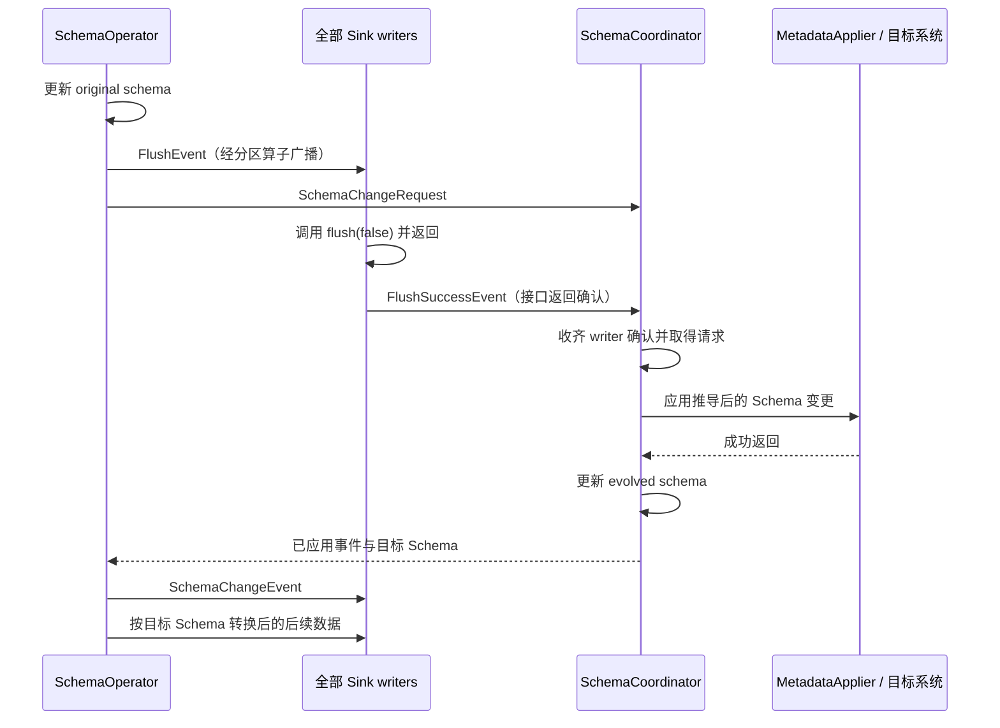

[系列导读与验证材料](/flink-cdc-series/) · [一：一致性边界](/2026/10/18/flink-cdc-1-consistency/) · [二：增量快照](/2026/10/18/flink-cdc-2-incremental-snapshot/) · [三·上：Source 状态机](/2026/10/18/flink-cdc-3a-source-state/) · [三·下：故障恢复](/2026/10/18/flink-cdc-3b-checkpoint-recovery/) · [四：Schema 演进](/2026/10/18/flink-cdc-4-schema-evolution/) · [五：Paimon 提交](/2026/10/18/flink-cdc-5-paimon-commit/)

---

第三篇讨论了 Source 如何从快照切换到 binlog，以及如何从 Checkpoint 找回处理进度。现在再加一个条件：处理进度后面的记录，可能已经换了字段布局。只恢复“读到哪里”还不够，系统还必须知道“接下来这些字节应该按什么结构解释”，并让目标端及时准备好接受它们。

本文沿着一条具体链路展开：MySQL 执行 ADD COLUMN，Source 捕获 DDL 并更新解码结构，Pipeline 将它转换成 SchemaChangeEvent，协调下游 flush，再调用目标连接器修改表结构。最后在链路中间注入失败，检查恢复后哪些动作会重做。

**版本与证据范围**：源码固定为 Flink CDC release-3.7.0，提交 `045e8da45df4b1017849b04e2d8bfe8f0ed7936d`；实验使用 Flink 1.20.3、Debezium 1.9.8.Final、Java 11.0.29、MySQL 8.4.11。下面明确标注源码结论、实测结果和未验证边界，不将其他版本、其他连接器或任意 DDL 的行为混入本篇。

## 一次 ADD COLUMN，实际上跨越了四种 Schema

先看这张表。它能解释为什么“支持 Schema 演进”不能只用一个布尔值回答。

| 层次 | 保存或使用的结构 | 必须解决的问题 |
| --- | --- | --- |
| MySQL / Debezium 解码 | 表字段、顺序、类型及历史表结构 | 读到某条行事件时，如何还原字段含义 |
| Source 的恢复状态 | Split 中的 tableSchemas 与 binlog offset | 重启后怎样重新建立可继续读日志的解码上下文 |
| Pipeline 的逻辑状态 | original schema 与 evolved schema | 输入结构如何映射为目标结构，数据如何转换 |
| 外部目标系统 | 真实表、列、类型、约束 | DDL 是否执行、执行到哪一步、重复执行是否安全 |

这四种结构可能在不同时间变化。目标端可能已经加了列，Coordinator 却尚未收到成功结果；Source 也可能已经保存新表结构，但恢复位点仍在 DDL 前面。理解演进的重点，是说明这些暂时不一致如何被协调和恢复，而不是要求所有结构始终同步更新。

为了把论证落到实处，全文使用同一个例子：源表原来是 `items(id, amount)`，随后执行 `ADD COLUMN note VARCHAR(20) AFTER id`，新行布局变成 `(id, note, amount)`。把 note 插在中间，可以检验系统是否真的更新了字段布局，而不仅是忽略末尾多出来的一列。

## DDL 捕获先服务于解码，向用户输出是另一件事

### 从 binlog QUERY 事件到内部表结构

**源码结论**：本版本依赖 Debezium 1.9.8.Final，同时在 CDC MySQL 模块中包含同包同名的改写类 MySqlStreamingChangeEventSource。运行路径应以 CDC 固定提交中的这个类为准，Debezium 原版用于比较。SQL DDL 经由 binlog QUERY 事件处理：handleQueryEvent 先处理事务边界和过滤条件，再调用 MySqlDatabaseSchema.parseStreamingDdl，生成表结构变更并向 dispatcher 分发。BEGIN、COMMIT 和被过滤语句走各自分支。改写类还包含 GTID 恢复等修正，不能仅凭依赖版本号认定它与 Debezium 原版完全相同。[CDC 内置实现与修改说明](https://github.com/apache/flink-cdc/blob/045e8da45df4b1017849b04e2d8bfe8f0ed7936d/flink-cdc-connect/flink-cdc-source-connectors/flink-connector-mysql-cdc/src/main/java/io/debezium/connector/mysql/MySqlStreamingChangeEventSource.java#L86)、[handleQueryEvent](https://github.com/apache/flink-cdc/blob/045e8da45df4b1017849b04e2d8bfe8f0ed7936d/flink-cdc-connect/flink-cdc-source-connectors/flink-connector-mysql-cdc/src/main/java/io/debezium/connector/mysql/MySqlStreamingChangeEventSource.java#L605)。

Flink CDC 的 `EventDispatcherImpl` 随后先调用 `historizedSchema.applySchemaChange(event)` 更新 Debezium 使用的结构，再将包含 DDL、TableChanges 和位点信息的 HistoryRecord 放进 SourceRecord 队列。因此，内部解码结构的更新发生在用户反序列化器收到事件之前。[EventDispatcherImpl](https://github.com/apache/flink-cdc/blob/045e8da45df4b1017849b04e2d8bfe8f0ed7936d/flink-cdc-connect/flink-cdc-source-connectors/flink-connector-mysql-cdc/src/main/java/org/apache/flink/cdc/connectors/mysql/debezium/dispatcher/EventDispatcherImpl.java#L313)。

配置也体现了这一区别：在未用底层 Debezium 属性覆盖默认值的构造路径上，`MySqlSourceConfigFactory` 会设置 `include.schema.changes=true`，让内部链路能接收结构变化；面向使用者的 `includeSchemaChanges` 则控制是否把这些记录交给输出反序列化器。后面还有 `putAll(dbzProperties)`，所以不能把默认设置说成不可覆盖的常量。[MySqlSourceConfigFactory](https://github.com/apache/flink-cdc/blob/045e8da45df4b1017849b04e2d8bfe8f0ed7936d/flink-cdc-connect/flink-cdc-source-connectors/flink-connector-mysql-cdc/src/main/java/org/apache/flink/cdc/connectors/mysql/source/config/MySqlSourceConfigFactory.java#L386)。

`MySqlRecordEmitter` 的分支最清楚：只要是 binlog Split 的 Schema 记录，就先把 TableChanges 写入 Split 的 tableSchemas；只有公开的 includeSchemaChanges 开关为 true，才在这个分支推进 startingOffset 并输出该记录。DML、心跳等其他分支另有推进位点的逻辑。[MySqlRecordEmitter](https://github.com/apache/flink-cdc/blob/045e8da45df4b1017849b04e2d8bfe8f0ed7936d/flink-cdc-connect/flink-cdc-source-connectors/flink-connector-mysql-cdc/src/main/java/org/apache/flink/cdc/connectors/mysql/source/reader/MySqlRecordEmitter.java#L75)。

这解释了一个常见现象：关闭 DDL 输出以后，后面的行数据仍然可能按新结构正确解码。关闭的是一个输出通道，内部结构维护仍在进行。但不能据此建议 Pipeline 随意关闭 Schema 输出：其下游逻辑状态需要接收 SchemaChangeEvent，内部 Debezium 能解码，不等于下游仍能正确理解新布局。

### “捕获了 DDL”不等于“一条 SQL 对应一个下游事件”

至少还要经过两道筛选。`BinlogSplitReader.shouldEmit` 对 Schema 记录检查是否属于表结构变化以及表是否在捕获范围；CREATE/DROP DATABASE 这类没有对应表结构变化的记录会被跳过。默认配置还包含 `database.history.skip.unparseable.ddl=true`，因此不能将“任务继续运行”当作“每种 DDL 都被正确理解”的证据。具体不可解析语句会产生什么后果，本轮未做覆盖实验。[BinlogSplitReader](https://github.com/apache/flink-cdc/blob/045e8da45df4b1017849b04e2d8bfe8f0ed7936d/flink-cdc-connect/flink-cdc-source-connectors/flink-connector-mysql-cdc/src/main/java/org/apache/flink/cdc/connectors/mysql/debezium/reader/BinlogSplitReader.java#L289)。

到了 Pipeline MySQL Connector，`MySqlEventDeserializer.deserializeSchemaChangeRecord` 又取出 HistoryRecord 中的 SQL，交给 `CustomMySqlAntlrDdlParser`，转换为框架认识的 SchemaChangeEvent。这一层负责生成可供不同 Sink 使用的结构化事件，与前面的 Debezium 解码层承担不同职责。[MySqlEventDeserializer](https://github.com/apache/flink-cdc/blob/045e8da45df4b1017849b04e2d8bfe8f0ed7936d/flink-cdc-connect/flink-cdc-pipeline-connectors/flink-cdc-pipeline-connector-mysql/src/main/java/org/apache/flink/cdc/connectors/mysql/source/MySqlEventDeserializer.java#L103)。

**实际解析器实验**：本轮直接运行真实 CustomMySqlAntlrDdlParser 的四个用例，结果如下。它们没有连接数据库，证明的是事件转换规则。

| 输入 DDL | 实际得到的 Pipeline 事件 |
| --- | --- |
| ADD note VARCHAR(20) AFTER id | 一个 AddColumnEvent，保留 AFTER id 位置 |
| CHANGE amount amount_new BIGINT | 依次为 AlterColumnTypeEvent、RenameColumnEvent |
| DROP amount | 一个 DropColumnEvent |
| ADD INDEX idx_amount(amount) | 不生成 SchemaChangeEvent |

第二行尤其重要：一条 SQL 可以被拆成多个事件；最后一行则说明，MySQL 接受并记录的 DDL 不一定属于 Pipeline 的表结构事件模型。以后讨论“DDL 重放”，必须说清楚重放的是源 SQL 的解析、框架事件，还是目标数据库上的物理操作。

## Source 恢复的是解码上下文，不只是 binlog 位点

### Checkpoint 中有什么

**源码结论**：`MySqlBinlogSplitState` 同时维护 startingOffset 和 tableSchemas，转换成 Split 后由 Split serializer 保存。恢复配置路径会把 Split 携带的 TableChanges 注册给 EmbeddedFlinkDatabaseHistory，再由 Debezium 重建表结构上下文，并加载恢复位点。[MySqlBinlogSplitState](https://github.com/apache/flink-cdc/blob/045e8da45df4b1017849b04e2d8bfe8f0ed7936d/flink-cdc-connect/flink-cdc-source-connectors/flink-connector-mysql-cdc/src/main/java/org/apache/flink/cdc/connectors/mysql/source/split/MySqlBinlogSplitState.java)、[StatefulTaskContext](https://github.com/apache/flink-cdc/blob/045e8da45df4b1017849b04e2d8bfe8f0ed7936d/flink-cdc-connect/flink-cdc-source-connectors/flink-connector-mysql-cdc/src/main/java/org/apache/flink/cdc/connectors/mysql/debezium/task/context/StatefulTaskContext.java#L116)。

这里的 EmbeddedFlinkDatabaseHistory 不应被想象成一个独立、持久、完整的外部 DDL 历史库。静态映射承担初始化时传递表结构的作用，真正随 Flink 状态保存的依据来自 Split。它恢复的是可供解码使用的结构，而不是通过一个永久 DDL 日志从数据库建表之初重新演算。[EmbeddedFlinkDatabaseHistory](https://github.com/apache/flink-cdc/blob/045e8da45df4b1017849b04e2d8bfe8f0ed7936d/flink-cdc-connect/flink-cdc-source-connectors/flink-connector-mysql-cdc/src/main/java/org/apache/flink/cdc/connectors/mysql/debezium/EmbeddedFlinkDatabaseHistory.java)。

这也区分了两类启动：从有效 Checkpoint 恢复，可以利用其中保存的表结构；新建一个作业，直接指定很老的 binlog offset，则不能自动获得那个历史时刻的完整 Schema。固定版本的 MySQL Source 文档专门提示了 earliest/specific-offset/timestamp 启动在历史表结构变化后的风险。两者不能都简称为“从旧位点启动”。[MySQL Source 启动边界](https://github.com/apache/flink-cdc/blob/045e8da45df4b1017849b04e2d8bfe8f0ed7936d/docs/content/docs/connectors/flink-sources/mysql-cdc.md#L778)。

### 实验一：恢复点前后的 ADD 和 DROP

本轮建立了独占 MySQL 8.4.11 容器，真实运行 MySqlSource 和 Flink MiniCluster。源表有 10 行；完成快照后，先更新 amount=11，确认已进入 binlog 阶段，再建立基线 Checkpoint C2。Sink 同时记录不回滚的原始投递轨迹和受 Flink ListState 管理的恢复结果，借此区分“曾经输出过”与“恢复后状态中保留了什么”。

随后运行两条时间线，各自测试 includeSchemaChanges=true 和 false，共四个作业：

```text
A：C2 → ADD note → UPDATE note=blue, amount=20 → 首次收到更新时失败
   恢复 C2 → 重读 ADD → 再读 UPDATE

B：C2 → ADD note → UPDATE amount=20 → C3
   → DROP note → UPDATE amount=30 → 首次收到更新时失败
   恢复 C3 → 重读 DROP → 再读 UPDATE
```

**实际结果**：四组全部通过。A 中恢复后的数据能读出中间新增的 note 字段；B 中从含 note 的 Checkpoint 恢复后，即使真实数据库已经删掉 note，仍可继续处理日志中的 DROP，输出新的两列记录。恢复点之后的更新在原始轨迹中出现两次，Checkpoint 管理的结果只保留一次；初始 READ 总数仍为 10，没有重做完整快照。

当 includeSchemaChanges=true，A 的 ADD、B 的 DROP 也各出现两次原始投递，而 B 中恢复点之前的 ADD 只出现一次。开关为 false 时，没有 DDL 对外输出，行字段结构仍按 ADD/DROP 变化。这里验证的是 Source 的解析、状态与恢复；探针反序列化器动态遍历 Struct 字段，不能把结果升级成“固定 SQL 表结构可自动演进”。

### 实验二：只有 DDL、还没有后续 DML 的 Checkpoint

前一个实验中，DDL 后很快有 DML，新的数据事件可以推进位点。为了核实 DDL 自身的边界，又补做一个更窄的窗口：关闭 Schema 输出，将心跳周期设为一小时，在 ADD 被内部处理后、下一次数据更新之前触发 Checkpoint。观察器调用真实 emitter 的 super.processElement，只记录处理前后状态，不改生产算法。

**实际结果**：ADD 分支处理后，tableSchemas 已含 note，而 startingOffset 在这个分支没有改变；此时 Checkpoint 完成。随后执行新结构的 UPDATE，并在首次投递时触发失败。从刚才的 Checkpoint 恢复后，内部 ADD 总处理次数为 2，三列数据再次正确输出。

因此，不能把 Source Checkpoint 的状态草率描述成“Schema 必定严格等于 offset 时刻的结构”。在这个配置和事件窗口下，保存的新结构可以先于保存的位点。正确性还依赖恢复后能够继续消费这段日志，而本轮实测只确认了这条 ADD COLUMN 的重复解析与后续数据处理。

Debezium 的 TableEditorImpl 对已有名称的列使用替换式更新，这与本例重复 ADD 能被内部模型处理相符；但内部模型重复处理成功，并不意味着把同一条 ADD SQL 再发给 MySQL 也会成功。RENAME、复杂 ALTER、主键变化以及在线改表工具，均不能由此类推。

这个补充测试首次在提交作业前遇到测试探针的 NotSerializableException，原因是匿名 emitter 捕获测试实例；改为 static 构造后通过。首次失败与最终报告分别保留，它不属于 CDC 运行失败。

## Pipeline 用一轮 flush 协议建立新旧结构的边界

### 为什么不能收到 DDL 就直接 ALTER 目标表

考虑旧布局的一批数据还在 Sink writer 缓冲区，源端的新 DDL 已经到达。如果旧记录、新记录和目标结构更新缺少协调，记录就可能被按不匹配的布局处理。因此需要在数据通路上分隔演进前后的记录，并等待各 writer 完成其 flush 接口调用。这个确认只说明对应调用已经返回；缓冲是否排出、怎样跨 Schema 保留待提交数据，需要继续检查具体 Sink 的实现。

本文主线是 MySQL Pipeline 的 regular SchemaOperator。MySqlDataSource 的 `isParallelMetadataSource()` 返回 false；Source 的快照并行度大于 1，并不自动意味着采用 distributed SchemaOperator。后者是另一套元数据来源模型，本文只在测试结果中单独报告。[MySqlDataSource](https://github.com/apache/flink-cdc/blob/045e8da45df4b1017849b04e2d8bfe8f0ed7936d/flink-cdc-connect/flink-cdc-pipeline-connectors/flink-cdc-pipeline-connector-mysql/src/main/java/org/apache/flink/cdc/connectors/mysql/source/MySqlDataSource.java)。

**源码结论**：regular SchemaOperator 收到 SchemaChangeEvent 后，先更新本地 originalSchemaMap，再向下游发送 FlushEvent，然后才向 SchemaCoordinator 发送 SchemaChangeRequest 并同步等待响应。这个“先 flush、后等待”的次序有直接因果关系：如果先阻塞等待，协调者需要的 flush 确认就可能永远到不了。[SchemaOperator.handleSchemaChangeEvent](https://github.com/apache/flink-cdc/blob/045e8da45df4b1017849b04e2d8bfe8f0ed7936d/flink-cdc-runtime/src/main/java/org/apache/flink/cdc/runtime/operators/schema/regular/SchemaOperator.java#L162)。



图中的两条控制消息不要求严格按图中到达顺序发生：flush 确认可能先于请求到达。Coordinator 为此记录 pendingRequests 和已确认的 writer 集合，在确认足够后再等待请求就绪。它用单线程 Schema 变更执行器串行处理外部变更。[SchemaCoordinator](https://github.com/apache/flink-cdc/blob/045e8da45df4b1017849b04e2d8bfe8f0ed7936d/flink-cdc-runtime/src/main/java/org/apache/flink/cdc/runtime/operators/schema/regular/SchemaCoordinator.java#L246)。

RegularPrePartitionOperator 会把 FlushEvent 和 SchemaChangeEvent 广播给下游 writers，数据记录则按表与主键等信息分区。DataSinkWriterOperator 收到 flush 后调用 writer 的 `flush(false)`，再通知 Coordinator；旧 SinkFunction 路径调用的是 `finish()`。[RegularPrePartitionOperator](https://github.com/apache/flink-cdc/blob/045e8da45df4b1017849b04e2d8bfe8f0ed7936d/flink-cdc-runtime/src/main/java/org/apache/flink/cdc/runtime/partitioning/RegularPrePartitionOperator.java)、[DataSinkWriterOperator](https://github.com/apache/flink-cdc/blob/045e8da45df4b1017849b04e2d8bfe8f0ed7936d/flink-cdc-runtime/src/main/java/org/apache/flink/cdc/runtime/operators/sink/DataSinkWriterOperator.java#L213)。

这里建立的是一轮演进的处理次序。flush 成功既不普遍证明旧缓冲已经排出，也不证明数据已经持久化或提交。第五篇所用 PaimonWriter.flush 就是空操作：外部 Schema 更新后，writer 收到 SchemaChangeEvent 才通过 replace 处理旧缓冲并切换结构。因此，Schema 切换安全需要由连接器的具体状态移交流程承接，不能仅凭 FlushSuccessEvent 推导，更不能断言旧数据、外部 DDL 和后续数据共同提交为一个事务。

**补充实测（2026-10-18）**：第五篇在真实 MySQL → Paimon 作业中，直接观测到 DDL 前有 4 条内部记录留在旧布局 writer 缓冲；flush 返回及目标 ADD 完成后，仍为 4 条，writer 仍缓存两列结构。正常路径收到物理 Schema 更新后，缓冲变为 0，并在后续完成 Checkpoint 后通过全量对账；另一条路径在真实 ADD 成功、writer 尚未更新时抛错，从旧 Checkpoint 恢复并重放，也通过对账。故障路径依靠重读数据，不是恢复这段未入 Checkpoint 的内存缓冲。细节与限制见[第五篇补充实验](/2026/10/18/flink-cdc-5-paimon-commit/)，不能据此推广到任意 DDL 或并行配置。

### original 与 evolved 为什么要分开保存

源端结构与目标端结构不一定相同：多个源表可能路由到同一目标表，目标可能保留源端已删除的列，也可能不接受某种变更。SchemaManager 因而分别维护 originalSchemas 和 evolvedSchemas；SchemaOperator 收到协调结果后刷新目标结构，再用 `coerceDataRecord` 把输入记录转换为该结构。

一对一路由时，变更主要被映射到目标表；多对一路由时，SchemaCoordinator 会推导兼容的合并结构，再求出需要施加到目标的差异。这是按受支持类型规则做的结构推导，并非任意两个业务字段都能无损合并。[SchemaCoordinator.deduceEvolvedSchemaChanges](https://github.com/apache/flink-cdc/blob/045e8da45df4b1017849b04e2d8bfe8f0ed7936d/flink-cdc-runtime/src/main/java/org/apache/flink/cdc/runtime/operators/schema/regular/SchemaCoordinator.java#L320)。

由此可以给出一个源码推导的不变量：一条数据离开 SchemaOperator 时，应当能按照该记录对应的 original schema 被解释，并按当前 evolved schema 被构造。若两者不兼容而无法转换，源码会报错；Schema 演进并没有消除类型不兼容问题，而是把它显式放进了传播链路。

## 演进模式改变什么，必须看具体分支

本基线的默认模式是 LENIENT。它的核心是改写某些危险或破坏性的结构变化，并为后续数据转换保留空间。这个名称不意味着任意 DDL 失败都可以忽略。下面仅讨论 regular 路径，在路由和事件类型过滤之后的行为。

| 模式 | 本版本源码中的关键行为 | 容易误读的边界 |
| --- | --- | --- |
| EVOLVE | 尝试应用推导后的变更，失败传播 | 仍受连接器能力和事件类型过滤限制 |
| TRY_EVOLVE | 尝试应用；特定“不支持变更”异常可忽略 | 不吞掉任意 SQL、网络或运行时异常 |
| LENIENT | 改写 ADD / DROP / RENAME COLUMN | 不是外部 DDL 失败后继续运行的总开关 |
| IGNORE | 丢弃后续演进事件，保留 CreateTableEvent | 初始化结构仍然需要建立 |
| EXCEPTION | 遇到推导后的非 CreateTableEvent 变更时报错 | 允许初始化建表事件；也不是对全部源 SQL 的审计开关 |

最值得逐行读的是 `SchemaDerivator.lenientizeSchemaChangeEvent`。在本版本中，ADD COLUMN 会被改成追加 nullable 列；DROP COLUMN 保留原列，必要时把它改为 nullable；RENAME COLUMN 会添加新名字的 nullable 列，并保留旧列、必要时放宽旧列的非空约束。[SchemaDerivator](https://github.com/apache/flink-cdc/blob/045e8da45df4b1017849b04e2d8bfe8f0ed7936d/flink-cdc-runtime/src/main/java/org/apache/flink/cdc/runtime/operators/schema/common/SchemaDerivator.java#L155)。

例如源端将 `amount` 改名为 `amount_new`，在 LENIENT 的这一分支下，目标可以同时保留 amount 与 amount_new。此后的记录按字段名和目标结构转换，源端已不存在的旧字段会走缺失值处理。这个动作本身不会自动把目标历史行的 amount 搬到 amount_new；历史数据是否补写，是另一个工作。

前面的解析器实验保留了 `ADD note AFTER id` 的位置，但经过 LENIENT 改写后，目标侧添加的是末尾 nullable 列。也就是说，“解析正确保留了源 DDL 的位置”与“目标照搬源端字段顺序”是两件事。下游数据转换正是用来承接这种差异的。

这里还发现固定提交中的一处文档与实现差异：Schema evolution 文档描述 LENIENT 会把 AlterColumnTypeEvent 转成 Rename 加 Add；实际方法只对 ADD、DROP、RENAME COLUMN 分支特别处理，ALTER COLUMN TYPE 走默认返回原事件的分支。本篇采用源码结论，不把那段描述当作本版本已经实现的能力。[同版本文档](https://github.com/apache/flink-cdc/blob/045e8da45df4b1017849b04e2d8bfe8f0ed7936d/docs/content/docs/core-concept/schema-evolution.md#L61)。

异常边界同样具体：`shouldIgnoreException` 只在 TRY_EVOLVE 且异常是 UnsupportedSchemaChangeEventException 时返回 true。LENIENT 中外部应用失败仍会传播。初始化目标已存在时的 Schema 扩展又是单独的配置与处理路径，不能用 TRY_EVOLVE 的名字推导它必然吞掉失败。[SchemaCoordinator.applyAndUpdateEvolvedSchemaChange](https://github.com/apache/flink-cdc/blob/045e8da45df4b1017849b04e2d8bfe8f0ed7936d/flink-cdc-runtime/src/main/java/org/apache/flink/cdc/runtime/operators/schema/regular/SchemaCoordinator.java#L480)。

本轮运行了 SchemaDerivator、SchemaManager、SchemaEvolve 等既有测试，用于验证对象转换与算子行为。但这些测试不是所有模式与所有外部连接器的笛卡尔积，更不是每种数据库 DDL 都能照表执行的证明。

## 故障恢复最难的窗口，在外部 DDL 与内部状态之间

### Checkpoint 保存了什么，没有保存什么

regular SchemaCoordinator 的 snapshot 序列化 SchemaManager，包括原始结构和目标结构；SchemaManager 保留有限版本，而不是无限 DDL 历史。pendingRequests、flush 确认集合和未完成的 future 属于运行期协调状态，不被当作外部事务一同持久化。`notifyCheckpointComplete` 在这里仅记录完成信息，不负责提交外部 DDL。[SchemaCoordinator.snapshot](https://github.com/apache/flink-cdc/blob/045e8da45df4b1017849b04e2d8bfe8f0ed7936d/flink-cdc-runtime/src/main/java/org/apache/flink/cdc/runtime/operators/schema/regular/SchemaCoordinator.java#L178)、[SchemaRegistry](https://github.com/apache/flink-cdc/blob/045e8da45df4b1017849b04e2d8bfe8f0ed7936d/flink-cdc-runtime/src/main/java/org/apache/flink/cdc/runtime/operators/schema/common/SchemaRegistry.java#L398)。

这带来一个必须分开的事实：Checkpoint 可以恢复 Flink 所保存的 Schema 认知，但它不会自动把外部数据库回滚成同一个时刻。外部 ALTER TABLE 是否可回滚、是否可重复，以及发生超时后如何判断执行结果，取决于目标连接器与数据库契约。

看 `applyAndUpdateEvolvedSchemaChange` 的顺序：先调用 metadataApplier.applySchemaChange，再更新 SchemaManager 的 evolved schema。MetadataApplier 接口并没有一套由此自动建立的 prepare/commit/rollback 协议。如果外部变更成功后调用抛错，或者进程在后续确认前失败，就产生了“外部已变化、Flink 尚未确认”的窗口。

| 故障位置 | 从源码能确定的行为或风险 | 本轮证据 |
| --- | --- | --- |
| Source 的 DDL / 新 DML 已输出，尚无覆盖它们的完成 Checkpoint | 恢复旧进度后可能重复解析及投递 | 4 个真实 MySQL 作业 |
| 关闭 Schema 输出，内部结构已更新，但无后续 DML 推进位点 | 保存结构可能先于保存位点，DDL 可再次内部处理 | 1 个真实 MySQL 作业，限所测 ADD |
| 已发 FlushEvent，尚未收齐确认或请求未完成 | 运行期请求与确认需要在恢复后重新建立 | 源码；未对每个消息位置注入故障 |
| 外部 DDL 成功，调用却抛错 | 外部副作用仍在，重放可能再次调用应用入口 | 2 个模拟源 Pipeline 作业 |
| 一条逻辑变更拆成多个目标操作，前面成功、后面失败 | 接口没有自动撤销已成功操作的通用事务 | 源码推导；真实目标未实验 |
| Coordinator reset 时旧异步操作尚未结束 | 需要终止旧执行器、隔离旧代消息，避免污染恢复状态 | 源码及既有 Coordinator 测试；未做物理进程故障矩阵 |

### 实测“执行成功后报错”，不冒充外部幂等证明

本轮运行了源码自带的 `FlinkSchemaCoordinatorRecoveryITCase`：regular 模式并行度 1 和 distributed 模式并行度 2，各运行一个真实 MiniCluster 作业。它的 Source 是模拟的 RecoverySourceFunction，目标是内存 ValuesDatabase。第一个新增列 extra_v1 在应用成功后故意抛错，作业随后从 Checkpoint 恢复。

**实际结果**：两个作业均通过。测试断言 Source 至少运行两次，extra_v1 发出两次、应用入口调用两次，最终目标结构为 id、value、extra_v1、extra_v2，最终数据为预期值。[FlinkSchemaCoordinatorRecoveryITCase](https://github.com/apache/flink-cdc/blob/045e8da45df4b1017849b04e2d8bfe8f0ed7936d/flink-cdc-composer/src/test/java/org/apache/flink/cdc/composer/flink/FlinkSchemaCoordinatorRecoveryITCase.java#L118)。

但关键约束写在测试 Sink 里：第一次调用先让 delegate 真正修改内存目标，再抛异常；第二次收到同一 extra_v1 变更时，直接 return。测试显式模拟了幂等目标。因此它证明的是“存在这种目标契约时，重放与恢复能完成”，不能证明“任意数据库重复 ADD 都安全”。两次入口调用，也不是两次物理 DDL 执行。[FailingOnceMetadataApplier](https://github.com/apache/flink-cdc/blob/045e8da45df4b1017849b04e2d8bfe8f0ed7936d/flink-cdc-composer/src/test/java/org/apache/flink/cdc/composer/testsource/recovery/RecoveryDataSink.java#L87)。

如果真实目标第一次 ADD 已成功，第二次却报 duplicate column，而连接器没有识别已达成的目标结构，也没有其他幂等处理，任务就可能在重放时继续失败。这是从故障窗口推导出的待验问题，本文没有把它报告为已复现的生产问题。

### 恢复时还要处理旧线程和本地 Schema 缓存

`SchemaRegistry.resetToCheckpoint` 会进入 resetting 状态并增加 generation，等待协调执行器上的既有工作，关闭旧 Schema 变更执行器，再恢复状态和初始化运行期结构。提交到协调事件循环的操作会检查代际，避免旧请求在新一轮恢复中继续生效；regular Coordinator 还清空 flush 集合并结束旧 pending future。若旧线程不能在超时时间内退出，reset 会失败，而不是假定外部调用已经安全取消。[resetToCheckpoint 与事件循环](https://github.com/apache/flink-cdc/blob/045e8da45df4b1017849b04e2d8bfe8f0ed7936d/flink-cdc-runtime/src/main/java/org/apache/flink/cdc/runtime/operators/schema/common/SchemaRegistry.java#L414)。

这些防护解决的是进程内部旧执行流程与恢复流程的交错。它们无法撤销数据库已经执行的 DDL，也无法仅凭 Java 线程中断证明远端调用没有发生。

另一方面，regular SchemaOperator 的 original/evolved map 是本地运行期缓存，并不是由这个类单独做状态快照。恢复后怎样让它重新知道表结构？MySQL Pipeline 的 emitter 会利用 Split 中的表结构建立 CreateTableEvent 缓存，并在相应表第一次后续记录到来时输出初始化结构。这里的 CreateTableEvent 是元数据引导，不代表源数据库刚刚执行 CREATE TABLE。[MySqlPipelineRecordEmitter](https://github.com/apache/flink-cdc/blob/045e8da45df4b1017849b04e2d8bfe8f0ed7936d/flink-cdc-connect/flink-cdc-pipeline-connectors/flink-cdc-pipeline-connector-mysql/src/main/java/org/apache/flink/cdc/connectors/mysql/source/reader/MySqlPipelineRecordEmitter.java#L113)。

重复的初始化事件也因此是正常情形：多个快照 reader 或一次恢复都可能带来 CreateTableEvent。Coordinator 用当前 original schema 判断事件是否冗余，并向算子返回目标结构。不能看到一次重复 CreateTableEvent，就断定会在目标上重复物理建表。具体首次建表与已有目标的处理仍由连接器及配置决定。

## 哪些结论已经成立，哪些仍需端到端验证

本篇原始验证通过 **40 个执行用例，0 failure、0 error、0 skipped**。这 40 个用例覆盖不同层级，不能相加后称为 40 次完整端到端实验。下表保留原始范围；后来第五篇的真实 Paimon 实验与本次补充验证单独列出，不倒算进这 40 项，也不表示本轮重新执行了全部既有测试。

| 证据层级 | 用例数 | 主要内容 |
| --- | ---: | --- |
| 对象、解析器、算子测试设施 | 33 | Schema 状态与序列化、事件改写、Coordinator、DDL 转换 |
| MiniCluster + 模拟 Source + 内存目标 | 2 | 外部式变更成功后报错、重放与协调器恢复 |
| MiniCluster + 真实 MySQL + MySqlSource | 5 | ADD/DROP 前后恢复，以及仅 DDL 的 Checkpoint |
| 真实 MySQL Pipeline → 真实外部 Sink | 0 | 本篇原始验证未执行；后续见第五篇 |

**后续补充证据，不计入上表 40 项**：第五篇提供真实 MySQL → Paimon 链路。本次又执行两种旧布局缓冲场景，并重跑原 Schema 作业做完整字段核对：前两者各 10 行 × 3 列，后者 10 行 × 4 列，全部与源库一致，包含 NULL 与主键唯一性检查。缓冲场景的故障注入发生在真实 ADD 成功之后、writer 收到结构更新之前；它没有覆盖多个目标操作部分成功、请求超时或物理进程退出。详见[补充证据 README](/flink-cdc-series/#evidence-revision)。

这里还必须划清 Flink SQL 的边界。`RowDataDebeziumDeserializeSchema.createRowConverter` 的字段名、转换器和输出行宽来自预先配置的 RowType。内部 Debezium 表结构发生变化，不会因此自动重编译 SQL 查询、给已有算子增加字段或迁移业务状态。本轮五个 MySQL 作业使用动态 Struct 探针，没有验证固定 SQL 作业的自动结构迁移。[RowDataDebeziumDeserializeSchema](https://github.com/apache/flink-cdc/blob/045e8da45df4b1017849b04e2d8bfe8f0ed7936d/flink-cdc-connect/flink-cdc-source-connectors/flink-connector-debezium/src/main/java/org/apache/flink/cdc/debezium/table/RowDataDebeziumDeserializeSchema.java#L612)。

还有几类场景仍是 evidence_incomplete：快照扫描过程中并发 DDL、主键和 Chunk key 改动、在线改表工具、跨多表的复杂演进、真实目标多个 DDL 操作部分成功与超时，以及物理 JM/TM 进程崩溃。旧布局数据仍在 writer 缓冲时执行 ADD 的正常移交及该窗口故障恢复，已由第五篇补充实验覆盖一组固定配置；其他 DDL、并行配置和存储后端仍未验证。

第四篇回答的是：DDL 怎样进入内部解码状态，怎样变成 Pipeline 事件，怎样通过 flush 与协调器传播，以及恢复为什么可能重放。[第五篇](/2026/10/18/flink-cdc-5-paimon-commit/)已选择真实 Paimon，继续核对 flush、DDL 幂等、数据提交和源目标全量对账，并列出整个系列的验证范围。这里的局部协议与后续实测应按各自条件阅读，不能合成为任意部署的端到端保证。

## 源码精读入口与复现实验

建议按数据流和恢复流两遍阅读，而不是按包名从头翻：第一遍从 MySqlStreamingChangeEventSource → EventDispatcherImpl → MySqlRecordEmitter → MySqlEventDeserializer → SchemaOperator → SchemaCoordinator → DataSinkWriterOperator；第二遍从 MySqlBinlogSplitState → StatefulTaskContext / EmbeddedFlinkDatabaseHistory → SchemaRegistry.resetToCheckpoint → MySqlPipelineRecordEmitter 的恢复引导路径。前文的固定提交链接可直接定位各段。

实验脚本、三个新增测试源文件、8 份最终 Surefire XML、原始 Maven 日志、首次探针失败记录，以及源码一致性检查由作者保存在本地；公开子集及其范围的阅读入口为 [证据 README](/flink-cdc-series/#evidence-4)。临时 MySQL 容器已停止并删除；未修改生产源码，没有向 Flink CDC 上游提交生产代码改动。

相关前文：[第三篇上：Source 状态机与快照切换](/2026/10/18/flink-cdc-3a-source-state/)；[第三篇下：Checkpoint 恢复与故障窗口](/2026/10/18/flink-cdc-3b-checkpoint-recovery/)。Debezium 原版比较材料来自 [MySQL Connector 1.9.8.Final sources JAR](https://repo.maven.apache.org/maven2/io/debezium/debezium-connector-mysql/1.9.8.Final/debezium-connector-mysql-1.9.8.Final-sources.jar) 与 [Core 1.9.8.Final sources JAR](https://repo.maven.apache.org/maven2/io/debezium/debezium-core/1.9.8.Final/debezium-core-1.9.8.Final-sources.jar)。 CDC 实际使用的改写类见前文固定提交链接。

---

[系列导读与验证材料](/flink-cdc-series/) · [一：一致性边界](/2026/10/18/flink-cdc-1-consistency/) · [二：增量快照](/2026/10/18/flink-cdc-2-incremental-snapshot/) · [三·上：Source 状态机](/2026/10/18/flink-cdc-3a-source-state/) · [三·下：故障恢复](/2026/10/18/flink-cdc-3b-checkpoint-recovery/) · [四：Schema 演进](/2026/10/18/flink-cdc-4-schema-evolution/) · [五：Paimon 提交](/2026/10/18/flink-cdc-5-paimon-commit/)
