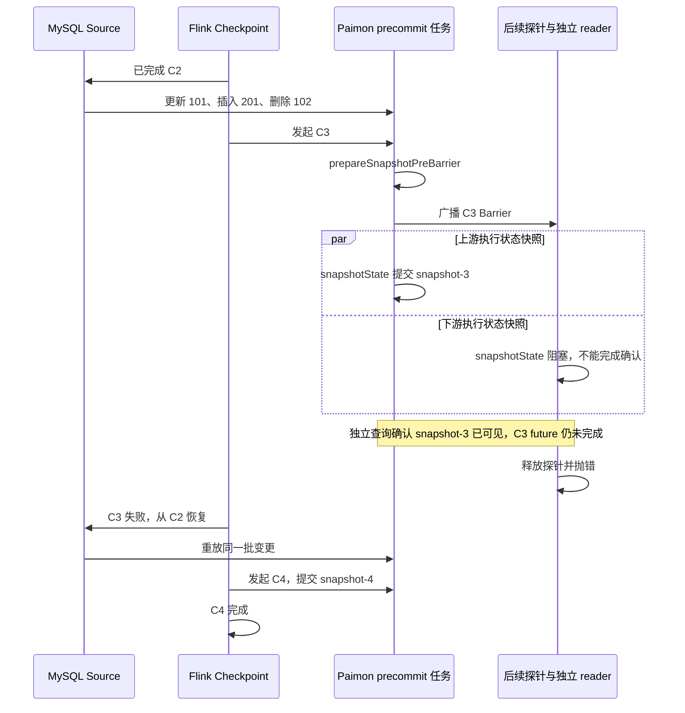

[系列导读与验证材料](/flink-cdc-series/) · [一：一致性边界](/2026/10/18/flink-cdc-1-consistency/) · [二：增量快照](/2026/10/18/flink-cdc-2-incremental-snapshot/) · [三·上：Source 状态机](/2026/10/18/flink-cdc-3a-source-state/) · [三·下：故障恢复](/2026/10/18/flink-cdc-3b-checkpoint-recovery/) · [四：Schema 演进](/2026/10/18/flink-cdc-4-schema-evolution/) · [五：Paimon 提交](/2026/10/18/flink-cdc-5-paimon-commit/)

---

前四篇已经把 Source 的增量快照、恢复进度和 Schema 传播拆开了。到了最后一篇，问题要落在目标端：MySQL 的变更经过 Flink CDC 写入真实 Sink，Checkpoint 失败以后，外部读者究竟会看到什么？

第五篇原始 Checkpoint 故障实验得到三个可以复核的事实：恢复后，目标主键表与 MySQL 全量逐行一致；两个已发布快照中出现了完全相同的一批 changelog；对应 Flink Checkpoint 尚未完成时，目标快照已经可以查询。本文另有 Schema 故障实验；审校补充中对它重新运行并做全量逐字段对账，同时新增“旧布局数据仍在 writer 缓冲时发生 ADD”的正常与故障场景。各组实验的结果分别说明，不把某一组的检查自动套到其他作业。

**范围固定**：Flink CDC release-3.7.0，提交 `045e8da45df4b1017849b04e2d8bfe8f0ed7936d`；Flink 1.20.3、Debezium 1.9.8.Final、Paimon 2.0.0、Java 11.0.29、MySQL 8.4.11。Paimon release-2.0.0 对应提交 `604e6d5e131c74a8d127333a2a3ad6d0319732bf`，关键源码与 Maven sources JAR 做过字节一致性核对。实验日期为 2026-10-18。

## 先给“正确”选择一个可观察的含义

如果只执行 `SELECT *`，最终结果没有多行，通常只能说明主键合并后的当前状态正确。对于读取 changelog 做计数、审计或触发外部动作的消费者，还要检查变更是否重复。对于要求故障期间不可看到未完成数据的读者，还要检查外部可见性与 Flink Checkpoint 完成的关系。

| 要验证的性质 | 应该看什么 | 仅靠最终行数能否判断 |
| --- | --- | --- |
| 当前主键状态一致 | 全量逐主键、逐字段对账，确认无重复可见主键 | 不能，只比较数量太弱 |
| 变更历史不重复 | 实际 changelog、事件标识与重复批次 | 不能 |
| 可见性受完成 Checkpoint 约束 | 阻止 Checkpoint 完成时，独立读取目标 | 不能 |
| Schema 变更可恢复 | 外部 DDL 成功后中断，再检查重放及目标结构 | 不能 |
| 跨表或业务事务原子性 | 多表一致读取和事务边界故障实验 | 不能，本轮未覆盖 |

这里还有一个版本限定：同一提交的 Paimon Pipeline Connector 文档明确声明不支持 exactly-once，采用 at-least-once 与主键表幂等写入。接下来的源码和实验，是解释这句话对应的实际机制，而不是把 Paimon、Flink 或所有 Sink 的语义一并下结论。[同版本 Paimon Connector 使用说明](https://github.com/apache/flink-cdc/blob/045e8da45df4b1017849b04e2d8bfe8f0ed7936d/docs/content/docs/connectors/pipeline-connectors/paimon.md#L149)。

## 选择真实文件系统 Paimon，让提交结果可以直接读取

Paimon 的 filesystem Catalog 不需要额外启动一个数据库服务，但它仍是真实 Sink：writer 生成数据文件，Catalog 持久化 Schema，提交生成 manifest 和 snapshot，独立 reader 从这些文件读取结果。本轮使用专门的仓库目录，保留了全部实验文件，没有用内存 ValuesDatabase 替代目标。

MySQL 使用独占容器，源表为 `cdc_article5.items(id INT PRIMARY KEY, amount INT NOT NULL)`，初始 10 行。作业运行于真实 Flink MiniCluster，Source、SchemaOperator、分区逻辑和 Paimon Sink 都使用固定版本的生产实现；只在边界处增加观察与一次性故障探针。并行度为 1，Paimon bucket 为 1，Schema 模式显式选择 EVOLVE，并开启 `changelog-producer=input` 以便核对变更历史。

这条实验链路通过生产 translator 构造，与本文研究的运行时路径一致；没有经过 CLI YAML 解析和集群分发部署。因此它验证了同 JVM MiniCluster 中的真实数据库、真实文件目标和任务恢复，不验证 Kubernetes、远端存储或物理进程崩溃。

```text
MySQL Pipeline Source
  → SchemaOperator / SchemaCoordinator
  → regular 分区
  → Paimon BucketAssign
  → 按 bucket 重新分区
  → FlushEventAlignment
  → DataSinkWriterOperator / PaimonWriter
  → 按目标表组织 committable
  → PreCommitOperator
  → Paimon Catalog、manifest 与 snapshot
```

Paimon 又增加了一轮 bucket 分区，因此 FlushEvent 也需要在这个拓扑中对齐。`FlushEventAlignmentOperator` 收集同一 Schema 请求对应的 bucket 分配子任务标识，收到所需标识后才输出一个 FlushEvent。否则，某条路径先到的 flush 可能越过另一条路径上的旧数据。本轮 p=1 实际经过此算子；多并行度下所有交错时序没有被本轮实验覆盖。[PaimonEventSink](https://github.com/apache/flink-cdc/blob/045e8da45df4b1017849b04e2d8bfe8f0ed7936d/flink-cdc-connect/flink-cdc-pipeline-connectors/flink-cdc-pipeline-connector-paimon/src/main/java/org/apache/flink/cdc/connectors/paimon/sink/v2/PaimonEventSink.java#L56)、[FlushEventAlignmentOperator](https://github.com/apache/flink-cdc/blob/045e8da45df4b1017849b04e2d8bfe8f0ed7936d/flink-cdc-connect/flink-cdc-pipeline-connectors/flink-cdc-pipeline-connector-paimon/src/main/java/org/apache/flink/cdc/connectors/paimon/sink/v2/bucket/FlushEventAlignmentOperator.java)。

## Paimon 的 flush 是空操作，为什么还能切换 Schema

第四篇解释了通用协议：SchemaOperator 发出 FlushEvent，等待 writers 确认，Coordinator 应用目标 Schema，再让新结构的数据继续流动。到了具体连接器，必须继续追问 writer 的 flush 到底做了什么。

**源码结论**：本版本 `PaimonWriter.flush(boolean)` 的方法体为空。注释说明，Schema 替换时由 StoreSinkWrite.replace 将缓冲内容转成文件。所以收到 flush 确认，并不代表 Paimon 已发布一个包含这些数据的新 snapshot。[PaimonWriter.flush](https://github.com/apache/flink-cdc/blob/045e8da45df4b1017849b04e2d8bfe8f0ed7936d/flink-cdc-connect/flink-cdc-pipeline-connectors/flink-cdc-pipeline-connector-paimon/src/main/java/org/apache/flink/cdc/connectors/paimon/sink/v2/PaimonWriter.java#L221)。

在 writer 之前，还要经过 Paimon 的 BucketAssignOperator。对这里的加列，convertSchemaChangeEvent 读取目标 physicalSchema，并转换为描述物理表结构的 CreateTableEvent 交给下游。恢复后处理数据时，convertDataChangeEvent 也可能先引导这个物理结构，再通过 SchemaDerivator 转换字段。因此 writer 收到的结构事件不一定仍是源端的 AddColumnEvent。[结构事件转换](https://github.com/apache/flink-cdc/blob/045e8da45df4b1017849b04e2d8bfe8f0ed7936d/flink-cdc-connect/flink-cdc-pipeline-connectors/flink-cdc-pipeline-connector-paimon/src/main/java/org/apache/flink/cdc/connectors/paimon/sink/v2/bucket/BucketAssignOperator.java#L228)、[恢复时的数据处理](https://github.com/apache/flink-cdc/blob/045e8da45df4b1017849b04e2d8bfe8f0ed7936d/flink-cdc-connect/flink-cdc-pipeline-connectors/flink-cdc-pipeline-connector-paimon/src/main/java/org/apache/flink/cdc/connectors/paimon/sink/v2/bucket/BucketAssignOperator.java#L268)。

结构事件到达 writer 后，PaimonRecordEventSerializer 更新记录转换所需的结构，并返回需要刷新表结构的标记。PaimonWriter 清除缓存、获取最新 FileStoreTable，然后调用已有 write 的 replace。[PaimonRecordEventSerializer](https://github.com/apache/flink-cdc/blob/045e8da45df4b1017849b04e2d8bfe8f0ed7936d/flink-cdc-connect/flink-cdc-pipeline-connectors/flink-cdc-pipeline-connector-paimon/src/main/java/org/apache/flink/cdc/connectors/paimon/sink/v2/PaimonRecordEventSerializer.java#L65)、[PaimonWriter.write](https://github.com/apache/flink-cdc/blob/045e8da45df4b1017849b04e2d8bfe8f0ed7936d/flink-cdc-connect/flink-cdc-pipeline-connectors/flink-cdc-pipeline-connector-paimon/src/main/java/org/apache/flink/cdc/connectors/paimon/sink/v2/PaimonWriter.java#L141)。

`StoreSinkWriteImpl.replace` 的实际动作是：从旧 writer 提取 checkpoint 状态，关闭旧 writer，以新表结构创建 writer，再恢复这些状态。底层 `AbstractFileStoreWrite.checkpoint()` 会调用各分区、bucket writer 的 prepareCommit，收集文件和待提交增量。这里的 checkpoint 是 Paimon writer 内部状态提取方法，不能直接等同于 Flink 的一次全局完成 Checkpoint。[StoreSinkWriteImpl.replace](https://github.com/apache/flink-cdc/blob/045e8da45df4b1017849b04e2d8bfe8f0ed7936d/flink-cdc-connect/flink-cdc-pipeline-connectors/flink-cdc-pipeline-connector-paimon/src/main/java/org/apache/flink/cdc/connectors/paimon/sink/v2/StoreSinkWriteImpl.java#L211)、[AbstractFileStoreWrite.checkpoint](https://github.com/apache/paimon/blob/604e6d5e131c74a8d127333a2a3ad6d0319732bf/paimon-core/src/main/java/org/apache/paimon/operation/AbstractFileStoreWrite.java#L369)。

因此需要分开理解三个动作：先停止旧结构的数据跨越演进边界，再把旧 writer 的缓冲与增量移交给适配新结构的 writer，最后在数据提交路径上发布 snapshot。Schema 文件已经更新，也不要求这些数据文件此刻已经成为可查询的新快照。

### 实验一：新列已经存在，新数据尚未可见

先完成初始快照和 Checkpoint C1，再将 id=101 的 amount 更新为 11，确认进入 binlog 后完成 C2。此时 Paimon 最新数据快照为 snapshot-2，外部查询得到 `(101,11)`。随后执行：

```sql
ALTER TABLE cdc_article5.items
  ADD COLUMN note VARCHAR(20) AFTER id;

UPDATE cdc_article5.items
  SET note = 'blue', amount = 20
  WHERE id = 101;
```

**实际结果**：没有触发下一次 Checkpoint 时，Paimon Catalog 已能看到 `(id,note,amount)`，Source 观察点也已收到更新；但数据快照仍是 snapshot-2，独立查询得到 `(101,null,11)`。触发 C3 后，查询才变成 `(101,blue,20)`。这直接验证了目标 Schema 的可见性和目标数据的提交可见性并不绑定在一个时刻。

这里没有把“看到 Source 更新”当成“writer 已持久化新行”的证据。关键证据来自真实目标：Schema 变化已经发生，而可查询的数据仍属于旧快照。

### 补充实验：旧布局记录仍在 writer 缓冲时发生 DDL

前一个实验只证明“目标 Schema 已更新，已发布数据仍旧”。要回答旧缓冲能否跨过结构切换，还必须直接确认记录已经进入真实 writer，而且尚未提交。审校补充因此使用独立 MySQL 和同版本 Paimon，再跑正常与故障两条路径；并行度 1、bucket=1、filesystem Catalog、EVOLVE、input changelog，write-buffer-size=8mb。

**观测方法**：探针继承 PaimonWriter，write/flush 仍调用原 super 实现，再以只读反射读取真实 MergeTreeWriter.writeBuffer 的 size。本轮底层实现是 SortBufferWriteBuffer；没有替换 write、replace 或 commit 算法。MetadataApplier 包装器先执行真实 ADD，再用 latch 暂停或抛错。实际类加载位置与五个关键生产文件的固定提交一致性核对都保存在证据中。这是带观测与故障注入的真实链路实验，不是原封不动的 CLI 发行包部署验证。

基线 C2/snapshot-2 完成后，执行更新 id=103、插入 id=202、删除 id=102。确认 DELETE 已到 writer，此时缓冲是 4 条内部记录：UPDATE_BEFORE、UPDATE_AFTER、INSERT、DELETE，并非四行业务数据。writer 缓存结构为 [id,amount]；独立查询仍看到 id=103 的旧值、id=102 存在且没有 id=202。然后执行：

```sql
ALTER TABLE items ADD COLUMN flag VARCHAR(20) AFTER id;
UPDATE items SET flag='blue',amount=20 WHERE id=101;
```

| 观察点 | 正常路径的实际状态 |
| --- | --- |
| DDL 前 | writer 两列；真实缓冲 4；目标 snapshot-2 |
| flush 返回后 | 缓冲仍为 4；没有排空 |
| 真实 ADD 完成、包装器尚未返回 | Catalog 已为 [id,flag,amount]；writer 仍为两列且缓冲 4；snapshot 和已完成 Checkpoint 集合未变 |
| 释放包装器，writer 收到物理 CreateTableEvent | 结构从两列变三列；缓冲从 4 变为 0 |
| 后续 C3 完成 | 当前表完整对账通过；取消作业后用新 Catalog 再读也通过 |

**正常路径结果**：10 行、10 个唯一主键、3 列全部与 MySQL 一致，含 NULL。id=103 为 (103,NULL,13)，id=202 为 (202,NULL,22)，id=102 不存在，id=101 为 (101,blue,20)。缓冲 4→0 支持“这次结构刷新处理了旧缓冲”，但它自身不是提交成功证明；后续完成 Checkpoint 和独立读回才补齐本次可见结果的证据。

**故障路径结果**：第二个独立作业固定同一个“真实 ADD 已成功、writer 仍为旧两列且缓冲 4”窗口，随后抛错。作业进入 attempt=1，从 C2 恢复，真实 ADD 应用入口共调用两次。恢复后 Catalog 已经是三列，BucketAssign 先向新 writer 引导三列物理结构，再把重读的旧 DML 转为该结构，flag 为 NULL。重放 ADD 对应的物理结构刷新再次使缓冲 4→0；C3 完成后及取消作业后的两次全量核对均通过，最终数据与正常路径相同。

这条故障路径依靠的是**旧完成 Checkpoint 之后的数据重放**，不是把故障前尚未快照的内存缓冲恢复出来。BucketAssign 的物理 Schema 引导和字段转换来自[固定源码](https://github.com/apache/flink-cdc/blob/045e8da45df4b1017849b04e2d8bfe8f0ed7936d/flink-cdc-connect/flink-cdc-pipeline-connectors/flink-cdc-pipeline-connector-paimon/src/main/java/org/apache/flink/cdc/connectors/paimon/sink/v2/bucket/BucketAssignOperator.java#L268)，日志则实际记录了三列 writer、重放 DML 和 Schema 刷新。两者结合解释所测 ADD，不能证明任意类型转换、RENAME、复杂 ALTER 或多并行配置同样安全。

初版探针只识别 AddColumnEvent；核对源码后发现 writer 实际接收的是物理 CreateTableEvent，于是补强观察钩子并重新执行两条路径。首轮日志与最终日志均保留；重复执行不增加独立场景数。最终证据见[正常路径缓冲日志](/assets/flink-cdc-series/revision/runs/buffer-normal-final/buffer-observations.txt)、[故障路径缓冲日志](/assets/flink-cdc-series/revision/runs/buffer-failure-final/buffer-observations.txt)。

## DDL 幂等必须逐种操作检查

PaimonMetadataApplier 通过 Catalog 应用 SchemaChangeEvent。目标 Schema 的修改最终进入 Paimon SchemaManager，生成新的 TableSchema 并原子写入相应 Schema 文件；这条调用不等待某次 Flink Checkpoint 完成。[PaimonMetadataApplier](https://github.com/apache/flink-cdc/blob/045e8da45df4b1017849b04e2d8bfe8f0ed7936d/flink-cdc-connect/flink-cdc-pipeline-connectors/flink-cdc-pipeline-connector-paimon/src/main/java/org/apache/flink/cdc/connectors/paimon/sink/PaimonMetadataApplier.java#L174)、[SchemaManager.commitChanges / commit](https://github.com/apache/paimon/blob/604e6d5e131c74a8d127333a2a3ad6d0319732bf/paimon-core/src/main/java/org/apache/paimon/schema/SchemaManager.java#L259)。

**源码结论**：CREATE 使用忽略已存在的创建方式；ADD 遇到 ColumnAlreadyExistException 会记录警告并返回；DROP 对表或列不存在的异常会跳过；RENAME 遇到相关不存在或已存在异常则包装为 SchemaEvolveException。它们没有统一的“所有 DDL 自动幂等”规则。[CREATE 与 ADD 分支](https://github.com/apache/flink-cdc/blob/045e8da45df4b1017849b04e2d8bfe8f0ed7936d/flink-cdc-connect/flink-cdc-pipeline-connectors/flink-cdc-pipeline-connector-paimon/src/main/java/org/apache/flink/cdc/connectors/paimon/sink/PaimonMetadataApplier.java#L211)、[DROP 与 RENAME 分支](https://github.com/apache/flink-cdc/blob/045e8da45df4b1017849b04e2d8bfe8f0ed7936d/flink-cdc-connect/flink-cdc-pipeline-connectors/flink-cdc-pipeline-connector-paimon/src/main/java/org/apache/flink/cdc/connectors/paimon/sink/PaimonMetadataApplier.java#L343)。

这还需要区分两种幂等概念。重复执行同一个已经成功的 ADD，目标保持原状，是有用的恢复能力。但“列名存在就返回”不一定验证列类型、位置以及同一个事件中其他列是否符合要求。仅看方法没有抛错，可能高估了目标结构的一致性。

### 实验二：真实 ADD 成功后抛错，再走真实重试

沿用前面的作业，在 C3 后继续为源表添加 flag，并更新数据：

```sql
ALTER TABLE cdc_article5.items
  ADD COLUMN flag VARCHAR(20) AFTER note;

UPDATE cdc_article5.items
  SET flag = 'yes', amount = 30
  WHERE id = 101;
```

故障 wrapper 每次都调用真实 PaimonMetadataApplier。第一次添加 flag 成功后，wrapper 故意抛 RuntimeException，使作业恢复；第二次调用也进入真实 delegate，没有模拟“第二次直接成功”。

**实际结果**：作业进入 attempt=1，恢复点是 flag 出现之前的 C3；flag 的应用入口被调用两次。真实 Catalog 在重放时识别列已存在，链路继续运行，C4 后目标得到 `(101,blue,yes,30)`。最后再插入 id=201、删除 id=102，C5 后目标仍为 10 行，新增和删除均符合预期。

这比第四篇的内存目标实验多验证了一层：重复 ADD 的成功处理来自真实连接器与真实 Catalog。但结论仍只覆盖所测 ADD 和表结构，不能扩展成 RENAME、复杂 ALTER 或所有目标系统都能这样恢复。

### 补充核对：Schema 作业的全部行与全部字段

原 Schema 实验的关键行断言还不足以证明全量一致。审校补充在新建 MySQL 中重新执行同一场景：先加 note，完成 C3；再加 flag，真实 DDL 成功后抛错；恢复后再次调用真实 ADD，完成 C4；插入 id=201、删除 id=102，完成 C5。随后取消作业，以新 Catalog 读取 Paimon，并与源库 SELECT * 的完整结果比较。这是同场景重跑，不能追溯宣称已删除的原 MySQL 实例此前做过这项核对。

**实际结果**：字段名与顺序均为 [id,note,flag,amount]，10 行、10 个唯一主键、全部 4 列一致。id=101 为 (101,blue,yes,30)，id=201 为 (201,green,ok,40)，id=103..110 的 note、flag 均为真正的 NULL，amount=10；id=102 不存在。

对账在构造按主键索引时显式检查重复键，比较每一行的每个类型值及 NULL，不以行数、关键行或哈希替代完整数据。覆盖的类型是本表的 INT 与 VARCHAR；没有验证全部类型映射，也没有在此场景另外扫描 changelog。因此这补齐的是当前主键表结果，不能证明变更历史只出现一次。[完整源目标结果](/assets/flink-cdc-series/revision/runs/schema/schema-full-reconciliation.txt)。

### 六组 Catalog 检查：返回成功不总是满足目标结构

另一个独立实验直接调用真实 MetadataApplier，使用单独的 filesystem Catalog。输入是人工构造的框架事件，没有伪造 Catalog；它用于隔离验证 API 边界，不计为 MySQL 端到端作业。

| 检查 | 实际结果 | 能支持的结论 |
| --- | --- | --- |
| 同一个 CREATE 重复执行 | 返回成功 | 已有表的创建重试可被接受 |
| 相同 ADD note VARCHAR(20) 重复执行 | 返回，Schema ID 不变 | 所测相同 ADD 可重试 |
| note 已为 VARCHAR(20)，再 ADD note BIGINT | 返回，实际仍是 VARCHAR(20) | 名称存在不等于请求类型已满足 |
| 一个 ADD 事件包含已存在的 note 和不存在的 extra | 返回，extra 仍不存在 | 捕获已有列异常不等于逐列验证完成 |
| RENAME note→memo 重复执行 | 第二次抛 SchemaEvolveException | 不能套用 ADD 的重试结论 |
| DROP memo 重复执行 | 返回，memo 不存在 | 所测删除重试可被接受 |

后两种 ADD 检查刻意构造了目标前置状态，不能写成“本轮 MySQL 同步自然产生了缺列”。它们揭示的是更窄但实用的边界：要判断幂等恢复，除了看异常处理，还要检查操作后的目标结构是否达到预期。

本轮没有继续修改连接器或替这些差异补偿；不同模式、已有目标校验配置及真实业务表约束，都需要在具体部署中继续核实。

## 真正的提交发生在哪里：不要停在 Sink V2 的接口名字上

看到 PaimonSink 实现 TwoPhaseCommittingSink，很容易直接画出“writer 准备文件，Checkpoint 全局成功，committer 才发布”的流程。但接口名字不能替代调用链。本版本 CDC Pipeline 的关键路径在自定义 precommit 拓扑。

### 从文件增量到实际 Checkpoint ID

**源码结论**：`PaimonWriter.prepareCommit()` 调用各表 write 的 prepareCommit，返回 MultiTableCommittable，其中携带表标识、文件提交消息和暂用的 checkpoint identifier。writer 使用 lastCheckpointId+1 推进内部标识，不能据此假定实际 Flink Checkpoint ID 永远连续。[PaimonWriter.prepareCommit](https://github.com/apache/flink-cdc/blob/045e8da45df4b1017849b04e2d8bfe8f0ed7936d/flink-cdc-connect/flink-cdc-pipeline-connectors/flink-cdc-pipeline-connector-paimon/src/main/java/org/apache/flink/cdc/connectors/paimon/sink/v2/PaimonWriter.java#L110)。

`PaimonSink.addPreCommitTopology()` 随后按目标表组织这些消息，并添加 PreCommitOperator。后者在 `prepareSnapshotPreBarrier(checkpointId)` 中把消息上的标识替换为实际 Checkpoint ID。这一步使被跳过、失败或不连续的 Checkpoint ID 能与真正触发的 barrier 对齐。[PaimonSink.addPreCommitTopology](https://github.com/apache/flink-cdc/blob/045e8da45df4b1017849b04e2d8bfe8f0ed7936d/flink-cdc-connect/flink-cdc-pipeline-connectors/flink-cdc-pipeline-connector-paimon/src/main/java/org/apache/flink/cdc/connectors/paimon/sink/v2/PaimonSink.java#L134)。

最关键的调用在 PreCommitOperator.snapshotState：它直接调用 commitUpToCheckpoint，后者组合消息后执行 StoreMultiCommitter.commit，再清空本轮列表。也就是说，外部数据提交发生在这个算子执行 Checkpoint 的过程中；全局 Checkpoint 仍要等待其他算子的状态和确认。[PreCommitOperator](https://github.com/apache/flink-cdc/blob/045e8da45df4b1017849b04e2d8bfe8f0ed7936d/flink-cdc-connect/flink-cdc-pipeline-connectors/flink-cdc-pipeline-connector-paimon/src/main/java/org/apache/flink/cdc/connectors/paimon/sink/v2/PreCommitOperator.java#L121)。

这个路径中的 StoreMultiCommitter 按表组织消息，依次调用各表 StoreCommitter；后者调用 TableCommitImpl.commitMultiple，最终进入 FileStoreCommitImpl 发布快照。表的持久化状态可以在这个调用成功后被外部读者看到。遍历多张表的提交循环也不能自行推导出跨表原子性。[StoreMultiCommitter.commit](https://github.com/apache/paimon/blob/604e6d5e131c74a8d127333a2a3ad6d0319732bf/paimon-flink/paimon-flink-common/src/main/java/org/apache/paimon/flink/sink/StoreMultiCommitter.java#L144)、[TableCommitImpl](https://github.com/apache/paimon/blob/604e6d5e131c74a8d127333a2a3ad6d0319732bf/paimon-core/src/main/java/org/apache/paimon/table/sink/TableCommitImpl.java#L274)。

### 为什么读到 filterAndCommit 还不够

仓库里确实存在另一个类 PaimonCommitter，它调用 StoreMultiCommitter.filterAndCommit，成功后确认请求，异常时请求稍后重试。但当前 PreCommitOperator 消费 committable 并在 snapshotState 中直接提交，没有把这些待提交消息继续输出给后面的 committer。不能只精读 PaimonCommitter，就认为所研究的普通流式 Pipeline 一定由它完成最终发布。[PaimonCommitter](https://github.com/apache/flink-cdc/blob/045e8da45df4b1017849b04e2d8bfe8f0ed7936d/flink-cdc-connect/flink-cdc-pipeline-connectors/flink-cdc-pipeline-connector-paimon/src/main/java/org/apache/flink/cdc/connectors/paimon/sink/v2/PaimonCommitter.java#L53)、[DataSinkTranslator 的拓扑衔接](https://github.com/apache/flink-cdc/blob/045e8da45df4b1017849b04e2d8bfe8f0ed7936d/flink-cdc-composer/src/main/java/org/apache/flink/cdc/composer/flink/translator/DataSinkTranslator.java#L190)。

底层 `FileStoreCommitImpl.filterCommitted` 会查找同一 commitUser 的最新 snapshot，并据 commitIdentifier 过滤已经处理的提交。这是一种提交标识层面的去重机制，不是对每条业务变更的内容做去重。而本轮失败 C3 后重放的数据由 C4 再次提交，identifier 已经不同。就算理解了底层过滤规则，也不能把它自动升级为整个源到目标的事件去重保证。[FileStoreCommitImpl.filterCommitted](https://github.com/apache/paimon/blob/604e6d5e131c74a8d127333a2a3ad6d0319732bf/paimon-core/src/main/java/org/apache/paimon/operation/FileStoreCommitImpl.java#L274)。

另外，FileStoreCommitImpl 在一次提交尝试结果不确定后的重试路径，也会检查相关 snapshot 的 commitUser、identifier 和 commitKind。这属于提交尝试自身的恢复防护，同样不意味着一个新的 Checkpoint 会识别“这些行与上一个失败 Checkpoint 的业务内容相同”。[FileStoreCommitImpl.tryCommitOnce](https://github.com/apache/paimon/blob/604e6d5e131c74a8d127333a2a3ad6d0319732bf/paimon-core/src/main/java/org/apache/paimon/operation/FileStoreCommitImpl.java#L910)。

### 恢复状态并不是外部目标的回滚镜像

PaimonWriter.snapshotState 返回的 PaimonWriterState 保存 commitUser；restoreWriter 从恢复状态取得这个身份，并从 Flink 的恢复上下文取得 lastCheckpointId，重新构造 writer。这个状态对象没有保存一份可把已发布 snapshot 或 Schema 文件撤销的外部事务镜像。[PaimonWriterState](https://github.com/apache/flink-cdc/blob/045e8da45df4b1017849b04e2d8bfe8f0ed7936d/flink-cdc-connect/flink-cdc-pipeline-connectors/flink-cdc-pipeline-connector-paimon/src/main/java/org/apache/flink/cdc/connectors/paimon/sink/v2/PaimonWriterState.java)、[PaimonSink.restoreWriter](https://github.com/apache/flink-cdc/blob/045e8da45df4b1017849b04e2d8bfe8f0ed7936d/flink-cdc-connect/flink-cdc-pipeline-connectors/flink-cdc-pipeline-connector-paimon/src/main/java/org/apache/flink/cdc/connectors/paimon/sink/v2/PaimonSink.java#L95)。

Source 恢复自己的位点和表结构，SchemaCoordinator 恢复自己的原始与目标结构认知，Sink 恢复必要的写入身份与进度；外部 Catalog 和 snapshot 则可能已经走到更晚的位置。第四篇的 Schema 重放窗口与本篇的数据重放窗口，都是由这两种状态推进方式之间的差异产生的。

至此，源码给出了一个待验证的窗口：目标快照已经发布，但 Flink 全局 Checkpoint 尚未完成。如果此时失败，Source 从旧 Checkpoint 重放，而目标已发布的快照不会仅因这个 Flink Checkpoint 失败就自动消失。

## 实验三：snapshot 已发布，Checkpoint 尚未完成

原始验证中的第二个端到端作业（Checkpoint 故障场景）使用新的仓库与重新创建的 MySQL 表。先得到同样的 C2 基线：10 行，id=101 的 amount=11。接着依次执行三个独立操作：将 101 更新为 20、插入 `(201,40)`、删除 102。这里没有把这三条语句包装成一个跨表或多语句业务事务。

本次故障探针放在生产 precommit 拓扑之后。它不改写 Paimon 的提交方法，而是在后续观察算子的 snapshotState 中阻塞，使这个 Checkpoint 无法获得全部确认。测试线程在阻塞期间独立打开 Paimon Catalog 读取目标，随后释放阻塞并抛错。



该图将 Barrier 传递与外部提交分开：Flink 1.20.3 的任务路径先执行 prepareSnapshotPreBarrier，再广播 Barrier，随后进行状态快照。上游提交与下游探针阻塞之间不由 Barrier 建立“提交已完成”的前提；本实验以阻塞期间的独立目标查询确认提交结果。[SubtaskCheckpointCoordinatorImpl](https://github.com/apache/flink/blob/release-1.20.3/flink-streaming-java/src/main/java/org/apache/flink/streaming/runtime/tasks/SubtaskCheckpointCoordinatorImpl.java#L330)。

**实际结果**：探针阻塞时，触发 Checkpoint 的 future 仍未完成，完成回调列表为 `[1,2]`；Paimon 已存在 snapshot-3，独立查询已经看到 101=20、201=40，而且 102 已消失。这不是根据日志推测可见性，而是直接读取真实目标文件得到的结果。

释放探针并抛错后，作业进入 attempt=1。Source 后的状态探针从旧 Checkpoint 恢复到 11 条已处理数据记录——10 条快照行加第一次更新；原始投递轨迹随后再次出现更新 101、插入 201、删除 102。此时 snapshot-3 仍然存在，其新结果仍可读取。

接下来触发 C4。最终完成回调列表为 `[1,2,4]`，Paimon 新增 snapshot-4。两个快照中的 commitUser 相同，commitIdentifier 分别为 3 和 4。

| 观察点 | Flink 已完成 Checkpoint | Paimon 最新 snapshot | id=101 | id=201 | id=102 |
| --- | --- | --- | ---: | ---: | --- |
| 基线 | 1、2 | 2 | 11 | 不存在 | 存在 |
| C3 被阻塞 | 1、2 | 3 | 20 | 40 | 不存在 |
| C3 失败并重启，尚未重新提交 | 1、2 | 3 | 20 | 40 | 不存在 |
| 重放并完成 C4 | 1、2、4 | 4 | 20 | 40 | 不存在 |

本轮因此实际确认了“外部可见性可能早于全局 Checkpoint 完成”和“恢复会重放该窗口内的源变更”。但单看这张结果表，还不能判断目标记录历史究竟有没有重复，必须继续读 changelog。

## 最终主键表正确，changelog 却重复了

作业结束后，独立启动 reader，重新打开 filesystem Catalog。先做普通全量扫描，再从 snapshot-3 开始读取 input changelog，并分别取出 snapshot-3 与 snapshot-4 的变更。

**实际回读结果**：普通扫描得到 10 行、10 个不同主键，与此时 MySQL 查询结果逐字段完全相同；两份 changelog 却各自包含下面四条记录：

```text
snapshot-3                       snapshot-4
DELETE        102,10              DELETE        102,10
INSERT        201,40              INSERT        201,40
UPDATE_BEFORE 101,11              UPDATE_BEFORE 101,11
UPDATE_AFTER  101,20              UPDATE_AFTER  101,20
```

上表为便于比较而排序展示，不代表原始全局事件排序。重复性来自真实 changelog 内容比较；不是把两条 Source 日志、两次函数调用或两个文件名当成重复业务变更。

为什么当前表仍正确？本轮是主键表，采用默认 deduplicate 合并方式。对同一个主键重复写入同一份最终值，合并查询仍可得到相同结果；删除同一主键也能保持不存在的状态。Paimon 的 DeduplicateMergeFunction 保留当前合并顺序中的最新记录。这个属性与“记录只写入过一次”不同。[DeduplicateMergeFunction](https://github.com/apache/paimon/blob/604e6d5e131c74a8d127333a2a3ad6d0319732bf/paimon-core/src/main/java/org/apache/paimon/mergetree/compact/DeduplicateMergeFunction.java#L29)。

用一个受限的表达式描述：在本轮确定的主键、完整行值和顺序条件下，重复写入 `put(k,v)` 可以得到相同的最终主键状态。但把 changelog 中的 INSERT 直接计数、把变更金额直接累加，或者每收到一条变更就执行外部动作，并不天然满足这种幂等性。本轮没有运行这些下游消费者，不能把推导出的风险说成已经观测到的业务损失。

snapshot 元数据也要慎读：本例 snapshot-4 的 totalRecordCount 为 17，而合并后的业务查询是 10 行。文件/快照中的记录统计并不等于当前主键表的逻辑行数。只根据 snapshot JSON 中一个 count 字段判断重复行或对账成功，都可能误判。

因此，“MySQL 与 Paimon 主键表当前状态一致”是本轮已经验证的结果；“Paimon changelog 只包含一次源变更”则被本轮故障实验否定。两者不能互相替代。

## 把源码结论、实验结果和未覆盖场景放在同一张表里

| 问题 | 源码支持的结论 | 实际证据及适用范围 |
| --- | --- | --- |
| flush 是否排空或提交数据 | PaimonWriter.flush 为空；Schema 替换另有状态移交流程 | 补充实验中 flush 前后旧布局缓冲均为 4；目标 Schema 已变，旧 snapshot 仍可查询 |
| 旧缓冲怎样跨越 Schema 更新 | replace 提取待提交状态并重建 writer | 正常 ADD 后物理结构更新使缓冲 4→0；后续完成 Checkpoint 及取消后读回均对账一致 |
| DDL 已成功而 writer 尚未更新时如何恢复 | 旧 Checkpoint 重读；BucketAssign 按物理结构转换数据；ADD 具有特定重复处理分支 | 补充故障实验重放旧 DML、真实 ADD 入口两次、10 行 × 3 列一致 |
| 相同 ADD 能否重试 | 已存在列异常被跳过 | 原 Schema 场景及补充重跑均恢复成功；重跑后 10 行 × 4 列对账一致 |
| 所有 DDL 是否都幂等 | CREATE、ADD、DROP、RENAME 分支不同 | 直接 Catalog 检查：重复 RENAME 抛错；两类 ADD 冲突返回却未满足全部请求结构 |
| 提交是否一定等全局 Checkpoint 完成 | PreCommitOperator.snapshotState 直接提交 | 原 Checkpoint 故障实验中，C3 未完成时 snapshot-3 可查询 |
| Checkpoint 失败会否回滚目标 snapshot | 此链路没有随该失败自动回滚目标的协议 | 同一实验中，C3 失败并重启后 snapshot-3 仍可读 |
| 恢复后当前表是否正确 | 所测主键合并和重放路径可承接重复写入 | 各实验分别核对当前表；补充三场景全部行、字段、NULL 与源库一致 |
| 变更是否只出现一次 | 不能由主键合并或 Sink V2 名称推出 | 原 Checkpoint 故障实验的 snapshot-3/4 各有同样四条 changelog；本次 Schema/缓冲实验未另扫 changelog |

原始验证包括 43 个对象/组件测试、2 个真实 MySQL → Paimon MiniCluster 作业、6 组直接 Catalog 边界检查，以及独立持久化回读。审校补充新增两种缓冲场景，并将既有 Schema 场景重跑以补齐全量逐字段对账；补强观察钩子后的重复运行不计为新增场景。本轮没有重跑全部 43 个既有测试。这些是不同证据单位，不能合并宣称为几十次完整端到端恢复实验。

第一次端到端启动曾遇到 classpath 冲突：Paimon 大包携带的 JdbcConnectionPools 使用 shaded HikariDataSource，实验加载的当前 CDC 接口则使用未 shaded 类型，导致 AbstractMethodError。核对类来源后，仅将固定版本编译目录放到依赖 JAR 之前，最终实验通过。首次失败保留在证据目录，属于实验装配问题，没有算作 CDC 恢复结论。

原始及补充实验均未覆盖多并行度与多 Chunk 异构 HIGH 的真实 Sink 故障组合、多表事务及跨表原子提交、S3/HDFS/Hive Catalog、非主键或其他 merge engine、物理 JM/TM kill、Savepoint/版本迁移、所有 DDL 和所有故障位置。本次补齐的是单并行度、单 bucket、主键表、所测 ADD 的缓冲窗口与当前表对账；未增加 changelog 唯一性验证。尤其不能把本篇 Pipeline Connector 的结论直接推广到 Paimon 原生 Flink SQL Sink 或其他写入入口。那些路径需要重新跟踪实际提交调用和故障行为。

## 五篇文章最终落在什么判断方法上

第一篇提出一致性的观察边界；第二篇把快照与日志拼接到一条可解释的时间线上；第三篇检查 Source 状态、分配和恢复；第四篇加入 Schema 的捕获与传播；第五篇把恢复进度与真实外部结果放在一起验证。任何一层的局部正确，都不能替其他层签发保证。

评估一条实际 CDC 任务，可以按四个顺序递进的问题开展：恢复后从哪里重读；用什么 Schema 解释这些记录；目标写入在哪个时刻可见；重复出现时哪个具体机制使结果仍可接受。若最后一个问题的答案只是“有主键”，就应继续检查业务真正消费的是当前表、changelog，还是外部副作用。

对本篇固定版本和配置，可以准确表达的结论是：**所测故障中 Source 从已完成的 Checkpoint 恢复；原 Checkpoint 故障窗口允许目标快照先可见并重复记录 changelog；该实验以及补充 Schema、缓冲实验的主键表最终状态分别经对账确认正确。** 这与该版本文档声明的 at-least-once 加主键幂等写入相符。若需求还包含变更历史不重复或完成 Checkpoint 之前不可见，就需要继续设计并验证相应协议；新增当前表对账不能证明这些要求。

## 整个系列的验证范围

全系列 CDC 源码统一固定到 release-3.7.0 的 045e8da45df4b1017849b04e2d8bfe8f0ed7936d，运行主线为 Flink 1.20.3、Java 11.0.29、MySQL 8.4.11；Debezium 依赖为 1.9.8.Final，但 CDC 内置改写类必须按固定提交阅读。第五篇另固定 Paimon 2.0.0。第三个主题拆成上下两个阅读单元，仍按同一组验证统计。

| 主题 | 源码或论文支持的内容 | 已执行的证据 | 不能由这些证据推出的结论 |
| --- | --- | --- | --- |
| 第一篇：一致性边界 | 位点、快照归一、事务事件与外部结果的区别 | 18 项 Java 测试；3 组独立真实 MySQL 验证，包括读取视图、提交边界、重复写入模型 | 没有运行 CDC 到外部 Sink 作业；数据库模型不构成 CDC 端到端证明 |
| 第二篇：增量快照 | 对照 DBLog 讨论 LOW/HIGH、回填、从最小 HIGH 追赶及分片过滤 | 8 项工具单测 + 5 项真实 MySQL Reader 测试；多 Chunk 使用手工 metadata、顺序读取 | 不覆盖真实并行分配、故障恢复与外部 Sink 的组合；论文算法与具体实现的前提不能混用 |
| 第三篇上、下：状态与恢复 | Reader/Enumerator 状态、Split 归属、完成确认、Checkpoint 门槛及恢复 | 合计 51 项对象/序列化测试 + 2 个真实 MySQL MiniCluster 故障作业；下游为受管内存 ListState | 两篇不重复计数；所测事务恢复点在整笔事务之前，未验证事务内部 event/row Checkpoint；没有真实外部 Sink 或物理进程 kill |
| 第四篇：Schema 捕获与传播 | DDL 解码、Schema 事件、Coordinator、flush 确认、状态恢复 | 原始 33 项对象/解析器/算子测试 + 2 个模拟源/内存目标作业 + 5 个真实 MySQL Source 作业 | 原始 40 项中没有真实外部 Sink；内存目标重复 ADD 不证明真实 DDL 幂等；Source 动态 Struct 不等于 SQL 动态迁移 |
| 第五篇：外部提交与恢复 | Paimon flush、replace、DDL 分支、precommit snapshot 发布 | 原始 43 项组件测试、2 个真实 MySQL → Paimon 作业、6 组 Catalog 检查；Checkpoint 场景当前表对账及两个快照的重复 changelog | p=1、bucket=1、主键表和 filesystem 的结果不能推广到所有入口、存储后端或故障位置；主键表正确不等于历史无重复 |
| 本次补充：缓冲与完整字段核对 | BucketAssign 物理 Schema、旧缓冲状态移交、恢复后的字段转换 | 新增正常/故障两种缓冲场景；原 Schema 场景重跑补齐全量对账；分别 10 行 × 3 列、10 行 × 3 列、10 行 × 4 列，均通过 | 重跑不算新增独立覆盖；未重跑全部历史组件测试；未另查新增场景的 changelog，也未验证复杂 DDL 或其他并行配置 |

表中的“测试”“数据库探针”“MiniCluster 作业”和“Catalog 直接调用”是不同证据单位，不能相加成一个端到端通过数。整条推理还依赖各篇明确的条件：例如第二篇的稳定主键与 Chunk key、扫描期间 Schema 不变、默认开启回填，不能被第四篇研究过运行期 Schema 演进这一事实自动解除。

跨篇组合中仍为 **evidence_incomplete** 的重点是：真实并行多 Chunk、不同 HIGH、Schema 演进与 Paimon 故障同时发生；事务内部 event/row 恢复；快照中 DDL；多操作部分成功后的恢复；多表原子性；物理 JM/TM/HA 故障；扩缩容和版本迁移。现有结果提供可复核的局部与特定端到端事实，没有证明这些条件任意组合都成立。

## 源码阅读路线与实验材料

源码建议依次阅读：PaimonDataSink → PaimonEventSink → BucketAssignOperator 的物理 Schema 与字段转换 → PaimonRecordEventSerializer → PaimonWriter → StoreSinkWriteImpl.replace → PaimonSink.addPreCommitTopology → PreCommitOperator → StoreMultiCommitter → TableCommitImpl → FileStoreCommitImpl。再单独阅读 PaimonMetadataApplier 的四种 DDL 异常分支，以及 Paimon SchemaManager 的 Schema 文件提交路径。前文链接均固定到本轮提交。

作者本地的原始证据保存了三个 Java 探针、实际执行计划、原始日志、43 个测试的 Surefire 报告、各阶段目标查询、快照摘要、完整实验仓库和重放入口。见 [实验 README](/flink-cdc-series/#evidence-5)、[持久化回读与逐行对账](/assets/flink-cdc-series/article-05/durable-readback-results.txt)、[快照摘要](/assets/flink-cdc-series/article-05/snapshot-summary.json)。原始实验的临时 MySQL 已停止并删除，Paimon 实验文件保留；未修改生产源码。

本次审校补充在本地单独保存探针改动、实际运行命令、缓冲观察、源目标全部字段和 Paimon warehouse，见[补充证据 README](/flink-cdc-series/#evidence-revision)、[三场景结果索引](/assets/flink-cdc-series/revision/result-summary.json)。上述链接提供公开子集，完整日志与 warehouse 保留于作者本地。旧证据未被覆盖；补充的当前表核对和原 Checkpoint 场景的重复 changelog 证据保持分开。

前文：[第四篇：Schema 演进的捕获、传播与恢复](/2026/10/18/flink-cdc-4-schema-evolution/)；[第三篇下：Checkpoint 恢复与故障窗口](/2026/10/18/flink-cdc-3b-checkpoint-recovery/)。

---

[系列导读与验证材料](/flink-cdc-series/) · [一：一致性边界](/2026/10/18/flink-cdc-1-consistency/) · [二：增量快照](/2026/10/18/flink-cdc-2-incremental-snapshot/) · [三·上：Source 状态机](/2026/10/18/flink-cdc-3a-source-state/) · [三·下：故障恢复](/2026/10/18/flink-cdc-3b-checkpoint-recovery/) · [四：Schema 演进](/2026/10/18/flink-cdc-4-schema-evolution/) · [五：Paimon 提交](/2026/10/18/flink-cdc-5-paimon-commit/)
