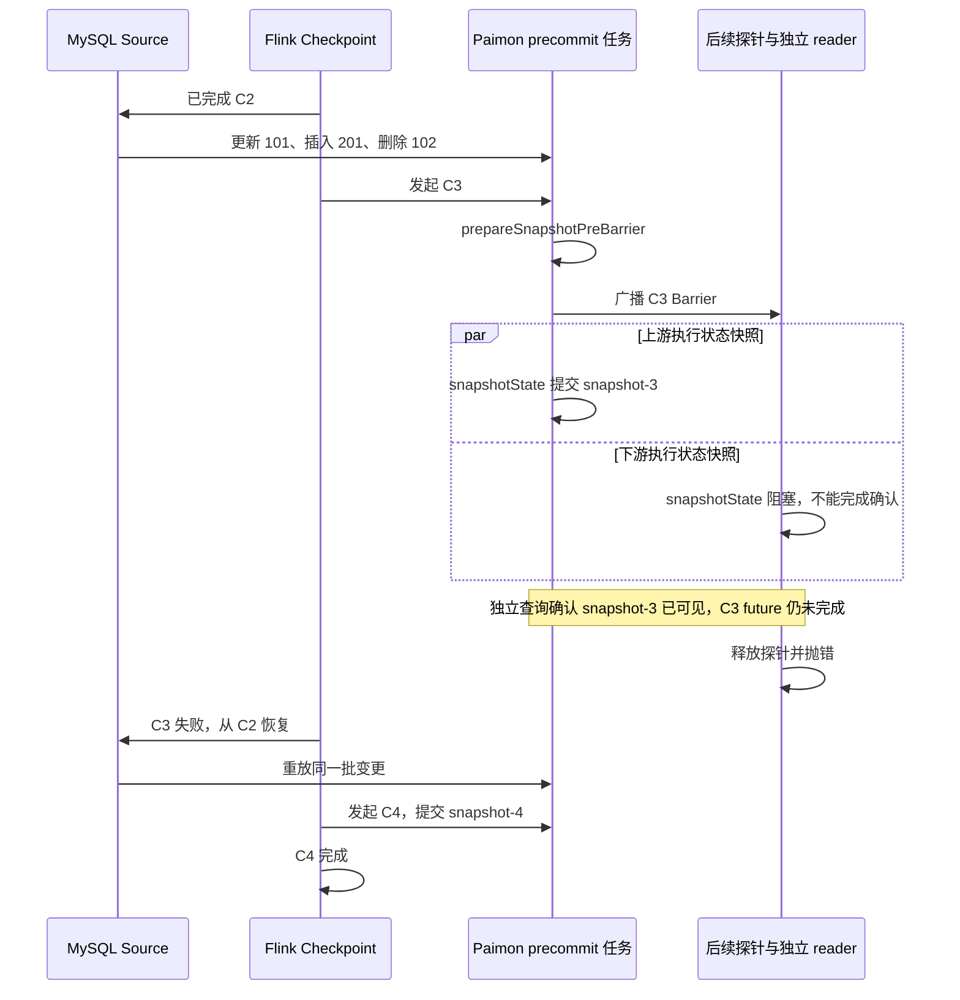

[系列导读与验证材料](/flink-cdc-series/) · [一：一致性边界](/2026/10/18/flink-cdc-1-consistency/) · [二：增量快照](/2026/10/18/flink-cdc-2-incremental-snapshot/) · [三·上：Source 状态机](/2026/10/18/flink-cdc-3a-source-state/) · [三·下：故障恢复](/2026/10/18/flink-cdc-3b-checkpoint-recovery/) · [四：Schema 演进](/2026/10/18/flink-cdc-4-schema-evolution/) · [五：Paimon 提交](/2026/10/18/flink-cdc-5-paimon-commit/) · [Pekko CDC 项目系列](/pekko-cdc-series/)

---

前四篇讨论了 Source、Checkpoint 与 Schema 传播。本篇把问题落到真实目标：MySQL 的变更写入 Paimon 后，writer 缓冲何时处理，Schema 何时切换，数据何时可见，失败后又从哪里恢复？

实验得到的关键区别是：**最终主键表与 MySQL 一致，不代表 changelog 没有重复，也不代表数据只在全局 Checkpoint 完成后可见。** 下文按 writer 缓冲 → Schema 切换 → 提交 → 恢复展开。正文保留机制与关键结果，实验步骤、补充核对及修订过程集中在附录。

**范围固定**：Flink CDC release-3.7.0，提交 `045e8da45df4b1017849b04e2d8bfe8f0ed7936d`；Flink 1.20.3、Debezium 1.9.8.Final、Paimon 2.0.0、Java 11.0.29、MySQL 8.4.11。Paimon release-2.0.0 对应提交 `604e6d5e131c74a8d127333a2a3ad6d0319732bf`，关键源码与 Maven sources JAR 做过字节一致性核对。实验日期为 2026-10-18。

这里还有一个版本限定：同一提交的 Paimon Pipeline Connector 文档明确声明不支持 exactly-once，采用 at-least-once 与主键表幂等写入。接下来的源码和实验，是解释这句话对应的实际机制，而不是把 Paimon、Flink 或所有 Sink 的语义一并下结论。[同版本 Paimon Connector 使用说明](https://github.com/apache/flink-cdc/blob/045e8da45df4b1017849b04e2d8bfe8f0ed7936d/docs/content/docs/connectors/pipeline-connectors/paimon.md#L149)。

原 Schema/提交实验使用独占 MySQL 容器、真实 Flink MiniCluster 和 filesystem Paimon Catalog。初始表为 `cdc_article5.items(id INT PRIMARY KEY, amount INT NOT NULL)`，共 10 行；并行度 1、bucket=1、Schema 模式 EVOLVE，开启 `changelog-producer=input`。生产 translator 串起 Source、SchemaOperator、分区与 Sink，边界处加入观察和一次性故障探针。目标生成真实数据文件、Schema、manifest 与 snapshot，由独立 reader 读取。

这验证的是同 JVM MiniCluster 的真实源、真实文件目标与任务恢复；没有覆盖 CLI YAML 解析、集群分发或物理进程崩溃。补充缓冲实验的观测方式见[附录 A](#appendix-buffer)；另新增的 20 行跨 Chunk 迁移作业见[附录 G](#appendix-chunk-e2e)，与原恢复场景分开记录。

## 一、writer 缓冲：flush 确认不等于排空

第四篇中的 FlushEvent 是 Schema 演进协议的一部分：SchemaOperator 等待 writers 确认后，Coordinator 才应用目标 Schema。确认的具体含义仍取决于 Sink 实现。

**源码结论**：本版本 `PaimonWriter.flush(boolean)` 的方法体为空。注释说明，Schema 替换时由 StoreSinkWrite.replace 将缓冲内容转成文件。所以收到 flush 确认，并不代表 Paimon 已发布一个包含这些数据的新 snapshot。[PaimonWriter.flush](https://github.com/apache/flink-cdc/blob/045e8da45df4b1017849b04e2d8bfe8f0ed7936d/flink-cdc-connect/flink-cdc-pipeline-connectors/flink-cdc-pipeline-connector-paimon/src/main/java/org/apache/flink/cdc/connectors/paimon/sink/v2/PaimonWriter.java#L221)。

`StoreSinkWriteImpl.replace` 的实际动作是：从旧 writer 提取 checkpoint 状态，关闭旧 writer，以新表结构创建 writer，再恢复这些状态。底层 `AbstractFileStoreWrite.checkpoint()` 会调用各分区、bucket writer 的 prepareCommit，收集文件和待提交增量。这里的 checkpoint 是 Paimon writer 内部状态提取方法，不能直接等同于 Flink 的一次全局完成 Checkpoint。[StoreSinkWriteImpl.replace](https://github.com/apache/flink-cdc/blob/045e8da45df4b1017849b04e2d8bfe8f0ed7936d/flink-cdc-connect/flink-cdc-pipeline-connectors/flink-cdc-pipeline-connector-paimon/src/main/java/org/apache/flink/cdc/connectors/paimon/sink/v2/StoreSinkWriteImpl.java#L211)、[AbstractFileStoreWrite.checkpoint](https://github.com/apache/paimon/blob/604e6d5e131c74a8d127333a2a3ad6d0319732bf/paimon-core/src/main/java/org/apache/paimon/operation/AbstractFileStoreWrite.java#L369)。

**实验结果**：在旧结构 `[id,amount]` 下，更新、插入和删除共留下 4 条内部记录，分别是 UPDATE_BEFORE、UPDATE_AFTER、INSERT、DELETE。真实 writer 的 flush 返回后，缓冲仍为 4；收到后续物理结构事件才变成 0。这里的“4”不是四行业务数据，缓冲清零也不是 snapshot 已提交的证明。完整观察与读回结果见[附录 A](#appendix-buffer)。

因此，flush 确认、旧 writer 状态移交、snapshot 发布必须分开判断。接下来需要追踪：哪一个结构事件触发了状态移交？

## 二、Schema 切换：Catalog 与 writer 分别推进

PaimonMetadataApplier 通过 Catalog 应用 SchemaChangeEvent。目标 Schema 的修改最终进入 Paimon SchemaManager，生成新的 TableSchema 并原子写入相应 Schema 文件；这条调用不等待某次 Flink Checkpoint 完成。[PaimonMetadataApplier](https://github.com/apache/flink-cdc/blob/045e8da45df4b1017849b04e2d8bfe8f0ed7936d/flink-cdc-connect/flink-cdc-pipeline-connectors/flink-cdc-pipeline-connector-paimon/src/main/java/org/apache/flink/cdc/connectors/paimon/sink/PaimonMetadataApplier.java#L174)、[SchemaManager.commitChanges / commit](https://github.com/apache/paimon/blob/604e6d5e131c74a8d127333a2a3ad6d0319732bf/paimon-core/src/main/java/org/apache/paimon/schema/SchemaManager.java#L259)。

在 writer 之前，还要经过 Paimon 的 BucketAssignOperator。对这里的加列，convertSchemaChangeEvent 读取目标 physicalSchema，并转换为描述物理表结构的 CreateTableEvent 交给下游。恢复后处理数据时，convertDataChangeEvent 也可能先引导这个物理结构，再通过 SchemaDerivator 转换字段。因此 writer 收到的结构事件不一定仍是源端的 AddColumnEvent。[结构事件转换](https://github.com/apache/flink-cdc/blob/045e8da45df4b1017849b04e2d8bfe8f0ed7936d/flink-cdc-connect/flink-cdc-pipeline-connectors/flink-cdc-pipeline-connector-paimon/src/main/java/org/apache/flink/cdc/connectors/paimon/sink/v2/bucket/BucketAssignOperator.java#L228)、[恢复时的数据处理](https://github.com/apache/flink-cdc/blob/045e8da45df4b1017849b04e2d8bfe8f0ed7936d/flink-cdc-connect/flink-cdc-pipeline-connectors/flink-cdc-pipeline-connector-paimon/src/main/java/org/apache/flink/cdc/connectors/paimon/sink/v2/bucket/BucketAssignOperator.java#L268)。

结构事件到达 writer 后，PaimonRecordEventSerializer 更新记录转换所需的结构，并返回需要刷新表结构的标记。PaimonWriter 清除表对象缓存、获取最新 FileStoreTable，然后调用已有 write 的 replace。[PaimonRecordEventSerializer](https://github.com/apache/flink-cdc/blob/045e8da45df4b1017849b04e2d8bfe8f0ed7936d/flink-cdc-connect/flink-cdc-pipeline-connectors/flink-cdc-pipeline-connector-paimon/src/main/java/org/apache/flink/cdc/connectors/paimon/sink/v2/PaimonRecordEventSerializer.java#L65)、[PaimonWriter.write](https://github.com/apache/flink-cdc/blob/045e8da45df4b1017849b04e2d8bfe8f0ed7936d/flink-cdc-connect/flink-cdc-pipeline-connectors/flink-cdc-pipeline-connector-paimon/src/main/java/org/apache/flink/cdc/connectors/paimon/sink/v2/PaimonWriter.java#L141)。

这形成两个不同的时刻：Catalog 先持久化新 Schema，writer 再接收物理结构事件并执行 replace。旧缓冲的移交仍不等于数据提交。

**实验结果**：添加 note 后、下一次 Checkpoint 之前，Catalog 已是 `(id,note,amount)`，数据仍来自 snapshot-2，id=101 读到 `(101,NULL,11)`；完成 C3 后才读到 `(101,blue,20)`。这是独立目标查询的结果，未把 Source 已收到更新当作 writer 已持久化的证据。步骤见[附录 B](#appendix-schema)。

**源码结论**：CREATE 使用忽略已存在的创建方式；ADD 遇到 ColumnAlreadyExistException 会记录警告并返回；DROP 对表或列不存在的异常会跳过；RENAME 遇到相关不存在或已存在异常则包装为 SchemaEvolveException。它们没有统一的“所有 DDL 自动幂等”规则。[CREATE 与 ADD 分支](https://github.com/apache/flink-cdc/blob/045e8da45df4b1017849b04e2d8bfe8f0ed7936d/flink-cdc-connect/flink-cdc-pipeline-connectors/flink-cdc-pipeline-connector-paimon/src/main/java/org/apache/flink/cdc/connectors/paimon/sink/PaimonMetadataApplier.java#L211)、[DROP 与 RENAME 分支](https://github.com/apache/flink-cdc/blob/045e8da45df4b1017849b04e2d8bfe8f0ed7936d/flink-cdc-connect/flink-cdc-pipeline-connectors/flink-cdc-pipeline-connector-paimon/src/main/java/org/apache/flink/cdc/connectors/paimon/sink/PaimonMetadataApplier.java#L343)。

**Catalog 直接调用结果**进一步限定了幂等性：重复同一个 ADD 可返回成功，重复 RENAME 会抛错；已有同名列但类型不同，或一个 ADD 同时包含已有列和新列，也可能返回而没有满足完整请求。这些是人工构造事件的 API 边界检查，不是 MySQL 同步自然发生的故障，详见[附录 C](#appendix-catalog)。判断恢复是否成功，必须检查最终目标结构。

## 三、提交：snapshot 在算子快照阶段发布

**源码结论**：`PaimonWriter.prepareCommit()` 调用各表 write 的 prepareCommit，返回 MultiTableCommittable，其中携带表标识、文件提交消息和暂用的 checkpoint identifier。writer 使用 lastCheckpointId+1 推进内部标识，不能据此假定实际 Flink Checkpoint ID 永远连续。[PaimonWriter.prepareCommit](https://github.com/apache/flink-cdc/blob/045e8da45df4b1017849b04e2d8bfe8f0ed7936d/flink-cdc-connect/flink-cdc-pipeline-connectors/flink-cdc-pipeline-connector-paimon/src/main/java/org/apache/flink/cdc/connectors/paimon/sink/v2/PaimonWriter.java#L110)。

`PaimonSink.addPreCommitTopology()` 随后按目标表组织这些消息，并添加 PreCommitOperator。后者在 `prepareSnapshotPreBarrier(checkpointId)` 中把消息上的标识替换为实际 Checkpoint ID。这一步使被跳过、失败或不连续的 Checkpoint ID 能与真正触发的 barrier 对齐。[PaimonSink.addPreCommitTopology](https://github.com/apache/flink-cdc/blob/045e8da45df4b1017849b04e2d8bfe8f0ed7936d/flink-cdc-connect/flink-cdc-pipeline-connectors/flink-cdc-pipeline-connector-paimon/src/main/java/org/apache/flink/cdc/connectors/paimon/sink/v2/PaimonSink.java#L134)。

最关键的调用在 PreCommitOperator.snapshotState：它直接调用 commitUpToCheckpoint，后者组合消息后执行 StoreMultiCommitter.commit，再清空本轮列表。也就是说，外部数据提交发生在这个算子执行 Checkpoint 的过程中；全局 Checkpoint 仍要等待其他算子的状态和确认。[PreCommitOperator](https://github.com/apache/flink-cdc/blob/045e8da45df4b1017849b04e2d8bfe8f0ed7936d/flink-cdc-connect/flink-cdc-pipeline-connectors/flink-cdc-pipeline-connector-paimon/src/main/java/org/apache/flink/cdc/connectors/paimon/sink/v2/PreCommitOperator.java#L121)。

这个路径中的 StoreMultiCommitter 按表组织消息，依次调用各表 StoreCommitter；后者调用 TableCommitImpl.commitMultiple，最终进入 FileStoreCommitImpl 发布快照。表的持久化状态可以在这个调用成功后被外部读者看到。遍历多张表的提交循环也不能自行推导出跨表原子性。[StoreMultiCommitter.commit](https://github.com/apache/paimon/blob/604e6d5e131c74a8d127333a2a3ad6d0319732bf/paimon-flink/paimon-flink-common/src/main/java/org/apache/paimon/flink/sink/StoreMultiCommitter.java#L144)、[TableCommitImpl](https://github.com/apache/paimon/blob/604e6d5e131c74a8d127333a2a3ad6d0319732bf/paimon-core/src/main/java/org/apache/paimon/table/sink/TableCommitImpl.java#L274)。

仓库里确实存在另一个类 PaimonCommitter，它调用 StoreMultiCommitter.filterAndCommit，成功后确认请求，异常时请求稍后重试。但当前 PreCommitOperator 消费 committable 并在 snapshotState 中直接提交，没有把这些待提交消息继续输出给后面的 committer。不能只精读 PaimonCommitter，就认为所研究的普通流式 Pipeline 一定由它完成最终发布。[PaimonCommitter](https://github.com/apache/flink-cdc/blob/045e8da45df4b1017849b04e2d8bfe8f0ed7936d/flink-cdc-connect/flink-cdc-pipeline-connectors/flink-cdc-pipeline-connector-paimon/src/main/java/org/apache/flink/cdc/connectors/paimon/sink/v2/PaimonCommitter.java#L53)、[DataSinkTranslator 的拓扑衔接](https://github.com/apache/flink-cdc/blob/045e8da45df4b1017849b04e2d8bfe8f0ed7936d/flink-cdc-composer/src/main/java/org/apache/flink/cdc/composer/flink/translator/DataSinkTranslator.java#L190)。

**实验结果**：阻止 C3 完成时，独立 reader 已经读到 snapshot-3 的更新、插入和删除；完成回调列表仍为 `[1,2]`。因此，在这个固定版本的 Pipeline 中，外部可见性可以早于全局 Checkpoint 完成。时序如下，探针位置与完整观察表见[附录 D](#appendix-checkpoint)。



该图将 Barrier 传递与外部提交分开：Flink 1.20.3 的任务路径先执行 prepareSnapshotPreBarrier，再广播 Barrier，随后进行状态快照。上游提交与下游探针阻塞之间不由 Barrier 建立“提交已完成”的前提；本实验以阻塞期间的独立目标查询确认提交结果。[SubtaskCheckpointCoordinatorImpl](https://github.com/apache/flink/blob/release-1.20.3/flink-streaming-java/src/main/java/org/apache/flink/streaming/runtime/tasks/SubtaskCheckpointCoordinatorImpl.java#L330)。

## 四、恢复：重放如何影响当前表与变更历史

PaimonWriter.snapshotState 返回的 PaimonWriterState 保存 commitUser；restoreWriter 从恢复状态取得这个身份，并从 Flink 的恢复上下文取得 lastCheckpointId，重新构造 writer。这个状态对象没有保存一份可把已发布 snapshot 或 Schema 文件撤销的外部事务镜像。[PaimonWriterState](https://github.com/apache/flink-cdc/blob/045e8da45df4b1017849b04e2d8bfe8f0ed7936d/flink-cdc-connect/flink-cdc-pipeline-connectors/flink-cdc-pipeline-connector-paimon/src/main/java/org/apache/flink/cdc/connectors/paimon/sink/v2/PaimonWriterState.java)、[PaimonSink.restoreWriter](https://github.com/apache/flink-cdc/blob/045e8da45df4b1017849b04e2d8bfe8f0ed7936d/flink-cdc-connect/flink-cdc-pipeline-connectors/flink-cdc-pipeline-connector-paimon/src/main/java/org/apache/flink/cdc/connectors/paimon/sink/v2/PaimonSink.java#L95)。

Source 恢复自己的位点和表结构，SchemaCoordinator 恢复自己的原始与目标结构认知，Sink 恢复必要的写入身份与进度；外部 Catalog 和 snapshot 则可能已经走到更晚的位置。第四篇的 Schema 重放窗口与本篇的数据重放窗口，都是由这两种状态推进方式之间的差异产生的。

### Schema 已更新：重放记录并重新解释字段

**实验结果**：在“真实 ADD 成功、writer 仍为旧两列且缓冲 4”的窗口抛错，作业从 C2 恢复，真实 ADD 入口共调用两次。BucketAssign 向新 writer 引导目标的三列结构，并将重读旧 DML 的新增 flag 字段补为 NULL。完成 C3 后及取消作业后，10 行 × 3 列均与 MySQL 一致。

这里依靠的是旧完成 Checkpoint 之后的数据重放，没有恢复故障前尚未快照的内存缓冲。另一个 Schema 场景重跑后，10 行 × 4 列也完成了逐字段核对。两组证据分别见[附录 A](#appendix-buffer)和[附录 B](#appendix-schema)；所测 ADD 成功不能替代复杂 ALTER、RENAME 或其他并行配置的验证。

### 数据已发布：当前表收敛，变更历史可能重复

**实验结果**：C3 失败后从 C2 恢复，snapshot-3 仍可读取；重放并完成 C4 后新增 snapshot-4。两者 commitUser 相同，commitIdentifier 分别为 3 和 4。独立全量扫描得到 10 行、10 个不同主键，与 MySQL 逐字段一致；两个快照的 input changelog 却各包含以下四条记录：

```text
snapshot-3                       snapshot-4
DELETE        102,10              DELETE        102,10
INSERT        201,40              INSERT        201,40
UPDATE_BEFORE 101,11              UPDATE_BEFORE 101,11
UPDATE_AFTER  101,20              UPDATE_AFTER  101,20
```

上表按内容排序比较，不代表全局事件顺序。重复性来自真实 changelog 回读，见[持久化回读与对账](/assets/flink-cdc-series/article-05/durable-readback-results.txt)。

当前表能够收敛，与所测主键表采用默认 deduplicate 合并方式有关。对同一个主键重复写入同一份最终值，合并查询仍可得到相同结果；删除同一主键也能保持不存在的状态。Paimon 的 DeduplicateMergeFunction 保留当前合并顺序中的最新记录。这个属性与“记录只写入过一次”不同。[DeduplicateMergeFunction](https://github.com/apache/paimon/blob/604e6d5e131c74a8d127333a2a3ad6d0319732bf/paimon-core/src/main/java/org/apache/paimon/mergetree/compact/DeduplicateMergeFunction.java#L29)。

底层 `FileStoreCommitImpl.filterCommitted` 会查找同一 commitUser 的最新 snapshot，并据 commitIdentifier 过滤已经处理的提交。这是一种提交标识层面的去重机制，不是对每条业务变更的内容做去重。而本轮失败 C3 后重放的数据由 C4 再次提交，identifier 已经不同。就算理解了底层过滤规则，也不能把它自动升级为整个源到目标的事件去重保证。[FileStoreCommitImpl.filterCommitted](https://github.com/apache/paimon/blob/604e6d5e131c74a8d127333a2a3ad6d0319732bf/paimon-core/src/main/java/org/apache/paimon/operation/FileStoreCommitImpl.java#L274)。

另外，FileStoreCommitImpl 在一次提交尝试结果不确定后的重试路径，也会检查相关 snapshot 的 commitUser、identifier 和 commitKind。这属于提交尝试自身的恢复防护，同样不意味着一个新的 Checkpoint 会识别“这些行与上一个失败 Checkpoint 的业务内容相同”。[FileStoreCommitImpl.tryCommitOnce](https://github.com/apache/paimon/blob/604e6d5e131c74a8d127333a2a3ad6d0319732bf/paimon-core/src/main/java/org/apache/paimon/operation/FileStoreCommitImpl.java#L910)。

**推断边界**：在所测主键、完整行值与顺序条件下，重复 `put(k,v)` 可以得到相同的最终状态；直接累加 changelog 或据此触发外部动作并不天然满足这种幂等性。本实验没有运行这些下游消费者，不能把这种风险写成已观测到的业务损失。

### Source 已遗漏的行：正常提交不能补全输入

**新增端到端结果**：第二篇的 B→A 修改 Chunk key 场景已另行放入完整 MySQL → Flink MiniCluster → Paimon 作业。实际生成 A<105、B≥105，在 A HIGH 之后、B LOW 之前将 id=102 的 c 从 110 改为 100；源表 20 行，真实目标在 C2、C3 完成后均为 19 行。取消作业及新 JVM 回读仍缺少 id=102，其余行三列一致。稳定键对照则 20 行 × 3 列全部一致。

这组无故障实验表明：**所测链路的 Checkpoint 正常完成、Paimon snapshot 已发布，与源目标全量一致是不同判断。** Source 输出中没有该行，主键合并不能凭空生成它。前文恢复实验中“当前表收敛”的结果依赖那些场景实际送达的记录，不能扩展到撤去稳定 Chunk key 前提的输入。这组无故障运行的时序与证据见[附录 G](#appendix-chunk-e2e)。

**新增故障结果**：随后另行执行迁移/稳定键对照 × 两个恢复点的 4 个真实 Paimon 场景。C1 固定在 A 已输出、B 未 LOW、迁移尚未提交时；C2 固定在迁移后 binlog 已追赶时。下一次 Checkpoint 的目标 snapshot 已发布、全局尚未完成时抛错，分别恢复 C1 或 C2。前者只重扫 B，后者恢复 binlog；两组迁移的目标均仍缺 id102，稳定键对照均为 20 行 × 3 列一致。恢复后两次提交、取消作业和新 JVM 回读结果相同。它验证了这两个恢复点未补回缺行，没有验证 A 未完成的更早恢复点或后续再更新缺失行；详见[附录 H](#appendix-chunk-recovery)。

## 结论与未验证边界

原 Schema/提交与恢复实验验证了三个相互独立的性质：所测故障恢复后当前主键表一致；原 Checkpoint 故障场景的 changelog 出现重复批次；该场景的目标 snapshot 在全局 Checkpoint 完成前已经可见。Schema 与缓冲场景的完整对账只补齐当前表证据，未另扫它们的 changelog。新增跨 Chunk 迁移作业则得到不同结果：正常提交后当前表仍缺行；从本次固定的迁移前、后 Checkpoint 恢复也仍缺行。它与原 Schema/提交恢复组分别成立，不能用某组正确覆盖另一组失败。

原始及补充实验均未覆盖多并行度与多 Chunk 异构 HIGH 的真实 Sink 故障组合、多表事务及跨表原子提交、S3/HDFS/Hive Catalog、非主键或其他 merge engine、物理 JM/TM kill、Savepoint/版本迁移、所有 DDL 和所有故障位置。审校实验补齐的是单并行度、单 bucket、主键表、所测 ADD 的缓冲窗口与当前表对账；未增加 changelog 唯一性验证。尤其不能把本篇 Pipeline Connector 的结论直接推广到 Paimon 原生 Flink SQL Sink 或其他写入入口。那些路径需要重新跟踪实际提交调用和故障行为。

评估实际任务时，应依次确认恢复位点、解释记录的 Schema、目标可见时刻，以及重复写入的处理机制。业务读取当前表、changelog 或外部副作用，所需保证并不相同。各场景的证据不能相互替代，测试数也不能相加成端到端通过数；[附录 E](#appendix-scope)保留全部验证范围。

<a id="appendix-buffer"></a>

## 附录 A：旧 Schema 缓冲的正常与故障实验

为直接确认旧记录已进入真实 writer 且尚未提交，补充实验使用独立 MySQL 和同版本 Paimon，分别运行正常与故障路径；并行度 1、bucket=1、filesystem Catalog、EVOLVE、input changelog，write-buffer-size=8mb。

**观测方法**：探针继承 PaimonWriter，write/flush 仍调用原 super 实现，再以只读反射读取真实 MergeTreeWriter.writeBuffer 的 size。本轮底层实现是 SortBufferWriteBuffer；没有替换 write、replace 或 commit 算法。MetadataApplier 包装器先执行真实 ADD，再用 latch 暂停或抛错。实际类加载位置与五个关键生产文件的固定提交一致性核对都保存在证据中。这是带观测与故障注入的真实链路实验，不是原封不动的 CLI 发行包部署验证。

基线 C2/snapshot-2 完成后，执行更新 id=103、插入 id=202、删除 id=102。确认 DELETE 已到 writer，此时缓冲是 4 条内部记录：UPDATE_BEFORE、UPDATE_AFTER、INSERT、DELETE，并非四行业务数据。writer 缓存结构为 [id,amount]；独立查询仍看到 id=103 的旧值、id=102 存在且没有 id=202。然后执行：

```sql
ALTER TABLE items ADD COLUMN flag VARCHAR(20) AFTER id;
UPDATE items SET flag='blue',amount=20 WHERE id=101;
```

| 观察点 | 正常路径的实际状态 |
| --- | --- |
| DDL 前 | writer 两列；真实缓冲 4；目标 snapshot-2 |
| flush 返回后 | 缓冲仍为 4；没有排空 |
| 真实 ADD 完成、包装器尚未返回 | Catalog 已为 [id,flag,amount]；writer 仍为两列且缓冲 4；snapshot 和已完成 Checkpoint 集合未变 |
| 释放包装器，writer 收到物理 CreateTableEvent | 结构从两列变三列；缓冲从 4 变为 0 |
| 后续 C3 完成 | 当前表完整对账通过；取消作业后用新 Catalog 再读也通过 |

**正常路径结果**：10 行、10 个唯一主键、3 列全部与 MySQL 一致，含 NULL。id=103 为 (103,NULL,13)，id=202 为 (202,NULL,22)，id=102 不存在，id=101 为 (101,blue,20)。缓冲 4→0 支持“这次结构刷新处理了旧缓冲”，但它自身不是提交成功证明；后续完成 Checkpoint 和独立读回才补齐本次可见结果的证据。

**故障路径结果**：第二个独立作业固定同一个“真实 ADD 已成功、writer 仍为旧两列且缓冲 4”窗口，随后抛错。作业进入 attempt=1，从 C2 恢复，真实 ADD 应用入口共调用两次。恢复后 Catalog 已经是三列，BucketAssign 先向新 writer 引导三列物理结构，再把重读的旧 DML 转为该结构，flag 为 NULL。重放 ADD 对应的物理结构刷新再次使缓冲 4→0；C3 完成后及取消作业后的两次全量核对均通过，最终数据与正常路径相同。

最终证据见[正常路径缓冲日志](/assets/flink-cdc-series/revision/runs/buffer-normal-final/buffer-observations.txt)、[故障路径缓冲日志](/assets/flink-cdc-series/revision/runs/buffer-failure-final/buffer-observations.txt)。

<a id="appendix-schema"></a>

## 附录 B：Schema 可见性、ADD 重试与完整对账

### B.1 Schema 先可见，数据等待后续提交

先完成初始快照和 Checkpoint C1，再将 id=101 的 amount 更新为 11，确认进入 binlog 后完成 C2。此时 Paimon 最新数据快照为 snapshot-2，外部查询得到 `(101,11)`。随后执行：

```sql
ALTER TABLE cdc_article5.items
  ADD COLUMN note VARCHAR(20) AFTER id;

UPDATE cdc_article5.items
  SET note = 'blue', amount = 20
  WHERE id = 101;
```

**实际结果**：没有触发下一次 Checkpoint 时，Paimon Catalog 已能看到 `(id,note,amount)`，Source 观察点也已收到更新；但数据快照仍是 snapshot-2，独立查询得到 `(101,null,11)`。触发 C3 后，查询才变成 `(101,blue,20)`。这直接验证了目标 Schema 的可见性和目标数据的提交可见性并不绑定在一个时刻。

### B.2 ADD 成功后失败并重试

沿用本附录前述作业，在 C3 后继续为源表添加 flag，并更新数据：

```sql
ALTER TABLE cdc_article5.items
  ADD COLUMN flag VARCHAR(20) AFTER note;

UPDATE cdc_article5.items
  SET flag = 'yes', amount = 30
  WHERE id = 101;
```

故障 wrapper 每次都调用真实 PaimonMetadataApplier。第一次添加 flag 成功后，wrapper 故意抛 RuntimeException，使作业恢复；第二次调用也进入真实 delegate，没有模拟“第二次直接成功”。

**实际结果**：作业进入 attempt=1，恢复点是 flag 出现之前的 C3；flag 的应用入口被调用两次。真实 Catalog 在重放时识别列已存在，链路继续运行，C4 后目标得到 `(101,blue,yes,30)`。最后再插入 id=201、删除 id=102，C5 后目标仍为 10 行，新增和删除均符合预期。

### B.3 重跑后的全量逐字段对账

原 Schema 实验的关键行断言还不足以证明全量一致。审校补充在新建 MySQL 中重新执行同一场景：先加 note，完成 C3；再加 flag，真实 DDL 成功后抛错；恢复后再次调用真实 ADD，完成 C4；插入 id=201、删除 id=102，完成 C5。随后取消作业，以新 Catalog 读取 Paimon，并与源库 SELECT * 的完整结果比较。这是同场景重跑，不能追溯宣称已删除的原 MySQL 实例此前做过这项核对。

**实际结果**：字段名与顺序均为 [id,note,flag,amount]，10 行、10 个唯一主键、全部 4 列一致。id=101 为 (101,blue,yes,30)，id=201 为 (201,green,ok,40)，id=103..110 的 note、flag 均为真正的 NULL，amount=10；id=102 不存在。

对账在构造按主键索引时显式检查重复键，比较每一行的每个类型值及 NULL，不以行数、关键行或哈希替代完整数据。覆盖的类型是本表的 INT 与 VARCHAR；没有验证全部类型映射，也没有在此场景另外扫描 changelog。因此这补齐的是当前主键表结果，不能证明变更历史只出现一次。[完整源目标结果](/assets/flink-cdc-series/revision/runs/schema/schema-full-reconciliation.txt)。

<a id="appendix-catalog"></a>

## 附录 C：六组 Catalog 幂等边界检查

另一个独立实验直接调用真实 MetadataApplier，使用单独的 filesystem Catalog。输入是人工构造的框架事件，没有伪造 Catalog；它用于隔离验证 API 边界，不计为 MySQL 端到端作业。

| 检查 | 实际结果 | 能支持的结论 |
| --- | --- | --- |
| 同一个 CREATE 重复执行 | 返回成功 | 已有表的创建重试可被接受 |
| 相同 ADD note VARCHAR(20) 重复执行 | 返回，Schema ID 不变 | 所测相同 ADD 可重试 |
| note 已为 VARCHAR(20)，再 ADD note BIGINT | 返回，实际仍是 VARCHAR(20) | 名称存在不等于请求类型已满足 |
| 一个 ADD 事件包含已存在的 note 和不存在的 extra | 返回，extra 仍不存在 | 捕获已有列异常不等于逐列验证完成 |
| RENAME note→memo 重复执行 | 第二次抛 SchemaEvolveException | 不能套用 ADD 的重试结论 |
| DROP memo 重复执行 | 返回，memo 不存在 | 所测删除重试可被接受 |

后两种 ADD 检查刻意构造了目标前置状态，不能写成“本轮 MySQL 同步自然产生了缺列”。它们揭示的是更窄但实用的边界：要判断幂等恢复，除了看异常处理，还要检查操作后的目标结构是否达到预期。

本轮没有继续修改连接器或替这些差异补偿；不同模式、已有目标校验配置及真实业务表约束，都需要在具体部署中继续核实。

<a id="appendix-checkpoint"></a>

## 附录 D：Checkpoint 故障窗口的实验方法与观测

原始验证中的第二个端到端作业（Checkpoint 故障场景）使用新的仓库与重新创建的 MySQL 表。先得到同样的 C2 基线：10 行，id=101 的 amount=11。接着依次执行三个独立操作：将 101 更新为 20、插入 `(201,40)`、删除 102。这里没有把这三条语句包装成一个跨表或多语句业务事务。

故障探针放在生产 precommit 拓扑之后。它不改写 Paimon 的提交方法，而是在后续观察算子的 snapshotState 中阻塞，使这个 Checkpoint 无法获得全部确认。测试线程在阻塞期间独立打开 Paimon Catalog 读取目标，随后释放阻塞并抛错。

**实际结果**：探针阻塞时，触发 Checkpoint 的 future 仍未完成，完成回调列表为 `[1,2]`；Paimon 已存在 snapshot-3，独立查询已经看到 101=20、201=40，而且 102 已消失。这不是根据日志推测可见性，而是直接读取真实目标文件得到的结果。

释放探针并抛错后，作业进入 attempt=1。Source 后的状态探针从旧 Checkpoint 恢复到 11 条已处理数据记录——10 条快照行加第一次更新；原始投递轨迹随后再次出现更新 101、插入 201、删除 102。此时 snapshot-3 仍然存在，其新结果仍可读取。

接下来触发 C4。最终完成回调列表为 `[1,2,4]`，Paimon 新增 snapshot-4。两个快照中的 commitUser 相同，commitIdentifier 分别为 3 和 4。

| 观察点 | Flink 已完成 Checkpoint | Paimon 最新 snapshot | id=101 | id=201 | id=102 |
| --- | --- | --- | ---: | ---: | --- |
| 基线 | 1、2 | 2 | 11 | 不存在 | 存在 |
| C3 被阻塞 | 1、2 | 3 | 20 | 40 | 不存在 |
| C3 失败并重启，尚未重新提交 | 1、2 | 3 | 20 | 40 | 不存在 |
| 重放并完成 C4 | 1、2、4 | 4 | 20 | 40 | 不存在 |

作业结束后以独立 reader 重新打开 Catalog，普通全量扫描与从 snapshot-3 开始的 input changelog 分别核对，结果见正文恢复部分。

snapshot 元数据也要慎读：本例 snapshot-4 的 totalRecordCount 为 17，而合并后的业务查询是 10 行。文件/快照中的记录统计并不等于当前主键表的逻辑行数。只根据 snapshot JSON 中一个 count 字段判断重复行或对账成功，都可能误判。

<a id="appendix-scope"></a>

## 附录 E：源码、实验与全系列验证范围

| 问题 | 源码支持的结论 | 实际证据及适用范围 |
| --- | --- | --- |
| flush 是否排空或提交数据 | PaimonWriter.flush 为空；Schema 替换另有状态移交流程 | 补充实验中 flush 前后旧布局缓冲均为 4；目标 Schema 已变，旧 snapshot 仍可查询 |
| 旧缓冲怎样跨越 Schema 更新 | replace 提取待提交状态并重建 writer | 正常 ADD 后物理结构更新使缓冲 4→0；后续完成 Checkpoint 及取消后读回均对账一致 |
| DDL 已成功而 writer 尚未更新时如何恢复 | 旧 Checkpoint 重读；BucketAssign 按物理结构转换数据；ADD 具有特定重复处理分支 | 补充故障实验重放旧 DML、真实 ADD 入口两次、10 行 × 3 列一致 |
| 相同 ADD 能否重试 | 已存在列异常被跳过 | 原 Schema 场景及补充重跑均恢复成功；重跑后 10 行 × 4 列对账一致 |
| 所有 DDL 是否都幂等 | CREATE、ADD、DROP、RENAME 分支不同 | 直接 Catalog 检查：重复 RENAME 抛错；两类 ADD 冲突返回却未满足全部请求结构 |
| 提交是否一定等全局 Checkpoint 完成 | PreCommitOperator.snapshotState 直接提交 | 原 Checkpoint 故障实验中，C3 未完成时 snapshot-3 可查询 |
| Checkpoint 失败会否回滚目标 snapshot | 此链路没有随该失败自动回滚目标的协议 | 同一实验中，C3 失败并重启后 snapshot-3 仍可读 |
| 恢复后当前表是否正确 | 所测主键合并和重放路径可承接重复写入 | 各实验分别核对当前表；补充三场景全部行、字段、NULL 与源库一致 |
| 变更是否只出现一次 | 不能由主键合并或 Sink V2 名称推出 | 原 Checkpoint 故障实验的 snapshot-3/4 各有同样四条 changelog；本次 Schema/缓冲实验未另扫 changelog |

原始验证包括 43 个对象/组件测试、2 个真实 MySQL → Paimon MiniCluster 作业、6 组直接 Catalog 边界检查，以及独立持久化回读。审校补充新增两种缓冲场景，并将既有 Schema 场景重跑以补齐全量逐字段对账；补强观察钩子后的重复运行不计为新增场景。缓冲与对账补充阶段没有重跑全部 43 个既有测试。这些是不同证据单位，不能合并宣称为几十次完整端到端恢复实验。

### 全系列验证范围

全系列 CDC 源码统一固定到 release-3.7.0 的 045e8da45df4b1017849b04e2d8bfe8f0ed7936d，运行主线为 Flink 1.20.3、Java 11.0.29、MySQL 8.4.11；Debezium 依赖为 1.9.8.Final，但 CDC 内置改写类必须按固定提交阅读。第五篇另固定 Paimon 2.0.0。第三个主题拆成上下两个阅读单元，仍按同一组验证统计。

| 主题 | 源码或论文支持的内容 | 已执行的证据 | 不能由这些证据推出的结论 |
| --- | --- | --- | --- |
| 第一篇：一致性边界 | 位点、快照归一、事务事件与外部结果的区别 | 18 项 Java 测试；3 组独立真实 MySQL 验证，包括读取视图、提交边界、重复写入模型 | 没有运行 CDC 到外部 Sink 作业；数据库模型不构成 CDC 端到端证明 |
| 第二篇：增量快照 | 对照 DBLog 讨论 LOW/HIGH、回填、从最小 HIGH 追赶及分片过滤 | 原 8 项工具单测 + 5 项 Reader 测试；新增迁移/对照 2 项真实 MySQL Reader 用例，迁移组确认缺行；手工 metadata、顺序读取 | 该行只统计 Reader 层；新增真实 Sink 作业另列；仍不覆盖并行分配与故障恢复组合，论文与实现前提不能混用 |
| 第三篇上、下：状态与恢复 | Reader/Enumerator 状态、Split 归属、完成确认、Checkpoint 门槛及恢复 | 合计 51 项对象/序列化测试 + 2 个真实 MySQL MiniCluster 故障作业；下游为受管内存 ListState | 两篇不重复计数；所测事务恢复点在整笔事务之前，未验证事务内部 event/row Checkpoint；原始组没有真实外部 Sink；新增 Paimon 恢复另列，仍无物理进程 kill |
| 第四篇：Schema 捕获与传播 | DDL 解码、Schema 事件、Coordinator、flush 确认、状态恢复 | 原始 33 项对象/解析器/算子测试 + 2 个模拟源/内存目标作业 + 5 个真实 MySQL Source 作业 | 原始 40 项中没有真实外部 Sink；内存目标重复 ADD 不证明真实 DDL 幂等；Source 动态 Struct 不等于 SQL 动态迁移 |
| 第五篇：外部提交与恢复 | Paimon flush、replace、DDL 分支、precommit snapshot 发布 | 原始 43 项组件测试、2 个真实 MySQL → Paimon 作业、6 组 Catalog 检查；Checkpoint 场景当前表对账及两个快照的重复 changelog | p=1、bucket=1、主键表和 filesystem 的结果不能推广到所有入口、存储后端或故障位置；主键表正确不等于历史无重复 |
| 审校补充：缓冲与完整字段核对 | BucketAssign 物理 Schema、旧缓冲状态移交、恢复后的字段转换 | 新增正常/故障两种缓冲场景；原 Schema 场景重跑补齐全量对账；分别 10 行 × 3 列、10 行 × 3 列、10 行 × 4 列，均通过 | 重跑不算新增独立覆盖；未重跑全部历史组件测试；未另查新增场景的 changelog，也未验证复杂 DDL 或其他并行配置 |
| 新增跨篇：Chunk key 迁移到真实目标 | before-key/HIGH 过滤与 Sink 当前表完整性的边界 | 另行执行 2 个 MySQL → Flink MiniCluster → Paimon 场景；真实两 Chunk 切分/分配；迁移组 20→19 缺 id102，对照 20×3 一致；四时点全量对账含新 JVM | p=1、无故障、固定 Schema、filesystem；不是 Reader Map 重建，也未验证并发、恢复、DDL 或 changelog 唯一性；第二、五篇共用这两项证据，不重复计数 |
| 新增跨篇：Chunk 迁移的 Checkpoint 恢复 | 已完成 A、未完成 B 与 binlog 进度的恢复差异；外部发布早于全局完成 | 新增 4 个真实 MySQL → MiniCluster → Paimon 故障场景；迁移前 C1/迁移后 C2 恢复均 20→19 缺 id102，两组稳定键对照均 20×3 一致；恢复后四时点含新 JVM | p=1、bucket=1、filesystem、固定 Schema、task 异常；未测 A 未完成的更早恢复点、缺失行再次更新、物理故障或本组 changelog；第二、三、五篇共用，不能重复计数 |

表中的“测试”“数据库探针”“MiniCluster 作业”和“Catalog 直接调用”是不同证据单位，不能相加成一个端到端通过数。整条推理还依赖各篇明确的条件：例如第二篇的稳定主键与 Chunk key、扫描期间 Schema 不变、默认开启回填，不能被第四篇研究过运行期 Schema 演进这一事实自动解除。

跨篇组合中仍为 **evidence_incomplete** 的重点是：真实并行多 Chunk、不同 HIGH、Schema 演进与 Paimon 故障同时发生；事务内部 event/row 恢复；快照中 DDL；多操作部分成功后的恢复；多表原子性；物理 JM/TM/HA 故障；扩缩容和版本迁移。现有结果提供可复核的局部与特定端到端事实，没有证明这些条件任意组合都成立。

<a id="appendix-provenance"></a>

## 附录 F：探针修订、装配问题与材料索引

此前精简第五篇时仅重组文章，没有重跑 CDC 实验。随后新增附录 G 的跨 Chunk 完整作业，本次再新增附录 H 的恢复实验；以下历史修订记录仍属于原实验，不能追溯合并为新运行。

初版探针只识别 AddColumnEvent；核对源码后发现 writer 实际接收的是物理 CreateTableEvent，于是补强观察钩子并重新执行两条路径。首轮日志与最终日志均保留；重复执行不增加独立场景数。最终证据见[正常路径缓冲日志](/assets/flink-cdc-series/revision/runs/buffer-normal-final/buffer-observations.txt)、[故障路径缓冲日志](/assets/flink-cdc-series/revision/runs/buffer-failure-final/buffer-observations.txt)。

第一次端到端启动曾遇到 classpath 冲突：Paimon 大包携带的 JdbcConnectionPools 使用 shaded HikariDataSource，实验加载的当前 CDC 接口则使用未 shaded 类型，导致 AbstractMethodError。核对类来源后，仅将固定版本编译目录放到依赖 JAR 之前，最终实验通过。首次失败保留在证据目录，属于实验装配问题，没有算作 CDC 恢复结论。

审校时另纠正了三处表述：flush 返回不代表缓冲排空；Debezium 依赖虽为 1.9.8.Final，CDC 内置改写类仍须按固定提交阅读；Flink 任务先广播 Barrier，再执行状态快照，不能用下游收到 Barrier 推断上游提交已经完成。正文沿用这些限定。

### 实际拓扑与源码入口

```text
MySQL Pipeline Source
  → SchemaOperator / SchemaCoordinator
  → regular 分区
  → Paimon BucketAssign
  → 按 bucket 重新分区
  → FlushEventAlignment
  → DataSinkWriterOperator / PaimonWriter
  → 按目标表组织 committable
  → PreCommitOperator
  → Paimon Catalog、manifest 与 snapshot
```

Paimon 又增加了一轮 bucket 分区，因此 FlushEvent 也需要在这个拓扑中对齐。`FlushEventAlignmentOperator` 收集同一 Schema 请求对应的 bucket 分配子任务标识，收到所需标识后才输出一个 FlushEvent。否则，某条路径先到的 flush 可能越过另一条路径上的旧数据。本轮 p=1 实际经过此算子；多并行度下所有交错时序没有被本轮实验覆盖。[PaimonEventSink](https://github.com/apache/flink-cdc/blob/045e8da45df4b1017849b04e2d8bfe8f0ed7936d/flink-cdc-connect/flink-cdc-pipeline-connectors/flink-cdc-pipeline-connector-paimon/src/main/java/org/apache/flink/cdc/connectors/paimon/sink/v2/PaimonEventSink.java#L56)、[FlushEventAlignmentOperator](https://github.com/apache/flink-cdc/blob/045e8da45df4b1017849b04e2d8bfe8f0ed7936d/flink-cdc-connect/flink-cdc-pipeline-connectors/flink-cdc-pipeline-connector-paimon/src/main/java/org/apache/flink/cdc/connectors/paimon/sink/v2/bucket/FlushEventAlignmentOperator.java)。

源码建议依次阅读：PaimonDataSink → PaimonEventSink → BucketAssignOperator 的物理 Schema 与字段转换 → PaimonRecordEventSerializer → PaimonWriter → StoreSinkWriteImpl.replace → PaimonSink.addPreCommitTopology → PreCommitOperator → StoreMultiCommitter → TableCommitImpl → FileStoreCommitImpl。再单独阅读 PaimonMetadataApplier 的四种 DDL 异常分支，以及 Paimon SchemaManager 的 Schema 文件提交路径。前文链接均固定到本轮提交。

作者本地的原始证据保存了三个 Java 探针、实际执行计划、原始日志、43 个测试的 Surefire 报告、各阶段目标查询、快照摘要、完整实验仓库和重放入口。见 [实验 README](/flink-cdc-series/#evidence-5)、[持久化回读与逐行对账](/assets/flink-cdc-series/article-05/durable-readback-results.txt)、[快照摘要](/assets/flink-cdc-series/article-05/snapshot-summary.json)。原始实验的临时 MySQL 已停止并删除，Paimon 实验文件保留；未修改生产源码。

审校补充实验在本地单独保存探针改动、实际运行命令、缓冲观察、源目标全部字段和 Paimon warehouse，见[补充证据 README](/flink-cdc-series/#evidence-revision)、[三场景结果索引](/assets/flink-cdc-series/revision/result-summary.json)。上述链接提供公开子集，完整日志与 warehouse 保留于作者本地。旧证据未被覆盖；补充的当前表核对和原 Checkpoint 场景的重复 changelog 证据保持分开。

<a id="appendix-chunk-e2e"></a>

## 附录 G：跨 Chunk 迁移的完整作业与全量对账

本组使用第二篇相同固定 CDC 提交与第五篇相同 Paimon 版本。两个独立场景均为完整单 JVM MiniCluster 作业，p=1、bucket=1、filesystem、EVOLVE、默认回填，关闭自动重启；没有 DDL 或故障注入。真实 Source Factory 和生产 translator 装配链路，仅注入已有 SnapshotPhaseHooks、透传事件观察及既有 Schema UID 对齐。源码、类加载位置与配置见[实验说明](/assets/flink-cdc-series/chunk-e2e/README.txt)、[探针](/assets/flink-cdc-series/chunk-e2e/ChunkMovementJob.java)、[环境](/assets/flink-cdc-series/chunk-e2e/environment.json)。

**固定时序**：输入改为 c=95..114 的 20 行，主键 id 不变；ANALYZE TABLE 后用 chunk.size=10，让真实 Splitter/Assigner 生成并分配 `(-∞,105)`、`[105,+∞)`。探针对边界与 Chunk 数量做断言。B pre-LOW 内，迁移组把 id102 的 c110 改为 100；稳定键对照只把其 amount 改为 21。随后两组分别更新 id101 amount=11、id103 amount=31，三个独立事务全部先于 B LOW。生产水位日志与钩子读取一致，事后独立 server-id 的真实 binlog 审计确认 `H_A < E_102 < L_B == H_B`。

**完整链路进度**：快照输出后完成 C1；确认 A 的追赶更新已输出，再把 id103 amount 改为 32，等待 Source 接到这条 B HIGH 之后的变化。之后停止写入、完成 C2 并独立查询，额外完成 C3，再取消作业。实验 JVM 退出后另启 JVM，打开同一真实 warehouse，与冻结保存的完整 MySQL 查询结果逐字段比较。

| 场景 | C2 / snapshot-2 | C3 / snapshot-3、取消后、新 JVM | 全量差异 |
| --- | --- | --- | --- |
| 修改非主键 Chunk key：110→100 | 源 20 行，目标 19 行 | 三个后续读取时点仍为 19 行 | 仅缺少 (102,100,20)；其余 19 行三列一致，无重复键或多余行 |
| Chunk key 不变，只更新 amount | 两端均 20 行 | 三个后续读取时点全部一致 | 20 行 × 3 列一致，无缺失、多余或字段差异 |

每次完整扫描检查 `[id,c,amount]` 字段名/顺序、全部行值和主键集合，显式拒绝重复主键。最终读取的是合并后的当前表，不能用 snapshot 元数据的 totalRecordCount 代替业务行数，也不能因开启 input changelog 就声称验证了事件历史唯一性。证据：[迁移组四阶段对账](/assets/flink-cdc-series/chunk-e2e/move-final/reconciliation.txt)、[对照组四阶段对账](/assets/flink-cdc-series/chunk-e2e/control-final/reconciliation.txt)、[源端完整数据](/assets/flink-cdc-series/chunk-e2e/move-final/mysql-final.tsv)、[新 JVM 目标完整数据](/assets/flink-cdc-series/chunk-e2e/move-final/fresh-jvm-paimon.tsv)。

**证据分层**：原 Reader 组是三行表、手工 Split metadata、Map 重建；本组是 20 行表、真实自动切分/分配、完整生产算子链及 Paimon 文件提交。两组各自实际运行，不能把前者的计数并入后者。两个新场景的行为断言成功，其中迁移场景明确断言 `data_equal=false`；这不是连接器修复，也不是两个数据正确的作业。本轮未重跑原第五篇的故障恢复或组件测试。

这组无故障运行没有覆盖 p>1、多 Chunk 并发、反向迁移、修改主键、缺失后的再次更新、Checkpoint 失败恢复、并发 DDL、物理进程 kill 或其他存储后端。首次迁移运行在既有对账之后的日志审计中复用了复制 server-id，产生连接冲突；改用独立 server-id 并保留生产水位日志后重跑迁移组、运行对照组，正文只引用最终运行。首轮、编译与工具装配记录保留本地；完整说明见[证据索引](/flink-cdc-series/#evidence-chunk-e2e)。

<h2 id="appendix-chunk-recovery">附录 H：跨 Chunk 迁移后的两个恢复点</h2>

本次新增四个完整作业，复用附录 G 的固定版本、20 行输入、生产切分器与算子链；默认回填、p=1、bucket=1、filesystem、固定 Schema。开启一次 task 自动重启。探针通过现有 SnapshotPhaseHooks 固定 B 的 pre-LOW，透传 Source wrapper 观察真实 Reader 状态，在真实 Paimon precommit 后增加故障算子；未改生产算法、未替换真实 Catalog 或提交器。[实验说明](/assets/flink-cdc-series/chunk-recovery/README.txt)、[完整探针](/assets/flink-cdc-series/chunk-recovery/ChunkRecoveryJob.java)。

**迁移窗口**：A 输出后暂停 B，完成 C1，再释放 B 并提交 c110→100（对照只改 amount）。真实水位与原始 UPDATE 满足 `H_A < E_102 < L_B == H_B`。Source 收到 id103 amount=32 后，迁移前组保留 C1 为最新成功点；迁移后组再完成 C2。p=1 的生产分配器无需等待额外完成 Checkpoint 即可切入 binlog，这使两组故障前能够到达相同的逻辑数据进度。

**故障窗口**：阻塞下一次 Checkpoint 的下游算子，不把“闸门已到达”当作 Paimon 已提交。另开 Catalog 等到新 snapshot 的 `commitIdentifier` 等于故障 Checkpoint，执行冻结源表与目标的全量核对，同时断言全局 Future 未完成、没有对应完成回调；随后释放闸门抛出异常。Flink 自动进入 attempt=1，初始化上下文确认恢复编号，Reader 的恢复 Split 与保存状态逐项核对范围/位点文本。

| 场景 | 已完成恢复点 / 失败点 | Source 恢复事实 | 成功提交与最终当前表 |
| --- | --- | --- | --- |
| 迁移，恢复到迁移前 | C1 / C2 | B 的 HIGH=null；只重扫 B | C3、C4 完成；20→19，缺 id102 |
| 迁移，恢复到迁移后 | C2 / C3 | 恢复 binlog 位点；不重扫 A/B | C4、C5 完成；20→19，缺 id102 |
| 稳定键对照，恢复到更新前 | C1 / C2 | 只重扫 B | C3、C4 完成；20×3 全部一致 |
| 稳定键对照，恢复到更新后 | C2 / C3 | 恢复 binlog 位点 | C4、C5 完成；20×3 全部一致 |

恢复后再次更新进度标记 id103 为 amount=33，确认 Source 继续输出；迁移前组先等待重扫 B 的 HIGH，才提交该标记。此后停止写入。首个恢复后成功 Checkpoint、额外成功 Checkpoint、取消作业后，以及退出实验 JVM 后的新 JVM 回读，均全量比较字段名/顺序、所有主键、三列值、缺失/多余行和重复键。迁移组只有 `(102,100,20)` 缺失，公共 19 行三列全部一致；对照组无差异。冻结源数据分别保存为故障前和最终 TSV，避免用 amount=33 的最终源表去对照故障前的 amount=32。[四组摘要与逐阶段数据](/flink-cdc-series/#evidence-chunk-recovery)。

这些是 4 个独立场景，重复运行和新 JVM 回读不增加计数。两组迁移断言刻意要求 `data_equal=false`；行为复现成功不是同步正确。首次试跑曾在下游闸门到达后过早读到旧 snapshot；改为等待真实 snapshot 的 commitIdentifier 后重跑。随后补齐恢复 B HIGH 的闸门、恢复 Split 对照与故障前源表文件，正文仅采用最终四组运行；过程记录保留，不解释为 CDC 数据故障。

**未验证边界**：本组没有扫描 input changelog，不能套用附录 D 的重复批次结论；没有覆盖 A 未完成的更早恢复点、再次更新缺失行、重新全量扫描、p>1、DDL、物理 JM/TM kill、HA 或其他存储。结论限定为：A 完成事实已进入 C1 的这个迁移前恢复点，以及迁移后 C2，都没有使所测缺行自动修复。Source 状态解释见[第三篇下](/2026/10/18/flink-cdc-3b-checkpoint-recovery/#chunk-recovery)。

前文：[第四篇：Schema 演进的捕获、传播与恢复](/2026/10/18/flink-cdc-4-schema-evolution/)；[第三篇下：Checkpoint 恢复与故障窗口](/2026/10/18/flink-cdc-3b-checkpoint-recovery/)。

---

[系列导读与验证材料](/flink-cdc-series/) · [一：一致性边界](/2026/10/18/flink-cdc-1-consistency/) · [二：增量快照](/2026/10/18/flink-cdc-2-incremental-snapshot/) · [三·上：Source 状态机](/2026/10/18/flink-cdc-3a-source-state/) · [三·下：故障恢复](/2026/10/18/flink-cdc-3b-checkpoint-recovery/) · [四：Schema 演进](/2026/10/18/flink-cdc-4-schema-evolution/) · [五：Paimon 提交](/2026/10/18/flink-cdc-5-paimon-commit/)
