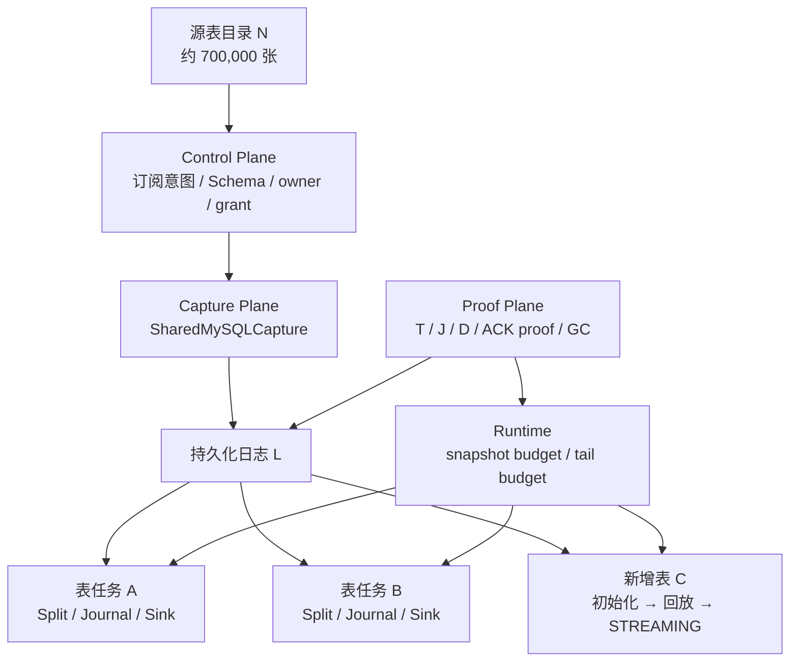
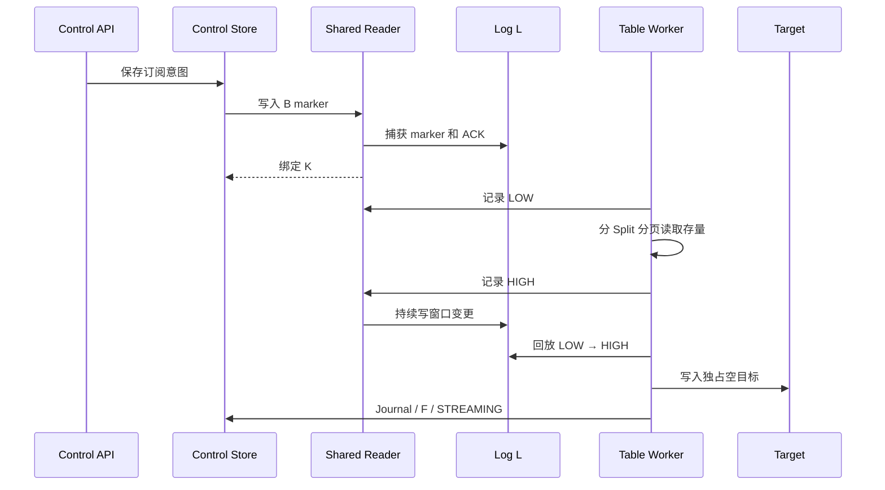

[系列导读](/pekko-cdc-series/) · [第一篇：常驻 CDC](/2026/10/18/pekko-cdc-1-resident-tasks/) · [第二篇：批转流](/2026/10/18/pekko-cdc-2-recovery-contract/) · [第三篇：源码执行](/2026/10/18/pekko-cdc-3-mysql-journal-experiment/) · [第四篇：恢复证明](/2026/10/18/pekko-cdc-4-protocol-design/) · [第五篇：Pekko 与 Flink](/2026/10/18/pekko-cdc-5-flink-comparison/) · [Flink CDC 深入系列](https://xuyinyin.cn/flink-cdc-series/)

> **源码基线**：`cc09559`。实验材料保留各自冻结版本和失败记录；文章不把不同版本的结果合并成一次验收。
>
> **证据标记**：**源码结论**来自当前调用链；**实际实验**来自真实 MySQL、Actor Journal、Sink 或集群；**保存材料复算**不等于重新运行；**未验证边界**不写成产品保证。

> 本文回答：一个 MySQL 实例有 70 万张表，但同时只有少量表活跃，怎样让 CDC 长期运行，并支持不停机新增、取消和恢复表任务？

## 0. 先看目标架构



四个平面各有边界：

| 平面 | 负责什么 | 不负责什么 |
|---|---|---|
| Capture Plane | 共享 binlog Reader、原始回调、日志 L | 不负责单表全量完成 |
| Control Plane | 订阅意图、Schema、owner、grant | 不负责目标写入 |
| Execution Plane | Split、快照、回放、Sink | 不负责全局 ACK 证明 |
| Proof Plane | T/J/D、ACK ancestry、GC | 不代替业务数据处理 |

这四层的分离，是整个项目区别于“每张表一个常驻任务”的关键。

## 1. 先把 70 万拆成 N、S、A(t)

```text
N：目录中登记的物理表数量
S：已经订阅并需要持续跟随的表数量
A(t)：时刻 t 正在执行快照、回放、提交或审计的表数量
```

资源模型应写成：

```text
连接数 ≈ capture domain 数 + 活跃快照连接数
worker 数 ≤ snapshotBudget + tailBudget
A(t) ≤ snapshotBudget + tailBudget
```

`N` 很大，不等于 `A(t)` 也很大。冷表应该只保留持久任务身份，不应提前占用 Reader、JDBC 连接、线程和 Actor dispatcher。

**源码结论**：`CdcTaskStore.claim` 只把可调度任务转成持久化 grant；活动任务才创建 Runner、Journal session 和执行步骤。

**实际实验**：700,000 条冷任务元数据完成分页遍历和索引检查，但实验没有创建 700,000 张物理表，也没有启动 700,000 个 Reader。

**未验证边界**：70 万张真实物理表、持续 DDL、持续 binlog 写入和天级动态 churn 的连接与 Schema 成本尚未测出。

## 2. 一个 capture domain 共享一个 Reader

`SharedMySQLCapture` 负责一个 capture domain 的 Debezium Engine、owner lease、原始 callback 顺序和 L。表任务从 L 中读取属于自己的事件组，Reader 不因为新增一张表而重新建立一套 binlog 会话。

```text
SharedMySQLCapture
    └── capture callback
          └── MySQLCdcGroupAssembler
                └── pekko_capture_log (L)
                      ├── table A task
                      ├── table B task
                      └── table C bootstrap task
```

共享 Reader 并不等于共享所有工作。快照分页、目标写入和 Journal 校验仍然由有限 worker 执行。

**解释性代码：共享 Reader 的最小边界**

```scala
// 说明调用顺序，不是完整生产源码
recordCallback(records, handle) {
  pending.enqueue((records, handle))
  while (pending.headOption.exists(canCover)) {
    val covered = appendGroupsAndAck(pending.head.records)
    if (covered) pending.dequeue().handle.markProcessedAndFinished()
  }
}
```

原始 ACK 只能覆盖连续前缀。一个表目标暂时变慢时，Reader 可以继续把事件写入 L；L 的保留压力最终会反过来限制整个 capture domain。

## 3. 表级任务是身份边界，不是永久线程

表级任务持有：

- 表标识和 generation；
- Schema 版本；
- Split 范围和批次身份；
- Journal revision 和目标 ledger；
- LOW/HIGH/F 与恢复状态。

它不等于一条永久线程。当前运行时把阻塞 JDBC 和 Sink 写入放到 bounded step worker，Actor 或 Journal 只负责串行化身份和持久进度。

```text
冷任务：目录 + 持久状态
活动任务：grant + Runner + Journal session + worker
释放任务：receipt + continuation + 可重建的下一步
```

**源码结论**：资源预算由 `snapshotBudget`、`tailBudget` 和持久化 grant 共同限制；不能从任务行数推导线程数。

**实际实验**：Actor 共享线程实验支持“身份数量可以大于线程数量”；真实 CDC 资源实验只覆盖固定活跃任务数。

## 4. 新增两张表时，已有 Reader 不停

业务动作是：今天同步 5 张表，明天新增 2 张表。新增表的运行路径是：



取消时只影响该表的 assembler、Journal session、目标任务和持久化意图。共享 Reader 不能因为一张表取消而跳过前面的原始 ACK 前缀。

## 5. 这篇文章最终证明什么

**已由源码明确**：目录身份、共享捕获、表级执行和有界资源可以分层。

**已由实验支持**：700,000 条冷元数据可以分页；指定真实 MySQL/Journal/Sink 窗口可以完成逐字段对账；proof GC 可以在保护条件成立时运行。

**仍未验证**：70 万真实活跃表容量、长期吞吐、DDL、多 owner 和所有 guardian JVM 故障窗口。

源码入口：`SharedMySQLCapture.scala`、`CdcPlatformRuntime.scala`、`CdcTaskStore.scala`、`CdcBootstrapKernel.scala`。实验材料见 [`2026-11-12-runtime-gc`](https://github.com/Xuxiaotuan/pekko-reference/tree/9653daa/docs/experiments/2026-11-12-runtime-gc/cluster-live-20261113/) 和 [`700,000 条冷元数据实验`](https://github.com/Xuxiaotuan/pekko-reference/tree/9653daa/docs/experiments/2026-11-08-cdc-standalone-entry/metadata-candidate/H01-metadata-63169a06a2ce/)。
