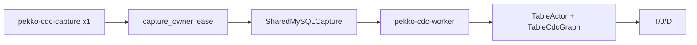
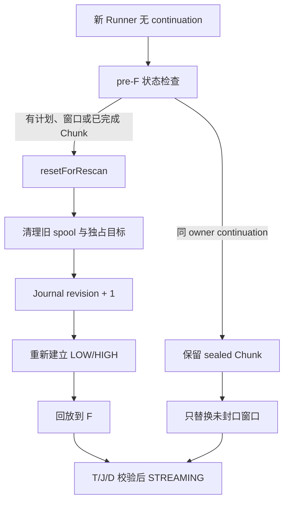
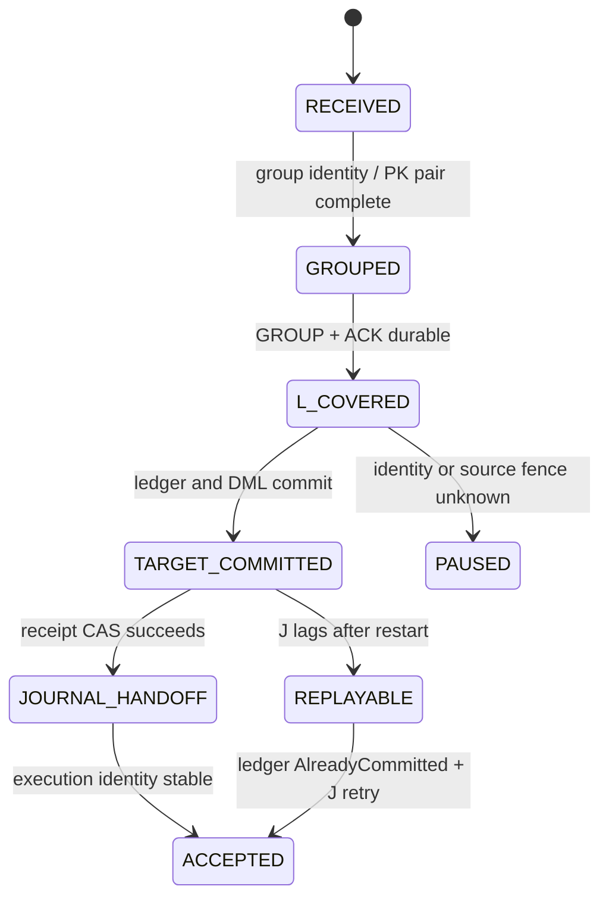
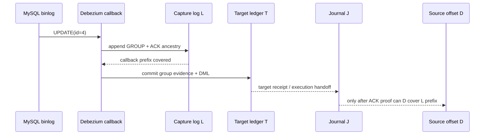
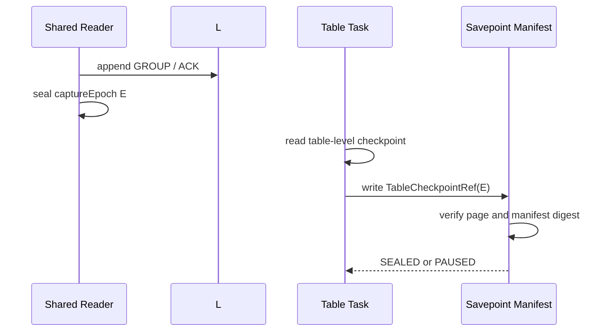

## 2026-11-22 运行时基线更新

本系列当前以 `pekko-reference` 的 `main` 分支为唯一 CDC 基线。生产部署拆成两个模块：`pekko-cdc-capture` 和 `pekko-cdc-worker`。Capture 运行一个副本并持有 `SharedMySQLCapture`。Worker 至少运行两个副本，通过 `TaskLease` 创建独立的 `TableActor` 和 materialized `TableCdcGraph`，不复制源端 Reader。



`pekko-server` 是共享兼容库和历史测试入口，不是第三个生产部署模块。历史源码链接和实验版本仍按原报告解释，不能用当前模块结构改写旧实验结论。

作者：xuyinyin
[系列导读](/pekko-cdc-series/) · [Pekko CDC 深入解析（一）](/2026/10/18/pekko-cdc-1-resident-tasks/) · [Pekko CDC 深入解析（二）](/2026/10/18/pekko-cdc-2-recovery-contract/) · [Pekko CDC 深入解析（三）](/2026/10/18/pekko-cdc-3-mysql-journal-experiment/) · [Pekko CDC 深入解析（四）](/2026/10/18/pekko-cdc-4-protocol-design/) · [Pekko CDC 深入解析（五）](/2026/10/18/pekko-cdc-5-flink-comparison/)

> **本篇入口**：第一篇把 `orders_06` 放进共享 Reader 的资源模型。本文沿 `orders_06.id=4` 的 UPDATE，追踪它从 SourceRecord、L、目标事务到 Journal 和 D 的交接；第三篇再把同一任务放进提交未知的重启窗口。
>
> **源码基线**：当前 `main` 分支源码；历史实验仍按各自材料冻结的提交、版本和切点解释。

> **真实故障先行**：在固定的 I16 窗口中，目标页已经提交，Journal 仍停在第 0 页，进程随后退出。重启后同一组事件从 L 重新读出，目标 ledger 返回 `AlreadyCommitted`，Journal 才把进度向前推进；最终 64 行、384 个字段逐字段相等。这个结果首先说明一件事：**目标表里已经有值，不等于这条事件已经取得了可恢复身份**。
>
> 本文不把 I16 扩展成所有 Sink 的 exactly-once 证明，而是从 `orders_06.id=4` 的 UPDATE 出发，解释它如何获得稳定的 group identity，如何经过 L、T、J、D，最后成为可以释放的事件。

在这条链上，TableActor 不是事件身份的来源。它只提供表级串行边界和恢复入口；稳定身份来自 SourceRecord 的源 lineage、表、位置、行键和事件序号。表级 Checkpoint 记录“这张表已经把哪一批证据交接到哪里”，captureEpoch Savepoint 只记录“这些表的 Checkpoint 在哪个 Shared Reader 观察面下被同时引用”。

```text
SharedMySQLCapture
  └─ L：全局可重放事件前缀
       ├─ TableActor(orders_01) → Checkpoint_01
       ├─ TableActor(orders_06) → Checkpoint_06
       └─ TableActor(orders_07) → Checkpoint_07
```

因此，同一个 captureEpoch 下可以存在不同的表级 J、D 和回放位置。Savepoint 不能把它们压成一个全局 offset，Checkpoint 也不能替代 L 的事件身份。

本轮真实 Checkpoint 恢复把这条关系落到了 MySQL、JDBC Actor Journal 和事务 Sink。

新增的单表 Graph 把这条证据链固定成 Streams 顺序：Sink commit → Journal persist → L consumer projection。只要 Journal 没有返回持久 revision，Graph 不推进 ACK。真实 GRAPH 场景的目标 ledger、Journal 行和逐字段对账已通过，材料见[独立 Graph 验证报告](https://github.com/Xuxiaotuan/pekko-reference/blob/0371c3f/docs/experiments/2026-11-19-table-graph/README.md)。
N0、J1、J2、C0、C1、K1、K2 共 7 个窗口都记录了 T、J、D、原始重放批次和逐字段比较。自动恢复套件中，提交未知、延迟提交、延迟回滚和重启窗口完成，明确拒绝与 Journal 回复保持 evidence_incomplete，因为故障注入没有进入预期事件。完整材料见[Checkpoint 恢复报告](https://github.com/Xuxiaotuan/pekko-reference/blob/228dba6/docs/experiments/2026-11-19-checkpoint-recovery/README.md)。

提交未知、长 ACK proof 和 owner 接管的完整恢复推理放到第三篇。为统一案例名，`orders_06` 是系列中的业务表名，实验材料中的真实 task、execution 和 offset 仍以各自快照为准。


## 2026-11-22 跨 Chunk 与跨重启修订

本篇当前源码基线固定为 [`644d8bd`](https://github.com/Xuxiaotuan/pekko-reference/tree/644d8bdcc6d9721e7a08232b935793f05d70dac5)。之前的漏行风险来自一个错误前提：把持久化游标当作旧 Repeatable Read 读视图的证明。跨 JVM 重启后，旧 Chunk 即使已经写入 spool，也不能证明仍属于同一个源端读视图。



新的窗口 ID 使用 `bootstrapId + journalRevision + chunkIndex + attempt`。无 continuation 的重启会清理旧 material，并发出 `BASELINE_RESET_AFTER_RESTART`。这个基线重建不额外消耗 recovery budget，逻辑 executionId 保持不变，revision/epoch 负责隔离新旧读视图。

真实证据见[跨 Chunk 与跨重启验证材料](https://github.com/Xuxiaotuan/pekko-reference/blob/644d8bdcc6d9721e7a08232b935793f05d70dac5/support/docs/experiments/2026-11-22-cross-chunk-restart/README.md)。同 owner continuation 和 full rescan 均通过，目标表与源表的差异、缺失和额外字段均为 0。材料中保留了修正断言前的失败输出，完整分页实际为 5 页、full rescan 不应要求旧窗口产生 `ABANDONED`，这两项没有被通过结果覆盖。

## 0 先固定问题：接受不是一个回调返回值

一次 MySQL UPDATE 至少要经过四个边界：源事件已经被识别，事件组已经写入 L，目标事务 T 已经有可核验的 ledger，Journal J 和源 offset D 之间建立了可重读的交接。把 `markProcessedAndFinished()`、目标 `COMMIT` 或当前行值单独当成“接受”，都会把不同存储域的事实混在一起。

对事件组 `g`，本文使用下面的局部判定：

$$
accepted(g) = identity(g) \land durable_L(g) \land target_receipt(g) \land journal_handoff(g)
$$

这里的 `accepted` 只表示该事件组已经进入可重放的协议边界；它不表示 L 可以立即 GC。D 的 ACK ancestry、保护引用和 owner fence 仍由第三篇的恢复协议决定。



状态机的关键不是“每一步都成功”，而是每一步都留下可以在下一次启动时重读的身份。`REPLAYABLE` 是正常的恢复路径；`PAUSED` 是证据不足时的终态，不是异常日志被吞掉。



这张时序图只表达“谁把事实交给谁”。任意一步返回 `unknown`，后继组件都不能用自己的成功替前一步补证据。

## 1 一条事件的证据链

当前实现把一次变更拆成六个可观察位置：

```text
MySQL row event
    │
    ▼
Debezium SourceRecord + 原始 callback handle
    │  callback 只有在 L 覆盖后才允许返回
    ▼
L: pekko_capture_log（GROUP / BARRIER / ACK / SCHEMA）
    │  CapturedLogReader 按 L sequence 组成 SourceBatch
    ▼
T: Sink 目标事务 + pekko_sync_cdc_group_ledger
    │  commit 返回只说明目标事务的本地结果
    ▼
J: BootstrapJournal 的有序进度事件
    │  recordProgress 先收到 Journal，再投影 consumer floor
    ▼
D: Debezium JDBC offset/history 的实际消费位置
    │  CaptureAckPaging 证明 D 的 ACK ancestry
    ▼
Checkpoint / GC：只回收被完整证据保护的 L 前缀
```

这条链的交接关系比任何单一“成功”标志都重要：L 负责让回调可以安全返回，T 负责目标组的幂等身份，J 负责执行交接，D 只有在 ACK ancestry 被证明后才可代表可释放的源前缀。

$$
release(g) \Rightarrow durable_L(g) \land verified_T(g) \land accepted_J(g) \land covered_D(g)
$$

这里的 `release` 比本文的 `accepted` 更强。第二篇只追踪事件如何进入可重放边界；第三篇才证明什么时候可以恢复、推进和 GC。

## 1.1 `captureEpoch` 绑定的是观察面，不是事件身份

事件组 `g` 的 identity 仍然是：

$$
G = H(protocol, sourceLineage, database, table, file, position, row)
$$

本次新增的 `captureEpoch` 不参与 `G` 的计算。原因很直接：同一条 L 中的事件可能被多个表级任务重放，重放不能因为 Runtime 重新封存了一个 Savepoint 就生成新的 group identity。

Savepoint 额外保存一个观察面：

$$
E = (captureId, epoch, sealedSequence, position, routeDigest, tableSetDigest)
$$

因此事件的可恢复引用变成：

$$
R(g) = (G, E, generation, schemaDigest, T/J/D\ references)
$$

`G` 解决“这是哪一组源事件”，`E` 解决“它属于哪一个 Shared Reader 观察边界”，`generation` 解决“它属于哪一代表订阅”。三者缺一不可：只有 `G`，无法判断动态订阅是否已经切换；只有 `E`，无法判断目标 ledger 的内容；只有 generation，无法证明源事件没有被重复解释。

当前 `CdcSavepointStore` 把表级引用分页写成 `TableCheckpointRef`。引用里保存 phase、checkpoint digest、Journal/目标证据摘要和 table digest，不保存 JDBC connection、ActorRef、Debezium engine 或 callback handle。恢复时这些运行期对象重新创建，原始 L、Journal 和目标 ledger 再按既有 T/J/D 协议校验。



这也解释了为什么“目标表里有值”仍然不能直接升级为 Savepoint 成功：目标值只覆盖 T 的一个局部事实，Savepoint 还必须知道它属于哪个 epoch、哪一代订阅和哪条 Journal 证明。

## 2 具体事件：`orders_06.id=4` 的 UPDATE 从源端走到目标端

真实验收表 `pekko_cdc_runtime_acceptance.source_rows` 有六个字段：

```sql
id BIGINT PRIMARY KEY,
label VARCHAR(...),
amount DECIMAL(...),
note VARCHAR(...),
updated_at DATETIME(6),
revision INT
```

本轮真实操作把 `orders_06.id=4` 更新为：

```text
table=orders_06
id=4
label=gc-final-update
amount=14.2500
note=gc-live
updated_at=2026-11-13 05:48:00.123456
revision=4
```

随后还插入了 `id=6`，用于验证同一运行中不止一种事件。这里先只看 `id=4`，因为它足够暴露所有确认边界。

### 2.1 Debezium 回调不是一个可直接提交的 Batch

Debezium Embedded Engine 将一批 `SourceRecord` 和一个原始 `CdcBatchCommitHandle` 交给 `DebeziumBatchConsumer`。`MySQLCdcSourceNode.CdcResource` 只是把这个回调交给 `MySQLCdcGroupAssembler` 或 `DebeziumBatchBridge`：

```scala
override def handleBatch(
    records: Vector[SourceRecord],
    commitHandle: CdcBatchCommitHandle
): Unit = {
  if (assembler.nonEmpty) assembler.get.accept(records, commitHandle)
  else bridge.publish(batchId, rows, cursorValue(records.last), commitHandle)
}
```

`CdcBatchCommitHandle` 只提供一个动作：

```scala
trait CdcBatchCommitHandle {
  def markProcessedAndFinished(): Unit
}
```

该句柄的语义来自 Debezium SDK：调用它会通知 SDK 这一批可以被标记为已处理，之后 offset 才可能被 flush。它不包含目标事务状态，也不包含 Journal 状态。把这个句柄当成 Sink 的 ACK，是最容易犯的错误。

### 2.2 `SourceRecord` 先获得稳定身份，再进入组装器

`SharedMySQLCapture.processDataRecord` 先从 Debezium `source` 结构中取出 file、position、row，构造 `CapturePoint`。如果这个点命中某个有效订阅，代码会把 record 的 source offset 中的 collection-order 字段去掉，再解析为 `MySQLCdcEnvelope`：

```scala
val point = CapturePoint(src.getString("file"),
  src.getInt64("pos"), src.getInt32("row"))
val envelope = MySQLCdcEnvelope.decode(copy, source.connectorId)
  .fold(x => throw new IllegalArgumentException(x.message), _.get)
val groupId = MySQLCdcGroup.id(store.protocol, envelope)
```

`MySQLCdcGroup.id` 由协议版本、源 lineage、数据库、表、binlog file、position 和 row 计算 SHA-256。这个 ID 不是数据库主键，也不是 Debezium 的 offset；它是一次源事件在本协议中的稳定出现身份。

对于普通 UPDATE，组装器生成 `single.u` group；对于主键修改，MySQL CDC 会先产生带 `__debezium.newkey` 的 DELETE，再在后续 record 中产生 CREATE。`MySQLCdcGroupAssembler` 暂存半组，并要求两条 record 的 source offset、partition 和 schema 相同，最后形成有序的 `pk.d` / `pk.c` group。半组没有完成前，原始 callback 不会被确认。

### 2.3 L 的写入和原始 ACK

组装器回调 `publish`，进入 `SharedMySQLCapture` 的闭包：

```scala
val group = MySQLCdcGroup.parse(g, store.protocol)
groupCoverage(group.groupId) =
  store.append(group).getOrElse(
    throw new IllegalArgumentException("group lost its durable route"))
```

`MySQLCaptureStore.append` 在自己的数据库事务里完成三件事：锁住 reader lineage、检查路由区间、向 `pekko_capture_log` 插入一个不可变的 `GROUP` frame。`source_key` 唯一，重复出现时要求 digest 和 payload 完全相同；内容冲突会失败。

回调中每个 record 都调用一次 `done()`。只有 `Pending.remaining == 0` 时，`acknowledgeCoveredCallbacks` 才能处理队头：

```scala
val ack = store.coverSequence(ready.offset, ready.references.toVector)
ready.handle.markProcessedAndFinished()
confirmedAckSequence = ack
pending.dequeue()
```

`coverSequence` 再次锁 reader，沿旧 ACK 建立 parent，写入一个新的 `ACK` frame，并把被引用的 barrier 标记为 covered。于是对 `id=4` 而言，第一条可靠事实是：

```text
GROUP(id=4 的 UPDATE) 已在 L 中落盘
ACK(parent=上一条 ACK, references=[该 GROUP]) 已落盘
原始 callback handle 才被调用
```

**源码结论：** 原始 callback 的“返回”证明 L 覆盖了 callback 的完整前缀；它不证明目标端已经写入。
## 3 T：目标事务如何做到重放不产生第二次业务效果

从 L 读取时，`CapturedLogReader.readBatch` 以 sequence 为边界取 group，而不是按当前 MySQL 表重新查询：

```scala
val entries = consumer
  .map(store.readForConsumer(id, after, limit, _))
  .getOrElse(store.read(id, after, limit))
val groups = entries.map { r =>
  require(r.schemaId == sub.schemaId, "capture row schema mismatch")
  MySQLCdcGroup(...).canonicalJson
}
```

它返回 `CdcCapturedBatch`，其中包含 `batchSequence`、`batchId`、`cursor.value` 和 `cursor.upperBound`。`batchId` 根据 execution、source node、partition 和 sequence 计算，重启后如果继续同一 execution，身份可复原；如果是新 execution，目标仍以 group ledger 的稳定 groupId 做幂等保护。

Sink 的核心事务可简化成下面的伪代码：

```scala
connection.setAutoCommit(false)
for ((group, events) <- plannedGroups) {
  val old = SELECT evidence
    FROM pekko_sync_cdc_group_ledger
    WHERE group_id = ? FOR UPDATE
  old match {
    case Some(evidence) if evidence == expected => // replay
    case Some(_) => throw ProtocolConflict
    case None =>
      INSERT INTO pekko_sync_cdc_group_ledger(group_id, evidence)
      applyEvent(target, events)
  }
}
connection.commit()
```

`evidence` 不只包含 groupId，还包含 cursor identity、target table 和完整 group JSON。这样可以区分两种情况：

* 同一 group 重放，返回 `AlreadyCommitted`，目标业务行不再执行第二次；
* 同一 groupId 对应不同内容，直接拒绝，避免把数据冲突伪装成幂等。

`MySQLCdcApplyEngine` 在 `connection.commit()` 抛异常时包装为 `ExecutionFailure.CommitUnknown`。这是一个重要边界：客户端不知道服务端是否已经提交，重试前必须读取 ledger；不能直接 rollback 后假定目标没有变化。

**源码结论：** T 的幂等性由目标库 ledger 和同事务 DML 共同提供；`Committed` 与 `AlreadyCommitted` 都只表示目标事务路径已完成，不能代替 J 或 D 的证明。
## 4 J：为什么目标已经提交，Journal 仍然可能落后

Bootstrap Runner 对每一个有界工作单元先调用 Sink，再更新 Journal。`replay` 的主线是：

```scala
val batch = log.readBatch(...)
admission.writing {
  waitSink(sink.commitBatch(id, s.executionId, batch, _ => ()))
  emit("REPLAY_T", ...)
}
update(_.copy(
  deltaAfter = entries.last.sequence,
  batchSequence = s.batchSequence + 1
))
```

`update` 通过 `BootstrapJournalAccess.update` 读取当前状态、递增 revision，并向 `BootstrapJournal.Write` 发送 CAS。Actor 的 `Write` 只接受满足 expected revision、phase 转移、execution identity、recovery attempts 和 gc checkpoint 不变的状态。写入成功后，`recordProgress` 才产生 `J_COMMITTED` 观察事件。

因此有一个明确的故障窗口：

```text
T committed
    │ JVM 在 Journal.update 之前退出
    ▼
目标 ledger 已有 group，J 仍指向旧 deltaAfter
```

重启时 Runner 从旧 `deltaAfter` 重新读 L。Sink 读到相同 group ledger 后返回 `AlreadyCommitted`，随后 J 才能推进。这个窗口的安全性依赖三件事：

1. L 的 group payload 不可变；
2. ledger 的 evidence 与 replay 内容一致；
3. Journal 仍保留原 execution 或有足够的恢复身份，不能把当前源表快照替换成另一个 batch。

**实验结果：** 旧 Bootstrap 矩阵的 I16 固定过“目标页已经提交、Journal 仍停在第 0 页”，恢复日志中同一窗口第 0 页从 `new=true` 变为 `new=false`，最终 64 行、384 个字段逐字段相等。该结果证明指定窗口能够按 ledger 重放，不证明任意外部副作用也恰好一次。

**未验证边界：** 本文没有把 I16 的 baseline 结果扩大为所有 Sink、所有事务隔离级别或所有 Journal provider 的保证；它只覆盖实验中使用的真实 MySQL 目标、Actor Journal 和固定切点。
## 5 D：offset 不是“读到了”，而是一个需要被 L 反向证明的事实

Debezium 使用 JDBC offset store。真实运行日志中可以看到：

```text
offset table: capture_offsets_986a1b7135f4986150aa5fa0028feeaa
previous offset: binlog.000017 / 325166188 / event=3
```

D 的值由 SDK 的 offset flush 产生，应用代码不能把它当作 Sink commit 的结果。`SharedMySQLCapture.readCheckpoint` 从 state MySQL 读取 offset 表；`verifiedOffsetSequence` 再根据 D 的 offset key 查找 L 中同 offset 的最新 ACK，并调用 `verifyChain` 检查 parent chain。

这一点决定了启动和 GC 的顺序：

```text
读 D
  └─找到与 D 绑定的 ACK
      └─验证 ACK parent / reference / digest
          └─才能说 D 覆盖到某个 L sequence
```

旧版 `CaptureAckProof.inspect` 直接在一次调用里遍历整条链，固定最多 4096 个节点和 15 秒预算。真实集群的 `primary` 已有 7,110 条 ACK，最新 ACK 序号为 7,121，因此 GC 返回：

```text
BLOCKED / ACK proof budget exceeded
```

这个失败不是 Source/Sink 不一致，也不是目标 COMMIT 失败，而是证明算法的单次预算不足。它说明“D 已经有值”和“D 的 ancestry 已经被验证”是两个不同事实。

## 6 事件何时算“被 CDC 接受”

把前面的调用链压成一个交接例子：

```text
SourceRecord(id=4, binlog.000017:325166188,row=3)
    └─ groupId = hash(protocol, lineage, table, file, pos, row)
        └─ L GROUP(seq=412, digest=g)
            └─ L ACK(seq=413, parent=410, references=[412])
                └─ T ledger(groupId=g, evidence=e) + target DML
                    └─ J receipt(execution=e1, deltaAfter=413)
                        └─ D 只有在 ACK ancestry 证明后才可覆盖该前缀
```

因此，下面四个看似相近的观察不能互换：

| 观察 | 能证明什么 | 不能证明什么 |
|---|---|---|
| `SourceRecord` 到达 | Reader 看到了事件 | L 已落盘、目标已提交 |
| 原始 callback 返回 | L 覆盖了 callback 前缀 | T/J/D 已经同步 |
| 目标行存在 | 某次执行留下了该值 | 当前 group 的提交身份 |
| `J` revision 增加 | Journal 接受了一个 execution | D 已被 ACK ancestry 覆盖 |

**源码结论**：`SharedMySQLCapture` 以 pending 前缀控制原始 ACK；`MySQLCaptureStore` 以不可变 GROUP/ACK frame 保存 L；`MySQLCdcApplyEngine` 以 group ledger 区分 `Committed`、`AlreadyCommitted` 和 `ProtocolConflict`；`BootstrapJournal` 用 revision CAS 接受执行交接。

**实际实验**：R08 的真实 MySQL Reader 矩阵覆盖同事务多行、同一行多次更新和主键 DELETE/CREATE；I16 覆盖目标先提交、Journal 滞后的重启窗口。两组结果都保存了原始 SourceRecord、ACK 顺序和逐字段对账，但它们分别证明事件组装边界和指定恢复窗口，不是所有外部 Sink 的统一保证。

## 下一篇：把 `orders_06` 停在 T/J/D 之间

`orders_06.id=4` 已经取得 group identity 后，下一步不是继续堆更多 ACK，而是把任务停在 T 已提交、J 尚未写入或 COMMIT 回复丢失的窗口。第三篇将把这个问题改写成 T/J/D 的证明关系，并说明为什么只保存 offset 仍不足以恢复。

## 附录 A：关键源码入口

* [`SharedMySQLCapture.scala`](https://github.com/Xuxiaotuan/pekko-reference/blob/main/common/src/main/scala/cn/xuyinyin/magic/connectors/mysql/source/capture/SharedMySQLCapture.scala)：Reader owner、callback pending、L 覆盖、原始 ACK。
* [`MySQLCdcGroupAssembler.scala`](https://github.com/Xuxiaotuan/pekko-reference/blob/main/common/src/main/scala/cn/xuyinyin/magic/connectors/mysql/source/MySQLCdcGroupAssembler.scala)：普通事件和主键 DELETE/CREATE 的跨 callback 组装。
* [`MySQLCaptureStore.scala`](https://github.com/Xuxiaotuan/pekko-reference/blob/main/common/src/main/scala/cn/xuyinyin/magic/connectors/mysql/source/capture/MySQLCaptureStore.scala)：L frame、ACK parent、B/F fence、D 反查。
* [`MySQLCdcApplyEngine.scala`](https://github.com/Xuxiaotuan/pekko-reference/blob/main/common/src/main/scala/cn/xuyinyin/magic/connectors/mysql/sink/MySQLCdcApplyEngine.scala)：目标事务、group ledger、`CommitUnknown`。
* [`BootstrapJournal.scala`](https://github.com/Xuxiaotuan/pekko-reference/blob/main/common/src/main/scala/cn/xuyinyin/magic/cdc/bootstrap/BootstrapJournal.scala)：revision CAS、恢复 receipt、Journal 事件状态。

## 附录 B：真实材料

* [Reader 身份、同事务多行与主键修改实验](https://github.com/Xuxiaotuan/pekko-reference/blob/472e809/docs/experiments/2026-10-28-ab-matrix/README.md)：R08 的 SourceRecord、ACK 顺序和逐字段结果。
* [初始化与重启故障矩阵](https://github.com/Xuxiaotuan/pekko-reference/blob/472e809/docs/experiments/2026-10-25-bootstrap/README.md)：I16 的目标提交、Journal 滞后和恢复证据。
* [最终 acceptance](https://github.com/Xuxiaotuan/pekko-reference/blob/472e809/docs/experiments/2026-11-12-runtime-gc/cluster-live-20261113/final/README.md)：当前运行版本的 Source/Sink 对账与边界。

多表 Graph 验证确认 ACK 顺序仍然按表隔离。`a` 的 Journal 和 ACK 不依赖 `b` 的提交完成，详见[多表 Graph 验证报告](https://github.com/Xuxiaotuan/pekko-reference/blob/a7c48a7/docs/experiments/2026-11-20-table-graph-multi/README.md)。

Graph 重启实验把 `Journal persist → 新 JVM read → L ACK` 的恢复顺序落到了真实 MySQL。恢复前后的目标 ledger 和 Journal 均有记录，逐字段对账通过。详见[Graph Journal 恢复报告](https://github.com/Xuxiaotuan/pekko-reference/blob/56b1daf/docs/experiments/2026-11-20-table-graph-restart/README.md)。

取消后的确认边界同样按表隔离。被取消表的最终差异是预期结果，其他表的 Journal、Sink 和 ACK 不受影响。详见[Graph 取消验证报告](https://github.com/Xuxiaotuan/pekko-reference/blob/299c954/docs/experiments/2026-11-20-table-graph-cancel/README.md)。

## 2026-11-22 C1 提交结果未知恢复复核

本轮在 `cdc-runtime-acceptance` 使用独立 supervisor、Guardian、旧 Worker、新 Worker、真实 MySQL、Actor Journal 和 Sink 重跑 C1。旧 Owner 的 COMMIT 回复被代理丢弃后，Guardian 先确认旧 Owner 隔离和连接排空，Journal 保持 `RECOVERY_PENDING`，新 Owner 消费恢复许可并安装 Reader gate。

修复后的运行完成两窗口快照、B 到 F 回放、Graph 激活和持续流转。源表与目标表逐字段对账结果为 384 个字段一致，缺失、额外和字段差异均为空，Guardian drain 和会话释放均确认。证据保存在 [C1 实验材料](https://github.com/Xuxiaotuan/pekko-reference/blob/main/support/docs/experiments/2026-11-22-graph-fence-v2/k8s-v2-reader-20261122/README.md)。

修复前的 `RECOVERY_PENDING/local_release_unconfirmed`、Reader 未启动和逐字段缺失材料仍保留在同一实验目录中。这个结果覆盖单表固定窗口和 64 行样本，后续容量结论按两到三张表单独验证，不能外推到 70 万物理表。

## L floor 与 Graph 生命周期复核

本轮把 `TableCdcGraphRuntime` 的生命周期依赖收敛到 `TableGraphLifecycle`，Graph 的 materialize、stop 和恢复入口不再直接持有 Runner 实例。快照 LOW/HIGH/F 仍由现有快照生命周期驱动，Streaming 阶段由独立 Graph materialize。源码已推送到 [pekko-reference main](https://github.com/Xuxiaotuan/pekko-reference/tree/main)。

L floor 的两表跨进程 GC 复跑已创建真实 MySQL、`a`/`b` 两张表和真实 Debezium Reader。首轮暴露 GC 账号缺少 `pekko_capture_epochs_v1` 权限，第二轮已进入 streaming，但 `a` 在固定窗口内未进入最终 `STREAMING`，因此这轮保留为 `evidence_incomplete`，材料见 [L floor 复跑记录](https://github.com/Xuxiaotuan/pekko-reference/tree/main/support/docs/experiments/2026-11-22-graph-fence-v2/l-floor-followup-20261122)。这条边界不能被 C1 的单表恢复通过覆盖。

## 计划停止与未知结果必须分开

恢复协议中有一条边界不能混淆。任务在计划停止时如果尚未进入 Graph 执行，可以释放 grant 并保留原有 `STREAMING` 进度，下一次启动继续调度。只有提交结果未知、guardian 丢失或资源释放无法证明时，才应该写入 `UNKNOWN` 并暂停。当前实现为计划停止增加了专用释放路径，避免正常重启消耗恢复预算。

这条路径已经通过静态编译和 509 项非外部回归。真实两表 RG01 在快照、回填、F 激活和逐字段对账阶段均进入过实际运行路径，但跨重启后的 GC 删除仍未通过，不能把正常停止释放等同于 L floor 已被证明。
