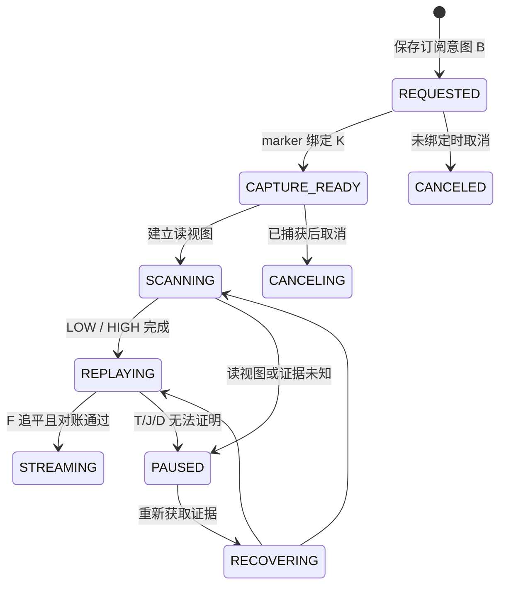
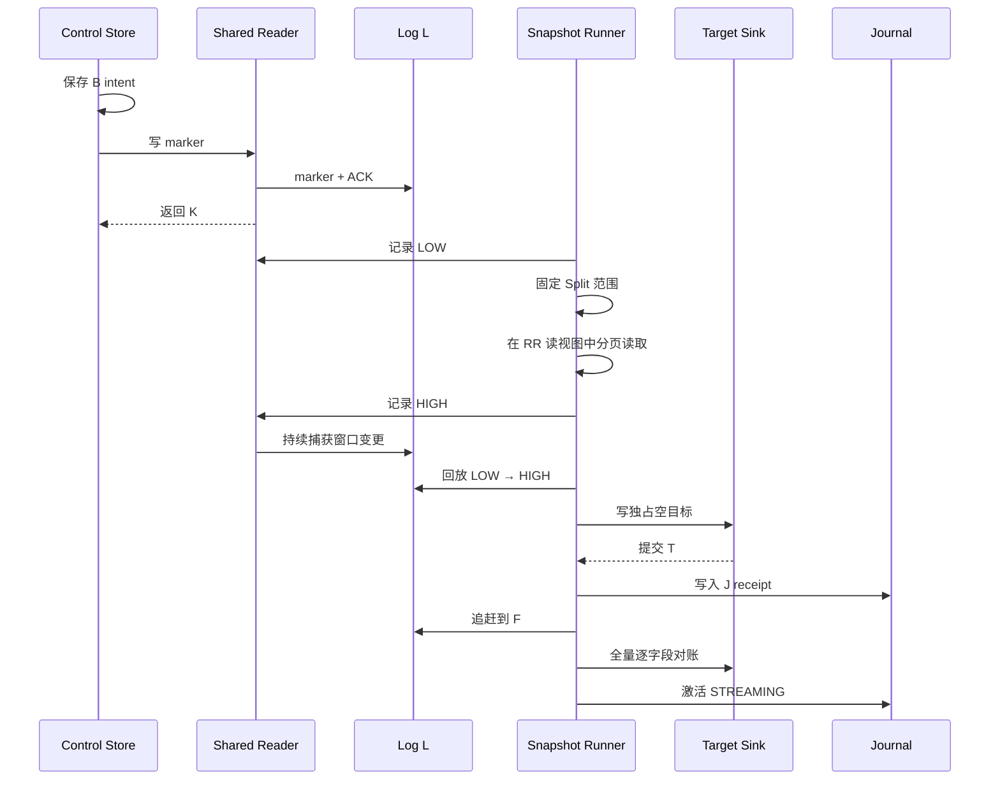

[系列导读](/pekko-cdc-series/) · [第一篇：常驻 CDC](/2026/10/18/pekko-cdc-1-resident-tasks/) · [第二篇：批转流](/2026/10/18/pekko-cdc-2-recovery-contract/) · [第三篇：源码执行](/2026/10/18/pekko-cdc-3-mysql-journal-experiment/) · [第四篇：恢复证明](/2026/10/18/pekko-cdc-4-protocol-design/) · [第五篇：Pekko 与 Flink](/2026/10/18/pekko-cdc-5-flink-comparison/) · [Flink CDC 深入系列](https://xuyinyin.cn/flink-cdc-series/)

> **源码基线**：`cc09559`。实验材料保留各自冻结版本和失败记录；文章不把不同版本的结果合并成一次验收。
>
> **证据标记**：**源码结论**来自当前调用链；**实际实验**来自真实 MySQL、Actor Journal、Sink 或集群；**保存材料复算**不等于重新运行；**未验证边界**不写成产品保证。

> 本文回答：新表初始化期间源库继续写入，系统怎样保证既不漏掉存量，也不丢掉窗口内增量？

## 0. 先看状态机



## 1. 七个边界必须分开

| 边界 | 含义 | 不能混同 |
|---|---|---|
| B | 订阅意图已经保存 | Reader 已经接纳 |
| K | marker 在 Reader 中形成的绑定边界 | 全量完成 |
| LOW | 快照读视图开始时的日志位置 | 全局 checkpoint |
| HIGH | 本次初始化窗口的上界 | 最后一条业务事件 |
| F | 全量结果和增量回放已经接上的终点 | 业务表已经可见 |
| T/J/D | 目标、Journal、Source ACK 的三条事实 | 一个可直接比较的 offset |
| Schema | 目标写入使用的字段版本 | 当前数据库元数据 |

B 是意图，K 是绑定结果，因此正确关系是：

```text
bind(B, generation, sourceFence) = K
```

F 和 HIGH 只有在同一 capture、同一 generation、同一 source lineage 下才可以比较：

```text
F covers HIGH
```

T/J/D 不要求数值相等，只要求对同一批次形成覆盖关系：

```text
cover(T, J, D) = verified
```

## 2. 完整批转流时序



关键顺序是“先保留增量，再读取存量”。如果先打开快照、后启动 Reader，窗口内的事件没有可靠位置可以回放。

## 3. Split 分页为什么要有界

一个 Split 只负责固定范围，不能把整张表一次性装入内存：

```scala
final case class SnapshotSplit(
  table: String,
  lower: Option[Long],
  upper: Long,
  generation: String,
  schemaId: String
)

// 解释性伪代码
while (hasNext(split)) {
  val page = readPage(split, pageSize)
  writeTarget(page)
  journal.accept(page.identity)
}
```

每个 Split 都必须保存范围、批次身份和 revision。重启后不能只从一个裸游标继续，因为读视图可能已经变化。

## 4. 跨重启分页的真实反例

真实 MySQL 反例是：

```text
连接 A 在 RR 快照中读到游标 b
连接 B 提交了排序更靠前的新行 a
进程重启
连接 C 从 b 继续读取
结果：a 可能永远不会被新读视图看到
```

所以：

```text
持久化游标 ≠ 已证明扫描范围稳定
```

跨重启必须重新确认读视图、范围证明或源侧版本；不能把分页游标本身当成全量正确性的证明。

## 5. 初始化中取消

| 时机 | 可以做什么 | 不能做什么 |
|---|---|---|
| B 已保存、K 未形成 | 删除或暂停待接纳意图 | 不能推进 D 或伪造 STREAMING |
| K 已形成、快照未完成 | 写 STOP，等待当前边界排空 | 不能删除共享 L |
| 已进入 REPLAYING | 停止后续批次，保留已提交事实 | 不能把半完成目标表直接发布 |
| 已进入 STREAMING | 记录取消 generation，完成表级排空 | 不能影响其他表 Reader |

## 6. 证据范围

**实际实验**覆盖多 Split 分页、LOW/HIGH 窗口回填、全量后回放和逐字段对账。相关材料包括 [`2026-10-25-bootstrap`](https://github.com/Xuxiaotuan/pekko-reference/tree/9653daa/docs/experiments/2026-10-25-bootstrap/)、[`2026-10-29-proof-cursor-snapshot`](https://github.com/Xuxiaotuan/pekko-reference/tree/9653daa/docs/experiments/2026-10-29-proof-cursor-snapshot/) 和 [`2026-11-12-runtime-gc`](https://github.com/Xuxiaotuan/pekko-reference/tree/9653daa/docs/experiments/2026-11-12-runtime-gc/cluster-live-20261113/)。

**失败证据**必须保留：跨重启游标漏行、marker 与目录写入同事务的事件计数风险、关闭后未归属事务延迟消失。

**未验证边界**：DDL、复合主键、字符串排序键、跨表事务原子性和 70 万真实活跃表的全量初始化容量。
