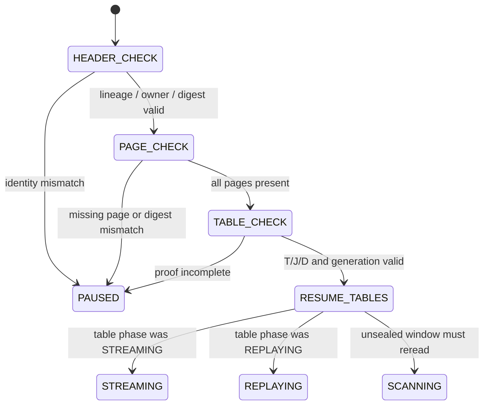
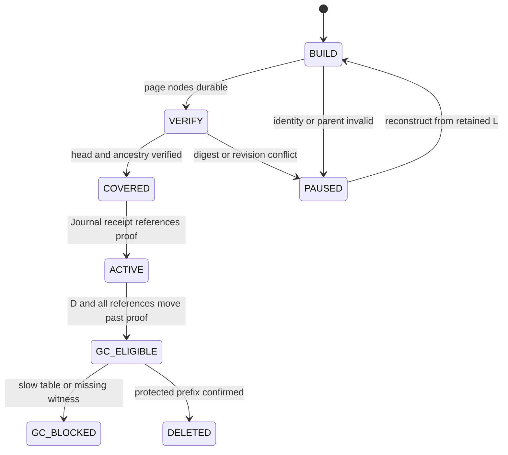
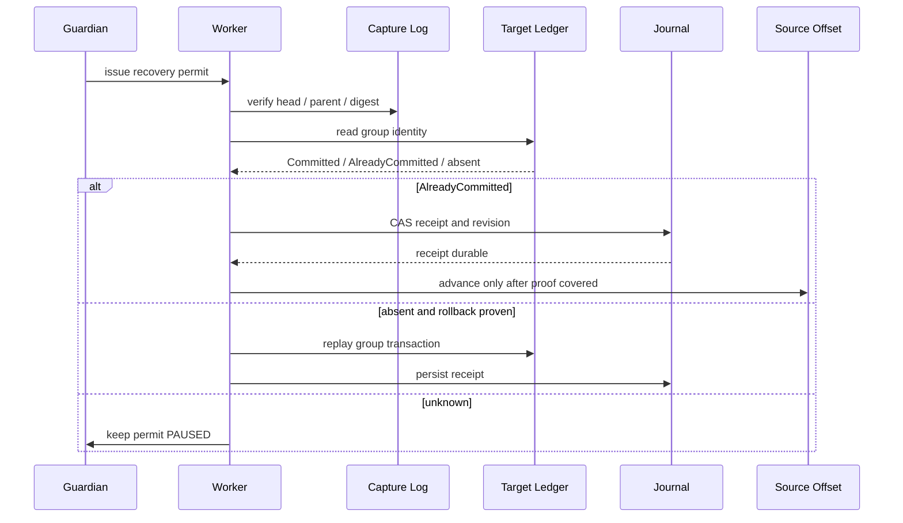

作者：xuyinyin

[系列导读](/pekko-cdc-series/) · [Pekko CDC 深入解析（一）](/2026/10/18/pekko-cdc-1-resident-tasks/) · [Pekko CDC 深入解析（二）](/2026/10/18/pekko-cdc-2-recovery-contract/) · [Pekko CDC 深入解析（三）](/2026/10/18/pekko-cdc-3-mysql-journal-experiment/) · [Pekko CDC 深入解析（四）](/2026/10/18/pekko-cdc-4-protocol-design/) · [Pekko CDC 深入解析（五）](/2026/10/18/pekko-cdc-5-flink-comparison/)

> **源码基线**：`472e809`。Pekko 源码调用链按该提交阅读；后续提交只改变文档或验证材料，不改变本文涉及的生产实现。

上一篇把 `orders_06.id=4` 的 UPDATE 追到了目标事务和 Journal。现在把同一条案例线停在最危险的位置。目标事务可能已经提交，Journal 还没有写入，Source offset 也可能已经向前。恢复程序凭什么决定重放、继续还是暂停？

本文只回答这个问题。答案是让 ACK proof 保存一条可重读的祖先链，再把这条链和任务、owner、source fence、Journal receipt 绑定在同一个恢复许可里。`D` 只有被这条关系覆盖时，才有资格成为下一次恢复输入。

这里需要先区分两种恢复材料。异常退出时真正自动推进的是**表级 Checkpoint**：它包含某张表最近的 Split/窗口阶段、可重放的 L 引用以及 T/J/D 交接摘要。Runtime Savepoint 不是必经的故障恢复前提，它只在运维需要固定一组表的 captureEpoch 观察面时提供额外定位。即使 Savepoint 标记为 SEALED，恢复程序仍必须按表读取 Checkpoint，并重新验证 T、J、D、ACK ancestry 和 owner fence。


## 0 一个具体故障

案例任务 `orders_06` 在 `execution=17` 中处理第 7110 个 ACK。这里沿用系列案例名，实验材料中的真实 task 标识仍以快照为准。目标 Sink 已提交该组事件，客户端在 `COMMIT` 返回前断开，Journal 仍停在旧 revision。系统留下了下面的状态：

```text
T = target ledger 已有 group-7110
J = revision 418，最后 receipt = group-7109
D = Reader 已观察到 source offset 7110
L = ACK head 7110，parent chain 可读取
```

如果只看目标表，程序会认为 7110 已经完成。如果只看 D，程序会把 7110 当成可以跳过的前缀。两种判断都缺少执行身份。正确动作是先隔离旧 owner，再用同一组 identity 读回目标 ledger、Journal receipt 和 ACK ancestry。ledger 返回 `AlreadyCommitted` 后，Journal 才能补写 7110 的 receipt。

真实 I16 材料验证了这个固定窗口。重启日志显示同一页从 `new=true` 变成 `new=false`，最终目标 64 行、384 个字段逐字段相等。

### 0.1 本轮 Checkpoint 故障矩阵

在同一套隔离 MySQL、Actor Journal 和 MySQL Sink 上，表级 Checkpoint 窗口 7/7 完成逐字段对账。自动恢复的 9 个 PASS 场景覆盖提交、回滚、主键变更、Journal 等待和重启；R3、R5、R6、R7-PK、R7-D 按协议进入 SAFE_BLOCK。R4、REJECT-J、REJECT-J-RETRY 的探针没有产生预期的故障事件，保留为失败证据，不被计入成功。材料见[Checkpoint 恢复报告](https://github.com/Xuxiaotuan/pekko-reference/blob/228dba6/docs/experiments/2026-11-19-checkpoint-recovery/README.md)。

这次结果把“Checkpoint 能重放”与“所有故障注入都已建立”分开。

单表 Graph 的真实运行又验证了另一条顺序：Graph 不是把 Sink Future 当成完成，而是等待 MySQL 事务结果、Actor Journal revision 和 L projection 按顺序完成。它补充的是正常 materialized Graph 的提交边界，不能替代跨 JVM Graph 重启故障。详见[独立 Graph 验证报告](https://github.com/Xuxiaotuan/pekko-reference/blob/0371c3f/docs/experiments/2026-11-19-table-graph/README.md)。
前者由真实 T/J/D 和逐字段结果支持，后者仍有三项待重做的探针边界。
这个结果支持指定窗口的幂等重放，不等价于任意 Sink 的 exactly-once 保证。

## 1 T、J、D 各自记录什么

把三个位置压成一个 `currentOffset`，会掩盖提交未知窗口。

- `T` 是目标事务和目标 ledger。它回答一组事件是否已经作用于目标。
- `J` 是 Journal 中的 execution receipt 和 revision。它回答哪次执行已经被持久化。
- `D` 是 Reader 的 Source offset。它回答 Reader 读到了哪里，不能单独回答这个位置是否已经安全交接。
- `L` 是共享 Reader 的 append-only capture log。它保存 ACK、GROUP 和 BARRIER 帧，以及这些帧之间的 parent/reference 关系。

恢复要证明的不是 `T == J == D`，而是下面的关系成立：

$$
\operatorname{advance}(J,D) \Rightarrow
\operatorname{ledger}(T,g)\ \land\
\operatorname{proof}(L,D,g)\ \land\
\operatorname{identity}(g,owner,sourceFence)
$$

`J` 只有在目标结果、L 的 ancestry 和执行身份同时匹配时才推进。`D` 可以比 `J` 新，前提是 L 能证明这段差距属于同一条 lineage。

## 1.1 Savepoint 恢复时，Manifest 只负责定位，证据仍由 T/J/D 再验证

Savepoint 不是把 `T`、`J`、`D` 的内容复制成一份更大的 JSON。它保存的是这些证据的稳定引用和摘要：

```text
Savepoint header
  ├── captureEpoch E
  ├── tableSetDigest
  └── manifestDigest

TableCheckpointRef
  ├── taskId / generation / phase
  ├── checkpointRef
  ├── journalRef digest
  ├── targetRef digest
  └── tableDigest
```

恢复顺序必须先验证 Savepoint 自身，再进入表级恢复：

```text
1. sourceLineage / captureId / protocolVersion
2. ownerEpoch / guardian identity
3. manifestDigest / pageDigest / tableSetDigest
4. Shared Reader captureEpoch 和当前 L frontier
5. 每张表的 generation、Journal receipt、目标 ledger、Schema
6. 交回现有 BootstrapRunner 和 CdcTaskStore
```



这条路径有一个刻意的保守点：Savepoint 中的 `phase=STREAMING` 不是恢复许可。恢复代码仍要检查对应的 Journal receipt、目标 ledger、L ACK ancestry 和 owner fence。任何一项结果 UNKNOWN，任务保持 `PAUSED`，而不是因为 Manifest 已经 `SEALED` 就直接启动 writer。

Savepoint 与安全 GC 的关系也由这个顺序决定。只有被已封存 Savepoint、活动表级 consumer 和 ACK proof 同时保护的 L 前缀，才可以进入 GC 候选。删除 proof 表中的分页记录不等于删除原始 L；恢复时仍然允许从保留的 L 重建 proof。

本次实现已经在控制库完成 header/page/table 三层存储和本地摘要校验，但真实 MySQL、Actor Journal 和 Sink 的 Savepoint 重启恢复尚未跑完。因此本文可以确认源码调用链和失败分类，不能把 Savepoint Manifest 的本地读取测试写成跨 JVM 端到端恢复结果。

## 2 ACK proof 的最小结构

ACK proof 不是把所有 ACK 复制一份。它是一组可以分页读取、可以校验 digest、可以从旧 head 接续的证明节点。

```scala
final case class CaptureAckPageIdentity(
  task: String,
  offset: String,
  head: Long,
  anchor: Long,
  intent: String,
  sourceFence: String,
  guardianAttempt: String,
  priorHead: Option[Long] = None,
  priorDigest: Option[String] = None
)
```

`proofId` 由 canonical identity 的 SHA-256 得出。`priorHead` 和 `priorDigest` 使新 proof 必须承接旧 proof，不能从另一个任务或另一代 owner 的 head 拼接。

一条 proof 的局部不变量可以写成：

$$
seq(parent(frame)) < seq(frame)
$$

$$
head_{new} \ge head_{old}
$$

$$
proof_{new}.priorDigest = digest(proof_{old})
$$

只要发现 parent 逆序、digest 冲突、未知 mode 或 prior head 不匹配，证明就失败。程序保留原始 L 并暂停，不把空 proof 当成“已经验证”。



这个状态机有一个工程上的含义。proof 表可以删除，原始 L、目标 ledger 和 Journal 不能因为 proof 表暂时缺失而被当成不存在。恢复程序可以从 L 重建 proof，不能从目标最终行值反推 proof。

## 3 从恢复入口走到 proof

当前实现的调用顺序是：

```text
CdcManagedRecovery.recover
  ├─ fencePendingB / issueFencedPermit
  │    └─ CdcTaskStore.withFenceState
  │         └─ CapturePinnedProof.verifyOn
  │              └─ MySQLCaptureStore.pendingBDescriptorOn
  ├─ CdcTaskStore.withReadyProofState
  │    ├─ CapturePinnedProof.verifyExactOn
  │    ├─ currentDOn
  │    └─ advancedIfCompleteOn
  │         └─ verifyAdvancedOn(priorHead, priorDigest)
  └─ readerRecoveryGate
       └─ recordFenceReleased / Journal verifier / target receipt
```

`CdcTaskStore` 的控制表用于锁定任务、owner、permit、fence 和 proof anchor。它不替代原始 L、Journal 或目标 ledger。`withReadyProofState` 先锁住旧证据，再读取当前 D。顺序反过来时，Source 可能在两次读取之间追加 ACK，恢复程序就无法判断 D 是否属于当前 lineage。

源码入口：

- [`CdcManagedRecovery.scala`](https://github.com/Xuxiaotuan/pekko-reference/blob/472e809/server/src/main/scala/cn/xuyinyin/magic/cdc/platform/CdcManagedRecovery.scala)
- [`CdcTaskStore.scala`](https://github.com/Xuxiaotuan/pekko-reference/blob/472e809/server/src/main/scala/cn/xuyinyin/magic/cdc/platform/CdcTaskStore.scala)
- [`CaptureAckPaging.scala`](https://github.com/Xuxiaotuan/pekko-reference/blob/472e809/server/src/main/scala/cn/xuyinyin/magic/connectors/mysql/source/capture/CaptureAckPaging.scala)
- [`BootstrapJournal.scala`](https://github.com/Xuxiaotuan/pekko-reference/blob/472e809/server/src/main/scala/cn/xuyinyin/magic/cdc/bootstrap/BootstrapJournal.scala)

## 4 7110 个 ACK 为什么要分页

旧实现一次遍历 parent chain，最多处理 4096 个 ACK、15 秒和 65536 个 reference。这个上限不是协议上限，而是一次调用的工作预算。常驻任务的 ACK 链超过预算时，正确结果应该是 `PAUSED` 或继续分页，而不是删除旧 L。

分页实现把 proof 分成 `BUILD` 和 `VERIFY` 两段。每一步最多处理 128 个 ACK 转移或引用检查单元，并用 `revision` 做乐观并发检查：

```scala
require(limit > 0 && limit <= 128)
val state = selected(c, id, lock = true)
require(state("revision").toLong == expectedRevision)
require(state("done") == "0")

// 读取一个 page，检查 parent 顺序和 digest
// 成功后更新 next_seq、next_digest、ref_index、revision
```

继续使用 7110 的例子。`stepOn` 从当前 `head` 沿 ACK 的 `parent` 向后读取，每一步最多消耗 128 个 ACK 转移或引用检查单元：

```text
anchor=7000, head=7110：
page-0 从 7110 向后验证到 7000，并将 phase 切到 VERIFY
anchor=0, head=7110：
page-0、page-1 ... 按 next_seq/next_digest 接续
最后一页到达 anchor=0，phase=VERIFY
```

因此，`head=7110` 不等于固定需要 8 页。页数由 anchor、每个 ACK 的引用数量和 128 的单页预算共同决定。进程在任意 page 退出时，重启读取 `next_seq、next_digest、ref_index、revision、phase`。如果 identity 没变，继续该页；若发现 revision、digest 或 prior head 不匹配，proof 停在 `PAUSED`，不会从剩余节点“拼出一条看起来完整的链”。

真实实验中旧预算在 ACK 数量 7110 时返回 `ACK proof budget exceeded`。后续分页材料验证了小批量构建、校验和受保护删除。实验支持固定版本下的分页恢复和 GC 边界，不支持任意数据库管理员篡改状态表后的安全性。

## 5 提交结果未知时的动作

提交结果未知有三种不同情况，恢复动作不能混在一起。

| 情况 | 可读取证据 | 恢复动作 |
|---|---|---|
| 目标 ledger 已有同一 group identity | `Committed` 或 `AlreadyCommitted` | 不重复 DML，补写 Journal receipt |
| 目标 ledger 没有该 identity，且事务可确认回滚 | `RolledBack` | 重新执行当前 group |
| 目标和 Journal 都无法确认 | 无完整 binding | 隔离旧 owner，保留上下文并暂停 |



旧 owner 的连接列表为空也不够。一次真实排空实验曾出现连接列表已空，但 5 秒窗口内仍有一条未归属事务，随后事务才消失。后续重跑通过，首次失败材料仍然保留。接管许可必须同时依赖 guardian 隔离、事务排空和 source fence。

## 6 这套协议证明了什么

源码已经明确的部分是：

- proof identity 绑定 task、head、anchor、intent、source fence 和 guardian attempt。
- `verifyExactOn` 检查旧 witness，`verifyAdvancedOn` 检查新 D 是否承接旧 head。
- Journal 只有在目标 receipt 和 proof 条件满足后才能推进。
- proof 表可以小批量删除，原始 L 仍然保留。

真实实验已经确认的部分是：

- I16 窗口中目标先提交、Journal 后推进时，重放可以通过目标 ledger 幂等完成。
- 7110 ACK 的 proof 预算失败会被保留，分页 proof 可以在固定版本和切点下重建。
- 真实 MySQL、Actor Journal、MySQL Sink 的固定闭环可以逐字段对账。

仍然不能外推的部分是：

- 未证明所有 Sink 都能提供同等 group identity。
- 未证明任意隔离级别下跨重启游标都安全。
- 未证明 guardian JVM 重启和源端 fencing 的所有窗口都自动恢复。
- 未证明 proof hash 可以防御同时拥有状态库和日志库管理员权限的对手。

恢复协议的核心不是保存一个更大的 offset，而是保存一条可以重读、可以验证、可以和执行身份绑定的关系。只有这条关系成立，T、J、D 才能继续向前。

## 下一篇：`orders_06` 如何从 LOW/HIGH 走到 F

第四篇把这条恢复关系放回 `orders_06` 的初始化流程，具体推演它如何从 `LOW` 和 `HIGH` 追到 `F`，再切换到持续同步。第五篇再把同一案例放进 Flink CDC 3.6.0 的 Split 和 Checkpoint。

## 附录：源码与实验入口

- [Reader 身份、同事务多行与主键修改实验](https://github.com/Xuxiaotuan/pekko-reference/blob/472e809/docs/experiments/2026-10-28-ab-matrix/README.md)
- [初始化与重启故障矩阵](https://github.com/Xuxiaotuan/pekko-reference/blob/472e809/docs/experiments/2026-10-25-bootstrap/README.md)
- [proof cursor snapshot 反例](https://github.com/Xuxiaotuan/pekko-reference/blob/472e809/docs/experiments/2026-10-29-proof-cursor-snapshot/README.md)
- [最终 acceptance](https://github.com/Xuxiaotuan/pekko-reference/blob/472e809/docs/experiments/2026-11-12-runtime-gc/cluster-live-20261113/final/README.md)

在同一个 Reader 上同时运行两张表的 Graph 后，两个目标表均完成 24 字段逐字段对账，停止后的连接清理为空。详见[多表 Graph 验证报告](https://github.com/Xuxiaotuan/pekko-reference/blob/a7c48a7/docs/experiments/2026-11-20-table-graph-multi/README.md)。

真实重启窗口中，新 JVM 使用同一 Graph Journal 恢复 cursor，继续处理后续 binlog 变更，最终 24 字段对账通过。此前最终 STATE 探针失败仍保留为失败材料。详见[Graph Journal 恢复报告](https://github.com/Xuxiaotuan/pekko-reference/blob/56b1daf/docs/experiments/2026-11-20-table-graph-restart/README.md)。
