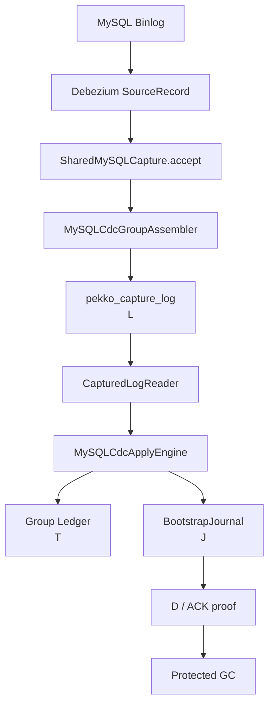

[系列导读](/pekko-cdc-series/) · [第一篇：常驻 CDC](/2026/10/18/pekko-cdc-1-resident-tasks/) · [第二篇：批转流](/2026/10/18/pekko-cdc-2-recovery-contract/) · [第三篇：源码执行](/2026/10/18/pekko-cdc-3-mysql-journal-experiment/) · [第四篇：恢复证明](/2026/10/18/pekko-cdc-4-protocol-design/) · [第五篇：Pekko 与 Flink](/2026/10/18/pekko-cdc-5-flink-comparison/) · [Flink CDC 深入系列](https://xuyinyin.cn/flink-cdc-series/)

> **源码基线**：`cc09559`。实验材料保留各自冻结版本和失败记录；文章不把不同版本的结果合并成一次验收。
>
> **证据标记**：**源码结论**来自当前调用链；**实际实验**来自真实 MySQL、Actor Journal、Sink 或集群；**保存材料复算**不等于重新运行；**未验证边界**不写成产品保证。

> 本文不从状态定义开始，而是沿着一条真实 `id=4` UPDATE 追踪源码和故障证据。

## 0. 先看执行链路



## 1. 事件证据卡片

| 位置 | 记录什么 | 能证明什么 |
|---|---|---|
| SourceRecord | 表、事务、offset、主键 | Reader 收到了哪条源事件 |
| L | group、Schema、ACK parent、digest | 回调前缀是否已持久覆盖 |
| T | 目标 DML 与 group ledger | 目标事务是否可幂等重放 |
| J | execution、batch、revision、receipt | 哪次执行已被 Journal 接受 |
| D | source offset 和 ACK proof | 哪个源前缀可安全释放 |
| GC | actual-D、pin、audit、proof | 哪些证明和 L 允许删除 |

## 2. SourceRecord 到 L

`SharedMySQLCapture.accept` 先把回调放入 pending 队列，再由 `MySQLCdcGroupAssembler` 组装完整事务。只有完整组或明确忽略结果写入 L，原始 callback 才能按连续前缀确认。

```scala
// 解释性代码：展示 callback 与 L 的先后关系
val group = assembler.accept(record)

val durable = group match {
  case CompleteGroup(value) => captureLog.append(value)
  case IgnoredGroup(reason) => captureLog.appendIgnore(reason)
  case PendingGroup(_) => false
}

if (durable) {
  callbackHandle.markProcessedAndFinished()
}
```

**源码结论**：callback 返回只说明 L 覆盖了该 callback 前缀，不说明目标已经提交。

## 3. L 到目标事务 T

`CapturedLogReader` 从 L 中读取完整 group，`MySQLCdcApplyEngine` 将目标 DML 和 group ledger 写在同一目标事务中：

```scala
beginTargetTransaction()

if (ledger.sameIdentity(group.identity)) {
  AlreadyCommitted
} else {
  require(ledger.empty(group.identity))
  applyDml(group.events)
  insertLedger(group.identity, group.evidence)
  commit()
  Committed
}
```

目标行存在不等于当前 T 已经成功。只有 ledger identity、事件证据和目标 DML 同时匹配，才可以安全判断重放结果。

## 4. T 到 Journal J

目标 COMMIT 返回成功后，Journal 仍可能没有持久化 receipt：

```text
T 已提交
  ↓ 进程崩溃
J 尚未持久化
  ↓ 重启
读取 ledger
  ↓
同一 group identity 重放
```

真实 I16 窗口中，目标页已经提交而 Journal 停在旧页；恢复后同一 group 被识别为已有 ledger，最终 64 行、384 个字段逐字段相等。这个结果只覆盖该真实 MySQL、目标和固定故障切点。

## 5. Journal J 到 Source D

J 记录的是执行进度；D 是 Reader 的源 offset。J 前进不能自动证明 D 已经覆盖，D 也不能自动证明目标已经提交。

`CaptureAckPaging` 用 ACK head、anchor、parent digest、source fence 和 guardian attempt 组成 proof identity。proof 未完成时，GC 和恢复许可都不能推进。

## 6. 四个真实故障窗口

| 窗口 | 可能状态 | 正确动作 |
|---|---|---|
| T 已提交、J 未持久化 | 目标 ledger 已存在 | 按 group identity 重放 |
| J 已持久化、D 滞后 | Journal 有 receipt，ACK 尚未覆盖 | 继续验证 ACK ancestry |
| COMMIT 回复丢失 | 目标结果未知 | readback、隔离，无法证明则暂停 |
| 两个原始 ACK 之间崩溃 | callback 前缀未完整确认 | 只重放连续前缀 |

## 7. ACK proof budget 失败

真实集群曾有 7,110 条 ACK，旧一次性 proof 遍历上限为 4,096，因此出现 `ACK proof budget exceeded`。当时 Source/Sink 行数据仍可对账相等，失败发生在“是否有资格回收 L”的证明阶段。

分页 proof 修复后，实际材料记录：

- actual-D proof head：7742；
- ACK nodes：7731；
- refs：7740；
- Source/Sink：均为 2 行、6 个投影字段逐字段一致；
- 旧 proof 在新 actual-D proof 建立后安全回收。

材料见 [`gc-ack-proof-budget-20261113`](https://github.com/Xuxiaotuan/pekko-reference/tree/5a15872/docs/experiments/2026-11-12-runtime-gc/cluster-live-20261113/gc-ack-proof-budget-20261113/) 和 [`gc-ack-proof-gc-20261113`](https://github.com/Xuxiaotuan/pekko-reference/tree/5a15872/docs/experiments/2026-11-12-runtime-gc/cluster-live-20261113/gc-ack-proof-gc-20261113/)。

## 8. 当前结论

**源码结论**：L、目标 ledger、Journal receipt 和 ACK proof 共同构成恢复边界。

**实际实验**：指定 T/J/D 故障窗口可以重放并逐字段对账；长 ACK 链可以分页证明并安全 GC。

**失败证据**：分页预算不足、跨重启读视图漏行、连接空但事务未排空。

**未验证边界**：DDL、所有 Sink provider、无限 ACK 历史、多 owner、70 万真实活跃表和恶意管理员级篡改。
