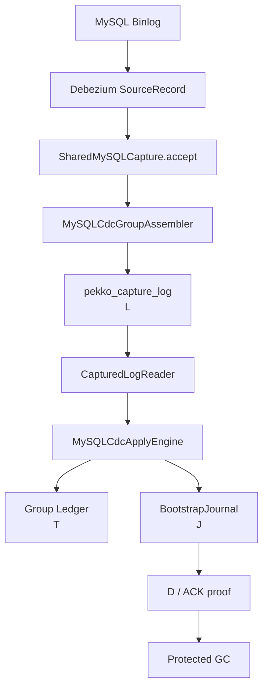

[系列导读](/pekko-cdc-series/) · [第一篇：架构](/2026/10/18/pekko-cdc-1-resident-tasks/) · [第二篇：批转流](/2026/10/18/pekko-cdc-2-recovery-contract/) · [第三篇：源码执行](/2026/10/18/pekko-cdc-3-mysql-journal-experiment/) · [第四篇：恢复证明](/2026/10/18/pekko-cdc-4-protocol-design/) · [第五篇：Pekko 与 Flink](/2026/10/18/pekko-cdc-5-flink-comparison/) · [Flink CDC 深入系列](https://xuyinyin.cn/flink-cdc-series/)

> **源码基线**：`cc09559`。实验材料保留各自冻结版本和失败记录；文章不把不同版本的结果合并成一次验收。
>
> **证据标记**：**源码结论**来自当前调用链；**实际实验**来自真实 MySQL、Actor Journal、Sink 或集群；**保存材料复算**不等于重新运行；**未验证边界**不写成产品保证。

> **2026-11-11 当前源码与证据：** 本轮把 guardian、supervisor、worker 的子 JVM 类路径中的测试类移除，再验证单表进入实时后硬停 worker、隔离、接管和后续更新：源与目标 64 行、384 字段相等，缺行、额外行、字段差异均为空，结束后会话释放。另有真实 MySQL 的历史 Journal 重放和 Bootstrap 跨 JVM receipt 重签测试；这是不同层次的证据，不能相加为任意故障可恢复。旧 C1 自动恢复断言超时的失败材料保留；当前承诺仍是未知 B 安全暂停。 [拆分与验证记录](https://github.com/Xuxiaotuan/pekko-reference/blob/8283a91/docs/experiments/2026-11-08-cdc-standalone-entry/retire-workflow-runtime-20261111/README.md)。

[A/B 补测材料](https://github.com/Xuxiaotuan/pekko-reference/blob/8283a91/docs/experiments/2026-10-27-ab-followup/README.md)记录了 R06、R09、R10-mid 的真实恢复和逐字段复算，也记录预复制基线、停止订阅后的预期差异以及安全暂停；不能把这些样本称为整个矩阵通过。

> **文章修订：2026-10-27。** I08/I11/I16/I21 与 E0 保留原冻结版本；启动准入的已提交实现和新定点实验对应 [`74b6d9a`](https://github.com/Xuxiaotuan/pekko-reference/tree/74b6d9ad1ebcfe19a786f4e1869aed276a63bb52)。本轮有界执行、资源释放和平台调度候选的源码版本、运行摘要及实际结果另见[平台实验报告](https://github.com/Xuxiaotuan/pekko-reference/blob/8283a91/docs/experiments/2026-10-27-cdc-platform/README.md)，不把不同版本的通过项相加。

仍以五张表增加到七张为例：f/g 要先获得完整存量，再持续追上变更。本文回答这条路径在故障窗口中凭什么被接受。我们先从原初始化实验选取三个恢复案例和一个启动反例，再检验后续启动门是否阻止同类不安全重入。最后讨论有界执行和资源释放怎样改变验收条件。它们检验不同命题，不能合并成无条件的端到端保证。

## 0. 一条 UPDATE 的源码链路



每个节点都要问三个问题：写入哪个存储、是否处于 JDBC 事务、异常时谁拥有重试责任。只要这三个问题没有答案，最终行相等就不能被写成 exactly-once 证明。

```scala
// 解释性代码：展示 callback 不能越过 L 的覆盖边界
val group = assembler.accept(record)
val durable = group match {
  case CompleteGroup(value) => captureLog.append(value)
  case IgnoredGroup(reason) => captureLog.appendIgnore(reason)
  case PendingGroup(_) => false
}
if (durable) callbackHandle.markProcessedAndFinished()
```


原初始化的完整 61 项预期检查、运行环境、失败尝试与所有字段导出见[原实验报告](https://github.com/Xuxiaotuan/pekko-reference/blob/8283a91/docs/experiments/2026-10-25-bootstrap/README.md)；启动门后的实际结果见[A1/A2 报告](https://github.com/Xuxiaotuan/pekko-reference/blob/8283a91/docs/experiments/2026-10-27-capture-admission/README.md)。下文按“命题—切点—观察—判定”阅读保存的材料，协议推导见第四篇。未完成的候选实验仍保持待验证。

2026-11-08 未提交候选新增一组互相对照的证据：修复前第五轮因正常重启累计恢复预算而暂停，源变更已进 L，目标未追上；修复后两组各五轮正常启停中，每轮源与目标逐字段相等，Journal 恢复次数为零。另一组在第二次运行后强制终止 JVM，替代进程因旧 owner 释放未证实而安全暂停；退出前的数据一致，但没有验证异常退出后的自动接管与追平。源码和[原始实验材料](https://github.com/Xuxiaotuan/pekko-reference/blob/8283a91/docs/experiments/2026-11-08-cdc-standalone-entry/README.md)均与旧版本分开保存。

[L 未结束事务对照](https://github.com/Xuxiaotuan/pekko-reference/blob/8283a91/docs/experiments/2026-11-08-cdc-standalone-entry/README.md)进一步固定旧状态库事务：旧 worker 崩溃时事务仍可见，替代 worker 保持 UNKNOWN 且没有创建 Reader；旧事务回滚后它仍未自动接管。源目标缺行和多行均为零，但有 5 个字段不同，因此这项实验是安全暂停证据，不是恢复后对账成功。

[D 滞后崩溃对照](https://github.com/Xuxiaotuan/pekko-reference/blob/8283a91/docs/experiments/2026-11-08-cdc-standalone-entry/README.md)在持有真实 offset 行锁时固定了 D 不变、Journal 从 revision 16 推进到 20；杀掉受控 Runner 并释放锁后，重启取得新 D，最终 64 行、384 字段一致。该样本不覆盖独立入口的 guardian 自动接管。

[目标 COMMIT 结果未知对照](https://github.com/Xuxiaotuan/pekko-reference/blob/8283a91/docs/experiments/2026-11-08-cdc-standalone-entry/README.md)分别固定服务端 OK 丢失与 COMMIT 未转发；两次全量 baseline 最终均为 64 行、384 字段一致。这两项不是增量组账本的提交未知，也不验证独立入口的跨进程接管。

[增量 replay 的目标提交对照](https://github.com/Xuxiaotuan/pekko-reference/blob/8283a91/docs/experiments/2026-11-08-cdc-standalone-entry/README.md)分别固定服务端 OK 回复丢失和 COMMIT 未转发：前者切点组账本有 1 条，后者为 0；两者最终均为 3 条，64 行 384 字段相等。它只验证受控 Runner 的两个时序，不证明迟提交或独立入口自动接管。

[增量迟提交与旧连接断开](https://github.com/Xuxiaotuan/pekko-reference/blob/8283a91/docs/experiments/2026-11-08-cdc-standalone-entry/README.md)另固定旧目标事务：迟提交样本观察到真实 COMMIT OK，断开样本在切点观察到旧事务和锁等待；两者最终均为 64 行、384 字段一致。断开样本没有对应 PFS ROLLBACK 事件，只能确认最后事务采样为空。

[独立入口 runtime18](https://github.com/Xuxiaotuan/pekko-reference/blob/8283a91/docs/experiments/2026-11-08-cdc-standalone-entry/README.md)在 JVM 崩溃后修改源表，替代进程因旧 owner 未证明释放而保持 UNKNOWN；T、J、D 采样未前进，目标保留崩溃前数据。源目标此时有差异，因此这是拒绝越界执行的证据，不是恢复追平的证据。

## 1. 先写判定规则，再看测试是否绿色

| 编号 | 要检验的命题 | 成功或拒绝的判定 |
|---|---|---|
| [G1](04-protocol-and-validation.md#g1) | 读视图丢失后，原范围不漂移 | 新 attempt 重读原 spec；不能接旧页游标，也不能重算边界 |
| [G2](04-protocol-and-validation.md#g2) | 同一封存身份对应同一内容 | T 已提交/J 未接受时核实原 receipt；内容冲突必须暂停 |
| [G3](04-protocol-and-validation.md#g3) | 有限追赶的终点和激活依据不移动 | 恢复仍使用原 F；激活 receipt 与 J 分别核实 |
| [G4](04-protocol-and-validation.md#g4) | 初始化结果最终覆盖到固定 F | 必要日志完整时，对整表 B→F 回放；激活后逐字段比较 |
| [G0](04-protocol-and-validation.md#g0) | 必要源变化连续进入 L | 不能把 SDK 重选点后到达的新事件当作旧区间完整证明 |

G0 是后续推理的前提。旧启动反例证明它曾被破坏；新版启动门可以拒绝已识别的不安全状态，但没有修补旧缺失事件。G1—G4 的局部样本通过不能替历史连续性补上证据。目标终值相等、正确暂停和故障后自动继续，也必须分开报告。

## 2. 故障门必须固定真实的因果顺序

实验使用两个独立 MySQL 9.5.0 实例、独立 worker JVM、真实 JDBC Journal 和生产 MySQL Apply 路径。LOW/HIGH/F 是源控制表事务，SourceRecord 来自 SDK；观察门暂停真实代码切点，没有手造 offset 或提交结果。

[BootstrapMatrixSpec](https://github.com/Xuxiaotuan/pekko-reference/blob/55fad0cf27f3a289dbb5d4fb4f2a31d60a661059/server/src/test/scala/cn/xuyinyin/magic/workflow/integration/BootstrapMatrixSpec.scala#L70)先等待指定观察点，再做并发 SQL、断连接或硬停 JVM。例如 T/J 缺口中的门在 `target.applyPage` 返回后、Journal 更新前，不能只看到一条“准备提交”日志就命名为 T 已提交。

主要夹具为 64 行、六字段，包含 DECIMAL、DATETIME(6)、NULL、空串和空白。比较器独立读取保存的源/目标完整行集，检查缺行、多行和逐字段差异；不是用 `COUNT(*)` 或测试中的 `equal=true` 代替判断。

<a id="e-i08"></a>

<a id="e-i08"></a>
## 3. I08：已完成窗口之后修改主键，怎样仍覆盖整表

**命题 G4。** 如果只依赖每个窗口自己的 HIGH，已越过范围的后续变化可能失去补偿。当前实现还应通过完整 B→F 回放覆盖这类变化。

**切点。** 第一段窗口已经完成，原运行状态为 `SCANNING`、`index=1`。固定这个切点后，对源表执行：

```sql
UPDATE a SET id=1000, label='forward' WHERE id=1;
UPDATE a SET id=-40, label='backward' WHERE id=40;
```

前一个键移到冻结 U 之外，后一个键移到已经越过的范围。实验还观察真实主键 DELETE/CREATE 的跨回调交付，再释放执行门。

**观察。** 最终源和目标都为 64 行；主键 1、40 不再存在，目标中两个迁移键为：

| 最终主键 | 目标 label | 源/目标比较 |
|---|---|---|
| −40 | `backward` | 本行各字段相等 |
| 1000 | `forward` | 本行各字段相等 |

整表 384 个字段相等，缺行、多行、不同字段均为空；J 已进入 STREAMING。它验证的是当前数据、源条件和固定窗口下“窗口回填加整表回放”的组合，未单独运行一个删除 B→F 的对照版本。因此不能把此结果包装成对某个替代算法的性能或必然失败证明。

**判定。** 最终键集合必须反映两次迁移，且全部字段一致；只比较行数会漏掉“旧键仍在、新键缺失”。这项正面证据支持 G4 的一个指定样本，G4 的前提和逐键推理在第四篇展开。

<a id="e-i11"></a>

<a id="e-i11"></a>
## 4. I11：RAW 页已保存，原边界行被删，恢复能否沿用旧页

**命题 G1。** RAW 页属于某次 RR 读视图。JVM 退出后，该视图消失；恢复只能复用原范围，不能复用未封存的扫描游标。

**切点。** 原窗口 `a_0_0` 已保存第一页 8 行，J 仍为 `SCANNING/index=0`，没有 sealed manifest。此时硬停 worker，修改源数据，并在重启前删除主键 32。

**观察。** 恢复日志先出现 `ABANDONED a_0_0`，再从新 attempt `a_0_1` 的第 0 页读取。状态库中提取的两个 spec 为：

```text
a_0_0：index=0，lower=null，upper="32"
a_0_1：index=0，lower=null，upper="32"
```

新读视图的页行数为 8、8、8、7；不会把旧视图的第一页拼在前面。最终剩 63 行，378 个字段相等。

**判定。** 即使最终数据相等，若重新规划导致 upper 漂移，也应失败。测试另外断言两个首范围的 upper 相同，避免终值对账掩盖恢复协议变化。这里验的是原范围整段重读，不是每个 Split 有独立 Actor 或可并行领取。

<a id="e-i16"></a>

<a id="e-i16"></a>
## 5. I16：目标页已经提交，Journal 仍停在第 0 页

**命题 G2。** 恢复时应重交同一封存页，并核实原目标 receipt；不能用当前源数据替换旧内容后继续沿用旧页身份。

**切点。** 窗口 `a_0_0` 已封存，第 0 页目标事务返回；J 的 `appliedPage` 仍为 0。现场目标确有 `operation_id=a_0_0:0` 的 receipt。此时硬停 JVM，再修改源数据后重启。

**观察。** 从原始日志摘取相同字段，省略时间和任务前缀：

```text
原运行：window=a_0_0, page=0, kind=BASELINE_T, new=true
恢复后：window=a_0_0, page=0, kind=BASELINE_T, new=false
```

恢复材料仍包含原 receipt，原内容没有被替换；随后应用其余页，再由 B→F/tail 处理源端的新变化。最终 64 行、384 个字段相等。

**判定。** `new=false` 证明本次页操作复用了已有 receipt；真实 T、J、封存材料和最终行集共同支持这一结论。它不等于任意外部触发器、通知或审计副作用恰好一次——首版目标明确禁止业务 trigger、外键和额外唯一约束。

I21 进一步覆盖 G3：切点已经存在目标激活 receipt，但 J 仍为 ACTIVATING、F 的 L 序号为 54；恢复保留原激活证明和 F，进入 STREAMING，后续消费游标到 57，384 个字段相等。54 和 57 是 L 游标，不是“第 54/57 批”，也不能与 D 的 pos 直接比较。此处 384 字段核对的是恢复后继续追赶的终值，不能把 F 之后的值称为 F 时刻的快照。

<a id="e-startup"></a>

<a id="e-startup"></a>
## 6. E0：后续事件已到目标，仍不能证明旧区间完整

**命题 G0。** 既有 B 所承诺的区间，在重启之后仍必须被连续捕获。仅凭 Reader 再次有输出，无法证明这一点。

**切点与真实顺序。** 独立启动探针固定 B 已绑定、原始 ACK 尚未开始，而实际持久 D 仍为 INITIAL 的窗口：

| 顺序 | 观察到的事实 |
|---|---|
| 崩溃前 D | `binlog.000003:194970`，snapshot=INITIAL |
| B 已绑定 | ROW195262、END195412，L sequence18 |
| id1 业务更新已提交 | ROW195705、END195893，GTID 后缀 488 |
| SDK 重启后重选点 | 实际 Schema callback 显示 196292，已越过前述更新 |
| 后续 id2 witness | GTID 后缀 490，到达真实目标和 Journal |

**观察与判定。** 两端各四行、没有缺失或额外主键，但 id1 的 `label/amount/revision/note/updated_at` 五字段仍旧；id2 的六字段一致。witness 对应目标组账本已存在，J 接受 L sequence20；整体仍判定失败。它直接反驳“后续 T/J 继续推进就代表恢复完整”。

**实验边界。** 该探针的初始目标为已复制的四行基线，并非完整 LOW/HIGH 初始化；恢复 batch128、测试代理禁 TLS，并由 producer/callback 双门命中切点。它证明本配置的一次实际不一致，不估计所有配置的失败频率。[启动报告与原始材料](https://github.com/Xuxiaotuan/pekko-reference/blob/8283a91/docs/experiments/2026-10-25-capture-startup/README.md)

<a id="e-conclusions"></a>

## 7. 怎样从代表性证据回到整体验收

| 证据 | 已得到的结论 | 当前状态 |
|---|---|---|
| I08 | 指定跨窗口迁移最终被整表回放补齐 | 限定样本通过 |
| I11 | 丢失读视图后复用范围、新 attempt 整段重读 | 限定窗口通过 |
| I16 / I21 | 目标领先 J 时复用页/激活证据，不移动原 F | 限定窗口通过 |
| E0 | B 已绑定而 D=INITIAL 的旧恢复行为可越过更新 | 历史实际反例；新版本拒绝重入，旧差异保留 |

完整初始化矩阵有 61 项预期检查通过，其中包括正确暂停/拒绝；不是 61 次故障后都自动收敛。旧回归中的 R02 仍失败，自然触发一次通过也不消除确定性反例。数量及其他组件检查统一记在[验证范围表](README.md#全系列验证范围汇总)，不在各篇重复累计。

上述代表性 I08/I11/I16/I21 都来自 [raw-evidence-07.zip](https://github.com/Xuxiaotuan/pekko-reference/blob/8283a91/docs/experiments/2026-10-25-bootstrap/artifacts/raw-evidence-07.zip)，目录前缀为 `target/bootstrap-matrix/matrix-all-1792931094818574000/`，子目录分别是 `I08-2b76f3b231ab`、`I11-ddb83c3124c3`、`I16-da53030119d0`、`I21-ac4cb6c37ede`。每目录的 `cut.json/final.json`、原运行与恢复日志允许复查上文摘取的字段；I08 无崩溃，因此没有 recovered.log。原始文件与摘要见[归档索引](https://github.com/Xuxiaotuan/pekko-reference/blob/8283a91/docs/experiments/2026-10-25-bootstrap/artifacts/archive-index.json)。

这些旧材料继续约束后续版本：允许重新读取，并不等于允许越过尚未进入 L 的变化；允许从固定范围重读，也不等于允许替换已封存内容。新增实现必须补证据，不能改写旧实验的版本和结果。

## 8. 启动门的实测结果：阻止不安全重入，没有修复旧漏数

旧 E0 的问题发生在 Reader 为旧 B 恢复之前。因此，新版本必须先读实际 D、L、history 和源控制事实，再决定是否创建 Engine。若先启动 SDK，再看到它开始输出，已经无法用这个输出证明旧起点没有移动。

[A1/A2 冻结实测](https://github.com/Xuxiaotuan/pekko-reference/blob/8283a91/docs/experiments/2026-10-27-capture-admission/README.md)构造了两类真实旧状态。旧 PREPARED/INITIAL 被分为 `UNBOUND_MARKER_UNPROVEN`，旧 B-bound/INITIAL 被分为 `INITIAL_WITH_COMMITMENT`；两者在新版 Engine 创建次数为 0 时拒绝。旧 B-bound 样本仍保存 id1 五字段差异。正确结果是“没有继续扩大未经证明的同步”，不是“漏掉的数据已恢复”。

新订阅的 B 也不再凭 `Engine.start` 或 Schema callback 放行。当前 attempt 必须有真实启动生命周期、原始 ACK，并核对实际完成态 D 与 L 引用，才能受理新的源 marker。真实 Reader 实验验证了提前调用没有新意图/B、两表并发新增、同身份幂等，以及撤准入后拒绝新命令。它们是控制与采集证据，不能单独算作目标恢复对账。

同版本另跑五个 Bootstrap 定点：I01 的五表新增两表最终 448 行、2688 字段相等；I11 为 63 行、378 字段；I16、I21、I21-postF 各为 64 行、384 字段。每项都重新读取保存的全行集，并核对 L、ACK、spool、边界和目标证据。这是五个明确变体的结果；`completeMatrix=false` 仍保留，未宣称已重跑整个扩展矩阵。

### 源 marker COMMIT 不确定必须单列

真实代理先截留源 COMMIT OK，再丢弃回复。服务端源控制行已经存在，客户端却不知道提交是否成功。实际行为是保留原 operation、进入 `PAUSED_UNPROVEN`、不补写第二个 B，并返回释放未知。

这个样本有实际 D/L/ACK 顺序，源/目标四行、24 字段相等，但目标来自预复制基线，T/J 为空。它证明没有在不确定 marker 上擅自重写或继续承诺；它没有验证 LOW/HIGH 初始化，更没有证明目标 COMMIT 回复丢失后的 T/J 恢复。源 marker 的不确定和目标事务的不确定必须分别定位。

## 9. 平台实测：数据结果与运行资格分开验收

本轮新 P01 经过 HTTP 增加五表，再新增两表并持续写入；七表的源/目标完整行集共 448 行、2,688 字段相等。P02 先运行十个实时订阅再增加第十一表，704 行、4,224 字段相等；snapshot 与 tail 各两个预算，观察到的活动步骤峰值不超过四。它们分别支持“动态初始化已接入平台”和“不会被旧八会话模型卡住”，不能外推到任意活跃规模。

| 样本 | 实际要核对的事实 | 不能写成什么 |
|---|---|---|
| P03 冷任务取消 | 无 execution、J、B，独立 PREEXEC_CANCEL 凭据 | 已初始化或数据一致 |
| P04 READ_OPEN 时取消 | 原 K、排空和部分目标不发布 | 自动完成全量 |
| P05 已实时同步后取消 | a 至 K 停止，b 继续逐字段相等 | 取消后 a 仍追随源端变化 |
| P06 干净重启 | 旧 owner 真实释放并 STOPPED 后，新 JVM 继续且目标相等 | 强杀后自动接管 |
| P07 遗留 ACTIVE grant | 新 owner 保留 UNKNOWN，Engine 创建数为 0 | 故障后自动恢复成功 |
| P08 查询/命令 | 实际 API 幂等、冲突、keyset 与权限 | 端到端数据恢复 |

保存材料的独立复算进一步反序列化真实 JDBC Journal，而非仅信任 `phase=STREAMING` 的投影。它按 task 的 journalRevision 查实际事件，检查 continuation、baseline root、目标 ACTIVATE、Schema、B/F、L 摘要和原始 ACK 前缀。控制面与 J 的采样非原子，允许查询投影落后，但不允许凭没有对应持久事件的标签宣布初始化完成。八个 P 场景中必须相等的切面合计 7,680 字段；取消、未执行和安全暂停的部分目标不凑入相等字段数。**这是保存材料复算，不是第二次数据库实验。**

## 10. 通过数不能代替边界证据

第一个来自测试设施。首轮 P04/P07 的 gate 用 String 引用做 CAS；stdin 产生的新字符串没有命中，READ_OPEN 虽然出现，CUTPOINT 却未真正阻塞。失败保留后，修正探针并重新冻结，才取得固定窗口证据。仅看用例名不能证明故障确实发生。

第二个来自验收契约。旧 Bootstrap 用例期望源 marker COMMIT unknown 后自动进入 STREAMING，新实现却按授权规则 PAUSED。原失败与 outer 超时保留。该版本的 13 个同切点分支明确验安全暂停：原 operation 只有一次源执行尝试，J PAUSED、恢复预算为 0、无 ACTIVATE，重试不继续写源；I22 还核对取消没有被接受、没有 K。不能把这些样本称为十三次自动恢复。旧期待可通过显式 legacy flag 重现。

受管 Reader 关闭也有相似边界。静默和忙源两个真实样本都曾出现“本地已结束、服务器仍 UNKNOWN”，后来同一 operation 才变为 REUSABLE。它们确认的是释放过程，未附带目标/Actor 对账，不能升级为端到端保证。首个 700,000 元数据尝试则因 redo 文件轮换撞上磁盘采样失败，部分记录没有删除；修正精确的采样竞争后另跑新 namespace，失败仍归档。

还有一条已经真实修复的资源遗漏。旧 Kernel 的 L 使用共享控制账号，释放观察却只匹配专属 SDK 账号；真实 MySQL 中的 L 事务仍 RUNNING，旧代码已经返回 reusable 并把 owner 写成 STOPPED。修后保持 L 的数据库位置，改用捕获域专属状态账号；相同窗口在真实事务结束前保持 UNKNOWN 和占用，回滚之后才释放。这是 Reader/L 资源实验，没有目标效果或 Actor Journal 执行，不能混入逐字段收敛数。

R07 也说明回调名不能替代边界：batch=1 时，原始 marker 行的 callback 返回，事务 END 还在后续回调。实际切点 f 仍 B_PENDING，重启安全拒绝。当前测试保留原切点，按持久 B 状态分别验证拒绝或恢复，不把 MARKER_RETURNED 写成完整 B 接受或原始 ACK 已完成。

[本轮报告](https://github.com/Xuxiaotuan/pekko-reference/blob/8283a91/docs/experiments/2026-10-27-cdc-platform/README.md)逐项给出最终候选、源码摘要、真实切点、结果类型、复算和资源确认。旧 61 项、旧 58 项、启动定点和新 P/B/H 各有版本，不能累加成一张“全系统已保证”的通过票。

## 证据、版本与边界

正文只保留支撑主论证的实验结果，按源码结论、实际实验、保存材料复算和未验证边界分开。历史补测、候选版本、失败重跑和集群流水线记录集中保存在[系列实验历史与版本补充](https://github.com/Xuxiaotuan/pekko-reference/blob/8283a91/docs/articles/cdc-design/appendices/06-series-evidence-history.md)。

实验材料本身仍位于 `docs/experiments/`，没有因正文重排而删除或覆盖。本文不能把历史候选的通过项合并成当前版本的完整验收；也不能把局部逐字段对账写成 70 万真实活跃表容量证明。
