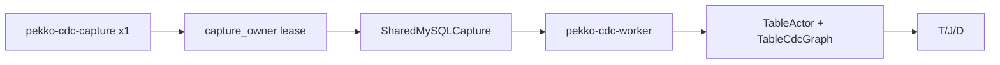
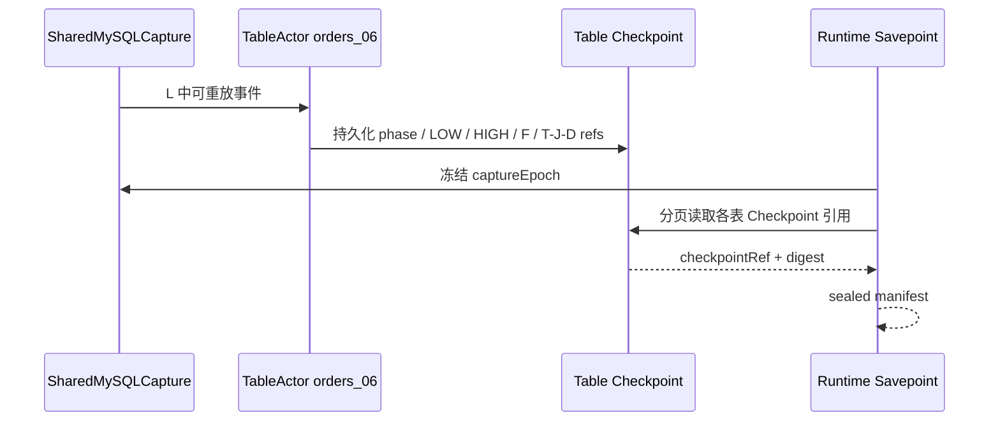
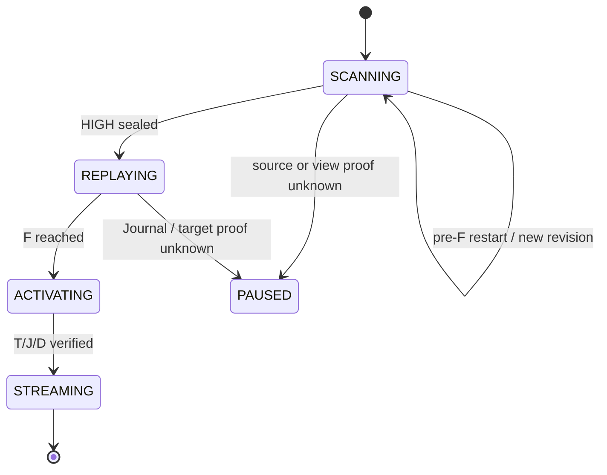
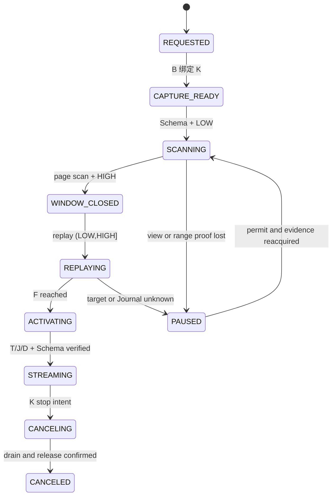
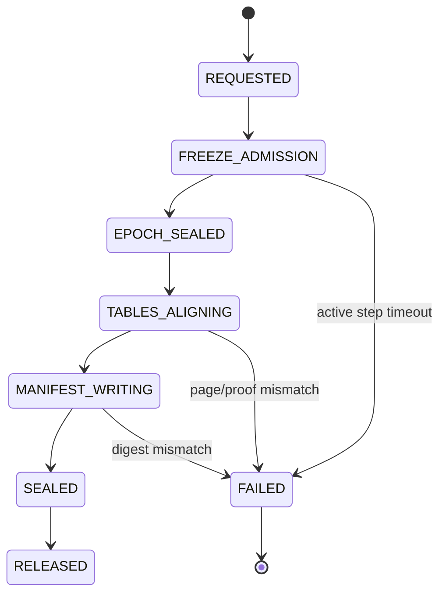
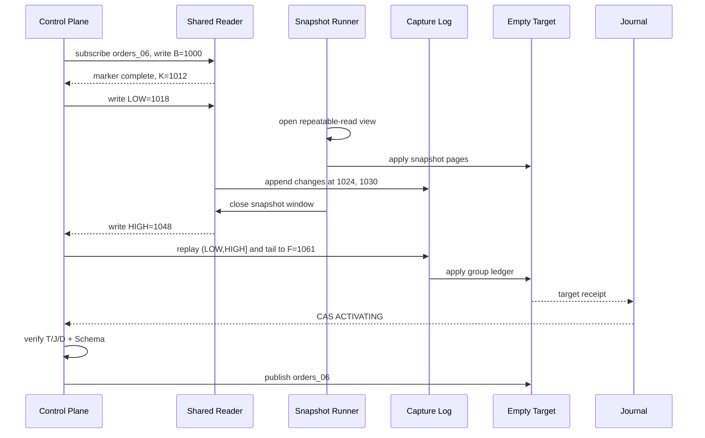

## 2026-11-22 运行时基线更新

本系列当前以 `pekko-reference` 的 `main` 分支为唯一 CDC 基线。生产部署拆成两个模块：`pekko-cdc-capture` 和 `pekko-cdc-worker`。Capture 运行一个副本并持有 `SharedMySQLCapture`。Worker 至少运行两个副本，通过 `TaskLease` 创建独立的 `TableActor` 和 materialized `TableCdcGraph`，不复制源端 Reader。



`pekko-server` 是共享兼容库和历史测试入口，不是第三个生产部署模块。历史源码链接和实验版本仍按原报告解释，不能用当前模块结构改写旧实验结论。

作者：xuyinyin

[系列导读](/pekko-cdc-series/) · [Pekko CDC 深入解析（一）](/2026/10/18/pekko-cdc-1-resident-tasks/) · [Pekko CDC 深入解析（二）](/2026/10/18/pekko-cdc-2-recovery-contract/) · [Pekko CDC 深入解析（三）](/2026/10/18/pekko-cdc-3-mysql-journal-experiment/) · [Pekko CDC 深入解析（四）](/2026/10/18/pekko-cdc-4-protocol-design/) · [Pekko CDC 深入解析（五）](/2026/10/18/pekko-cdc-5-flink-comparison/)

一张新表加入 CDC 时，最容易写出的方案是“先做快照，快照完成后再启动 binlog”。这个顺序没有定义快照期间发生的写入属于哪一边，也没有定义重启后从哪个位置继续。只要把全量和增量拆成两个没有交接证据的任务，就会出现漏数或重复执行。

本文围绕一张新增表 `orders_06` 展开。读者会看到一组具体的 `B、K、LOW、HIGH、F` 数值如何变化，`BootstrapRunner` 如何按窗口推进，以及为什么 `STREAMING` 必须是最后一个状态。

> **源码基线**：`644d8bd`。Pekko 源码调用链按该提交阅读，Flink CDC 对照固定 `release-3.6.0`；后续提交只改变文档或验证材料，不改变本文涉及的生产实现。

历史 I01—I24 只按各自冻结版本和切点解释，当前代码阅读和历史实验不会自动互相升级。

先把自动 Checkpoint 放回主流程。每张表在 SCANNING、WINDOW_CLOSED、REPLAYING 和 STREAMING 之间都要留下可恢复的表级状态；它是故障恢复的最小单位。Runtime Savepoint 只在需要对多张表做运维级冻结时，引用这些已存在的 Checkpoint，不改变 orders_06 自己的 B→K→LOW→HIGH→F 证明。



这条时序说明了两个方向：表级 Checkpoint 先于 Savepoint 存在，Savepoint 不能替代它；新增表或取消表也不会修改其他表的 Checkpoint。

本轮真实验证覆盖了这条时序的故障窗口。

在真实 GRAPH 场景中，LOW/HIGH/F 之外的持续流部分由独立 materialized Graph 承担。表级 Checkpoint 持久化完成后，Graph 才让 SharedMySQLCapture 推进该表的 consumer。这个闭环已经在单表上运行通过，多表 Graph 的冻结与切换仍需单独验证。详见[独立 Graph 验证报告](https://github.com/Xuxiaotuan/pekko-reference/blob/0371c3f/docs/experiments/2026-11-19-table-graph/README.md)。
7 个表级 Checkpoint 场景在重启后均完成目标逐字段对账；自动恢复中 5 个负例保留为 SAFE_BLOCK，R4 与两个 Journal 拒绝探针没有进入注入点。LOW/HIGH/F 的协议推演不能因此扩展为 Runtime Savepoint 已经完成跨 JVM 端到端恢复。详见[Checkpoint 恢复材料](https://github.com/Xuxiaotuan/pekko-reference/blob/228dba6/docs/experiments/2026-11-19-checkpoint-recovery/README.md)。


## 2026-11-22 跨 Chunk 与跨重启修订

本篇当前源码基线为 [`644d8bd`](https://github.com/Xuxiaotuan/pekko-reference/tree/644d8bdcc6d9721e7a08232b935793f05d70dac5)。LOW/HIGH/F 的协议现在与跨重启重建路径对齐：LOW/HIGH 只对当前 revision 的读视图有效，F 只有在目标、Journal 和 ACK 证据完成交接后才能激活。



这次实验证明的是固定 Chunk 和固定窗口下的正确恢复。它没有证明 source fence v2 已经完成独立 guardian 隔离、遗留事务排空和多 owner 接管，也没有把 L floor 的跨进程 GC 验证混入这次结果。未知 source fence 或 L floor 证据时，协议继续安全暂停。

## 0 先固定一张表的时间线

现有 Shared Reader 已经为 `orders_01` 到 `orders_05` 运行。10:00，控制面收到新增 `orders_06` 的订阅请求。

我们把源端 binlog position 简化成整数，方便说明关系。数值不是某次实验的真实 binlog 地址，实验数据仍以材料中的原始 offset 为准。

```text
10:00:00  写入订阅意图，生成 B=1000
10:00:02  marker 被 Reader 看到并完成事务，得到 K=1012
10:00:03  写入 LOW marker，记录 LOW=1018
10:00:04  快照扫描开始
10:00:05  源表 id=7 更新，事件进入 L，位置 1024
10:00:06  源表 id=12 删除，事件进入 L，位置 1030
10:00:08  快照页扫描结束，记录 HIGH=1048
10:00:10  回放 (LOW,HIGH]，继续追到 F=1061
10:00:11  T/J/D 和 Schema 校验通过，进入 STREAMING
```

这条时间线中，`id=7` 的更新可能已经被快照读到，也可能只存在于 L。系统不能靠最终行值猜它走过哪条路径。窗口边界必须直接写进状态。

## 1 七个事实分别解决什么问题

| 事实 | 作用 | 不能替代 |
|---|---|---|
| `B` | 记录订阅意图及其 generation | Reader 已经接纳该表 |
| `K` | 记录控制 marker 在共享 Reader 中完成的边界 | 全量已经完成 |
| `LOW` | 读视图建立时的源日志位置 | 快照结束位置 |
| `HIGH` | 本次快照窗口允许回填的上界 | 可以立即发布实时流 |
| `F` | 全量数据已经追到的发布前缀 | 最后一个业务批次 |
| `T/J/D` | 目标、Journal 和 Source ACK 的交接证据 | 一个可直接比较的 offset |
| `Schema` | 这次读取和写入使用的字段版本 | DDL 已经在所有表可见 |

`B`、`K` 解决“捕获是否建立”。`LOW`、`HIGH` 解决“快照覆盖哪段窗口”。`F` 解决“增量回放追到哪里才可以发布”。`STREAMING` 只有在这些事实已经形成关系后才能出现。



## 1.1 在 LOW/HIGH/F 之上再加一层 Runtime Savepoint

LOW/HIGH/F 解决一张表怎样从快照进入流式；Savepoint 解决多个表怎样在同一个 Shared Reader 观察面下被整体描述。二者不能互相替代。

```text
表级状态：B → K → LOW → HIGH → F → STREAMING
Runtime 状态：REQUESTED → FREEZE_ADMISSION
              → EPOCH_SEALED → TABLES_ALIGNING
              → MANIFEST_WRITING → SEALED → RELEASED
```

`EPOCH_SEALED` 保存当前 capture 的 L frontier、capture position、route digest 和 table-set digest。`TABLES_ALIGNING` 逐页读取任务索引和表级 Checkpoint 引用，不重新执行快照、不创建新的表级 Actor，也不把所有 70 万条目录记录一次性装入内存。



对 `orders_06` 的数值案例，Savepoint 可以记录：

```text
captureEpoch=17
sealedSequence=1061
orders_01.phase=STREAMING, checkpointRef=...
orders_06.phase=REPLAYING, F=1061, checkpointRef=...
orders_07.phase=SCANNING, HIGH 未封存, checkpointRef=...
```

这三个表不需要有相同的 `D`，也不需要共享一个目标事务。它们只需要证明自己的表级状态都属于 `captureEpoch=17`，并且各自的 T/J/D 恢复边界可以重新读取。

动态订阅的规则也必须写入协议：Savepoint 冻结前已经受理的表进入 table set；冻结期间到达的新表排在 Savepoint 之后，使用新的 B 独立初始化；冻结前已经取消的表写入 tombstone，恢复时不能自动复活。

当前第一版实现已经把 Runtime 冻结接到 `SharedMySQLCapture` 和 `CdcPlatformRuntime`：创建 Savepoint 时拒绝新增、取消和新的 step 派发，等待活动 grant 排空后封存 epoch。等待超时或分页摘要不一致时，Savepoint 标记失败，现有表级任务状态不被修改。

## 2 LOW/HIGH/F 的数值推演

### 2.1 LOW 为什么必须先于快照

`K=1012` 表示 Reader 已经捕获到这张表的订阅边界。随后单独写入 LOW marker，得到 `LOW=1018`。快照连接以固定读视图扫描主键范围。

如果没有 LOW，快照连接和 Reader 之间没有共同起点。扫描结束后即使知道一个新的 offset，也无法判断扫描期间哪些事件已经被快照覆盖。

对于快照行集 `S` 和 L 中的变更集合 `C`，本窗口的目标基线可以写成：

$$
Target_{base} = Snapshot(S, view_{LOW}) \oplus Replay(C_{LOW < p \le HIGH})
$$

其中 `⊕` 不是简单的追加，而是按 group identity 和主键语义合并。UPDATE、DELETE、CREATE 不能只按最后一行值去重。

### 2.2 HIGH 是扫描结束时的回填上界

快照最后一页提交后，Reader 写入 HIGH marker，得到 `HIGH=1048`。这一步只关闭当前窗口，不表示任务可以转为流。

在 `LOW=1018` 和 `HIGH=1048` 之间发生的事件已经进入 L。回放程序先把这段前缀应用到独占空目标表，再把回放位置推进到 `F`。

本例中 `F=1061`，因为回放时又出现了位置 1052 和 1061 的事件。`F` 必须是已经完成目标提交、Journal receipt 和 source ACK proof 的前缀。只写入 `F=1061` 而没有 T/J/D 关系，仍然不能激活任务。



### 2.3 为什么不能把快照游标当成 LOW/HIGH

假设扫描到了主键 `b`，进程在此处退出。另一连接随后提交了排序更靠前的 `a`。新连接从 `b` 继续读取，可能只看到 `d`，漏掉 `a`。持久化游标只描述上次读到的位置，不能证明跨重启后读视图仍然包含同一范围。

因此窗口恢复至少需要重新确认：

```text
window identity
read view / isolation boundary
lower and upper key range
applied page and completion root
```

如果读视图或范围证明丢失，当前实现会放弃旧窗口并重新获取证据。它不会把游标直接当成新的 LOW。

## 3 源码调用链

当前实现的职责分成四层。

```text
CdcBootstrapKernel
  └─ 建立 capture、task session 和 source schema
SharedMySQLCapture
  └─ 处理 marker、原始 callback、ACK 前缀和 K
BootstrapRunner
  └─ 读取 split、提交 page、回放到 F、推进 phase
CdcTaskStore / BootstrapJournal
  └─ 持久化 B、窗口 spec、grant、continuation、T/J 交接
```

`BootstrapRunner.scanStep` 是可重复调用的推进函数。一次 step 只处理一个固定范围或一页，不把整张表放入一个长事务。典型顺序如下：

```text
1. 读取当前 window spec 和 appliedPage
2. 校验 generation、Schema、lower、upper
3. 读取一页 RAW 数据
4. 写入目标临时表和 page receipt
5. CAS appliedPage
6. 没有下一页时写 HIGH 和 completion root
7. 由 replay step 读取 L 并推进 F
```

相邻窗口必须满足：

$$
upper_i = lower_{i+1}
$$

窗口完成条件还包括 page receipt、digest 和 completion root。最后一次 `COUNT(*)` 不能替代这些关系，因为 count 相等无法证明窗口没有空洞或重叠。

源码入口：

- [`CdcBootstrapKernel.scala`](https://github.com/Xuxiaotuan/pekko-reference/blob/main/common/src/main/scala/cn/xuyinyin/magic/cdc/platform/CdcBootstrapKernel.scala)
- [`SharedMySQLCapture.scala`](https://github.com/Xuxiaotuan/pekko-reference/blob/main/common/src/main/scala/cn/xuyinyin/magic/connectors/mysql/source/capture/SharedMySQLCapture.scala)
- [`BootstrapRunner.scala`](https://github.com/Xuxiaotuan/pekko-reference/blob/main/common/src/main/scala/cn/xuyinyin/magic/cdc/bootstrap/BootstrapRunner.scala)
- [`CdcTaskStore.scala`](https://github.com/Xuxiaotuan/pekko-reference/blob/main/common/src/main/scala/cn/xuyinyin/magic/cdc/platform/CdcTaskStore.scala)

## 4 三个故障窗口

### 初始化中取消

如果任务只有 B，还没有 K，取消可以删除待接纳意图，但不能推进 D，也不能影响其他表共享的 L。如果已经拿到 K，取消需要写 STOP marker，等待当前 callback 前缀完成，再关闭 assembler、Journal session 和目标临时表。清理动作属于任务级状态转移，不能通过删除目录行代替。

### T、J、D 速度不同

`T` 已提交、`J` 尚未写入时，目标 ledger 必须返回同一 group identity，恢复才可以写 receipt。`J` 已写入、D 滞后时，Reader 可以重读被 proof 覆盖的前缀。提交结果未知时，任务停在 `PAUSED`，直到 permit、owner、ledger 和 proof 重新形成关系。

### Schema 在 writer 缓冲中改变

快照和实时回放必须携带 schema version。旧 Schema 数据还在 writer buffer 中时，不能直接用新 Schema 解释字段。当前系列的 DDL 完整端到端矩阵仍不充分，这个窗口只能作为需要继续验证的边界，不能由 LOW/HIGH 结论自动覆盖。

## 5 实验如何对应状态机

| 实验 | 对应窗口 | 实际结果 | 支持范围 |
|---|---|---|---|
| I08 | LOW/HIGH 与边界键变化 | 固定范围重建后逐字段收敛 | 证明指定窗口可以重读 |
| I11 | 多 Chunk 相邻范围 | completion root 与范围连续 | 证明固定主键范围的衔接 |
| I16 | T 已提交、J 未推进 | ledger 幂等重放，64 行、384 字段相等 | 证明指定重启切点 |
| proof cursor snapshot | 跨重启游标与读视图 | 发现从 `b` 续扫可能漏掉更早提交的 `a` | 证明持久 cursor 不是读视图证明 |

这些实验分别覆盖状态机中的局部边界。它们没有证明任意排序键、任意隔离级别、任意 DDL 组合都可以自动恢复。

## 6 什么时候才能进入 STREAMING

对 `orders_06`，激活条件可以写成：

```text
B 已记录
K 已完成
Schema 已准备
LOW/HIGH 窗口已封存
所有 snapshot page 已有 receipt
L 中 (LOW,HIGH] 已回放
F 已经被 ACK proof 覆盖
T/J/D 关系可重读
独占空目标表逐字段对账通过
旧 owner 和事务已排空
```

任何一项为 UNKNOWN，状态停在 `PAUSED`。`STREAMING` 不是 Reader API 返回值，而是控制面把一组证据写入同一代任务状态后的结果。

## 下一篇：把 `orders_06` 放进 Flink CDC 的 Split、Checkpoint 与 Savepoint

第五篇把同一张 `orders_06` 放进 Flink CDC 3.6.0 的 Enumerator、Split、Reader、Checkpoint 和 Savepoint，比较两套运行时分别承担哪些责任。

## 附录：实验与源码入口

- [LOW/HIGH 故障矩阵 I01—I24](https://github.com/Xuxiaotuan/pekko-reference/blob/472e809/docs/experiments/2026-10-25-bootstrap/README.md)
- [跨重启分页反例](https://github.com/Xuxiaotuan/pekko-reference/blob/472e809/docs/experiments/2026-10-29-proof-cursor-snapshot/README.md)
- [动态订阅和共享 Reader 材料](https://github.com/Xuxiaotuan/pekko-reference/blob/472e809/docs/experiments/2026-10-28-ab-matrix/README.md)
- [最终 acceptance](https://github.com/Xuxiaotuan/pekko-reference/blob/472e809/docs/experiments/2026-11-12-runtime-gc/cluster-live-20261113/final/README.md)

多表实验证明表级 Graph 可以共享捕获层，同时保持各自的 Journal、cursor 和 ACK。跨 JVM 重启和 Savepoint 协调仍未纳入这轮证据。详见[多表 Graph 验证报告](https://github.com/Xuxiaotuan/pekko-reference/blob/a7c48a7/docs/experiments/2026-11-20-table-graph-multi/README.md)。

单表 Graph 现在已有 Journal 恢复证据。恢复许可来自持久化的 `deltaAfter` 和 `batchSequence`，不是进程内的最后 cursor。多表同时恢复协调和 Savepoint 仍未验证。详见[Graph Journal 恢复报告](https://github.com/Xuxiaotuan/pekko-reference/blob/56b1daf/docs/experiments/2026-11-20-table-graph-restart/README.md)。

表级状态机现在有初始化、追平、持续流和取消的真实证据。取消后重新订阅同一表的 generation 恢复仍未验证。详见[Graph 取消验证报告](https://github.com/Xuxiaotuan/pekko-reference/blob/299c954/docs/experiments/2026-11-20-table-graph-cancel/README.md)。

## 2026-11-22 C1 提交结果未知恢复复核

本轮在 `cdc-runtime-acceptance` 使用独立 supervisor、Guardian、旧 Worker、新 Worker、真实 MySQL、Actor Journal 和 Sink 重跑 C1。旧 Owner 的 COMMIT 回复被代理丢弃后，Guardian 先确认旧 Owner 隔离和连接排空，Journal 保持 `RECOVERY_PENDING`，新 Owner 消费恢复许可并安装 Reader gate。

修复后的运行完成两窗口快照、B 到 F 回放、Graph 激活和持续流转。源表与目标表逐字段对账结果为 384 个字段一致，缺失、额外和字段差异均为空，Guardian drain 和会话释放均确认。证据保存在 [C1 实验材料](https://github.com/Xuxiaotuan/pekko-reference/blob/main/support/docs/experiments/2026-11-22-graph-fence-v2/k8s-v2-reader-20261122/README.md)。

修复前的 `RECOVERY_PENDING/local_release_unconfirmed`、Reader 未启动和逐字段缺失材料仍保留在同一实验目录中。这个结果覆盖单表固定窗口和 64 行样本，后续容量结论按两到三张表单独验证，不能外推到 70 万物理表。

## L floor 与 Graph 生命周期复核

本轮把 `TableCdcGraphRuntime` 的生命周期依赖收敛到 `TableGraphLifecycle`，Graph 的 materialize、stop 和恢复入口不再直接持有 Runner 实例。快照 LOW/HIGH/F 仍由现有快照生命周期驱动，Streaming 阶段由独立 Graph materialize。源码已推送到 [pekko-reference main](https://github.com/Xuxiaotuan/pekko-reference/tree/main)。

L floor 的两表跨进程 GC 复跑已创建真实 MySQL、`a`/`b` 两张表和真实 Debezium Reader。首轮暴露 GC 账号缺少 `pekko_capture_epochs_v1` 权限，第二轮已进入 streaming，但 `a` 在固定窗口内未进入最终 `STREAMING`，因此这轮保留为 `evidence_incomplete`，材料见 [L floor 复跑记录](https://github.com/Xuxiaotuan/pekko-reference/tree/main/support/docs/experiments/2026-11-22-graph-fence-v2/l-floor-followup-20261122)。这条边界不能被 C1 的单表恢复通过覆盖。

## LOW/HIGH/F 之后的维护边界

LOW/HIGH/F 的初始化和转流路径已经在真实单表流程中跑通，计划停止后的 STREAMING 进度也能重新进入调度。L floor 的安全回收还需要额外满足实际 D、ACK proof 分页、慢表 pin 和 GC operation 的联合条件。当前两表探针已经验证 namespace inventory 和阻断保护，但没有把删除超时解释成成功。

因此，协议可以描述“何时允许回收”，不能在缺少 GROUP deletion 证据时声称“已经完成回收”。
