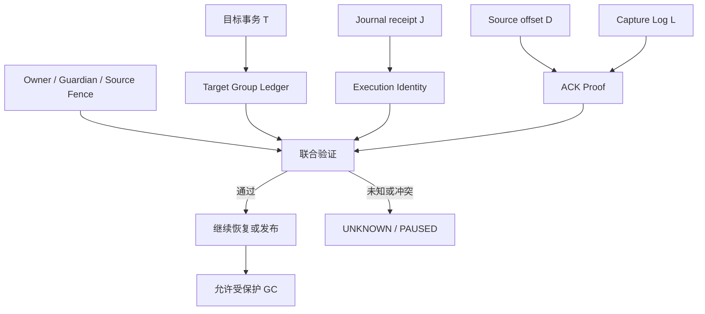
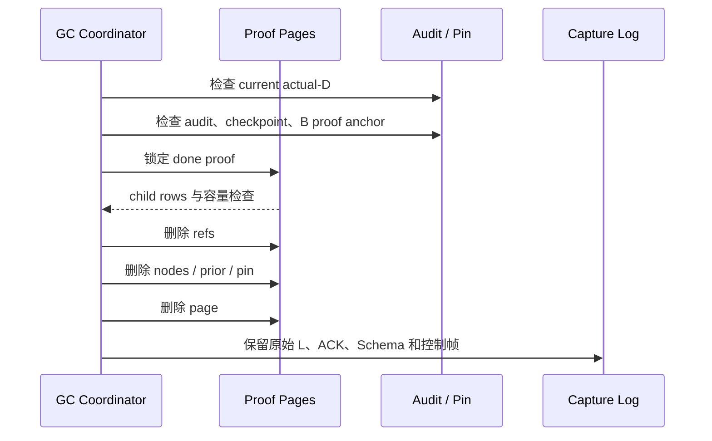

[系列导读](/pekko-cdc-series/) · [第一篇：常驻 CDC](/2026/10/18/pekko-cdc-1-resident-tasks/) · [第二篇：批转流](/2026/10/18/pekko-cdc-2-recovery-contract/) · [第三篇：源码执行](/2026/10/18/pekko-cdc-3-mysql-journal-experiment/) · [第四篇：恢复证明](/2026/10/18/pekko-cdc-4-protocol-design/) · [第五篇：Pekko 与 Flink](/2026/10/18/pekko-cdc-5-flink-comparison/) · [Flink CDC 深入系列](https://xuyinyin.cn/flink-cdc-series/)

> **源码基线**：`cc09559`。实验材料保留各自冻结版本和失败记录；文章不把不同版本的结果合并成一次验收。
>
> **证据标记**：**源码结论**来自当前调用链；**实际实验**来自真实 MySQL、Actor Journal、Sink 或集群；**保存材料复算**不等于重新运行；**未验证边界**不写成产品保证。

> 本文回答：当 T、J、D 处在不同位置，系统凭什么决定继续、重放、暂停或回收日志？

## 0. 恢复关系图



## 1. T/J/D 不是三个相等的 offset

| 事实 | 记录什么 | 推进条件 |
|---|---|---|
| T | 目标事务和 group ledger | 目标 identity 与事件证据匹配 |
| J | Journal receipt、execution、revision | receipt 可重新读取且 revision 连续 |
| D | Source offset 和 ACK 前缀 | ACK ancestry 覆盖当前 D |

安全条件应写成：

```text
recoverable(batch) =
  targetIdentityVerified
  ∧ journalReceiptVerified
  ∧ ackProofCovered
  ∧ ownerFenceVerified
```

这不是 `T == J == D`。三个位置可以暂时不同，但每次推进到恢复、发布或 GC 边界时，必须形成同一批次、同一 generation、同一 source fence 下的覆盖关系。

## 2. 故障矩阵

| 故障窗口 | T | J | D | 动作 |
|---|---|---|---|---|
| T 已提交、J 未写 | 已知 | 未知 | 可能滞后 | 查询 ledger，按原 identity 重放 |
| J 已写、D 滞后 | 已知 | 已知 | 滞后 | 验证 ACK proof 后推进 |
| COMMIT 回复丢失 | 未知 | 未知 | 未知 | 隔离、readback，证据不足则暂停 |
| 两个 ACK 之间崩溃 | 可能已写 | 可能未写 | 未覆盖 | 只确认连续前缀 |
| 旧 owner 未隔离 | 未知 | 未知 | 未知 | 新 owner 禁止执行 |
| proof 删除一半 | 不可信 | 不可信 | 不可信 | 暂停并重建 proof |

## 3. 恢复入口的解释性代码

```scala
// 解释性伪代码：表示恢复许可的联合检查
def recover(batch: BatchIdentity): RecoveryDecision = {
  if (!targetLedger.matches(batch)) Pause("TARGET_EVIDENCE_UNKNOWN")
  else if (!journal.receiptMatches(batch)) Pause("JOURNAL_EVIDENCE_UNKNOWN")
  else if (!ackProof.covers(batch.sourceFence, batch.offset)) Pause("ACK_NOT_COVERED")
  else if (!guardian.fenceVerified(batch.ownerAttempt)) Pause("OWNER_NOT_ISOLATED")
  else Continue
}
```

代码中最重要的不是 `Continue` 分支，而是每个证据缺失时都进入可持久化的暂停状态。

## 4. 长 ACK 链为什么需要分页 proof

一次性遍历 ACK 链会受到固定预算限制。真实集群在 7,110 条 ACK 时触发旧的 4,096 budget 失败。

分页 proof 状态包括：

```text
proof_id
head_seq / anchor_seq
next_seq / next_digest
ref_index
revision
phase = BUILD | VERIFY | DONE
```

因此，进程可以在第 73 页退出，重启后从 `next_seq/ref_index/revision` 继续；identity 或 revision 不一致时拒绝继续。

## 5. 安全 GC 的删除顺序



慢表、容量不足、proof 未完成和恢复点缺失都进入 `GC_BLOCKED`，不删除原始日志。

## 6. 实验结论和边界

**实际实验**：真实 MySQL、Actor Journal、MySQL Sink 完成分页 proof、actual-D 更新、旧 proof 回收和 Source/Sink 逐字段对账。

**保留失败**：旧 ACK proof budget exceeded、连接列表为空但未归属事务仍存在、跨重启分页游标漏行。

**未验证边界**：proof 表无限增长、DDL、复合主键、多 owner、物理文件缩容和 70 万真实活跃表。

源码入口：`CaptureAckPaging.scala`、`CaptureGcRetention.scala`、`CdcGcCoordinator.scala`。完整材料见 [`2026-11-12-runtime-gc`](https://github.com/Xuxiaotuan/pekko-reference/tree/9653daa/docs/experiments/2026-11-12-runtime-gc/cluster-live-20261113/)。
