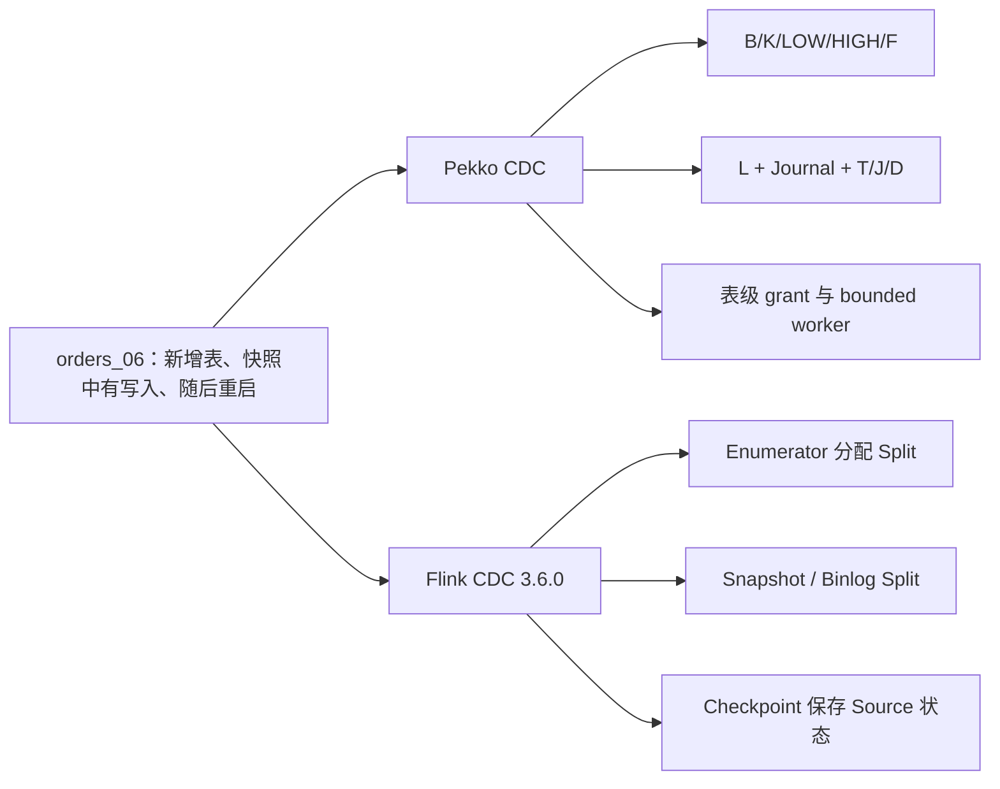
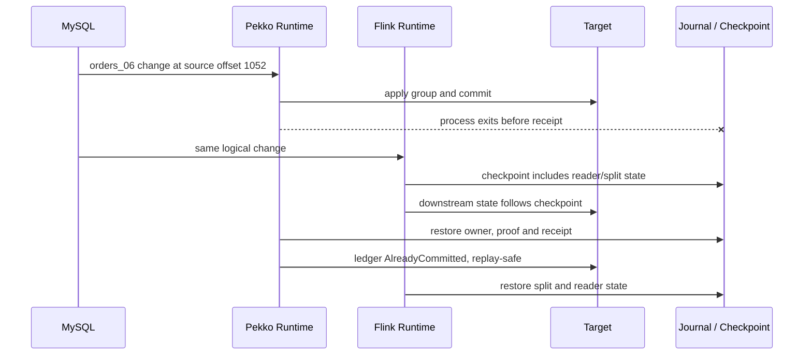

作者：xuyinyin

[系列导读](/pekko-cdc-series/) · [Pekko CDC 深入解析（一）](/2026/10/18/pekko-cdc-1-resident-tasks/) · [Pekko CDC 深入解析（二）](/2026/10/18/pekko-cdc-2-recovery-contract/) · [Pekko CDC 深入解析（三）](/2026/10/18/pekko-cdc-3-mysql-journal-experiment/) · [Pekko CDC 深入解析（四）](/2026/10/18/pekko-cdc-4-protocol-design/) · [Pekko CDC 深入解析（五）](/2026/10/18/pekko-cdc-5-flink-comparison/)

前四篇已经把 Pekko CDC 的资源、事件身份、恢复证明和 LOW/HIGH 状态机拆开。最后一篇不再问“哪个框架更好”，而是把同一张新增表放进两套运行时，比较每一条责任由谁承载。

案例仍然是 `orders_06`。它在一个已经运行的 MySQL capture 中加入，先完成快照，快照期间继续发生写入，再追到一个可以发布的边界。比较对象固定为 Pekko 当前实现和 Flink CDC 3.6.0 的 MySQL Source 源码。本文没有在同一机器、同一 Sink 和同一故障点重跑 Flink，因此结论只讨论状态归属、恢复路径和资源模型。

## 0 先给出结论

Pekko 和 Flink CDC 都能表达“快照之后接增量”，但它们把边界放在不同位置。

Pekko 把 `B、K、LOW、HIGH、F、T/J/D、Schema` 拆成任务级状态，并由 Shared Reader、Journal、目标 ledger 和控制存储共同推进。它适合把表级生命周期放进一个长期运行的控制面。

Flink CDC 把快照 Split、binlog Split、Split 分配状态、Reader 状态和 Checkpoint 放进 Source API 运行时。它把恢复和并行读取做成 Job 级基础设施，适合活跃表较多、吞吐和状态后端是主导问题的场景。

这不是性能结论。当前材料没有同负载 Flink benchmark，也没有 70 万真实物理表的长期容量曲线。



## 1 同一张表的业务承诺

`orders_06` 的操作序列固定如下：

```text
10:00  请求订阅 orders_06
10:02  捕获边界完成
10:03  开始快照
10:05  id=7 更新，id=12 删除
10:08  快照 Split 完成
10:10  回填快照窗口内的事件
10:11  进入持续同步
10:12  在目标提交与进度持久化之间重启
```

两套系统都必须回答四个问题：

1. 快照期间的更新由谁保存。
2. 快照 Split 和增量读取在哪里交接。
3. 重启时从哪一个状态恢复。
4. 哪一条状态可以决定目标继续发布。

差异从这里开始。Pekko 把这些问题拆到多张控制表和 Journal 中。Flink 把它们收敛到 SplitEnumerator、SourceReader 和 Checkpoint state。

## 2 Flink CDC 的源码调用链

Flink CDC 3.6.0 的 MySQL Source 从 `MySqlSourceEnumerator` 开始。Enumerator 接收 Reader 的 split 请求，从 `MySqlHybridSplitAssigner` 取下一个 split，再通过 Source Coordinator 分配给具体 Reader。

```text
MySqlSourceEnumerator
  └─ MySqlHybridSplitAssigner.getNext()
       ├─ MySqlSnapshotSplitAssigner.getNext()
       │    └─ MySqlChunkSplitter.splitChunks()
       └─ MySqlBinlogSplitAssigner
  └─ addSplitsBack(...) on failure
  └─ snapshotState(checkpointId)
  └─ notifyCheckpointComplete(checkpointId)
```

`MySqlSnapshotSplitAssigner` 保存 `remainingSplits`、`assignedSplits`、表 Schema 和已完成 Split 的 binlog offset。它在所有 snapshot split 完成后，还要等待一个完整 Checkpoint，才把 snapshot assigner 标记为 finished。这个等待保证已完成的 Split 处理结果已经进入一致的 Checkpoint 边界。

`MySqlHybridSplitAssigner` 不会在 snapshot split 尚未完成时直接分配 binlog split。源码中的顺序是先返回 snapshot split，等 snapshot assigner 完成并且 finished split 信息齐全，再创建或更新 binlog split。否则同一主键的快照行和增量事件可能乱序。

`MySqlSourceReader` 的 `snapshotState(checkpointId)` 会保存未完成的 snapshot split、尚未确认的 finished snapshot split 和未完成的 binlog split。Reader 失败后，Enumerator 通过 `addSplitsBack` 把这些 split 放回待分配集合。

源码入口：

- [`MySqlSourceEnumerator.java`](https://github.com/apache/flink-cdc/blob/release-3.6.0/flink-cdc-connect/flink-cdc-source-connectors/flink-connector-mysql-cdc/src/main/java/org/apache/flink/cdc/connectors/mysql/source/enumerator/MySqlSourceEnumerator.java)
- [`MySqlSnapshotSplitAssigner.java`](https://github.com/apache/flink-cdc/blob/release-3.6.0/flink-cdc-connect/flink-cdc-source-connectors/flink-connector-mysql-cdc/src/main/java/org/apache/flink/cdc/connectors/mysql/source/assigners/MySqlSnapshotSplitAssigner.java)
- [`MySqlHybridSplitAssigner.java`](https://github.com/apache/flink-cdc/blob/release-3.6.0/flink-cdc-connect/flink-cdc-source-connectors/flink-connector-mysql-cdc/src/main/java/org/apache/flink/cdc/connectors/mysql/source/assigners/MySqlHybridSplitAssigner.java)
- [`MySqlSourceReader.java`](https://github.com/apache/flink-cdc/blob/release-3.6.0/flink-cdc-connect/flink-cdc-source-connectors/flink-connector-mysql-cdc/src/main/java/org/apache/flink/cdc/connectors/mysql/source/reader/MySqlSourceReader.java)

这些类来自 Flink CDC 的 `release-3.6.0` 源码分支。3.6.0 的发布信息和兼容范围见 Apache Flink CDC 官方仓库。[版本发布页](https://github.com/apache/flink-cdc/releases)

## 3 Pekko 的同一条路径

Pekko 侧的调用链是另一种拆法：

```text
CdcBootstrapKernel
  └─ SharedMySQLCapture
       ├─ marker → B/K
       ├─ raw callback → L
       └─ ACK prefix → D
  └─ BootstrapRunner
       ├─ snapshot page → appliedPage
       ├─ HIGH / completion root
       └─ replay → F
  └─ BootstrapJournal + target ledger
       └─ T/J/D verification → STREAMING
```

对 `orders_06`，Pekko 的边界是：

```text
B=1000
K=1012
LOW=1012
HIGH=1048
F=1061
```

快照 page 和 L 的变更都归属于同一个 generation。目标临时表在 T/J/D 和 Schema 检查完成前不对业务发布。发生重启时，恢复入口先验证 owner、permit、Journal receipt 和 proof，再决定重放页面或继续回放 L。

Flink 的等价信息分散在 split state 和 checkpoint state 中。Pekko 没有把所有状态合成一个 Source checkpoint，而是把表级生命周期拆开。这个设计让取消一张表、新增一张表和给某一张表单独分配资源更直接，但也增加了需要自行证明的关系数量。

## 4 同一故障窗口里的恢复差异

把重启放在目标提交与进度持久化之间。



Pekko 的恢复依赖多份证据重新形成关系。目标 ledger 只能证明目标是否见过某个 group identity，不能单独推进 Journal。ACK proof 只能证明 Source 前缀，不能单独证明目标提交。所有证据都属于同一 owner 和 generation 时，才允许进入下一步。

Flink 的恢复边界由 Checkpoint 统一承载 Source split state、Reader state 和下游算子状态。`MySqlSourceEnumerator` 从保存的 pending state 重建 Split，Reader 从 checkpoint 恢复未完成 split。这个模型减少了业务代码需要手工组合的持久化对象，但动态表目录的加入和取消仍然需要通过作业与 Source 运行时的变更机制治理。

## 5 两套系统各自解决了什么

| 责任 | Pekko CDC | Flink CDC 3.6.0 |
|---|---|---|
| 表的订阅意图 | `B`、generation、控制存储 | Source 配置和 Split 生命周期 |
| 快照拆分 | `BootstrapRunner` 的范围窗口和 page receipt | `MySqlChunkSplitter` 和 snapshot split |
| 快照到增量 | `LOW/HIGH/F`、L 回放 | hybrid split 和 finished split offset |
| Source 进度 | L、ACK proof、D | Enumerator/Reader checkpoint state |
| 目标幂等 | group ledger、T/J receipt | 由具体 Sink、状态和提交协议决定 |
| 资源准入 | grant、snapshot/tail worker 上限 | Source 并行度、slot 和 backpressure |
| 单表取消 | 任务级 STOP、排空和释放 | 需要通过作业或 Source 变更路径处理 |
| 运行时恢复 | guardian、owner fence、Journal | JobManager、TaskManager、Checkpoint |

这个表描述的是责任归属。它不把任一边的所有连接器都自动升级成相同的端到端语义。

## 6 证据如何支持比较

Pekko 当前材料覆盖：

- 真实 MySQL Reader 的事件身份和 ACK 顺序。
- 目标先提交、Journal 后推进的固定重启窗口。
- LOW/HIGH、B/F 和多 Chunk 的固定故障矩阵。
- Actor Journal、MySQL Sink 和逐字段对账。
- proof 分页、保护引用和小批量 GC。

Flink 侧本文使用 3.6.0 源码调用链和公开运行模型。没有同数据集、同 Sink、同故障点的实时重跑，因此下面这些结论没有证据支持：

```text
Pekko 比 Flink 吞吐更高
Pekko 比 Flink 连接更少
Pekko 比 Flink 更可靠
Flink 一定能自动处理所有动态表变更
```

当前可以确认的是运行时责任不同。Pekko 把表级状态和生命周期拆到控制面，Flink 把 Split、Reader 和 Checkpoint 交给统一 Source 运行时。

## 7 适用场景

Pekko 更适合这些主导矛盾：

- 一个 MySQL 实例有很大的表目录，但日常只有少量活跃表。
- 新增和取消表需要不停已有 capture。
- 任务需要表级暂停、恢复和资源准入。
- 团队愿意维护事件身份、目标 ledger 和恢复证明。

Flink CDC 更适合这些主导矛盾：

- 活跃表和事件吞吐是主要问题。
- 需要成熟的 Source、Checkpoint、State 和 Sink 生态。
- 任务拓扑和并行度由统一 Job 运行时管理。
- 团队更看重已有 connector 的运维经验和故障恢复路径。

两边都需要单独验证 DDL、跨实例、长时间容量、共享 Sink 和外部副作用。架构对照可以指出责任位置，不能替代对应环境的故障实验。

## 8 系列结语

五篇文章的主线可以压缩成一条路径：

```text
资源模型
→ 事件身份
→ T/J/D 恢复证据
→ LOW/HIGH/F 批转流
→ Pekko 与 Flink 的运行时责任
```

Pekko 的优势来自表级生命周期和资源准入的可编程性。Flink CDC 的优势来自 Split、Checkpoint、State 和连接器生态已经被运行时承载。最终选择取决于系统的主导问题，不取决于哪一个名字更熟悉。

## 附录：Pekko 源码与实验入口

- [`SharedMySQLCapture.scala`](https://github.com/Xuxiaotuan/pekko-reference/blob/b17b9d1659f923fc256e3b09ad73777ac7acc677/server/src/main/scala/cn/xuyinyin/magic/connectors/mysql/source/capture/SharedMySQLCapture.scala)
- [`CdcPlatformRuntime.scala`](https://github.com/Xuxiaotuan/pekko-reference/blob/b17b9d1659f923fc256e3b09ad73777ac7acc677/server/src/main/scala/cn/xuyinyin/magic/cdc/platform/CdcPlatformRuntime.scala)
- [`CaptureAckPaging.scala`](https://github.com/Xuxiaotuan/pekko-reference/blob/b17b9d1659f923fc256e3b09ad73777ac7acc677/server/src/main/scala/cn/xuyinyin/magic/connectors/mysql/source/capture/CaptureAckPaging.scala)
- [`CaptureGcRetention.scala`](https://github.com/Xuxiaotuan/pekko-reference/blob/b17b9d1659f923fc256e3b09ad73777ac7acc677/server/src/main/scala/cn/xuyinyin/magic/connectors/mysql/source/capture/CaptureGcRetention.scala)
- [集群闭环与逐字段对账](https://github.com/Xuxiaotuan/pekko-reference/blob/b17b9d1659f923fc256e3b09ad73777ac7acc677/docs/experiments/2026-11-12-runtime-gc/cluster-live-20261113/)
- [真实失败证据](https://github.com/Xuxiaotuan/pekko-reference/blob/b17b9d1659f923fc256e3b09ad73777ac7acc677/docs/experiments/2026-10-29-proof-cursor-snapshot/README.md)
