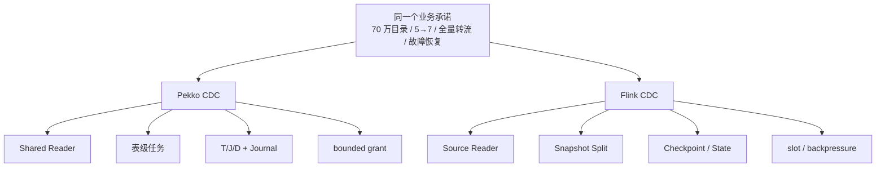

[系列导读](/pekko-cdc-series/) · [第一篇：常驻 CDC](/2026/10/18/pekko-cdc-1-resident-tasks/) · [第二篇：批转流](/2026/10/18/pekko-cdc-2-recovery-contract/) · [第三篇：源码执行](/2026/10/18/pekko-cdc-3-mysql-journal-experiment/) · [第四篇：恢复证明](/2026/10/18/pekko-cdc-4-protocol-design/) · [第五篇：Pekko 与 Flink](/2026/10/18/pekko-cdc-5-flink-comparison/) · [Flink CDC 深入系列](https://xuyinyin.cn/flink-cdc-series/)

> **源码基线**：`cc09559`。实验材料保留各自冻结版本和失败记录；文章不把不同版本的结果合并成一次验收。
>
> **证据标记**：**源码结论**来自当前调用链；**实际实验**来自真实 MySQL、Actor Journal、Sink 或集群；**保存材料复算**不等于重新运行；**未验证边界**不写成产品保证。

> 本文不比较品牌，而是比较同一个业务承诺：70 万表目录、5→7 动态新增、新表先全量再实时、初始化期间继续写入、支持取消和故障恢复。

## 0. 先固定比较口径



比较只使用四个维度：资源、进度、故障、规模。本文没有在同一数据集和同一故障切点上重新跑 Flink CDC，因此 Flink 部分是 3.6.0 的源码/运行模型对照，不是性能实测。

## 1. 两套系统解决的主问题不同

| 维度 | Pekko CDC | Flink CDC |
|---|---|---|
| 冷目录 | 持久任务索引，冷表不占 worker | Job、Source、Split 和 state 元数据 |
| Capture | 一个 capture domain 共享 Reader 和 L | Source Reader、Enumerator 和 Split |
| 动态新增 | B → LOW/HIGH → F，表级生命周期 | 依赖 Job/Source 的动态配置策略 |
| 执行资源 | snapshot/tail budget + grant | slot、并行度、背压 |
| 恢复证明 | T/J/D、Journal、ACK proof、owner fence | Checkpoint、operator state、Source offset |
| 生态 | 需要自行维护控制面和证明链 | 连接器、状态后端和流处理生态成熟 |

## 2. Pekko 的核心价值

Pekko 的关键不是“一个表一个 Actor”，而是把表级身份和执行资源拆开：

```text
目录记录 ──> 订阅意图 ──> capture domain
                         ├── Shared Reader
                         ├── table task A
                         ├── table task B
                         └── table task C

执行资源由 snapshot/tail grant 动态借用
```

这适合：

- 70 万目录远大于同时活跃表数量；
- 表需要动态新增、取消和重新初始化；
- 业务关心表级恢复上下文；
- 需要长期常驻而不希望频繁重建整个 Job。

代价是：owner、guardian、grant、Journal、ACK proof 和 GC 都要自己维护，系统不能只依赖 Actor mailbox 顺序。

## 3. Flink 的核心价值

Flink CDC 把 Source、Split、Enumerator、Checkpoint、State 和 Sink 放进统一流处理运行时。它更适合：

- 活跃表数量和事件吞吐是主要规模；
- 需要复杂算子、Join、窗口或多级流处理；
- 希望复用成熟的 Checkpoint、背压和状态后端；
- 连接器生态比表级控制面更重要。

Flink 也需要额外处理动态新增和取消表的作业配置、Split 元数据和运行时变更，这部分不在本文中宣称已经完成或实测。

## 4. 选择决策树

```text
主要矛盾是什么？
        │
        ├── 目录极大、活跃表少、动态表生命周期复杂
        │       └── 优先 Pekko CDC 控制面
        │
        ├── 活跃表多、吞吐高、复杂流计算
        │       └── 优先 Flink CDC Runtime
        │
        └── 两者都重要
                └── Pekko 管生命周期与准入
                    Flink 管流计算与状态处理
```

## 5. 证据和边界

Pekko 当前已有真实 MySQL、Actor Journal、Sink 和集群材料：

- 700,000 条冷目录分页实验；
- 多 Split、LOW/HIGH、全量转流；
- T/J/D 故障窗口；
- ACK proof 分页和安全 GC；
- Source/Sink 逐字段对账。

这些证据支持指定版本和固定窗口的可行性，不支持以下结论：

- Pekko 在所有吞吐场景中优于 Flink；
- Pekko 已完成 70 万真实活跃表容量验收；
- 两套系统的 Sink、DDL、跨表事务和 HA 语义完全等价；
- Guardian JVM 重启、多 owner 和无限 ACK 历史已经全部证明。

## 6. 最终判断

Pekko CDC 的目标不是复制 Flink 的全部能力，而是解决长期常驻 CDC 中的表级生命周期、共享捕获和资源准入问题。Flink CDC 的优势是成熟的流处理运行时、Checkpoint、状态后端和连接器生态。

两者可以在同一个系统里承担不同职责：Pekko 负责“哪些表在运行、如何启动和取消、如何安全恢复”，Flink 负责“事件如何被并行处理、计算和分发”。

对当前项目最准确的描述是：

> 一个面向海量冷表目录、少量活跃订阅和长期常驻运行的 CDC Runtime，重点解决动态表生命周期与可验证恢复。
