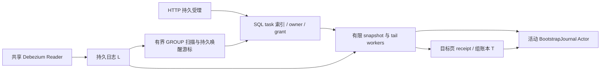

[系列导读与验证范围](/pekko-cdc-series/) · [1：目标架构](/2026/10/18/pekko-cdc-1-resident-tasks/) · [2：批转流源码](/2026/10/18/pekko-cdc-2-recovery-contract/) · [3：真实实验](/2026/10/18/pekko-cdc-3-mysql-journal-experiment/) · [4：恢复协议](/2026/10/18/pekko-cdc-4-protocol-design/) · [5：自建与复用](/2026/10/18/pekko-cdc-5-flink-comparison/) · [Flink CDC 深入系列](https://xuyinyin.cn/flink-cdc-series/)

> **文章修订：2026-10-27。** 已提交的启动准入与五个 Bootstrap 定点结果见 [`74b6d9a`](https://github.com/Xuxiaotuan/pekko-reference/tree/74b6d9ad1ebcfe19a786f4e1869aed276a63bb52)及[A1/A2 报告](/pekko-cdc-series/capture-admission/)；本轮平台候选的源码版本、实测与未验证项见[平台实验报告](/pekko-cdc-series/cdc-platform/)。没有 Pekko/Flink 同负载 benchmark，也没有 70 万真实源表容量结果。

一个实例的表目录很大，今天同步五张，明天增加两张，还要单独取消、恢复。本文回答：为这种长期复制任务，哪些控制与数据职责值得自建，哪些应复用成熟运行时？前四篇的源码与故障证据支持若干机制选择，但没有提供 Pekko 与 Flink CDC 同负载的总体成本或性能胜负。

本项目按各实验的冻结版本分别判断，不能把旧通过数当作新候选已回归；Flink CDC 源码对照沿用 3.6.0 固定提交 `bf160337ff558d70302e7884f68937611873117e`。另一组[Flink CDC 系列](https://xuyinyin.cn/flink-cdc-series/)使用自己的 3.7.0、Flink/Paimon 实验，不能混作同版本、同 Sink 的对照。

## 1. 先给双方相同的业务承诺

两种方案都应允许合理共享：表目录 N 约 70 万，订阅 S 由 5 增加到 7，活动写入速率和事务大小另外固定。新增 f/g 先初始化再跟随，其他表继续推进；取消的含义、可接受积压和故障恢复结果也必须一致。

Flink CDC 的 MySQL Pipeline 可以选择多表，表与 Job、slot、子任务没有固定的一一对应。[官方多表配置](https://nightlies.apache.org/flink/flink-cdc-docs-release-3.6/docs/connectors/pipeline-connectors/mysql/)因此，“70 万个 Actor 对比 70 万个 Flink Job”不是这个业务的有效实验输入。

公平比较还要固定目标语义。本项目的当前样本使用 MySQL Apply 和独占空目标；Flink 系列中的 Paimon 提交与快照机制不能直接作为同一种 Sink 成本。最终行值、业务副作用次数、跨表事务可见性也是不同承诺。

## 2. 现有正面证据支持哪些自建动机

| 业务需要 | 当前可复查证据 | 得到的结论 |
|---|---|---|
| 订阅变化不等于再复制一套采集器 | 共享 capture 的动态 B/K/L 路径与阶段一指定实验 | 采集身份可以与表消费者分离；不是全实例 Reader 数已有全局上限 |
| 新表先全量再持续 | I01 五表后新增 f/g；第二篇的 LOW/HIGH、封存、B→F 路径 | 当前受限数据集已跑通这条组合 |
| 范围和输出有独立恢复依据 | [I11](/2026/10/18/pekko-cdc-3-mysql-journal-experiment/#e-i11)、[I16](/2026/10/18/pekko-cdc-3-mysql-journal-experiment/#e-i16)的原 spec、新 attempt 和原 receipt | 能把恢复决策变成持久化事实核对 |
| 一张表短期落后时另一张继续 | 共享捕获 R14 中表级 T/J 分别推进 | L 在有限积压内解耦目标应用；未证明无限隔离 |
| 冷身份不占一份活动执行资源 | 当前 SQL 索引、分池 grant、活动 Journal Actor 与 bounded step 源码 | 支持资源按活动量分配的设计；真实成本以新报告为准，不能由普通 Actor 机制实验推算 |

这些证据说明自建方向有具体抓手：独立身份、动态控制和显式恢复事实。它们没有比较同负载内存、吞吐、控制延迟和长期维护成本，因而还不能证明经济性优势。

## 3. 当前实现选择了 SQL 冷控制与活动 Actor，而非每表常驻 Actor

一张表的控制状态不只是 RUNNING。新增请求可能尚未获得 B，初始化可能已封存但未激活，实时可能已暂停，取消可能已受理但资源尚未排空。Actor 可以按身份串行接受命令，Event Sourcing 可以保存接受事实；但这不要求把所有冷身份实例化成 Actor。

本轮平台的[实际装配](https://github.com/Xuxiaotuan/pekko-reference/blob/2fd592f0c7e43af9b15f68801b7ac8f242da696b/server/src/main/scala/cn/xuyinyin/magic/workflow/cdc/CdcBootstrapKernel.scala)是：SQL 保存定义、期望状态、候选索引、owner 与 grant；少量活动任务创建 `BootstrapJournal` Actor；阻塞 JDBC/Sink 工作在受预算限制的 step worker 上执行。一个共享 Reader 继续捕获源变化，L 解耦采集与每表应用。控制台从持久投影分页查询，不遍历所有 Actor 发 ask。



Actor 在这里承担活动执行的串行接受边界，SQL 承担可检索的冷事实与事务准入。这是一次明确的架构取舍：冷表数量增长不应直接增加 Actor、Future、线程、RR 事务与会话锁。动态 5→7 的 HTTP 请求返回 202，只表示定义已持久受理；它要经过捕获准入、初始化、审计激活，才可能进入持续同步。

过去持续占据线程、会话锁与默认八个 run 许可的实现已不适合作为本轮资源模型。新的 `step` 以一个完整窗口、一次组批或一次有界审计单元让出。快照和 tail 使用独立预算；已审计且无输入的实时任务退出活动会话，由 L 的新 GROUP 唤醒。新变化与 worker 完成竞争时，用持久 wake_seq 保留后续工作，不能依赖一个可能丢失的内存消息。

这还不是“70 万表已经跑通”。它把需要随总身份数增长的状态压到持久索引，把活动资源限制在预算内；索引扫描、状态写入、读视图时长和唤醒延迟是否可接受，必须实测。即使 70 万条冷索引被顺序遍历，也只证明那个元数据负载，不证明 70 万源表的采集、初始化或持续同步容量。

## 4. 数据面已经复用了什么，自建又增加了什么责任

本项目没有从零编写 MySQL binlog 解析器。它复用 Debezium SDK、JDBC 和 Pekko 持久化能力，自建的是它们之间的持久日志、完整组确认、范围封存与目标证据协议。

| 层次 | 当前复用或自建 | 继续维护的责任 |
|---|---|---|
| 原始采集 | 复用 Debezium；自建共享 capture、L 与原始 ACK 前缀协调 | SDK 启动/offset 阶段、Schema 与日志保留成本，版本兼容 |
| 初始化 | 自建固定范围、LOW/HIGH、fold、FINAL 与 B→F | 读视图丢失、完整日志前提、类型/约束和激活恢复 |
| 表执行进度 | 复用 Actor Journal，自建 BootstrapProgress 与 receipt 协调 | 明确拒绝、结果未知、seal 丢失、同 owner 缓存重建与跨 owner 重验 |
| 控制调度 | SQL 持久 task/grant、有限 step worker、活动 Journal Actor | 未决 grant 计预算、命令幂等、健康过期、物理释放未知与停机恢复 |
| 分布式状态运行时 | 当前没有通用执行图 Checkpoint | 若加入 Join、窗口、定时器等状态计算，需要额外一致恢复设计 |

Flink 的价值包括现有的 Source 分配、Reader 状态、Checkpoint 及运行时协调；外部 Sink 仍需各自的事务/幂等提交契约。[Flink 状态恢复说明](https://nightlies.apache.org/flink/flink-docs-release-1.20/docs/concepts/stateful-stream-processing/)若复制需求很快扩展为复杂状态计算，自建范围会明显变大，目标组账本不能替代算子状态的一致恢复。

## 5. 用一次批转流比较责任位置，而非比较术语数量

当前 Pekko 路径是固定 U、串行范围、LOW/HIGH 局部回填、FINAL 封存，再完整回放 B→F 并审计激活。Flink CDC 3.6.0 的[MySqlHybridSplitAssigner.createBinlogSplit](https://github.com/apache/flink-cdc/blob/bf160337ff558d70302e7884f68937611873117e/flink-cdc-connect/flink-cdc-source-connectors/flink-connector-mysql-cdc/src/main/java/org/apache/flink/cdc/connectors/mysql/source/assigners/MySqlHybridSplitAssigner.java#L207)则使用 snapshot split 范围与完成 offset 构造 binlog split 及完成信息，并与其 Reader/分配器状态衔接。

这些机制承担相近问题，但不是相同算法。本项目的 F 不是全局 Checkpoint；当前范围窗口也没有 Flink 的并行领取与完成确认协议。保存 FINAL 和完整 L 使恢复材料显式，却增加持久写入、保留空间、恢复审计和 B→F 应用工作。

[第四篇 G4](/2026/10/18/pekko-cdc-4-protocol-design/#g4)给出当前算法在明确前提下的逐键推理；[第三篇 E0](/2026/10/18/pekko-cdc-3-mysql-journal-experiment/#e-startup)又显示旧 INITIAL-D 恢复可以越过必要输入。新版 A1/A2 已实测拒绝已识别的不安全重入，旧五字段差异没有被修补。局部算法存在证明、危险状态被拒绝、业务数据已经修复，是三种不同结论；其他系统也应按固定版本和同一故障窗口分别判断。

## 6. 一台实例的 70 万表，成本不会随冷 Actor 消失

令 N 为源表目录数，S 为订阅表数，A 为有待处理工作的表数。当前方案试图把 Actor/worker 的活动成本约束在配置预算附近，而不是随 N 或 S 线性实例化；但系统总成本还包括下列几项：

| 成本 | 主要由什么决定 | 当前架构能否直接消除 |
|---|---|---|
| 冷控制索引与持久意图 | 任务数、版本数、索引与保留策略 | 不能；只是避免实例化同数量活动 Actor |
| binlog 读取与解析 | 源实例写入量、事务大小、SDK 过滤位置 | 共享 Reader 减少重复读取，不等于未订阅写入零成本 |
| Schema 获取、解析及 history | 实际捕获数据库的目录、DDL 历史、SDK 启动策略 | 不能靠减少 Actor 消除 |
| 初始化 | 选定表行数、窗口大小、并发写入与目标速度 | 有界分片限制峰值，但增加次数与追赶工作 |
| L、spool、receipt 与 Journal | 变化率、积压、封存页数、验证与保留时长 | 这是显式恢复证据的成本，不能忽略 |
| 服务端资源核实 | capture 数、专属账号、observer 权限与故障状态 | 必须为正确释放付费，超时不能直接回收 |

当前 [`SharedMySQLCapture`](https://github.com/Xuxiaotuan/pekko-reference/blob/2fd592f0c7e43af9b15f68801b7ac8f242da696b/server/src/main/scala/cn/xuyinyin/magic/connectors/mysql/source/capture/SharedMySQLCapture.scala)使用数据库内全表匹配来支持运行时新增订阅，`no_data` 也不表示没有 Schema 工作。若源库有 70 万表，即使今天只订阅五表，Debezium 的目录、Schema 与 history 成本仍需真实测量。冷调度实验没有执行这一步，不能据此声称整体内存已按五表计。

共享还扩大了故障域。假设 a 目标暂停十分钟，b 仍有写入。L 可以让 b 独立提交，但 a 恢复所需的历史不能被删掉。隔离的代价是积压字节、保留时长和后续追赶；L 达到上限时，整个捕获域可能承压。若 Reader、Schema 或 history 异常，表级 Actor 也不能独立修复采集连续性。

当前没有完成长期 GC、新共享链路的多 owner 自动接管或 guardian 恢复。旧静态快照的隔离实验不覆盖这些新资源。SQL owner 与 UNKNOWN grant 的保留，是防止未经证明的替代执行；它可以选择停住业务，不能因此称作已经实现自动 HA。

## 7. 高可用的成本，首先是区分“未知”与“失败”

单机进程退出并不意味着服务端 dump 连接、事务和命名锁都已经结束。本轮受管 close 将本地 runner/executor 终止、服务端会话/事务排空、owner 释放和 reusable 分开记录。它用原始 observer 连接、server UUID 与 canary 约束观察连续性，账号也按 capture 隔离，且必须覆盖 SDK 与全部 L 连接。旧装配漏掉共享控制账号下的 L，真实事务仍在却提前宣布可复用；修复及同窗口的 UNKNOWN/最终释放证据均单列保留。无法观察时持久保留占用，不能只凭 PID 或经过一段时间开替代 Reader。

这使控制面的状态更多，却比一个 running 布尔值准确。API 分开返回捕获准入、初始化历史证明、当前 runtime health 和 release 状态；超龄观察为 STALE，查询失败显示 UNKNOWN。PAUSED 没有普通 Resume 按钮，202 不是初始化完成，PREEXEC_CANCEL 也不是初始化证明。

Flink 的成熟协调机制可以减少一部分自建工作，但它与具体 MySQL Reader、外部 Sink 的协议仍需在相同故障窗口检验。本项目自建之后，必须自己维护源提交不确定、目标 T/J 缺口、原始 ACK、SDK D、资源释放与调度资格之间的证明链。新增一层 SQL 不能自动把这些不确定性变成事务原子性。

## 8. 怎样用共同负载判断这项取舍是否值得

下一项有意义的比较应固定同一 MySQL 版本、源目录和写入分布、相同目标类型及业务语义，而不是只固定表数量。至少分别报告：

| 维度 | 应测的量 | 关键限定 |
|---|---|---|
| 冷目录 | 控制索引、SDK Schema/history 的内存、启动时长、存储与查询计划 | 真实目录与合成元数据分别计 |
| 5→7 动态订阅 | 受理延迟、捕获准入延迟、初始化完成时长、对既有表延迟的影响 | 202、B、STREAMING 三个时点分开 |
| 活跃数据 | 吞吐、端到端延迟、连接/事务峰值、L/spool 增长 | 同事务规模、类型、热点分布与目标速率 |
| 故障恢复 | 安全暂停率、自动恢复范围、重放量、逐字段终值与恢复时长 | 正确拒绝不计作恢复成功 |
| 长期运行 | 日志保留、GC、反压、失联资源、升级与人工处置成本 | 短期全量对账不能代替长期 SLA |

本轮已经取得三类相互独立的正面证据：P01 的动态 5→7 经过真实平台链路逐字段相等；P02 在十表 tail 之后仍能初始化第十一表，活动步骤不超过四；H 写入并遍历 700,000 条冷控制记录，但不创建 ActorSystem 或 Reader。它们分别支持控制入口、有限执行和冷索引的可行性。受管 close、读视图重建、干净 owner 恢复与未知 owner 暂停又约束了这些资源能够怎样复用。

[本轮报告](/pekko-cdc-series/cdc-platform/)同时保留 gate 未命中、磁盘采样竞争、旧 marker 自动收敛期待失败和自然释放迟延。没有同负载 Flink benchmark，没有 70 万真实源表目录或长期活跃 CDC 结论。用这些局部证据支持具体架构决策是合理的，将它们合并成“比 Flink 更省资源、更高可用”则越过了验证范围。

如果主要问题是少量持续活跃表与海量长期控制身份、细粒度动态选择，SQL 冷索引加 Pekko 活动执行值得继续验证。如果需要广泛连接器、复杂 Join/窗口、跨算子一致恢复，成熟数据运行时能减少自建责任。把 Pekko 仅作为控制面、数据交给现成 CDC 运行时也可评估，但当前没有实现该组合。

因此本文支持的是一种有边界的架构选择：让长期身份与活动计算分开，让动态控制与数据正确性分别取证。它尚未支持“比 Flink CDC 更省资源”或“已适合 70 万表生产常驻”的总体结论。

## 技术附录与证据入口

[历史源码分析与实验档案](https://github.com/Xuxiaotuan/pekko-reference/blob/0690063b9111017c64684623ecbfce16247716ad/docs/articles/cdc-design/appendices/05-framework-comparison-history.md)保留本篇此前全文；[附录索引](https://github.com/Xuxiaotuan/pekko-reference/blob/0690063b9111017c64684623ecbfce16247716ad/docs/articles/cdc-design/appendices/README.md)集中提供版本、完整矩阵和原始材料入口。当前主文只保留支撑核心论点所需的实现、代表性证据和边界。

<details markdown="1">
<summary>展开历史基线分析与实验细节</summary>

研究 Flink CDC 的初衷，是把可靠的数据同步能力带进自己的 Pekko 项目。经过前四篇，判断已经比“Actor 轻、Flink 重”具体得多：项目有适合大量任务生命周期管理的基础；旧协议的重分批失败已经复现，新增完整组实现又通过了三个指定恢复样本。共享阻塞池的组件饥饿证据仍然存在，不能因恢复修复而删掉。

我的选择倾向是：**保留 Pekko 作为海量任务的控制底座；是否由它同时承载自建 CDC 数据内核，要按复制范围、恢复要求和团队维护成本单独决定。** 70 多万表使细粒度控制值得投入，但不会自动证明当前一表一 Engine 的执行方式更省资源。

本篇保留项目 `d88ec80` 的历史反例，并把 `65ab541` 的完整组实现纳入当前能力；Flink CDC 对照仍固定为 **3.6.0** 固定源码 `bf160337ff558d70302e7884f68937611873117e`，Flink 运行时概念参照 **1.20** 文档。本轮重新阅读 SourceReader、SnapshotSplitAssigner、HybridSplitAssigner 和 BinlogSplitReader；没有进行两套系统同负载性能实验。前一组网站 Flink CDC 文章使用自己的 3.7.0 研究基线和 Paimon 实验，不能混入本篇成为 3.6.0 的实测结论。[版本与材料](/pekko-cdc-series/)

## 1. 比较之前，先把业务承诺写成同一份

“支持 70 万表”至少可能指四种不同能力：目录能存 70 万个表定义；70 万个控制实体可寻址；70 万张真实表持续被捕获；或这些表在故障后仍能满足一致性和恢复时限。

创建很多对象只能验证第二类的一部分。少量真实表的正确性测试也不能与对象数量相乘，变成大规模端到端证明。

为比较两种方案，需要固定同一组业务输入：表分布在哪些源实例、多少表同时变化、总变更字节率、事务大小、Schema 数量和变更频率、可接受延迟，以及停止一张坏表时允许影响多少其他表。还需要指定目标：只要求最终行值收敛，还是目标 DML 副作用也不能重复，是否要求源事务整体可见。

这些条件直接改变实现成本。例如最终收敛可以容忍的某些重复写，不一定满足审计一次性；表级暂停若不能阻塞同源其他表，就需要额外的持久缓冲或更细捕获分组。框架名称不能替代这些约束。

**公平的部署单位也必须一致。** Flink CDC 的 MySQL Pipeline 配置可以匹配多张表，单表不必对应一个 Flink Job；TaskManager、slot、算子子任务与表也没有一一对应关系。[MySQL 多表配置](https://nightlies.apache.org/flink/flink-cdc-docs-release-3.6/docs/connectors/pipeline-connectors/mysql/)、[Flink 执行架构](https://nightlies.apache.org/flink/flink-docs-release-1.20/docs/concepts/flink-architecture/)

因此，不能拿“Pekko 的未来共享读取设计”去比较“Flink 每表独占一个作业”。双方都应允许合理分组，同时承担同样的隔离和恢复要求。

## 2. Pekko 的优势：让每个任务都有身份，却不各自拥有线程

第一篇已经沿 Mailbox 和 Dispatcher 解释了执行模型，并用 10,000 个普通 Actor、两条工作线程、40,000 条消息进行了机制验证。它说明大量实体能够共享执行资源，不是持久化 CDC 的规模验收。

这种模型与任务控制很匹配。一张表可以拥有独立的配置版本、暂停原因、重试阶段和运行身份；针对该表的命令按 Actor 状态机串行处理。调用者使用 workflowId 寻址，不需要追踪承载它的具体线程。

项目现有 [`WorkflowSharding`][sharding] 与 [`EventSourcedWorkflowActor`][actor] 已有这样的骨架：前者按 workflowId 路由实体，后者持久化定义和执行状态，恢复时重建仍在运行的工作。业务可以围绕实体表达“暂停快照但保留注册”“某租户耗尽配额”“等待人工确认 Schema”等状态。

优势来自控制粒度与生命周期表达，而不是免费的业务语义。比如 pause 命令返回究竟意味着“不再接收新数据”，还是“已经排空并持久化所有在途数据”，仍需协议定义。Actor 串行接受命令，不会自动使外部 Stream 在同一时刻停止。

### 当前实现还没有兑现的两层收益

第一，remember entities 开启使自动钝化关闭。当前不能声称所有冷任务只保留磁盘身份、不驻留实体。若要启用钝化，必须先处理 Actor 停止会取消 Engine、内部完成消息又不更新 Shard 活动时间的问题。

第二，当前单表 Source 创建独立 Debezium Engine，每个运行中的 Engine 有外层 runner；空 Bridge 读取还会阻塞共享 JDBC 线程池。[Source][source]、[EngineAccess][engine-access] 这意味着控制 Actor 的线程复用，没有自动变成整个 CDC 路径的资源复用。

这些差距没有否定选择 Pekko 的理由。它们说明：要把模型优势变成业务收益，昂贵的采集和写入资源必须按明确预算管理，而不能全部挂在一表一个长期执行实例上。

## 3. Flink CDC 的优势：快照交接已经是一套运行状态机

如果只把 Flink CDC 看成“读 MySQL，再写 Sink”，就看不到它真正节省了多少自建工作。本轮阅读 3.6.0 的 Source 实现，可以看到它如何保存扫描阶段和日志阶段之间的关系。

[`MySqlSnapshotSplitAssigner.snapshotState`][flink-assigner] 保存已处理表、剩余 split、已分配 split、表 Schema、各 split 完成 offset、分配器状态和 chunk splitter 状态。这比给每张表记录一个最大主键多得多：恢复需要知道哪些范围已交出，哪些完成信息已收到，哪些工作可以重新分配。

全部快照 split 完成后，分配器也不总是立即切换。在并行度大于 1 的对应路径，它等待包含完成状态的 Checkpoint 成功，再通过 `notifyCheckpointComplete` 推进状态；并行度为 1 有直接完成分支。这个细节很重要，不能概括为“任何情况下都等待一个 Checkpoint”。

Reader 一侧也保留独立状态。[`MySqlSourceReader.snapshotState`][flink-reader] 不只保存正在读的 split，还保存已经完成但未收到确认的 snapshot split、不完整 binlog split，以及被挂起的 binlog split。完成消息发出但确认尚未到达，是可恢复状态的一部分，而不是一个可随便丢掉的内存标记。

然后 [`MySqlHybridSplitAssigner.createBinlogSplit`][flink-hybrid] 根据各快照 split 的完成水位构造日志 split：保存表、范围与对应高水位，选择恢复起点，并在元数据过大时分组传递。日志 Reader 再按相应范围与水位过滤已由快照覆盖的事件。[`BinlogSplitReader.shouldEmit`][flink-binlog]

这条链说明 Flink CDC 的价值并不只是提供一个 JDBC 扫描器。它已经把并行扫描、完成确认、Checkpoint、恢复分配与日志去重衔接成一个协议。具体算法仍有前提与边界，但项目若要自建同级能力，就必须承担这些状态关系。

当前 Pekko 项目有 Debezium initial snapshot，另有主键上界与 keyset 分页的有界 Source。它们都不能仅凭名字替代这套 split 与水位协议。Actor 很适合承载状态机，但状态机要保存哪些信息、何时推进，需要另行设计与验证。

## 4. 两种恢复路径，承担责任的位置不同

当前 Pekko 路径主要依赖应用自行安排：

```text
目标事务 T → Actor Journal 确认 J → Source ACK → Debezium offset D
```

第二篇说明了这条顺序保护什么；第三篇分别保留旧批次账本失败与新完整组恢复样本。第四篇的最小生产路径已经实现完整物理行组、成员身份、目标组证据及原始回调前缀确认。当前以单 writer、固定 Schema、可信 streaming 基线和固定未重置日志历史为前提；并没有因为顺序未变，就获得所有权切换或所有故障点的保证。

Flink 的托管状态则通过 Checkpoint 建立执行图的恢复关系：Source 的读取状态与算子状态共同参与快照，失败后回到兼容的恢复切面，再处理之后的数据。这使业务开发者不必为每个有状态算子重新设计独立 Journal 与源位点如何协调。[状态化流处理](https://nightlies.apache.org/flink/flink-docs-release-1.20/docs/concepts/stateful-stream-processing/)

不过，外部数据库不会因为 Flink 内部状态恢复就自动回滚。最终提交语义取决于 Sink 是否参与相应的事务、提交或幂等协议，必须逐个连接器判断。[Connector 容错保证](https://nightlies.apache.org/flink/flink-docs-release-1.20/docs/connectors/datastream/guarantees/) 一个普通外部调用可能在 Checkpoint 之后执行成功，恢复重放时又执行一次。

因此，合理的对照不是“Pekko 没有一致性，Flink 天然全链路 exactly-once”，而是：Flink 已有一套托管状态的协调运行时，外部 Sink 契约仍需验收；Pekko 项目当前需要自己承担更大部分的数据恢复协议。

### 小到一个主键修改，也有应用必须承担的恢复责任

2026-10-19 的[真实身份实验](/pekko-cdc-series/source-record-identity/)发现，同一次主键修改的 d/c 共享完整 restart offset。只确认 d 后恢复，c 不再交付；稳定 eventId 无法补救源不再交付的成员。工程责任因而扩展到完整性分组，而不是只增加一张去重表。

[真实 Engine/Bridge 探针](/pekko-cdc-series/deferred-ack/)进一步验证：在 Bridge 前装配完整组、暂存半组并返回回调，再按原始回调前缀调用保留句柄，能够通过两个固定跨界场景。实际 D 在测试覆盖信号前不推进；旧句柄在后续回调中串行调用。这是历史组件门槛，覆盖是手动信号，不能与后来的真实生产 T/J 实验混为同一次运行。

这类边界不会因为 Actor 更轻就消失，也不能据此断言另一框架在同一故障窗口已经通过。比较仍要回到具体版本、恢复单位与实测证据。后续 [完整组生产验收](/pekko-cdc-series/group-recovery/)把真实 Source、Actor JDBC Journal 与 MySQL Sink 接起来，在 T 已提交/J 未持久化处验证了 16→1 拆批、1→实际 72 组的合批，以及主键 `[d][c]`。三组各 64 行、六字段零差异，已经提交的组没有新增审计；后续新写也收敛。关闭、迟到/错误 ACK和预算有组件检查，内容冲突与 PK 双成员回滚用 H2 验证；完整作业取消、J 已提交/D 滞后、COMMIT 回复丢失仍未固定实测。

这改善了本项目特定 Source/Sink 的恢复事实，但不是与 Flink 同负载的对照，也不覆盖新的 snapshot 初始化、DDL 或多 owner。不能从“修复三个样本”直接推导“已经获得 Flink 全部恢复能力”。

### 有状态计算会显著改变取舍

只有确定性的逐行复制时，事件级目标去重可以成为较窄的方案。加入窗口聚合、双流关联、定时器或缓存中的中间状态后，光记录“源读到哪里、目标写到哪里”就不够了。

例如累计金额保存在某个中间对象里：源重放了，累计状态却没有回到同一恢复点，可能重复累加；累计状态回退了，Sink 却已经保留新结果，又需要提交协调。每增加一类状态，就增加一致恢复的证明义务。

项目当前 CDC 可靠路径限制为直连 MySQL Apply，[WorkflowValidator 的显式校验](https://github.com/Xuxiaotuan/pekko-reference/blob/d88ec80f2a7166cfdaddf1284cc268a68bc62e28/pekko-server/src/main/scala/cn/xuyinyin/magic/workflow/engine/WorkflowValidator.scala#L78)拒绝内联 Transform；项目没有实现任意分布式算子状态快照。Pekko Stream 提供数据流组织能力，不意味着自动获得 Flink 的有状态计算恢复协议。若业务很快要进入复杂计算，自建范围会从“复制协议”扩展到“数据执行运行时”。

## 5. 资源成本应看曲线，而不是比较框架空载大小

设 N 为注册表数，R 为驻留 Actor 数，G 为捕获/部署分组数，λ 为总业务事件率，b 为平均提交批量。还要记录实际队列字节、Schema 大小、最大事务与恢复积压。

对经过资源分离的 Pekko 方案，可以建立以下设计账本：

```text
控制状态：N 的目录成本 + R 的实体状态成本
捕获基线：G × 每组读取器与连接成本
数据工作：真实变更字节的解码、转换与目标写入
提交证据：批次确认与事件级去重的写入、索引和保留
缓冲：尚未确认数据、慢表积压、大事务与可能新增的 spool
```

当前实现还未完成捕获资源分离，不能把其 Engine 项直接按较小的 G 计算。先实测运行工作流数与 Engine、线程、连接之间的斜率，才知道资源成本是否已经按预期缩减。

对 Flink 多表分组，基线包括作业协调、TaskManager/子任务、网络缓冲与状态后端，数据工作同样受真实负载约束，Checkpoint 和 Sink 提交也有成本。增大每组表数可以摊薄基线，却同时扩大元数据和故障影响范围。

### 5.1 元数据不能因为表很冷就忽略

假设每表常驻元数据净占 4 KiB，70 万张约为 2.67 GiB；16 KiB 则约为 10.68 GiB。这里只是容量算术，不是 Actor 内存测量，也没有包括索引、字符串共享、JVM 和副本。

Flink Source 的 tableSchemas、split 完成信息等同样随表数和分片数增长。3.6.0 的 Hybrid Assigner 会将过大的 split 元数据分组传输，这解决单次传递大小，不表示系统不再需要保存这些状态。

所以“冷表不消耗数据 CPU”与“冷表没有元数据成本”是两回事，两套系统都要测。

### 5.2 细粒度持久化也有写放大

当前项目每批推进 Actor Checkpoint。如果平均批量为 b，稳定情况下与数据相关的进度事件率大致受 λ/b 影响，此外还有控制事件；这是理想化估算，不是运行测量。

海量稀疏表可能每次只有一条变更，难以在单表内攒大批，Journal 确认成本就难以按总事件量充分摊薄。新实现的完整组账本增加查询、写入、索引及规范化成员证据存储；主键组一次保存两个成员，但并没有免除事件级信息的持久成本。即使 Actor 本身几乎不占 CPU，持久化数据库也可能先达到瓶颈。

如果为了摊薄成本跨表合批，又要回答一个表失败是否回滚整批、所有权如何验证，以及确认覆盖怎样拆回各表。这是资源复用与隔离粒度之间的真实取舍。

不能忽略这些成本，再用空 Actor 测试宣称 Pekko 更省；也不能忽略 Flink 的 Checkpoint、状态与部署基线，只看高吞吐时的摊销结果。

## 6. 用一个慢表场景检验“表级隔离”

设同一 MySQL 捕获域中，A 表因不兼容 Schema 暂停，B 表继续高频更新。业务要求 A 修好后不丢数据，B 的延迟还要保持可接受。

Pekko 能把 A 的控制实体置为 blocked，并继续响应 B 的控制命令。但这只完成控制隔离。若 A/B 共用一条日志读取和确认进度，A 的未完成记录仍然是确认前缀中的缺口。

此时只有明确的数据策略才能兑现业务要求：整个捕获域背压；把 A 的未完成数据可靠写入可重放存储；或调整捕获分组，承担额外连接与读取开销。把 A 的事件暂存在内存邮箱，继续推进 D，然后等待以后处理，无法承受进程崩溃。

Flink 也要通过实际作业分组、Schema 处理行为、数据通道与 Sink 策略回答同一问题。把多表放进同一 Pipeline 可以复用运行时，却可能共享背压和恢复范围。拆成更多 Pipeline 可以改善隔离，也会增加基线资源和运维对象。

因此，隔离不是 Actor 或 Job 名称附带的一项布尔能力。需要分别衡量：

| 隔离对象 | 要观察的问题 |
|---|---|
| 控制命令 | A 出错后，B 的查询、暂停、恢复能否继续响应？ |
| 数据吞吐 | A 的队列满后，B 是否被反压？ |
| 持久进度 | B 完成后，是否错误越过 A 的缺口？ |
| 进程故障 | 一个节点退出时，需要恢复哪些任务或分组？ |
| 人工修复 | 修复 A 是否需要回滚或重新初始化 B？ |

第一篇的组件实验已经展示一种控制与执行的差别：默认 Dispatcher 上的 Actor 仍能响应，JDBC 池却已被八个空读取占满。控制面健康不等于数据面有进展。

## 7. 恢复成本往往比稳态内存更影响选型

如果 K 个实体要恢复，实际存储与恢复处理能力为每秒 q 个，那么仅实体恢复就存在约 K/q 的理想化吞吐下界。q 必须测量，不能用线程数代替；Journal 大小、快照命中、连接建立和源端启动都会改变它。

当前 Pekko 配置记住活跃实体，默认实体恢复策略为 all。即使改为 constant，上游限速也是按 shard，不自动形成整个集群的统一数据库预算。能够创建很多 Actor 与能够同时恢复它们及其 Engine，是两个问题。

数据追平还需要计算剩余处理能力。用同一种工作量单位表示积压 B、稳定输入速率 λ、可用处理速率 μ；只有 μ>λ，才可能持续缩小积压。简化追平时间约为：

```text
追平时间 ≈ B / (μ − λ)
```

这不是本项目测试结果，也没有计入启动、Schema 阻塞和目标长尾。它说明如果平时已接近满载，故障后的恢复时间可能远大于停机时间。源日志保留窗口必须覆盖实际恢复与追平需要，而不是只覆盖 Actor 重启的几秒钟。

Flink 的恢复同样要承担状态加载、Source 重读和 Sink 协调成本。较大的作业分组有利于摊薄稳态开销，却可能一次恢复更多状态。因此应比较完整的恢复曲线和受影响表数，不能只比较进程 RSS 的一个截图。

## 8. 当前事实、目标设计和框架能力要分栏

| 维度 | 当前 Pekko 项目 | 若继续自建需要承担 | Flink CDC / Flink 对应机制 |
|---|---|---|---|
| 表级控制 | 持久 workflow Actor、按 ID 分片 | 细粒度命令契约、配额、钝化与唤醒 | 多表作业分组及外部控制平台；不是每表必有独立 Job |
| 执行资源 | 本地 Stream、每单表 Engine、共享阻塞池 | 捕获与 writer 预算、等待与取消、慢表隔离 | 并行子任务、共享运行时资源、背压；仍需配置预算 |
| 恢复 | 旧失败保留；新组实现通过指定 T/J 缺口的拆批/合批/主键恢复，原始前缀确认与全字段/审计可查 | 其余故障窗口、多 owner、证据保留、旧点与升级语义；不能把局部验收写成全协议完成 | 托管状态 Checkpoint 与连接器恢复；外部 Sink 语义仍需逐个验收 |
| 全量到增量 | Debezium initial snapshot 与独立分页 Source | split、水位、回填和阶段切换协议 | 现成的 snapshot/binlog split 状态机，具体前提仍需验证 |
| Schema | 身份、类型及兼容性检查 | 数据版本、排空边界、DDL 幂等恢复 | Schema 事件链与具体 Sink 的能力约束 |
| 目标系统 | 本系列实测 MySQL Apply | 每种 Sink 都需提交与重放契约 | 连接器生态可复用；不能把一种 Sink 结果推广给全部 |
| 大规模证据 | 普通 Actor 机制实验 + 旧协议反例 + 三组各 64 行的新恢复样本 | 真表数量、吞吐、延迟、集中恢复分级验证 | 本轮没有同负载容量或性能对照 |

中间一列是工程责任，不是已经交付的能力。右列是对应机制，也不是对任意配置与外部系统的无条件保证。

## 9. 三条可选路径，各自应在哪个边界负责

**继续自建 Pekko CDC 内核。** 适合可以收窄到特定 Source/Sink、确定的复制语义、少量转换，并且团队愿意长期维护源事件身份、类型、DDL、日志保留和故障接管的场景。收益是控制与资源政策高度可定制；代价是每扩展一种源、目标和计算形态，都扩大证明与回归矩阵。

对当前项目，重分批恢复的最小路径已落地，并在受控样本中通过；默认时区偏移和共享阻塞池问题仍未修复。接下来扩大故障窗口、验证完整作业取消与长期重放，比直接扩到更多连接器更有判定价值。这项优先级不能省略初始化、类型和副作用边界。

**Pekko 管理任务，Flink CDC 执行分组数据链路。** Pekko 保留表目录、租户配额、生命周期和运维入口，Flink 负责选择好的作业分组中的采集、状态和 Sink 提交。这样可以保留 Actor 的业务控制优势，同时复用已有数据运行时。

组合也不是零成本：启动请求超时但 Flink Job 实际已经创建，如何避免重复启动？Actor 的暂停状态与外部作业状态如何协调？Job ID、配置版本与恢复点由谁持久保存？这些属于控制协议，需要幂等命令和状态协调。当前项目没有实现这套组合，不应把架构图当成可用功能。

**直接围绕 Flink CDC 构建平台。** 如果核心需求已经是复杂有状态计算、多个目标和成熟数据恢复能力，减少自建内核范围通常更合理。代价是业务侧细粒度控制仍需要外部平台，不能期待一个 Pipeline YAML 自动表达所有租户生命周期。

这三条路径不要求一次性选定终局。可以先保留 Pekko 的控制模型，用最窄的真实复制范围检验自建内核的维护成本，再决定扩大还是引入外部执行引擎。判断依据应是可交付边界和实测结果，而不是对已有投入的偏好。

## 10. 什么样的对照实验才足以改变判断

后续比较应固定硬件、依赖、Source/Sink、Schema、数据分布、正确性标准和恢复点策略。分组数允许双方合理调优，但必须记录，由此产生的隔离差异不能隐藏。

建议把结果分别画成随规模变化的曲线：

| 变量 | 两边都要测量的结果 | 避免的错误替代 |
|---|---|---|
| 注册表数 N、Schema 大小 | 元数据内存、加载时间、查询响应 | 空 Actor 数代替真实表目录 |
| 活跃比例、事件字节率 | CPU、RSS、队列字节、端到端 P99、源连接 | 平均延迟代替热点与大事务 |
| 分组数 G | 基线资源、慢表影响范围、操作复杂度 | 一方池化、一方逐表独占 |
| 故障积压 B | 恢复时间、追平时间、日志保留需求 | 进程启动成功代替数据恢复 |
| DDL 与目标故障 | 缓冲版本、重复副作用、全表逐字段结果 | 任务 running 代替数据正确 |

合成控制目录可以先测，但必须与真实 MySQL 表数量分开报告。当前10,000 Actor 机制实验与三组各 64 行的新数据库恢复属于不同层级，不能组合成 70 万表结论；新恢复样本也没有测量组账本的吞吐、内存或长期存储斜率。第四篇 7,696 个抽象组合也不能替代一次真实提交恢复。

基于现有证据，我会继续发展 Pekko 的任务控制能力，因为它与海量长期身份、独立状态机和细粒度运维匹配；对 CDC 数据内核则保持有明确边界的投入。Flink CDC 提供的价值，是已经把大量采集、分片、状态与恢复关系落实成可复用运行时。学习它的目的，是带回这些协议约束，而不是只复制接口、或提前宣布自建方案胜出。

上一篇：[恢复协议与验证矩阵](/2026/10/18/pekko-cdc-4-protocol-design/)；[返回系列目录与验证范围](/pekko-cdc-series/)；[Flink CDC 深入系列](https://xuyinyin.cn/flink-cdc-series/)。

[sharding]: https://github.com/Xuxiaotuan/pekko-reference/blob/d88ec80f2a7166cfdaddf1284cc268a68bc62e28/pekko-server/src/main/scala/cn/xuyinyin/magic/workflow/sharding/WorkflowSharding.scala#L38
[actor]: https://github.com/Xuxiaotuan/pekko-reference/blob/d88ec80f2a7166cfdaddf1284cc268a68bc62e28/pekko-server/src/main/scala/cn/xuyinyin/magic/workflow/actors/EventSourcedWorkflowActor.scala#L164
[source]: https://github.com/Xuxiaotuan/pekko-reference/blob/d88ec80f2a7166cfdaddf1284cc268a68bc62e28/pekko-server/src/main/scala/cn/xuyinyin/magic/workflow/nodes/sources/MySQLCdcSourceNode.scala#L129
[engine-access]: https://github.com/Xuxiaotuan/pekko-reference/blob/d88ec80f2a7166cfdaddf1284cc268a68bc62e28/pekko-server/src/main/scala/cn/xuyinyin/magic/workflow/nodes/sources/DebeziumEngineAccess.scala#L185
[flink-assigner]: https://github.com/apache/flink-cdc/blob/bf160337ff558d70302e7884f68937611873117e/flink-cdc-connect/flink-cdc-source-connectors/flink-connector-mysql-cdc/src/main/java/org/apache/flink/cdc/connectors/mysql/source/assigners/MySqlSnapshotSplitAssigner.java#L420
[flink-reader]: https://github.com/apache/flink-cdc/blob/bf160337ff558d70302e7884f68937611873117e/flink-cdc-connect/flink-cdc-source-connectors/flink-connector-mysql-cdc/src/main/java/org/apache/flink/cdc/connectors/mysql/source/reader/MySqlSourceReader.java#L124
[flink-hybrid]: https://github.com/apache/flink-cdc/blob/bf160337ff558d70302e7884f68937611873117e/flink-cdc-connect/flink-cdc-source-connectors/flink-connector-mysql-cdc/src/main/java/org/apache/flink/cdc/connectors/mysql/source/assigners/MySqlHybridSplitAssigner.java#L207
[flink-binlog]: https://github.com/apache/flink-cdc/blob/bf160337ff558d70302e7884f68937611873117e/flink-cdc-connect/flink-cdc-source-connectors/flink-connector-mysql-cdc/src/main/java/org/apache/flink/cdc/connectors/mysql/debezium/reader/BinlogSplitReader.java#L289

## 共享捕获阶段一：缩小了哪项差距，还没有缩小哪项

旧版对照中的“每表独立 Engine”现在需要分路径描述。旧 `mysql.cdc` 仍保持原语义；新增共享模式用一个 Reader 捕获业务实例，L 将源端确认与各表 T/J 分开。真实五表增到七表、跨回调主键、恢复重分批和慢表隔离样本支持这一变化。它已超出纯设计草图，但还没有形成完整的动态全量转流产品。

| 业务要求 | 当前共享模式的事实 | 距离目标的差距 |
|---|---|---|
| 不停机增加捕获表 | Schema 准备、持久订阅和源 marker B；小样本真实验证 | 仅捕获就绪，B 前已有数据不会自动进入目标 |
| 不停机取消表 | K 固定捕获终点；旧区间保留可重放 | 目标排空和取消会话仍需既有生命周期操作；重新加入不补空档 |
| 一表慢不立即阻塞另一表 | L 接住完整组，表级 T/J 独立；固定门闩实测 | L 总容量共享，耗尽会暂停整个捕获域 |
| 单源共享读取 | 一个真实 Engine，新增表不重启 Reader | 仍读取数据库范围的 Schema/变更，70 万表元数据成本未验 |
| 可恢复 | 组身份、L 引用链、实际 D、T/J 缺口实测 | 无共享 Reader 自动接管、L GC 与任意旧恢复点保证 |
| 全量转流 | 当前要求可信目标基线 | LOW/HIGH、窗口回填及在线初始化仍待实现 |

Flink CDC 的快照 split、LOW/HIGH 对齐和完成交接，解决的正是最后一行的连续性问题。Pekko 的 Actor 身份、消息调度和生命周期控制，适合表达按表启停与暂停上下文；它们不会替代快照与 binlog 拼接算法。把共享捕获完成说成“已经和 Flink CDC 差不多”，仍会漏掉用户最关心的“新增表先同步已有全部数据”。

成本也出现了新的交换。减少每表 Engine 的同时，增加 L 持久写入、引用校验、表级轮询和独立状态实例。后者不是理论偏好：同实例 Offset 写触发反馈循环的失败已经观察到。当前版本固定了更窄的部署 profile，并保留失败证据。没有同负载吞吐、P99、CPU、连接数及内存斜率对照，不能宣布 Pekko 在 70 万表场景已经胜出。

这一阶段的价值是把下一步变成可检验的问题：在可靠捕获层之上增加 LOW/HIGH 初始化时，如何安排分页快照、窗口变更保留与回填，如何在初始化期间取消并恢复订阅，以及怎样让慢表的 L 积压和源 binlog 保留都落在预算内。当前[真实结果与验证范围](/pekko-cdc-series/shared-capture/)只支持其已列明的部分。

</details>
